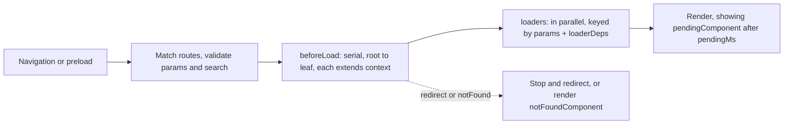
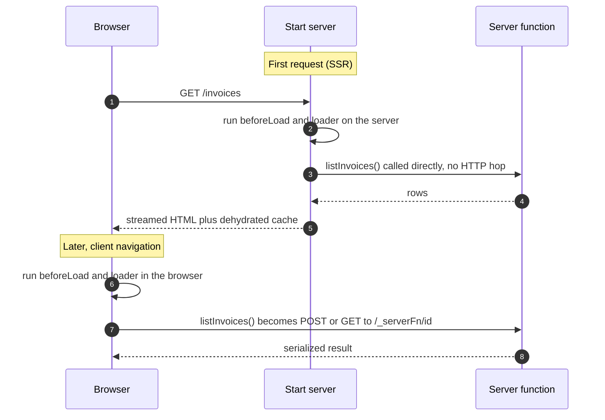

# 52 — TanStack Start and TanStack Router

> TanStack Router treats the URL as typed application state. TanStack Start adds a server without changing that design: your loaders still run in the browser, and the server is something you call. Once that clicks, everything else about Start follows.

**Prerequisites:** [31 Routing](31-routing-architecture.md), [30 Server State](30-server-state-and-data-fetching.md), [51 React Router v8](51-react-router-v8-framework-mode.md) · **Related:** [04 TypeScript](04-typescript-at-scale.md) · [43 Security](43-frontend-security-architecture.md) · [44 RSC Security](44-rsc-security-threat-model.md) · [54 Choosing a Framework](54-choosing-a-react-framework.md) · [60 Tooling](60-monorepos-build-tooling-and-bundlers.md)

---

## TL;DR

- **Two products.**
  - **TanStack Router** (v1 since December 2023) is a client router built around inference: routes, params, search params and loader data are all typed end to end, with no casts.
  - **TanStack Start** (1.0 on 13 October 2026) adds SSR, streaming, server functions, middleware, server routes and deployment to it, through Vite (or Rsbuild) and Nitro or host plugins.
- **Isomorphic by default.** Loaders and `beforeLoad` run on the server during SSR *and* in the browser on navigation. Anything that needs a database, the file system or a secret goes inside `createServerFn`. This is the opposite of React Router, where loaders are server-only. It's the single most important thing to teach a team.
- **Server functions are public RPC endpoints.** Validate input with `.validator()` (the stable name; `.inputValidator()` was removed before 1.0) and authorise in middleware on the function itself. A `beforeLoad` redirect protects the *page*, not the data.
- **Search params are first-class state.**
  - `validateSearch` takes a Standard Schema, such as a Zod object.
  - Invalid input is redirected to a canonical URL.
  - `stripSearchParams` keeps defaults out of links.
  - `loaderDeps` makes the search part of the loader's cache key.
- **The CSRF trap.** Start protects server functions with an origin check by default. Define your own request middleware in `src/start.ts` and that default is replaced: add `createCsrfMiddleware` back yourself. In production builds there's no warning. I verified both behaviours (section 8).
- **Experimental:** React Server Components (`tanstackStart({ rsc: { enabled: true } })`) and deferred hydration (`<Hydrate when={visible()}>`). Both are worth knowing; neither is a default.
- **Supply chain.** On 11 May 2026, attackers published 84 malicious versions across 42 `@tanstack/*` packages through the project's own CI, with valid provenance. Your dependency policy (cooldowns, lockfiles, script blocking) is part of your framework choice ([43](43-frontend-security-architecture.md)).

---

## 1. Two products, one router

| | TanStack Router (alone) | TanStack Start |
|---|---|---|
| What it is | A client-side router: SPA, or embedded in any host | A full-stack framework on top of the router |
| Rendering | Client only | SSR with streaming, selective SSR per route, SPA mode, prerendering |
| Server code | Your own API | `createServerFn` (RPC), server routes, request and function middleware |
| Build | Vite, Rsbuild, Webpack or esbuild plugin (or code-based routes without one) | Vite plugin (or Rsbuild), deployed via Nitro, Cloudflare, Netlify and others |
| Pick it when | You have an API already and want a type-safe SPA | You want SSR and a server you write in the same codebase, with explicit control |

The router is the product's centre of gravity. Start never replaces its concepts. It adds environments (server, client) and a way to cross between them. Everything in sections 2 to 4 applies with or without Start.

---

## 2. Type safety as the design centre

### 2.1 Registering the router

The bundler plugin generates `routeTree.gen.ts` from your route files. One declaration then makes every `Link`, `navigate`, `redirect` and hook in the app check against the real route tree:

```tsx
// src/router.tsx: one router per request on the server, one per tab in the browser
import { createRouter } from '@tanstack/react-router';
import { QueryClient } from '@tanstack/react-query';
import { setupRouterSsrQueryIntegration } from '@tanstack/react-router-ssr-query';
import { routeTree } from './routeTree.gen';

export function getRouter() {
  const queryClient = new QueryClient({ defaultOptions: { queries: { staleTime: 30_000 } } });
  const router = createRouter({
    routeTree,
    context: { queryClient },
    defaultPreload: 'intent',          // preload a route's code and data on hover/focus
    defaultPreloadStaleTime: 0,        // let TanStack Query decide freshness, not the router cache
    scrollRestoration: true,
  });
  setupRouterSsrQueryIntegration({ router, queryClient }); // dehydrate on the server, hydrate in the browser
  return router;
}

declare module '@tanstack/react-router' {
  interface Register { router: ReturnType<typeof getRouter> } // makes every Link, navigate and hook type-safe
}
```

`getRouter` is a factory for a reason. On the server, every request needs its own router and `QueryClient`. A module-level singleton would leak one user's cached data into another user's render.

These mistakes fail the typecheck. All three errors are real output from the chapter's verification app, built against `@tanstack/react-router` 1.170 and `@tanstack/react-start` 1.169:

```text
error TS2820: Type '"/invoice/$invoiceId"' is not assignable to type '"." | ".." | "/" | "/login" | "/invoices/$invoiceId" | …
error TS2353: Object literal may only specify known properties, and 'invoiceId' does not exist in type 'ParamsReducerFn<…
error TS2322: Type '(prev: { page: number; sort: "number" | "-number"; status?: … }) => { page: string; …
```

That's a wrong path, a param on a route that has none, and a string where the search schema says `number`.

### 2.2 File conventions

| File | Meaning |
|---|---|
| `src/routes/__root.tsx` | The root route: document shell, global context type |
| `index.tsx` | The index of its directory (`/invoices/`) |
| `$invoiceId.tsx` | A dynamic segment, typed as `params.invoiceId` |
| `_authed.tsx` + `_authed/` | A **pathless layout**: wraps children without adding a URL segment |
| `(marketing)/` | A route group: organises files, adds nothing to the URL |
| `-components/`, `-utils.ts` | Prefixed with `-`: ignored by the route generator, so colocated helpers are safe |
| `$.tsx` | Splat (catch-all) |
| `sitemap[.]xml.ts` | Escaped characters in a path segment |

Code-based routing (`createRoute` with `getParentRoute`) produces the same types without a plugin. File-based routing also lets the plugin split route components into lazy chunks automatically (`autoCodeSplitting`, on by default in Start), so it's the right default.

> [!TIP]
> In a design system, wrap your styled link with `createLink(MyAnchor)` so it keeps the router's type checking for `to`, `params` and `search`. Hand-rolled `<a onClick={navigate}>` wrappers lose types, preloading and accessibility in one move ([35](35-enterprise-design-system-architecture.md)).

---

## 3. Search params are state

Most apps keep filter, sort and pagination state in component state or a store, then sync it to the URL. TanStack Router inverts that. The URL *is* the store, and `validateSearch` is its schema.

```tsx
// src/routes/_authed/invoices/index.tsx: the URL is the state; search params are validated and typed
import { createFileRoute, Link, stripSearchParams } from '@tanstack/react-router';
import { queryOptions, useSuspenseQuery } from '@tanstack/react-query';
import { z } from 'zod';
import { listInvoices } from '~/functions/invoices.functions';

const invoiceSearch = z.object({
  page: z.number().int().min(1).catch(1),                         // bad input degrades to a default
  status: z.enum(['open', 'paid', 'void']).optional().catch(undefined),
  sort: z.enum(['number', '-number']).catch('number'),
});
type InvoiceSearch = z.infer<typeof invoiceSearch>;

const invoicesQuery = (s: InvoiceSearch) =>
  queryOptions({ queryKey: ['invoices', s], queryFn: () => listInvoices({ data: s }) });

export const Route = createFileRoute('/_authed/invoices/')({
  validateSearch: invoiceSearch,
  search: { middlewares: [stripSearchParams({ page: 1, sort: 'number' })] }, // keep default values out of URLs
  loaderDeps: ({ search }) => search,                          // the loader's cache key: only what it reads
  loader: ({ context, deps }) => context.queryClient.ensureQueryData(invoicesQuery(deps)),
  component: Invoices,
});

function Invoices() {
  const search = Route.useSearch();
  const { data } = useSuspenseQuery(invoicesQuery(search));
  const navigate = Route.useNavigate();
  return (
    <section>
      <h1>Invoices ({data.total})</h1>
      <label>
        Status{' '}
        <select
          value={search.status ?? ''}
          onChange={(e) => navigate({
            search: (prev) => ({ ...prev, page: 1, status: e.target.value ? (e.target.value as InvoiceSearch['status']) : undefined }),
          })}
        >
          <option value="">All</option><option value="open">Open</option><option value="paid">Paid</option><option value="void">Void</option>
        </select>
      </label>
      <ul>
        {data.items.map((inv) => (
          <li key={inv.id}>
            <Link to="/invoices/$invoiceId" params={{ invoiceId: inv.id }}>{inv.number}</Link> · {inv.status}
          </li>
        ))}
      </ul>
      <Link from={Route.fullPath} search={(prev) => ({ ...prev, page: prev.page + 1 })} disabled={search.page * 20 >= data.total}>
        Next page
      </Link>
    </section>
  );
}
```

What the running app did:

| Request | Response |
|---|---|
| `GET /invoices?page=abc&sort=number` | **307** to `/invoices?page=1&sort=number`: `.catch(1)` repaired the value, and the router redirected to the canonical URL |
| `GET /invoices?page=1&sort=number` (with `stripSearchParams`) | **307** to `/invoices`: defaults are removed from the address |
| Navigation links rendered on the page | `href="/invoices"`, not `?page=1&sort=number` |

Design rules that follow:

- **`.catch()` on every field.** URLs are user input: bookmarked, edited, pasted from old releases. A schema that throws makes an old link an error page. A schema that catches makes it a slightly different page.
- **`loaderDeps` returns only what the loader reads.** Everything in it is part of the cache key. If you include a UI-only param (`?panel=open`), every panel toggle refetches.
- **Updates are functional** (`search: (prev) => …`), so concurrent updates compose, and `from` keeps relative navigation typed.
- **Subscribe narrowly.** `Route.useSearch({ select: (s) => s.status })` re-renders only when `status` changes. The same applies to `useRouterState({ select })` ([38](38-react-performance-engineering.md)).

---

## 4. Loading data: the router cache and TanStack Query

### 4.1 The lifecycle



`beforeLoad` runs serially, so a parent can put `user` or `queryClient`-derived values into context for its children. Loaders then run in parallel. There is no waterfall unless a loader awaits something it doesn't need to.

### 4.2 The built-in cache

The router has its own stale-while-revalidate cache, keyed by route, params and `loaderDeps`. I read these defaults from the `router-core` source:

| Option | Default | Effect |
|---|---|---|
| `staleTime` | `0` | Data is stale immediately; revisiting a route shows cached data and reloads in the background |
| `preloadStaleTime` | 30 s | A hover preload isn't repeated within 30 seconds |
| `gcTime` / `preloadGcTime` | 5 min | Unused entries are dropped after five minutes |
| `pendingMs` / `pendingMinMs` | 1000 ms / 500 ms | Pending UI appears after a second, then stays at least half a second to avoid flashes |
| `defaultPreloadDelay` | 50 ms | Intent preloading waits 50 ms of hover |

### 4.3 With TanStack Query: router orchestrates, Query caches

For anything beyond simple pages, let **the router decide what a URL needs** and **Query own the cache**:

- `loader` calls `queryClient.ensureQueryData(options)`.
- The component reads with `useSuspenseQuery(options)`.
- `defaultPreloadStaleTime: 0`, so the router doesn't second-guess Query's `staleTime`.
- `setupRouterSsrQueryIntegration` dehydrates the server's query cache into the stream and hydrates it in the browser.

You get Query's invalidation, polling, optimistic updates and devtools, plus the router's preloading and pending states, with one cache instead of two ([30](30-server-state-and-data-fetching.md)).

---

## 5. TanStack Start: the execution model

### 5.1 Isomorphic by default



The same `loader` runs in both places. On the server, a server function call is a direct function call. In the browser, the build has replaced it with an RPC stub. So:

| You want | Use | On the client | On the server |
|---|---|---|---|
| Server-only logic callable from anywhere | `createServerFn()` | Network request | Direct call |
| A utility that must never run in the browser | `createServerOnlyFn(fn)` | Throws | Runs |
| A utility that must never run on the server | `createClientOnlyFn(fn)` | Runs | Throws |
| Different implementations per environment | `createIsomorphicFn().server(…).client(…)` | `.client()` | `.server()` |
| Browser-only UI | `<ClientOnly fallback>` / `useHydrated()` | Renders | Fallback |
| A whole file that must stay server-side | `*.server.ts` or `import '@tanstack/react-start/server-only'` | Import is a build error | Allowed |

**Environment variables.**

- `VITE_`-prefixed variables are compiled into the client bundle. Never put a secret behind that prefix.
- Read `process.env` inside handlers and middleware, never at module scope. Module scope evaluates before any request exists. On Cloudflare Workers, where env is injected per request, it's simply `undefined` there.

> [!WARNING]
> The project's own guidance warns that enabling TypeScript's `verbatimModuleSyntax` can leak server code into client bundles. The setting preserves imports as written, including imports that become unused once the compiler strips server-function bodies from the client build. That's the opposite of the setting I recommend for React Router ([51](51-react-router-v8-framework-mode.md)). Follow each framework's template and enforce it with a lint rule.

### 5.2 Server functions

```ts
// src/functions/invoices.functions.ts: server functions are RPC endpoints; each one validates and authorises
import { createServerFn } from '@tanstack/react-start';
import { notFound } from '@tanstack/react-router';
import { z } from 'zod';
import { authMiddleware } from './auth';
import { invoiceRepo } from '~/server/invoices.server';
import { readSessionUser } from '~/server/auth.server';

export const getSessionUser = createServerFn({ method: 'GET' }).handler(async () => {
  const user = await readSessionUser();
  return user ? { id: user.id, name: user.name } : null; // DTO: the client never sees permissions or tenant
});

export const listInvoices = createServerFn({ method: 'GET' })
  .middleware([authMiddleware])
  .validator(z.object({
    page: z.number().int().min(1),
    status: z.enum(['open', 'paid', 'void']).optional(),
    sort: z.enum(['number', '-number']),
  }))
  .handler(async ({ data, context }) => invoiceRepo.list(context.user.tenantId, data));

export const getInvoice = createServerFn({ method: 'GET' })
  .middleware([authMiddleware])
  .validator(z.object({ id: z.string().min(1) }))
  .handler(async ({ data, context }) => {
    const invoice = await invoiceRepo.get(context.user.tenantId, data.id);
    if (!invoice) throw notFound();
    return { invoice, canVoid: context.user.permissions.includes('invoice:void') && invoice.status === 'open' };
  });

export const voidInvoice = createServerFn({ method: 'POST' })
  .middleware([authMiddleware])
  .validator(z.object({ id: z.string().min(1), reason: z.string().trim().min(5) }))
  .handler(async ({ data, context }) => {
    if (!context.user.permissions.includes('invoice:void')) throw new Error('Forbidden');
    await invoiceRepo.void(context.user.tenantId, data.id, data.reason);
    return { ok: true as const };
  });
```

```ts
// src/functions/auth.ts: the auth middleware every protected server function composes
import { createMiddleware } from '@tanstack/react-start';
import { readSessionUser } from '~/server/auth.server';

export const authMiddleware = createMiddleware({ type: 'function' }).server(async ({ next }) => {
  const user = await readSessionUser();
  if (!user) throw new Error('Unauthorized');          // the data boundary: checked on every call
  return next({ context: { user } });
});
```

Things to know about server functions:

- **The builder order is enforced by types:** `.middleware()` → `.validator()` → `.handler()`. Input arrives as `data`, middleware output as `context`.
- **IDs are deterministic.** In production, a function's URL segment is `sha256("<file>--<function name>")`. The verification build's manifest showed four 64-character hex IDs, one per function. IDs are stable across deploys, which is good for open tabs. But **renaming or moving a server function is a breaking API change** for clients still running the old bundle. Keep the old export alive for a release, as you would deprecate an endpoint ([33](33-api-integration-bff-and-contracts.md)).
- **Serialisation is richer than JSON** (Dates, Maps, Sets, errors, streams). The `strict` option, on by default, makes the types reject inputs and outputs that won't serialise. Input validation still matters, because a well-typed client is not the only possible caller.
- **GET functions can be cached** with `setResponseHeaders({ 'Cache-Control': … })` from `@tanstack/react-start/server`. Only do that for data that doesn't depend on identity. Personalised responses get `private` and `Vary: Cookie`, or `no-store`.
- **There's no automatic revalidation.** Unlike React Router's actions, a mutation doesn't reload anything by itself. You await the write, then `router.invalidate({ sync: true })` or invalidate the Query keys. That's explicit and predictable, and easy to forget.

```tsx
// src/routes/_authed/invoices/$invoiceId.tsx (excerpt): mutation, then invalidation
function InvoiceDetail() {
  const { invoice, canVoid } = Route.useLoaderData();
  const router = useRouter();
  const voidFn = useServerFn(voidInvoice);          // handles redirect() and notFound() thrown by the server
  const [error, setError] = useState<string | null>(null);
  const [pending, setPending] = useState(false);

  async function onSubmit(form: FormData) {
    setPending(true); setError(null);
    try {
      await voidFn({ data: { id: invoice.id, reason: String(form.get('reason') ?? '') } });
      await router.invalidate({ sync: true });          // re-run active loaders, then render the persisted state
    } catch (e) {
      setError(e instanceof Error ? e.message : 'Could not void the invoice');
    } finally { setPending(false); }
  }
  // … <form action={onSubmit}> with an accessible error message
}
```

> [!NOTE]
> Server functions are explicit RPC: named, validated, called on purpose. That's the main philosophical difference from React's Server Functions (`'use server'`, [18](18-react-server-components-and-server-functions.md)), where an endpoint is created implicitly by a directive. Start doesn't use the directive. The trade-off is a little more ceremony for no hidden endpoints.

---

## 6. Middleware

| | Request middleware | Server function middleware |
|---|---|---|
| Created with | `createMiddleware()` | `createMiddleware({ type: 'function' })` |
| Runs for | Every server request: SSR, server routes, server functions | Server function calls only |
| Phases | `.server()` | `.client()` (before and after the RPC, in the browser) and `.server()` |
| Can validate input | No | Yes (`.validator()`) |
| Global registration | `requestMiddleware` in `src/start.ts` | `functionMiddleware` in `src/start.ts` |

Context flows down with `next({ context: { … } })`. A function middleware's client phase can send values to the server with `sendContext`, and the server phase can send values back. **Anything a client sends is input.** A workspace id from `sendContext` that parses as a UUID is a well-formed id, not an authorised one. Check membership against the session before using it.

---

## 7. Server routes

When the HTTP contract *is* the product (webhooks, feeds, file downloads, a public API), use a server route:

```ts
// src/routes/api/webhooks/billing.ts: a server route, the raw HTTP contract for a third party
import { createFileRoute } from '@tanstack/react-router';

export const Route = createFileRoute('/api/webhooks/billing')({
  server: {
    handlers: {
      POST: async ({ request }) => {
        const raw = await request.text();
        const ok = await verifySignature(request.headers.get('billing-signature'), raw);
        if (!ok) return new Response('Invalid signature', { status: 401 });
        return Response.json({ received: true });
      },
    },
  },
});
```

Against the build, an unsigned POST got **401** and a signed one **200**. Don't make an SSR loader fetch your own `/api/…` route. During SSR a relative URL has no origin, and you'd pay an HTTP hop to reach code in the same process. Put the logic in a service that both the server route and a server function call.

---

## 8. Security: the boundaries that matter

### 8.1 Route guards are UX

```tsx
// src/routes/_authed.tsx: pathless layout; beforeLoad gates the UI and puts the user in router context
import { createFileRoute, Outlet, redirect } from '@tanstack/react-router';
import { getSessionUser } from '~/functions/invoices.functions';

export const Route = createFileRoute('/_authed')({
  beforeLoad: async ({ location }) => {
    const user = await getSessionUser();               // a server function: works during SSR and navigation
    if (!user) throw redirect({ to: '/login', search: { redirect: location.href } });
    return { user };                                   // merged into context for every child route
  },
  component: () => <Outlet />,
});
```

An anonymous `GET /invoices` got a **307** to `/login?redirect=%2Finvoices%3Fpage%3D1%26sort%3Dnumber`. That's the right experience, and it is not security. `listInvoices` has its own `authMiddleware`, because anyone can call `/_serverFn/<id>` without loading the page. Validate `redirect` before using it after login: same-origin paths only.

### 8.2 CSRF: the default you can lose

Server functions are same-origin RPC endpoints, so Start ships `createCsrfMiddleware`. It checks, in order:

1. `Sec-Fetch-Site`, which must be `same-origin` by default.
2. `Origin`.
3. `Referer`.

It rejects requests that carry none of them, with a **403**.

When there's no `src/start.ts`, the framework applies that middleware to server-function requests for you. When you add `src/start.ts` with your own `requestMiddleware` (for logging, headers or auth), **your list replaces the default**. I built the same app three ways and sent a cross-site POST to a server function:

| Configuration | Cross-site POST | POST with no origin headers | Same-origin POST |
|---|---|---|---|
| No `src/start.ts` | **403** | **403** | Reaches the function |
| `src/start.ts` with `createCsrfMiddleware` | **403** | **403** | Reaches the function |
| `src/start.ts` **without** it | Reaches the function | Reaches the function | Reaches the function |

The dev server prints a warning in the third case. The production build doesn't. So the line goes in the template, with a test:

```ts
// src/start.ts: global middleware. Defining it replaces Start's default server-function CSRF check
import { createCsrfMiddleware, createMiddleware, createStart } from '@tanstack/react-start';

const csrf = createCsrfMiddleware({ filter: (ctx) => ctx.handlerType === 'serverFn' }); // keep this line

const securityHeaders = createMiddleware().server(async ({ next }) => {
  const result = await next();
  result.response.headers.set('X-Content-Type-Options', 'nosniff');
  return result;
});

export const startInstance = createStart(() => ({
  requestMiddleware: [csrf, securityHeaders],
}));
```

Keep the `filter`. Applied to every request, the check would also reject legitimate cross-site *navigations* to your pages (an inbound link sends `Sec-Fetch-Site: cross-site`). Server routes that accept cookie-authenticated mutations need the same protection, through their own middleware. `SameSite=Lax` cookies remain the first line of defence ([43](43-frontend-security-architecture.md)).

### 8.3 Sessions, cookies and head scripts

- Write cookies with `setCookie` from `@tanstack/react-start/server`, not `setResponseHeader('Set-Cookie', …)`. The latter replaces every cookie other middleware set on the response.
- Use the `__Host-` prefix, with `HttpOnly`, `Secure`, `SameSite=Lax` and a finite `Max-Age`. Rotate the session on login and privilege change ([45](45-authentication-and-authorization.md)).
- JSON-LD in `head().scripts` with `JSON.stringify(data)` is an XSS sink if the data contains `</script>`. Escape `<` as `<` when you serialise ([17](17-ssr-streaming-and-hydration.md)).

### 8.4 The supply-chain lesson

On 11 May 2026, between 19:20 and 19:26 UTC, 84 malicious versions of 42 `@tanstack/*` packages were published. The attackers chained a `pull_request_target` workflow, GitHub Actions cache poisoning, and an OIDC token lifted from runner memory. The packages carried valid provenance because they *were* built by the project's pipeline. The defences that worked were boring ones:

- Lockfiles.
- A minimum release age, so nothing published in the last few days installs automatically.
- Install scripts blocked by default.
- Treating every machine that installed during the window as compromised and rotating its secrets.

That applies to every framework you depend on ([62](62-cicd-release-engineering-and-feature-flags.md)).

---

## 9. Rendering: selective SSR, SPA mode, prerendering

### 9.1 Per-route SSR

| `ssr` | `beforeLoad` and `loader` | Component | Use for |
|---|---|---|---|
| `true` (default) | Server, then client on navigation | Server-rendered, then hydrated | Most pages |
| `'data-only'` | Server | Client only | Pages whose component needs browser APIs (canvas, editors) but whose data can load on the server |
| `false` | Client only | Client only | Routes that depend on browser state from the start |
| `({ params, search }) => …` | Decided per request | Decided per request | Document types that vary by param |

Children inherit and can only be *more* restrictive: under an `ssr: false` parent, a child can't turn SSR back on. `defaultSsr` in `createStart` changes the app-wide default. `spa: { enabled: true }` builds a SPA shell, and `prerender: { enabled: true, crawlLinks: true }` emits static HTML for discovered routes, with sitemap generation from the same page list.

Streaming works as in React Router: return a promise from a loader without awaiting it, and render it inside `<Suspense>` with `<Await>` or `use()` ([15](15-concurrent-react-suspense-and-transitions.md)).

### 9.2 Deferred hydration (experimental)

```tsx
// src/routes/index.tsx (excerpt)
import { Hydrate } from '@tanstack/react-start';
import { idle, visible } from '@tanstack/react-start/hydration';

<Hydrate when={visible({ rootMargin: '400px' })} prefetch={idle()}>
  <Testimonials />
</Hydrate>
```

A `<Hydrate>` boundary stays as server HTML until its strategy fires. The strategies are `load()`, `idle()`, `visible()`, `media()`, `interaction()`, `condition()` and `never()`. By default (`split`) its children move to a separate chunk, so their JavaScript isn't downloaded until needed. `prefetch` can fetch that chunk earlier without hydrating it. Some behaviour to plan for:

- It only affects the **initial document**. Boundaries that mount after navigation render normally.
- An interaction inside a waiting boundary hydrates it and replays the event. Pointer details aren't guaranteed to survive.
- External state changes can force an early hydration.
- In the verification build, the boundary rendered an extra wrapper `<div>`. Check flex and grid layouts that expect direct children.

The rule of thumb matches Angular's incremental hydration ([58](58-angular-at-scale.md)): **never defer controls the user needs first** (add to cart, primary navigation, forms). Measure INP and the chunk count before and after ([39](39-web-performance-and-core-web-vitals.md)).

### 9.3 Server components (experimental, optional)

Enable RSC with `tanstackStart({ rsc: { enabled: true } })` plus `@vitejs/plugin-rsc`. The model differs from Next.js:

- Server components are **values returned from server functions**: `renderServerComponent` for a renderable fragment, `createCompositeComponent` when the client must fill slots.
- They're cached by whoever owns the data, the router or TanStack Query. With Query, set `structuralSharing: false`.
- They're invalidated through the same `router.invalidate()` or `invalidateQueries`.

It's an elegant design if your team already thinks in loaders and Query keys. It also brings the Flight protocol, and its patch cadence, into your threat model ([44](44-rsc-security-threat-model.md)). Adopt it per feature, behind a flag, not as the app's foundation.

---

## 10. Deployment

| Target | Setup |
|---|---|
| Node, Docker, Vercel, Railway, Bun | Nitro: `nitro()` from `nitro/vite` after `tanstackStart()`; `node .output/server/index.mjs` |
| Cloudflare Workers | `@cloudflare/vite-plugin` with `viteEnvironment: { name: 'ssr' }`; `main` points at `@tanstack/react-start/server-entry`; env via bindings |
| Netlify | `@netlify/vite-plugin-tanstack-start` |
| Anything that speaks `fetch` | The server build exports `{ fetch }` (`dist/server/server.js`). I served the verification app with a dozen lines of `srvx` |

Rsbuild is a supported alternative to Vite (`@tanstack/react-start/plugin/rsbuild`) for teams already on that toolchain ([60](60-monorepos-build-tooling-and-bundlers.md)).

**Plugin order matters.** `tanstackStart()` comes before `viteReact()`. Otherwise route generation and server-function compilation fail.

For version skew, keep the previous deploy's assets available. Treat server-function renames as API changes (section 5.2). If you run multiple instances, check that your session and cache layers are shared: Start keeps no state of its own between requests.

---

## Decision framework

**Problem.** Should a team use TanStack Router alone, TanStack Start, or another framework?

**Constraints.** Is there an existing API? Is SSR or SEO required? How much state lives in the URL? What's the team's TypeScript maturity? Hosting? Tolerance for a framework that reached 1.0 in late 2026? Appetite for RSC?

| Situation | Recommendation | Why |
|---|---|---|
| SPA or internal tool with its own API, heavy filtering and sorting in the URL | TanStack Router + TanStack Query, no Start | The best typed URL-state model available, with no server to run |
| Full-stack app, team fluent in TypeScript and Query, wants explicit server calls and per-route SSR control | TanStack Start | Isomorphic loaders, explicit RPC, selective SSR, portable deployment |
| Content-heavy, SEO-first site with a CMS and aggressive caching needs | Next.js ([47](47-nextjs-app-router-architecture.md)) or Astro ([54](54-choosing-a-react-framework.md)) | Mature data caching, PPR and image pipelines matter more than search-param types |
| Remix/React Router app, or a team that wants progressive enhancement and server-only loaders | React Router v8 ([51](51-react-router-v8-framework-mode.md)) | The forms-and-actions model works without JavaScript; loaders never run in the browser |
| Existing TanStack Router SPA that now needs SSR | Add Start incrementally: start with `defaultSsr: false`, then enable SSR route by route | Routes don't change; you add an environment |

**Criteria.** Prefer Start when type-safe URL state and explicit control over where code runs outweigh built-in conventions for caching and mutations. Prefer Router alone when you already have a good API. A server you don't need is cost and attack surface.

**Failure modes.**

- Database calls in loaders: they run in the browser, and either fail or leak.
- Auth only in `beforeLoad`.
- A custom `src/start.ts` without the CSRF middleware.
- Forgetting to invalidate after mutations.
- Module-scope `process.env` reads.
- A singleton `QueryClient` on the server.
- Deferring hydration of primary controls.
- RSC adopted app-wide while experimental.

**Migration path.** TanStack Router SPA → Start with `defaultSsr: false` (no behaviour change, server functions available) → move data access behind server functions → enable SSR per route → prerender public pages → consider RSC for specific heavy, static-ish fragments.

---

## Pitfalls and anti-patterns

- **Server-only code in a loader.** Loaders are isomorphic. `db.query()` in a loader either breaks the client bundle or ships your connection code to it. Call a server function.
- **"The route is protected, so the function is protected."** It isn't. Middleware on every function that touches private data.
- **Dropping the CSRF middleware** by defining `requestMiddleware` without it. There's no production warning.
- **Search schemas without `.catch()`.** Old bookmarks become error pages.
- **`loaderDeps` returning the whole search object** when the loader reads two fields. In the chapter's example it's fine, because the loader uses all three.
- **Two caches for one piece of data:** router `staleTime` *and* Query `staleTime` fighting. Pick an owner. With Query, set `defaultPreloadStaleTime: 0`.
- **Self-fetching `/api/...` from SSR loaders.** Relative URLs fail on the server, and you add a hop. Share a service instead.
- **`setResponseHeader('Set-Cookie', …)`**, which clobbers other cookies. Use `setCookie`.
- **Renaming server functions casually.** Their URLs come from file path and name.
- **Floating `@tanstack/*` versions** in a monorepo with no cooldown, after May 2026.

---

## Architect's checklist

- [ ] `getRouter()` creates a fresh router and `QueryClient` per request; `Register` is declared once
- [ ] Every route with URL state has `validateSearch` with `.catch()` defaults, and `stripSearchParams` for defaults
- [ ] `loaderDeps` returns only what the loader reads; UI-only params stay out of cache keys
- [ ] All database, file system and secret access is inside `createServerFn` or `*.server.ts`; no module-scope `process.env`
- [ ] Every server function that touches private data has auth middleware and a `.validator()`; `sendContext` values are re-authorised
- [ ] `src/start.ts` includes `createCsrfMiddleware({ filter: (ctx) => ctx.handlerType === 'serverFn' })`, with a test that a cross-site POST gets 403
- [ ] Cookie-authenticated server routes have their own origin checks; webhooks verify signatures
- [ ] Mutations await their write, then invalidate the router or Query keys
- [ ] Per-route `ssr` choices are documented; primary controls are never inside deferred `<Hydrate>` boundaries
- [ ] Server-function renames go through a deprecation release
- [ ] `@tanstack/*` versions are pinned via lockfile, with a minimum release age and install scripts blocked
- [ ] Experimental features (RSC, deferred hydration) are behind flags, with an owner and a revisit date

---

## Interview angles

**Q1. What does "isomorphic by default" mean in TanStack Start, and what goes wrong if a team misses it?**
Route loaders and `beforeLoad` run on the server during the first render and in the browser on every client navigation. Code in a loader must work in both environments, and must be safe to ship to the client. Teams coming from React Router or Next.js put database calls or secrets in loaders. In the best case that breaks the build or fails at runtime in the browser. In the worst case it bundles server code or configuration into client JavaScript. The rule: server-only work lives in `createServerFn` (or `*.server.ts` modules it calls), and loaders call those functions.

**Q2. A route under `_authed` has a `beforeLoad` redirect. Is its data safe?**
No. `beforeLoad` controls what the user sees, but the data comes from server functions, and each is an HTTP endpoint anyone can call. Attach auth middleware to every function that reads or writes private data. Check tenant and permission inside it, and validate input with `.validator()`. Treat client-sent context as untrusted.

**Q3. Explain the CSRF behaviour of server functions and how you would protect a Start app.**
Server functions are same-origin RPCs. Start's CSRF middleware checks `Sec-Fetch-Site`, then `Origin`, then `Referer`, and returns 403 when the request is cross-site or carries none of them. Without `src/start.ts`, the framework applies it to server-function requests automatically. Once you define your own `requestMiddleware`, the default no longer applies, and you must add `createCsrfMiddleware({ filter: (ctx) => ctx.handlerType === 'serverFn' })` yourself. The dev server warns, production doesn't. I'd put it in the template, add an integration test that a cross-site POST returns 403, keep session cookies `SameSite=Lax`, and protect cookie-authenticated server routes separately.

**Q4. How would you design pagination and filtering state for a large data table with TanStack Router?**
Put it in the URL with a `validateSearch` schema. Every field gets `.catch()`, so bad or old links degrade instead of erroring. `stripSearchParams` keeps defaults out of URLs. Updates are functional, so they compose. `loaderDeps` exposes exactly the fields the loader needs, and the loader calls `ensureQueryData` with a key built from them. The component reads with `useSuspenseQuery` and subscribes narrowly with `select`. The result: shareable URLs, back and forward that work, cached pages, preloading on hover, and compile-time errors when someone passes a string as a page number.

**Q5. TanStack Start vs React Router v8 for a new B2B app. How do you decide?**
Both are portable, Vite-based and web-standard. React Router's loaders and actions are server-only, mutations revalidate automatically, and forms work without JavaScript. That's a strong default for form-heavy apps and teams that want conventions. Start's loaders are isomorphic, server access is explicit RPC, invalidation is manual, and it has the stronger typed search-param model and finer per-route SSR control. That favours dashboard-style apps with complex URL state, built by teams fluent in TanStack Query. I'd prototype the hardest screen in both, check the security defaults each needs (the CSRF behaviour above, the origin check gaps in [51](51-react-router-v8-framework-mode.md)), and weigh maturity: Start reached 1.0 in October 2026.

---

> [!TIP]
> **Runnable code:** [E52](E52-tanstack-start-and-router.md) has the app, with a smoke test of the auth guard against the production build. `node extract-examples.mjs 52` writes it out as a project; then run `npm ci` and `npm test` in it.

## Further reading

- TanStack Router docs, *Search params*: <https://tanstack.com/router/latest/docs/framework/react/guide/search-params> · *Data loading*: <https://tanstack.com/router/latest/docs/framework/react/guide/data-loading>
- TanStack Start docs, *Execution model*: <https://tanstack.com/start/latest/docs/framework/react/guide/execution-model> · *Server functions*: <https://tanstack.com/start/latest/docs/framework/react/guide/server-functions>
- TanStack Start docs, *Middleware*: <https://tanstack.com/start/latest/docs/framework/react/guide/middleware> · *Selective SSR*: <https://tanstack.com/start/latest/docs/framework/react/guide/selective-ssr>
- TanStack Start docs, *Deferred hydration*: <https://tanstack.com/start/latest/docs/framework/react/guide/deferred-hydration> · *Server components*: <https://tanstack.com/start/latest/docs/framework/react/guide/server-components>
- TanStack blog, *npm supply chain compromise postmortem*: <https://tanstack.com/blog/npm-supply-chain-compromise-postmortem>
- The packages' bundled agent skills (`node_modules/@tanstack/*/skills/**/SKILL.md`), which version with the code and are worth reading as documentation

---

[← Previous: 51 — React Router v8 in Framework Mode](51-react-router-v8-framework-mode.md) · [Index](README.md) · [Next: 53 — React Native and Expo for Web Architects →](53-react-native-and-expo.md)
