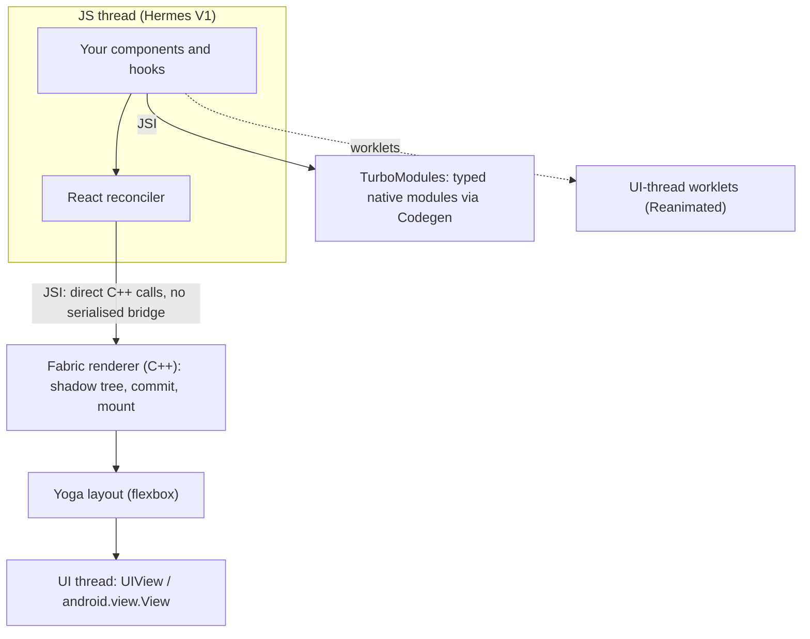
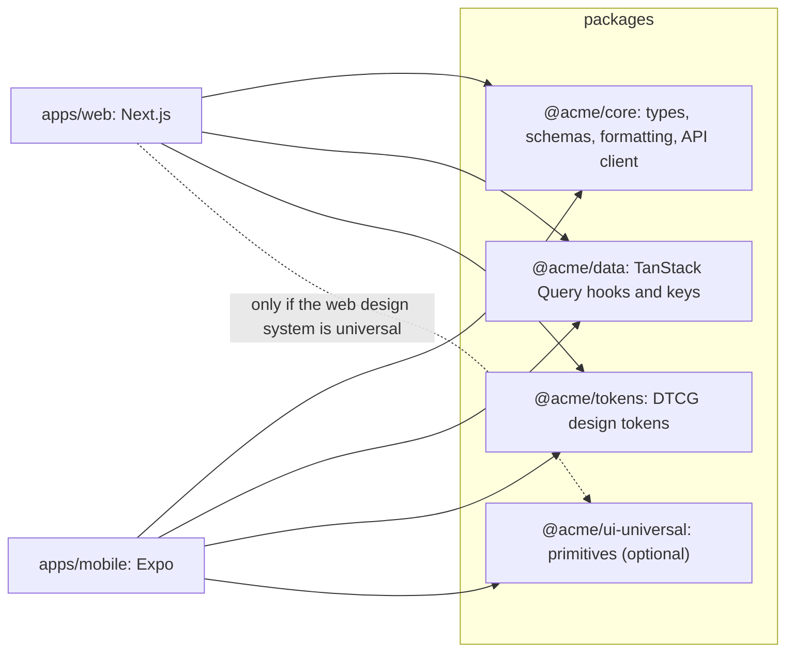
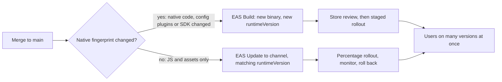

# 53 — React Native and Expo for Web Architects

> React Native is React with a different host. Components, hooks, state and data fetching work exactly as they do on the web. What changes is everything under them: the renderer, the layout engine, the threads, how releases reach users, and where your secrets can hide (nowhere). A web architect who learns those six things can lead a mobile team.

**Prerequisites:** [08 React's Mental Model](08-react-mental-model-and-rules.md), [10 React Internals](10-react-internals-fiber-and-reconciliation.md), [28 State and Data Ownership](28-state-and-data-ownership-architecture.md) · **Related:** [35 Design Systems](35-enterprise-design-system-architecture.md) · [36 Accessibility](36-accessibility-engineering.md) · [45 Auth](45-authentication-and-authorization.md) · [60 Monorepos](60-monorepos-build-tooling-and-bundlers.md) · [62 Release Engineering](62-cicd-release-engineering-and-feature-flags.md)

---

## TL;DR

- **Current versions:**
  - React Native 0.88 (October 2026) and Expo SDK 58 (React 19.3, built for iOS 27).
  - React Native ships a minor every two months and supports the latest three.
  - Expo ships an SDK for most React Native releases (SDK 58 went from 0.86 straight to 0.88); canary releases cover the rest.
  - Expo is the framework the React Native team recommends for new apps.
- **New Architecture only.** Since React Native 0.82 and Expo SDK 55, the old asynchronous bridge is gone. JSI, Fabric (the concurrent renderer) and TurboModules are the only path. Hermes V1 became the default engine in 0.84.
- **The web is converging.** React Native has gained web-shaped APIs:
  - `role` and `aria-*` props.
  - A subset of DOM node APIs on refs (0.82).
  - W3C `EventTarget` event dispatch by default (0.88).
  - A strict TypeScript API that makes deep imports type errors (default in 0.87).
- **Expo Router is a universal framework.** One `src/app/` tree serves iOS, Android and web. In SDK 58, data loaders, server rendering, middleware and native tabs are **stable**, and web defaults to server output. Server components remain experimental.
- **Share code by layer, not by screen:**
  - Always share domain logic, validation, API clients and design tokens.
  - Share UI primitives when a universal design system pays for itself.
  - Share screens when the product is genuinely the same on every platform.
- **The bundle is public.** Anything compiled into the app can be extracted, including `EXPO_PUBLIC_*` values. Tokens go in Keychain or Keystore (`expo-secure-store`), sign-in goes through the system browser with PKCE (RFC 8252), and every loader and API route is a public endpoint.
- **Release engineering is the real difference.**
  - Binaries go through store review.
  - JavaScript can go over the air (EAS Update), but only to binaries with a matching runtime version.
  - Old versions stay installed for months, so plan for them.

---

## 1. The platform in 2026

| | Version | Notes for architects |
|---|---|---|
| React Native | 0.88 (15 Oct 2026) | Minor releases every ~2 months; the latest three are supported. 0.87 was the breaking one (strict TypeScript API, removed APIs); 0.88 has no user-facing breaking changes |
| Expo SDK | 58 | React Native 0.88, React 19.3, Node 22.13+/24.3+/26+. Built for iOS 27 (scene-based lifecycle required) |
| JavaScript engine | Hermes V1 | Default since 0.84; ahead-of-time bytecode, no JIT; legacy Hermes no longer ships with 0.87 and later |
| Architecture | New Architecture only | Since 0.82 / SDK 55. SDK 54 was the last with the legacy bridge |
| React Compiler | On in new Expo apps since SDK 54 | `experiments.reactCompiler: true` in app config; existing apps opt in ([16](16-react-19-features-and-the-compiler.md)) |
| Web target | React Native Web 0.21 | What Expo uses for `-p web`; React Strict DOM (0.0.x) is the experimental web-standard alternative |

> [!NOTE]
> Expo bundles specific versions of React Native and its native modules per SDK. `npx expo install` picks compatible versions and `npx expo-doctor` checks them. In SDK 58, the bundled `react` is 19.3.0. If you enable Expo Router server components, make sure `react-server-dom-webpack` resolves to a patched release (19.3.1 or later), because the October 2026 Flight advisory applies there as everywhere else ([44](44-rsc-security-threat-model.md)).

---

## 2. How React Native renders: what's different under `<View>`



What a web engineer needs to unlearn:

- **There's no DOM and no CSS cascade.**
  - `View`, `Text`, `Image` and `Pressable` are host components that map to native views.
  - Styles are objects (`StyleSheet.create`). Nothing inherits except text styles inside nested `<Text>`.
  - Every string must sit inside `<Text>`.
- **Layout is Yoga flexbox, not CSS.** `flexDirection` defaults to `column`, and units are density-independent points, so `width: 100` is 100 pt on any screen. There are no media queries: use `useWindowDimensions()` and platform APIs.
- **Threads.** React renders on the JS thread. Fabric commits and mounts on the UI thread. Gestures and animations that must hit every frame run as *worklets* on the UI thread (Reanimated 4, `react-native-worklets`). A busy JS thread drops interactions just as a long task hurts INP on the web, but it can't freeze native scrolling or a worklet animation ([39](39-web-performance-and-core-web-vitals.md)).
- **The bridge is gone, which changes performance work.** With JSI, native modules are called synchronously when they need to be, and Fabric can commit concurrently. React 19 features (transitions, Suspense, `useDeferredValue`) behave as on the web ([15](15-concurrent-react-suspense-and-transitions.md)).
- **Host refs are more web-like now.** Since 0.82, refs to host components expose a subset of DOM node APIs. Since 0.88, events go through W3C `EventTarget` dispatch. Libraries written against web semantics port with fewer special cases.

---

## 3. Expo: the framework layer

What Expo adds on top of React Native:

| Capability | What it is |
|---|---|
| **Expo Router** | File-based routing for native and web: stacks, native tabs, modals, typed params, deep links for free, web SSR |
| **Continuous Native Generation (CNG)** | `ios/` and `android/` are generated from `app.json`/`app.config.ts` plus **config plugins** (`npx expo prebuild`), so native config is code-reviewed instead of hand-edited |
| **Expo Modules API** | Write native modules in Swift and Kotlin. Expo Modules 2.0 (annotated classes, faster synchronous calls) is in beta in SDK 58 |
| **Expo UI** (`@expo/ui`) | SwiftUI and Jetpack Compose components from React, production-ready since SDK 56 |
| **Development builds** | Your own debug app (`expo-dev-client`) with your native modules. Expo Go is for learning and prototypes only |
| **EAS** (Build, Submit, Update, Hosting, Workflows) | Cloud builds and signing, store submission, over-the-air JavaScript updates, hosting for web and server output, CI |

### 3.1 Expo Router in one tree

```text
src/app/
  _layout.tsx                 # root Stack (native stack on iOS/Android, history-backed on web)
  +middleware.ts              # one root server middleware (web/server output)
  (tabs)/_layout.tsx          # NativeTabs: the system tab bar
  (tabs)/index.tsx            # /
  (tabs)/settings.tsx         # /settings
  invoices/[invoiceId].tsx    # /invoices/:invoiceId (loader + screen)
  api/invoices/[id]+api.ts    # API route: GET /api/invoices/:id
packages/core/src/index.ts    # platform-free domain code shared with the Next.js web app
```

```tsx
// src/app/_layout.tsx: the root layout. A native stack on iOS/Android, a history-backed stack on web
import { Stack } from 'expo-router';
export { ErrorBoundary } from 'expo-router'; // or export your own ErrorBoundary({ error, retry })

export default function RootLayout() {
  return (
    <Stack>
      <Stack.Screen name="(tabs)" options={{ headerShown: false }} />
      <Stack.Screen name="invoices/[invoiceId]" options={{ title: 'Invoice' }} />
    </Stack>
  );
}
```

```tsx
// src/app/(tabs)/_layout.tsx: system tab bars (UITabBarController / BottomNavigationView), not a JS imitation
import { NativeTabs } from 'expo-router/native-tabs';

export default function TabsLayout() {
  return (
    <NativeTabs>
      <NativeTabs.Trigger name="index">
        <NativeTabs.Trigger.Label>Invoices</NativeTabs.Trigger.Label>
        <NativeTabs.Trigger.Icon sf="doc.text" md="description" />
      </NativeTabs.Trigger>
      <NativeTabs.Trigger name="settings">
        <NativeTabs.Trigger.Label>Settings</NativeTabs.Trigger.Label>
        <NativeTabs.Trigger.Icon sf="gear" md="settings" />
      </NativeTabs.Trigger>
    </NativeTabs>
  );
}
```

Native tabs give you the platform's own tab bar, including Liquid Glass on iOS, accessibility and system behaviours, at the cost of less visual customisation. That's usually the right trade for a product app. Pick JS tabs (`expo-router/js-tabs`) when the brand truly needs a custom bar. SDK 58 also reworked the navigation core: much of the forked React Navigation API is gone, and `withLayoutContext` is deprecated in favour of `integrateWithRouter`.

### 3.2 Data loaders and the universal server

SDK 58 made Expo Router's data loaders stable. A route exports `loader`, the component reads it with `useLoaderData`, and Expo runs it **on your server**:

- With `web.output: "server"` (the SDK 58 default), it runs per request on the web.
- With `"static"`, it runs at build time.
- **Native apps fetch it from the deployed server.**

```tsx
// src/app/invoices/[invoiceId].tsx: one route file for iOS, Android and web
import { Suspense } from 'react';
import { Pressable, StyleSheet, Text, View } from 'react-native';
import { useLoaderData, useLocalSearchParams } from 'expo-router';
import { createServerLoader } from 'expo-router/server';
import { formatMoney, type Invoice } from '@acme/core';

// Runs on the server: per request for web (server output), or when the native app fetches the route's data
export const loader = createServerLoader(async (request, params): Promise<{ invoice: Invoice }> => {
  const auth = request.headers.get('authorization');
  const res = await fetch(`${process.env.INTERNAL_API_URL}/invoices/${params.invoiceId}`, {
    headers: auth ? { authorization: auth } : {},
  });
  if (!res.ok) throw new Response('Not found', { status: 404 });
  return { invoice: await res.json() };
});

export default function InvoiceScreen() {
  return (
    <Suspense fallback={<Text role="progressbar">Loading invoice…</Text>}>
      <InvoiceDetail />
    </Suspense>
  );
}

function InvoiceDetail() {
  const { invoiceId } = useLocalSearchParams<{ invoiceId: string }>();
  const { invoice } = useLoaderData<typeof loader>();
  return (
    <View style={styles.card}>
      <Text role="heading" style={styles.title}>Invoice {invoice.number}</Text>
      <Text>{formatMoney(invoice.totalMinor, invoice.currency, 'en-GB')}</Text>
      <Pressable
        role="button"                                   // web-aligned a11y props work on every platform
        accessibilityHint={`Opens the share sheet for invoice ${invoiceId}`}
        style={({ pressed }) => [styles.button, pressed && styles.pressed]}
        onPress={() => {}}
      >
        <Text style={styles.buttonText}>Share</Text>
      </Pressable>
    </View>
  );
}

const styles = StyleSheet.create({
  card: { padding: 16, gap: 8 },
  title: { fontSize: 22, fontWeight: '600' },
  button: { minHeight: 44, minWidth: 44, justifyContent: 'center', paddingHorizontal: 16, borderRadius: 8, backgroundColor: '#1f4fd1' },
  pressed: { opacity: 0.8 },
  buttonText: { color: 'white', fontWeight: '600' },
});
```

I exported this app for web (`npx expo export -p web`) and served it. The export listed one API route, the middleware and one loader. Then:

| Request | Result |
|---|---|
| `GET /invoices/inv_42` with `Authorization` | **200**, server-rendered, with `Invoice INV-0042` and `€1,299.00` in the HTML |
| Same, without `Authorization` | **404** (the loader's upstream call failed, and it threw a 404 `Response`) |
| `GET /_expo/loaders/invoices/inv_42` with `Authorization` | **200** `application/json`: `{"invoice":{…}}`. This is what native apps call |
| `GET /api/invoices/inv_42` without a token | **401** from the API route |
| `POST /api/invoices/inv_42` without a token | **401** from `+middleware.ts` |

Three architectural consequences:

1. **A loader is a public JSON endpoint** (`/_expo/loaders/<path>`), just like a React Router `.data` request or a TanStack server function. Authorise inside it.
2. **Native apps now depend on a server you must deploy and version.** An old app binary calls your *current* loader. Loader output is an API contract with a compatibility window ([33](33-api-integration-bff-and-contracts.md)).
3. **Loaders are JSON-only and don't stream.** There's no public API to invalidate a mounted route's loader data, so use HTTP caching or a client cache (TanStack Query) for data that changes while the screen is open.

The middleware runs on the server for matched requests. It receives an immutable request and can short-circuit with a `Response`, but it can't rewrite one:

```ts
// src/app/+middleware.ts: one root middleware; it can short-circuit with a Response, not rewrite one
import type { MiddlewareFunction, MiddlewareSettings } from 'expo-server';

export const unstable_settings: MiddlewareSettings = {
  matcher: { patterns: ['/api/[...path]'] },
};

const middleware: MiddlewareFunction = (request) => {
  if (request.method !== 'GET' && !request.headers.get('authorization')) {
    return Response.json({ error: 'unauthorized' }, { status: 401 });
  }
};
export default middleware;
```

---

## 4. Code sharing between web and native



| Layer | Share? | How |
|---|---|---|
| Domain types, validation schemas, money, date and number formatting | **Always** | Pure TypeScript in `packages/core`, with no DOM or React Native imports |
| API client, error mapping, auth *interfaces* | **Yes** | Inject `fetch`, base URL and a token provider per platform |
| Server-state hooks (TanStack Query keys, query options) | **Usually** | Same keys, same invalidation rules; one `QueryClient` per app ([30](30-server-state-and-data-fetching.md)) |
| Design tokens | **Yes** | DTCG tokens compiled to CSS variables for web and a TypeScript theme for native ([35](35-enterprise-design-system-architecture.md)) |
| UI primitives | **Sometimes** | Universal components (React Native Web through Expo) or React Strict DOM, *or* two implementations behind one prop contract |
| Screens | **When the product is the same** | Expo Router universal app; otherwise separate screens sharing hooks |
| Navigation | **No** | Stacks and tabs vs URLs and layouts differ; share route constants and deep-link schemas |

```ts
// packages/core/src/index.ts: platform-free domain code shared by web (Next.js) and native (Expo)
import { z } from 'zod';

export const Invoice = z.object({
  id: z.string(),
  number: z.string(),
  status: z.enum(['open', 'paid', 'void']),
  totalMinor: z.number().int(),
  currency: z.string().length(3),
});
export type Invoice = z.infer<typeof Invoice>;

export function formatMoney(minor: number, currency: string, locale: string) {
  return new Intl.NumberFormat(locale, { style: 'currency', currency }).format(minor / 100);
}

export interface InvoiceApi { get(id: string, signal?: AbortSignal): Promise<Invoice> }

export function createInvoiceApi(baseUrl: string, getToken: () => Promise<string | null>): InvoiceApi {
  return {
    async get(id, signal) {
      const token = await getToken();
      const res = await fetch(`${baseUrl}/api/invoices/${encodeURIComponent(id)}`, {
        signal,
        headers: token ? { Authorization: `Bearer ${token}` } : {},
      });
      if (!res.ok) throw new Error(`Invoice ${id}: HTTP ${res.status}`);
      return Invoice.parse(await res.json()); // validate at the boundary, on every platform
    },
  };
}
```

**Platform files** pick implementations at bundle time: `Haptic.native.ts` and `Haptic.ts` (or `.ios.ts`, `.android.ts`, `.web.ts`). Keep them behind one exported signature, and keep `Platform.OS` checks out of business logic.

> [!TIP]
> Shared code has a bundle-size cost on the web. In the verification export, the invoice route's web chunk was about 98 KB gzipped, mostly the full Zod build pulled in through `@acme/core`. The entry chunk (React Native Web plus the router) was about 295 KB gzipped. If a web app shares packages with native, budget for it. Consider `zod/mini` in shared code, and measure with the same budgets as any web page ([39](39-web-performance-and-core-web-vitals.md)).

### 4.1 DOM components: web code inside a native app

A file that starts with `'use dom'` renders as-is on the web and inside a WebView on native (`@expo/dom-webview` by default since SDK 56):

```tsx
'use dom';
// src/components/RichNotes.tsx: web code rendered in a WebView on native, as-is on web
import type { DOMProps } from 'expo/dom';

export default function RichNotes({ html, onLinkPress }: {
  html: string;                                          // props cross an async bridge: serializable only
  onLinkPress: (href: string) => Promise<void>;          // native actions must be async, top-level props
  dom?: DOMProps;
}) {
  return (
    <article
      dangerouslySetInnerHTML={{ __html: html }}          // html must be sanitized upstream (see chapter 43)
      onClick={(e) => {
        const a = (e.target as HTMLElement).closest('a');
        if (a) { e.preventDefault(); void onLinkPress(a.href); }
      }}
    />
  );
}
```

DOM components suit **incremental migration** (bring a web editor, chart or Markdown renderer to native now, rewrite later) and content that's simply better on the web (rich text, WebGL). The limitations:

- No children.
- No native views inside.
- Props cross an asynchronous bridge.
- A separate JavaScript engine, with no shared state and slower startup than Hermes bytecode.

There's also a security property. **The async function props are a bridge from web content to native code.** An XSS bug inside a DOM component can call every native action you passed in. Sanitise HTML, keep the action surface minimal, and validate arguments on the native side.

---

## 5. Releases: binaries, over-the-air updates and version skew



- **Runtime versions are the compatibility contract.** An OTA update only reaches binaries with the same `runtimeVersion`. The `fingerprint` policy derives it from everything native: modules, config plugins, SDK. That makes "JS update for an incompatible binary" impossible by construction. Use it, and don't hand-maintain version strings.
- **OTA is for JavaScript and assets.** Platform rules allow downloaded interpreted code only if it doesn't change the app's primary purpose or bypass OS security. Ship fixes and incremental features over the air. Ship anything a reviewer would consider a new app through review.
- **Expect version skew measured in months.** Some users never update. Add a minimum-supported-version check (a remote config value the app reads at start), a forced-upgrade screen, and server-side compatibility for every API and loader that older binaries call ([62](62-cicd-release-engineering-and-feature-flags.md)).
- **Roll out gradually, on both channels.** Use staged store rollouts and percentage OTA rollouts. Have a kill switch (feature flags via OpenFeature) for anything risky, and crash-free sessions as the release gate.

---

## 6. Security on a device you don't control

| Concern | Web habit | Mobile reality | Do this |
|---|---|---|---|
| Secrets in config | Server env vars stay on the server | Everything in the bundle is extractable; `EXPO_PUBLIC_*` is inlined like `VITE_*` | No secrets in the app. Proxy third-party APIs through your server |
| Token storage | `HttpOnly` cookies via a BFF ([45](45-authentication-and-authorization.md)) | No cookie jar you control; `AsyncStorage` is plaintext | Keychain/Keystore via `expo-secure-store`; short-lived access tokens, rotating refresh tokens |
| Sign-in | Redirect to the IdP | Embedded WebViews can read credentials | System browser (`ASWebAuthenticationSession` / Custom Tabs, e.g. `expo-auth-session`) with PKCE, per RFC 8252 (BCP 212, which since August 2026 also includes RFC 10017 for browser apps) |
| Redirect URIs | HTTPS origins | Custom schemes (`acme://`) can be claimed by other apps | Prefer verified Universal Links / App Links for auth callbacks and sensitive deep links; validate every deep-link parameter |
| Transport | HTTPS, HSTS | Same, plus hostile networks | HTTPS everywhere; consider certificate pinning only with a rotation plan, because a pin outage bricks the app until users update |
| Server endpoints | Same | Loaders (`/_expo/loaders/*`) and API routes are public | Authorise in every loader, API route and middleware |
| Web content in app | XSS | WebView XSS reaches native bridges | Sanitise; minimise DOM component actions; no `javascript:` or arbitrary origins in WebViews |

Also: enable code shrinking and obfuscation for Android release builds (R8 is on by default in SDK 58). That's not security against a determined attacker, but it raises the cost of casual tampering. Then add app attestation (App Attest / Play Integrity) for APIs that must know the caller is your genuine app.

---

## 7. Performance

- **Startup.** Hermes V1 runs precompiled bytecode, so startup cost tracks bundle size and the work done before the first screen. Defer non-critical module initialisation, keep the root layout thin, and measure cold start on a low-end Android device, not on your laptop's simulator.
- **The JS thread is your main thread.** Long synchronous work (big JSON parses, sorting thousands of rows, heavy renders) blocks touch handling. Move work off the render path, paginate, and use transitions for non-urgent updates.
- **Lists.** Use `FlashList` v2 (built for the New Architecture; recycles views) or `FlatList` with stable keys and fixed item heights where possible. Never `ScrollView` an unbounded list.
- **Animation.** Gestures and animations belong on the UI thread with Reanimated 4 worklets, or its CSS-style transitions. Avoid `setState`-per-frame animations.
- **Images.** Use `expo-image` (memory and disk caching, placeholders) at the size you display, not the size you uploaded.
- **Compiler first, memo second.** With the React Compiler on, start by deleting manual memoisation in new code, then profile ([38](38-react-performance-engineering.md)).
- **Measure in production.** Track cold and warm start, slow and frozen frames, ANRs and crash-free sessions in RUM. React Native DevTools covers profiling and React's Performance tracks in development ([20](20-react-tooling-devtools-and-debugging.md), [41](41-observability-and-diagnostics.md)).

---

## 8. Accessibility

The concepts from [36](36-accessibility-engineering.md) carry over. The mechanics differ:

- **Use the web-aligned props** (`role`, `aria-label`, `aria-disabled`, `aria-expanded`). They're strictly typed: `role="buton"` fails the typecheck with "Did you mean 'button'?". `accessibilityHint` has no ARIA twin and is still useful.
- **Touch targets:** at least 44×44 pt (Apple) or 48×48 dp (Material). The chapter's button sets `minHeight`/`minWidth` for exactly that reason.
- **Text scales with the user's settings** (Dynamic Type, Android font scale). Don't disable `allowFontScaling` globally. Design layouts that reflow at 200%, and cap with `maxFontSizeMultiplier` only where text truly can't grow.
- **Respect reduced motion** (`AccessibilityInfo.isReduceMotionEnabled()`, Reanimated's `useReducedMotion`).
- **Test with VoiceOver and TalkBack on devices** in every release. Automated checks catch labels; only people catch flows.
- **The law covers apps too.** The European Accessibility Act and EN 301 549's software clauses apply to mobile apps as much as to websites.

---

## 9. Testing

| Level | Tool | Notes |
|---|---|---|
| Unit and component | Jest (`jest-expo` preset) + `@testing-library/react-native` | Same philosophy as Testing Library on the web: query by role and label ([42](42-testing-architecture.md)) |
| Shared packages | Vitest or Jest in `packages/*` | Pure TypeScript; test once, use everywhere |
| End to end | Maestro (YAML flows) or Detox | Run on real device farms or EAS Workflows; cover sign-in, deep links, OTA update application |
| Upgrade safety | `npx expo-doctor`, fingerprint diffs in CI | Catch native changes that need a new binary before they ship as an "OTA" |

---

## Decision framework

**Problem.** How should a web-first organisation deliver mobile apps, and how much should web and native share?

**Constraints.** Do you need app store presence and device APIs (push, background tasks, Bluetooth, widgets)? Does the brand demand native UX? Who's on the team (React engineers vs Swift and Kotlin engineers)? How often do you release? Is there an existing native app? Do you need offline? What are your compliance requirements?

| Situation | Recommendation | Why |
|---|---|---|
| React web team, needs a real app with native UX and store presence | **Expo** (development builds, CNG, EAS) | One language and component model; native views; Expo handles the native toolchain |
| Same product on web and mobile, small team | **Expo Router universal app**, web via server output | One route tree, stable loaders and middleware in SDK 58; accept React Native Web's bundle cost on web |
| Web app is the core product; mobile is a companion | Next.js web + Expo native sharing `packages/core`, data hooks and tokens | Each platform gets its best framework; shared logic without shared UI compromises |
| Existing native app adding React screens | React Native brownfield integration | Incremental; native team keeps ownership of the shell |
| Content site that mostly needs installability | PWA ([06](06-modern-web-platform-apis.md)) | No store review or second codebase; check push and storage limits on iOS |
| Graphics-heavy or deeply platform-specific app (camera pipelines, games) | Native (Swift/Kotlin), possibly with React Native for settings and secondary flows | React Native's strengths are product UI, not GPU pipelines |

**Criteria.** Choose the smallest amount of shared UI that delivers the product. Shared domain logic is nearly free and always pays. Shared screens pay only when the product really is the same. Evaluate the release model (runtime versions, OTA policy, skew windows) as seriously as the rendering model.

**Failure modes.**

- Secrets in the bundle.
- Tokens in `AsyncStorage`.
- Embedded-WebView login.
- OTA updates that assume native code the binary doesn't have (prevented by the `fingerprint` policy).
- Loaders and APIs that break old binaries.
- A universal UI kit that fits no platform.
- Testing only on simulators and high-end phones.
- Skipping a cycle of SDK upgrades, then facing a two-hop migration.

**Migration path.**

1. Extract `packages/core` from the web app.
2. Start the Expo app on it with development builds and the `fingerprint` runtime policy.
3. Add OTA with staged rollouts.
4. Introduce shared tokens.
5. Decide on universal primitives only after two products need them.
6. Upgrade one SDK at a time, every SDK.

---

## Pitfalls and anti-patterns

- **Treating React Native as "React in a WebView".** It renders native views. The performance model is threads and frames, not the DOM.
- **Developing only in Expo Go.** It can't load your native modules or config plugins. Use development builds from week one.
- **Hand-editing `ios/` and `android/` in a CNG project.** The next prebuild erases it. Write a config plugin.
- **`EXPO_PUBLIC_API_KEY` for a paid third-party API.** It's public. Proxy it.
- **Deep imports from `react-native/Libraries/*`.** They're type errors under the strict TypeScript API (0.87+) and break on upgrade.
- **`InteractionManager.runAfterInteractions`.** It was removed in 0.87; use `requestIdleCallback`.
- **One giant shared component library** forcing web-isms onto native, or native-isms onto web.
- **OTA as the release process.** Some changes need review, and all of them need staged rollout and monitoring.
- **No minimum-version policy,** so the API team carries every old contract forever.
- **Skipping SDKs.** SDK 58 jumped React Native 0.86 to 0.88, carrying 0.87's breaking changes and the iOS 27 scene lifecycle together. Two hops at once is how upgrades stall.

---

## Architect's checklist

- [ ] On a current Expo SDK and React Native version (latest three supported); upgrades happen every SDK, owned by a named team
- [ ] Development builds and CNG with config plugins; no hand-edited native folders; `expo-doctor` in CI
- [ ] `runtimeVersion` uses the `fingerprint` policy; OTA updates roll out by percentage with crash-rate gates and rollback
- [ ] Minimum supported app version is enforced remotely; APIs and loaders keep a documented compatibility window for old binaries
- [ ] No secrets in the bundle; tokens in Keychain/Keystore; sign-in via system browser with PKCE; auth callbacks on verified links
- [ ] Every loader (`/_expo/loaders/*`), API route and middleware authorises the request
- [ ] `packages/core` holds domain types, validation, formatting and the API client, with no platform imports; web bundle impact is measured
- [ ] DOM components sanitise content and expose a minimal, validated native-action surface
- [ ] Lists use FlashList or tuned FlatList; animations run on the UI thread; startup measured on low-end Android
- [ ] Accessibility: `role`/`aria-*` props, 44 pt/48 dp targets, font scaling up to 200%, VoiceOver/TalkBack testing per release
- [ ] E2E flows (Maestro or Detox) cover sign-in, deep links and update application on real devices
- [ ] Crash-free sessions, cold start and ANR rate are release-gating metrics

---

## Interview angles

**Q1. What did the New Architecture change, and why does it matter to an architect?**
The legacy bridge serialised every call between JavaScript and native code as asynchronous JSON messages. The New Architecture replaces it with JSI, a C++ interface JavaScript can call directly, sometimes synchronously. On top sit Fabric, a C++ renderer that supports React's concurrent features and synchronous layout reads, and TurboModules, lazily loaded native modules with Codegen-typed interfaces. Since React Native 0.82 it's the only architecture. For architects, that means React 19 features work as on the web, native module calls are cheap, and the library ecosystem has had to modernise: unmaintained bridge-only libraries are a migration risk to audit.

**Q2. How would you share code between a Next.js web app and an Expo app?**
By layer. A `packages/core` with pure TypeScript domain types, schemas, formatting and an API client that takes `fetch` and a token provider as dependencies. Shared TanStack Query keys and options. DTCG design tokens compiled per platform. Primitives are shared only if a universal design system is a deliberate product decision, and screens only if the product is the same. Navigation isn't shared; route constants and deep-link schemas are. I'd measure what shared code costs the web bundle, because packages pulled in for native convenience show up in Core Web Vitals.

**Q3. What can you ship over the air, and how do you stop an update from crashing old binaries?**
JavaScript and assets, within platform rules: no change to the app's primary purpose, no bypassing OS security. Compatibility comes from runtime versions. An update only reaches binaries with the same `runtimeVersion`, and the `fingerprint` policy derives it from the native project. So any native change produces a new runtime version and requires a store build. Add percentage rollouts, crash-rate gates and rollback, and keep server-side contracts compatible with the oldest supported binary.

**Q4. Where do tokens live in a React Native app, and how does sign-in work?**
Not in `AsyncStorage` or the bundle. Short-lived access tokens and rotating refresh tokens go in the Keychain or Keystore (`expo-secure-store`). Sign-in uses the authorisation code flow with PKCE in the system browser (`ASWebAuthenticationSession` or Custom Tabs), as RFC 8252 requires, never an embedded WebView that could read credentials. Redirects use verified Universal Links or App Links where possible. Third-party API keys never ship in the app; the server proxies those calls.

**Q5. A long list screen janks on low-end Android. How do you diagnose and fix it?**
Reproduce it on a real low-end device with a release build; debug builds and simulators lie. Profile with React Native DevTools to see whether the JS thread or the UI thread is saturated. On the JS thread, look for expensive item renders, unstable keys, re-renders of the whole list from parent state, and synchronous work in scroll handlers. Move to FlashList with recycling and estimated sizes, simplify item trees, memoise data transforms (or let the Compiler), and paginate. On the UI thread, check image decoding (`expo-image` at display size), overdraw and shadows. Move scroll-linked animations to Reanimated worklets. Then confirm with production frame metrics.

---

## Further reading

- React Native blog, *0.82: A New Era* (New Architecture only): <https://reactnative.dev/blog/2025/10/08/react-native-0.82> · *0.84: Hermes V1 by default*: <https://reactnative.dev/blog/2026/02/11/react-native-0.84>
- React Native blog, *0.87*: <https://reactnative.dev/blog/2026/08/11/react-native-0.87> · *0.88*: <https://reactnative.dev/blog/2026/10/19/react-native-0.88>
- Expo changelog, *SDK 58*: <https://expo.dev/changelog/sdk-58> · *How to upgrade to SDK 58*: <https://expo.dev/blog/how-to-upgrade-to-sdk-58>
- Expo docs, *Data loaders*: <https://docs.expo.dev/router/web/data-loaders/> · *Server middleware*: <https://docs.expo.dev/router/web/middleware/>
- Expo docs, *DOM components*: <https://docs.expo.dev/guides/dom-components/> · *React Server Components (experimental)*: <https://docs.expo.dev/guides/server-components/>
- IETF, *RFC 8252: OAuth 2.0 for Native Apps*: <https://www.rfc-editor.org/rfc/rfc8252>

---

[← Previous: 52 — TanStack Start and TanStack Router](52-tanstack-start-and-router.md) · [Index](README.md) · [Next: 54 — Choosing a React Framework →](54-choosing-a-react-framework.md)
