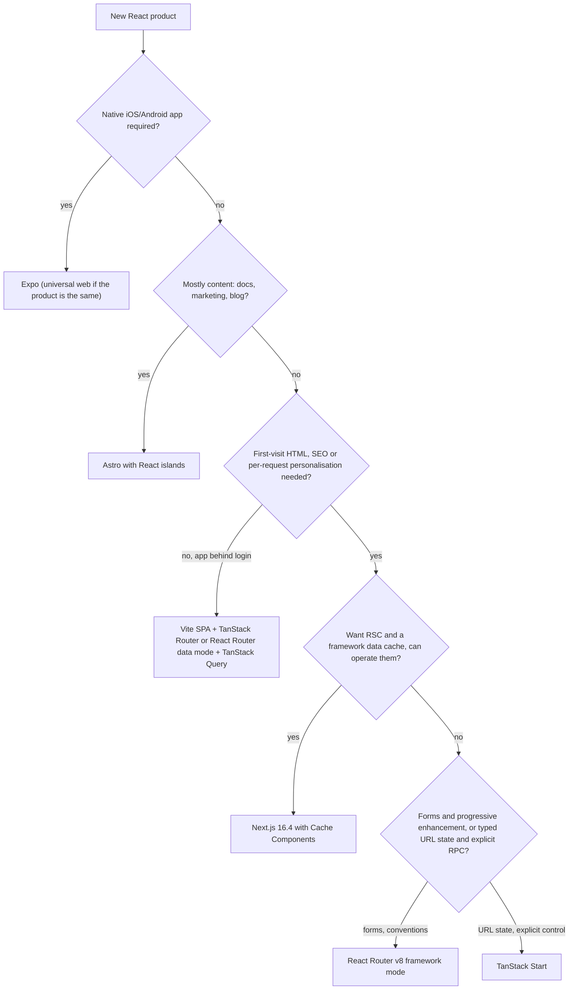

# 54 — Choosing a React Framework

> Choosing a framework mostly means choosing defaults: where code runs, what gets cached, who invalidates it, how writes reach the server, and what your platform has to provide. Pick the defaults you would otherwise build yourself and that your team can operate at 3 a.m. Popularity and the size of the hello-world are poor tie-breakers.

**Prerequisites:** [32 Rendering Strategy](32-rendering-strategy-architecture.md), [47](47-nextjs-app-router-architecture.md)–[53](53-react-native-and-expo.md) · **Related:** [01 Thinking Like an Architect](01-thinking-like-a-frontend-architect.md) · [44 RSC Security](44-rsc-security-threat-model.md) · [55 Ecosystem Atlas](55-react-ecosystem-atlas-2026.md) · [63 Governance and ADRs](63-architecture-governance-and-adrs.md) · [64 Migrations](64-migration-playbooks.md)

---

## TL;DR

- **The 2026 field:**
  - **Next.js 16.4.** Server Components first, a framework data cache (`'use cache'`), Server Actions.
  - **React Router v8.** Server-only loaders and actions, progressive enhancement, HTTP caching.
  - **TanStack Start 1.x.** Isomorphic loaders, explicit server functions, typed URL state.
  - **Expo SDK 58.** Native apps plus a universal web target.
  - **Astro 7.** Content sites with React islands.
  - **A Vite SPA** with TanStack Router or React Router's data mode, for apps behind a login that don't need server rendering.
  - **Niche but real:** Waku (minimal RSC, 1.0 release candidate), RedwoodSDK (Cloudflare-native RSC), Vike (assemble your own).
- **Out of the running:**
  - Create React App was deprecated in February 2025.
  - Gatsby is legacy; its last release was in February 2026.
  - **Remix 3 is not a React framework.** Remix v2 apps continue on React Router.
- **Decide on seven axes:**
  1. Rendering model.
  2. Where code runs.
  3. Data and cache ownership.
  4. Mutation model.
  5. Deployment and operations.
  6. Team complexity.
  7. Security posture and patch cadence.
- **Most authenticated B2B apps don't need SSR.** They need a fast SPA, good caching and good auth. SEO, content and first-visit performance are what justify server rendering. Don't pay for a server you don't need.
- **Evaluate with the hardest screen, not a demo:** two frameworks, one week each, the same requirements and the same measurements. Record the decision as an ADR with its reversal cost ([63](63-architecture-governance-and-adrs.md)).
- **The official list is a starting point.** react.dev recommends Next.js (App Router), React Router and Expo, and lists TanStack Start and RedwoodSDK under "other frameworks". Your constraints decide.

---

## 1. The landscape, November 2026

| | Version | Rendering | Server code | Cache owner | Mutations | Deploy needs | Maturity |
|---|---|---|---|---|---|---|---|
| **Next.js** | 16.4 | RSC + SSR + static, Partial Prefetching, Cache Components | Server Components, Route Handlers, `proxy.ts` | Framework (`'use cache'`, `cacheLife`, tags) + HTTP | Server Actions (`'use server'`) | Node server or adapter; shared cache and key for multi-instance ([50](50-nextjs-in-production.md)) | Highest; largest ecosystem; frequent security releases |
| **React Router** | 8.5 | SSR, SPA mode, prerender; RSC experimental | Loaders, actions, middleware, resource routes | HTTP (`headers` export) + your data layer | Actions + `<Form>`/fetchers; automatic revalidation | Any fetch runtime: Node, Workers, Lambda | High; yearly majors; Remix lineage |
| **TanStack Start** | 1.x (1.0 Oct 2026) | SSR, selective SSR per route, SPA, prerender; RSC experimental | Server functions, server routes, request/function middleware | Router SWR cache + TanStack Query | Explicit RPC + manual invalidation | Nitro, Cloudflare, Netlify, any `fetch` host | New 1.0; fast-moving |
| **Expo** | SDK 58 | Native views; web via React Native Web with server output | Data loaders, API routes, middleware (stable in 58) | Your client cache + HTTP | API routes / your API | EAS or any host for the server; app stores for binaries | High for native; web is the newer half |
| **Astro** | 7.4 | Static and server HTML; zero JS by default; React as islands | Endpoints, actions, `src/fetch.ts` (Advanced Routing) | Route caching (`Astro.cache`, `routeRules`), CDN | Astro actions / endpoints | Static host or adapters (Node, Cloudflare, Netlify, Vercel) | High for content; Astro team joined Cloudflare (Jan 2026), project stays platform-agnostic |
| **Vite SPA** | Vite 8 | Client-side only | None (your API or BFF) | TanStack Query / your client cache | Your API | Static hosting + an API | Highest stability; you assemble routing and data |
| **Waku** | 1.0 RC | RSC-first, minimal | Server components and functions | HTTP | Server functions | Node (Hono) or edge | Pre-1.0; small team |
| **RedwoodSDK** | 1.x | SSR + RSC + realtime | Workers, Durable Objects | Cloudflare primitives | Server functions | Cloudflare only | Young; opinionated on platform |
| **Vike** | 0.4.x | Whatever you assemble | Your server | Yours | Yours | Yours | Mature tool, framework-agnostic |

> [!WARNING]
> **"Remix" in 2026 means two things.** The React path of Remix is React Router (v7, now v8). Remix 3 is a ground-up rebuild that dropped React for its own component model, which started from a fork of Preact. There's no migration path from Remix v2 to Remix 3. A Remix v2 app goes to React Router ([51](51-react-router-v8-framework-mode.md)). Remix 3 is a reasonable thing to evaluate, but it's an evaluation of *leaving React*.

---

## 2. The seven axes

### 2.1 Rendering model: what must the first document contain?

Start with what an anonymous first visit needs, then a signed-in revisit:

| Need | Implication |
|---|---|
| Indexable content, social previews, ads landing pages | SSR or static generation for those routes |
| Fast first visit on slow devices for content-heavy pages | Static or streamed HTML, minimal JavaScript (Astro islands, RSC) |
| Signed-in app shell, heavy interaction, data per user | A SPA is fine; SSR is optional, and with RSC it's mostly an optimisation |
| Mixed (marketing + app) | Either one framework that does both per route, or **two apps**: Astro for marketing, a SPA or framework app for the product |

The two-app answer is underrated. Marketing and product have different release cadences, owners, performance profiles and caching rules. Joining them in one framework makes both pay for the other's needs ([21](21-frontend-architecture-styles-and-boundaries.md)).

### 2.2 Where code runs

| Model | Framework | Consequence |
|---|---|---|
| Server tree with client islands (RSC) | Next.js, Waku, RedwoodSDK | Data access lives in components; serialisation boundaries everywhere; the smallest client JavaScript for data-heavy pages ([18](18-react-server-components-and-server-functions.md)) |
| Server-only loaders and actions | React Router, Expo Router loaders | A clear request/response split; the loader is the data boundary |
| Isomorphic loaders + explicit RPC | TanStack Start | The same loader runs on server and client; server access only through server functions |
| Client only | Vite SPA | All data through an API you design and secure |

There's no "better" row. There's the row your team will get right. In every one, the endpoints the framework creates for you are public: Server Actions, `.data` requests, server functions, loader endpoints. Authorisation goes inside them ([45](45-authentication-and-authorization.md)).

### 2.3 Data and cache ownership

The most expensive production incidents in framework apps are cache incidents: stale data, data shown to the wrong user, invalidation that doesn't reach every instance. Ask who owns each layer:

| Layer | Next.js | React Router | TanStack Start | Vite SPA |
|---|---|---|---|---|
| Per-request dedupe | `React.cache`, fetch memoisation | Your code | Your code | Query |
| Cross-request server cache | `'use cache'` (+ `'use cache: remote'`), tags, `cacheLife` | HTTP / CDN / your store | HTTP on GET server functions / your store | N/A |
| Client cache | Router cache + prefetch | Loader data per navigation | Router SWR cache + Query | Query |
| Invalidation | `updateTag` / `revalidateTag` / `refresh()` | Automatic after actions | Manual (`router.invalidate`, Query) | Manual (Query) |

Next.js gives you the most caching for free, so it has the most caching to understand and operate, especially self-hosted ([48](48-nextjs-rendering-and-caching.md)). React Router gives you the least, and therefore the fewest surprises. TanStack Start sits between them, with the cache living in Query, which your team may already know.

### 2.4 Mutation model

- **Implicit endpoints** (Next.js Server Actions). Ergonomic, and close to forms and progressive enhancement. Each one is an endpoint created by a directive, so review them like an API.
- **Route actions** (React Router). Forms post to routes, and the route revalidates. They work without JavaScript, and correctness after writes is the default.
- **Explicit RPC** (TanStack Start). Named, validated functions. You own invalidation.
- **Your API** (SPA, Expo). Full control, full responsibility: contracts, versioning, CSRF ([33](33-api-integration-bff-and-contracts.md)).

### 2.5 Deployment and operations

| Question | Why it matters |
|---|---|
| Can we run a long-lived Node server, or only functions, the edge or static files? | Rules out options before any spike |
| How many instances, and in how many regions? | Shared caches, tag coordination, encryption keys and skew protection become your job ([50](50-nextjs-in-production.md)) |
| Do proxies buffer responses? | Streaming silently degrades to slow SSR |
| How do we observe it? | Per-route server timings, client RUM, error correlation by release ([41](41-observability-and-diagnostics.md)) |
| How do we roll out and roll back? | Version skew between open tabs and new deploys; old mobile binaries for months ([53](53-react-native-and-expo.md)) |

**Performance fidelity is platform-dependent.** A framework can be functionally complete on your platform while its headline performance features need integration you don't have, such as a CDN-served PPR shell or global ISR propagation. Ask vendors and adapters for both.

### 2.6 Team complexity

Count the concepts a new engineer must hold to change a page safely:

| | Concepts to hold | Typical failure |
|---|---|---|
| Vite SPA | Router, Query, API contract, auth | Waterfalls; leaky client-side authorisation assumptions |
| React Router | + loaders/actions, revalidation, middleware, SSR | Auth in parent loaders; non-idempotent actions |
| TanStack Start | + isomorphic execution, server functions, two caches | Server code in loaders; missing CSRF middleware after a custom `start.ts` ([52](52-tanstack-start-and-router.md)) |
| Next.js | + server/client graphs, `'use cache'` scopes and lifetimes, Actions, PPR, proxy | Cache scope mistakes; secrets crossing into client components; unpatched Flight packages |

More concepts can be worth it. The point is to pay for them on purpose.

### 2.7 Security posture and patch cadence

- **RSC frameworks carry the Flight protocol's patch obligations.** Nine React advisories between December 2025 and October 2026, two of them remote code execution ([44](44-rsc-security-threat-model.md)). Next.js vendors React, so you patch by upgrading Next. Other RSC frameworks depend on `react-server-dom-*` packages that you must keep at patched versions.
- **Built-in protections differ and can be lost.**
  - React Router's action origin check doesn't cover resource routes or requests without an `Origin` header.
  - TanStack Start's default CSRF middleware disappears when you define your own request middleware.
  - Next.js Server Actions check `Origin` against the host but allow requests that lack it.
  - Know the gaps and test them.
- **Supply chain is part of the framework.** A framework with 40 packages and a busy CI pipeline is a large target. In May 2026, malicious TanStack versions were published through the project's own pipeline. Lockfiles, release cooldowns and script blocking are prerequisites for any choice ([43](43-frontend-security-architecture.md)).

---

## 3. A decision flow



This is a starting point, not a verdict. Platform constraints (2.5) and team complexity (2.6) override it routinely.

---

## 4. Choose when, avoid when

**Next.js**
- *Choose when:* you want Server Components and Partial Prefetching in production today; content and commerce with a lot of cacheable personalised UI; you can deploy to a platform with full performance fidelity, or operate the self-hosting requirements.
- *Avoid when:* you can't commit to a patch cadence; your platform can't provide shared caches and streaming; the team is new to React and the product is an internal SPA.

**React Router v8**
- *Choose when:* you're on Remix v2 or React Router 7; the app is form-heavy and must work before JavaScript loads; you want web-standard requests and hosting freedom with few hidden caches.
- *Avoid when:* RSC is a hard requirement now (it's experimental here); you need a framework-level data cache with tag invalidation.

**TanStack Start**
- *Choose when:* the product lives in the URL (dashboards, admin tools with deep filtering); the team already runs TanStack Query; you want per-route SSR control and explicit server calls.
- *Avoid when:* you need maximum ecosystem maturity and long-term support guarantees today; the team is unlikely to internalise isomorphic loaders.

**Expo**
- *Choose when:* there's a native app in scope; one team ships iOS, Android and (optionally) web.
- *Avoid when:* the "app" is really a website someone wants in a store. Consider a PWA first ([06](06-modern-web-platform-apis.md)).

**Astro**
- *Choose when:* docs, marketing, editorial and blogs, where most of the page is static and React is needed in islands (`client:visible`, `client:idle`), plus server islands for personalised fragments.
- *Avoid when:* the site is mostly app. Islands talking to each other is where Astro gets awkward.

**Vite SPA**
- *Choose when:* the app sits behind authentication, SEO is irrelevant, and you already have (or want) a clean API or BFF. It's the simplest thing that works, and the easiest to operate: static files plus an API.
- *Avoid when:* first-visit performance on slow devices is a business metric for anonymous users.

**Waku, RedwoodSDK, Vike**
- *Choose when:* Waku for a small RSC-first app where minimalism is the goal; RedwoodSDK if you're all-in on Cloudflare (Workers, Durable Objects, realtime); Vike if you need a bespoke framework on Vite and have the team to own it.
- *Avoid when:* you need a large hiring pool and long-term vendor stability.

---

## 5. Running an evaluation

1. **Write requirements as gates and weights.** Gates are non-negotiable: "must run on our Kubernetes cluster", "must render indexable product pages". Weights express preference.
2. **Shortlist two.** Three or more makes for shallow spikes.
3. **Spike the hardest screen in each.** For example, a filterable, editable invoice table with optimistic updates behind SSO, plus one public SEO page. Same team, same timebox (one week each), same data.
4. **Measure:** bundle size and Core Web Vitals in the lab; server timings; lines of auth and caching code; failure behaviour (kill the API mid-request); deploy to *your* platform, not the vendor's demo; the security checklist (CSRF, endpoint authorisation, patch path).
5. **Score, then write the ADR**, including what would make you reverse the decision and what reversing costs.

A scorecard with hard gates keeps enthusiasm honest:

```ts
// scorecard.ts: weighted framework evaluation with hard gates. Run: node scorecard.ts
type Criterion = { id: string; weight: number; mustHave?: boolean };
type Scores = Record<string, number>; // 0 (fails) to 5 (excellent), per criterion

const criteria: Criterion[] = [
  { id: 'meets-rendering-needs', weight: 5, mustHave: true },  // e.g. SEO pages need SSR/SSG
  { id: 'runs-on-our-platform', weight: 5, mustHave: true },   // e.g. Kubernetes + Node, no Vercel
  { id: 'data-and-cache-fit', weight: 4 },
  { id: 'mutation-model-fit', weight: 3 },
  { id: 'type-safety', weight: 3 },
  { id: 'team-familiarity', weight: 3 },
  { id: 'security-defaults', weight: 4 },
  { id: 'operability', weight: 4 },                            // observability, skew, multi-instance
  { id: 'maturity-and-support', weight: 3 },
];

export function evaluate(name: string, scores: Scores) {
  const failedGates = criteria.filter((c) => c.mustHave && (scores[c.id] ?? 0) < 3).map((c) => c.id);
  const max = criteria.reduce((sum, c) => sum + c.weight * 5, 0);
  const total = criteria.reduce((sum, c) => sum + c.weight * (scores[c.id] ?? 0), 0);
  return { name, percent: Math.round((total / max) * 100), eligible: failedGates.length === 0, failedGates };
}
```

With illustrative spike scores (in the chapter's source), the output shows the point of gates. The second-highest raw score is ineligible:

```text
eligible    84%  React Router 8
eligible    78%  TanStack Start 1.x
eligible    75%  Next.js 16.4
ineligible  82%  Vite SPA + TanStack Router  (fails: meets-rendering-needs)
```

The scores are examples for one organisation's constraints, not a ranking of frameworks. Change the platform gate to "Vercel" and the team familiarity, and the order changes.

A minimal ADR for the decision:

```markdown
# ADR-017: Framework for the customer portal

Status: Accepted (2026-11-20) · Deciders: web platform group · Review: 2027-05

## Context
Public pricing and docs pages must be indexable; the portal is behind SSO; we run on our
Kubernetes platform (Node 24), multi-region, with a shared Redis.

## Decision
React Router v8 framework mode: SSR for public routes, prerender for docs, SPA-like portal.

## Consequences
+ Web-standard requests, forms that work before JS, HTTP caching we already operate.
- No framework data cache; we own caching in the data layer. RSC not used until stable.
Reversal cost: medium. Route modules map to TanStack Start or Next.js route by route.
```

---

## 6. Moving between frameworks

| From → To | Shape of the migration | Notes |
|---|---|---|
| Create React App → Vite | Mechanical: config, env prefix (`REACT_APP_` → `VITE_`), test runner | Usually days; do it before anything else ([64](64-migration-playbooks.md)) |
| SPA → React Router or TanStack Start | Incremental: adopt the router in SPA mode, then enable SSR per route | No big bang; hosting can stay static until SSR is on |
| Remix v2 → React Router v8 | Codemod to v7, then the v8 flags and minimums | Same architecture ([51](51-react-router-v8-framework-mode.md)) |
| Next.js Pages Router → App Router | Route by route; both routers coexist | Rethink data fetching and caching, not just file layout ([47](47-nextjs-app-router-architecture.md)) |
| Gatsby → Astro | Content collections plus React islands for existing components | Common and well trodden |
| Next.js ↔ React Router/TanStack Start | Rewrite of data, cache and mutation layers; components largely survive | Only with a strong reason: platform cost, operability, cache complexity |

Keep components framework-agnostic to keep these options cheap: presentational components take props, data access lives in loaders, server functions or hooks behind interfaces, and routing primitives are wrapped. That discipline is what makes a framework decision reversible ([22](22-component-architecture-and-patterns.md)).

---

## Decision framework

**Problem.** Choose the framework (or frameworks) for a new or re-platformed React product.

**Constraints.** Rendering needs per route type. Hosting platform and regions. Multi-instance and caching infrastructure. Team experience. Security and compliance obligations, including the patch SLA. Mobile scope. Expected lifetime of the product.

| If the dominant need is… | Lean towards | Watch out for |
|---|---|---|
| RSC, PPR, a rich framework cache, content-plus-commerce | Next.js | Self-hosting requirements; cache semantics; patch cadence |
| Forms, progressive enhancement, portability, few hidden caches | React Router v8 | Building your own cache layer; experimental RSC |
| Typed URL state, explicit server boundaries, Query-centric teams | TanStack Start | Isomorphic loaders; CSRF default; framework youth |
| Native apps | Expo | Release engineering; skew with old binaries |
| Content with islands | Astro | Island-to-island state; app-like sections |
| An authenticated app, simplest operations | Vite SPA | First-visit performance; you assemble the stack |

**Criteria.** Hard gates first (platform, rendering needs). Then weighted fit on data and cache, mutations, operability, security defaults and team familiarity. Reversal cost is a tie-breaker in its own right.

**Failure modes.**

- Choosing by hello-world or popularity.
- Running one spike in one framework only.
- Ignoring the platform until deployment week.
- Adopting experimental features (RSC outside Next.js, deferred hydration) as foundations.
- Using one framework for marketing and product when two apps would be simpler.
- Not budgeting for upgrades.

**Migration path.** Make the decision reversible. Keep components framework-agnostic, put data access behind interfaces, and document the reversal cost in the ADR. Revisit it every six to twelve months, or when a gate changes.

---

## Pitfalls and anti-patterns

- **"Everyone uses X."** Usage is a proxy for hiring and ecosystem, which are real factors, but not for fit.
- **Deciding SSR for an internal app** because the framework does it by default, then operating servers for no user benefit.
- **Single-framework absolutism.** Marketing on Astro and product on a SPA is often the cheapest answer.
- **Evaluating on the vendor's platform** when you'll deploy on yours.
- **Counting features, not concepts.** Every feature is something the team must understand to debug.
- **Treating built-in security as complete.** Each framework has a known gap in its CSRF story. Test yours.
- **Letting the decision expire unreviewed.** Frameworks move fast. A good choice in 2024 can be the wrong one in 2027.
- **Migrating framework and design system and state library at once.** One major move per quarter.

---

## Architect's checklist

- [ ] Requirements are written as gates (must) and weights (prefer), per route type (public, authenticated, admin)
- [ ] Platform constraints are confirmed: runtime, regions, instances, shared cache, streaming through proxies
- [ ] Two frameworks spiked on the hardest real screen, deployed to our platform, with the same measurements
- [ ] The security review covers endpoint authorisation, CSRF gaps, RSC patch path and supply-chain controls
- [ ] Cache ownership is documented per layer, with an invalidation strategy and a multi-instance plan
- [ ] Team complexity is assessed honestly; there's a training plan for the new concepts
- [ ] The decision is recorded as an ADR with reversal cost and a review date
- [ ] Components and data access are structured to keep the decision reversible
- [ ] An upgrade policy exists: owners, cadence, and how fast security releases ship

---

## Interview angles

**Q1. How would you choose a framework for a new B2B SaaS product?**
Split the routes first. Public marketing and docs need indexable, fast HTML. The product is behind SSO and needs a fast, well-cached, interactive app. Then confirm the platform constraints: Node on Kubernetes, multi-region, shared cache or not. Often the answer is two apps, Astro or a framework for marketing and a Vite SPA or React Router app for the product. If one framework must do both, I'd spike React Router v8 and Next.js (or TanStack Start) on the hardest screen, deploy each to our platform, and score them against gates and weights. The ADR records the reversal cost.

**Q2. What's the difference in data and caching philosophy between Next.js, React Router and TanStack Start?**
Next.js gives you a framework data cache: `'use cache'` with lifetimes and tags, invalidated with `updateTag`, `revalidateTag` and `refresh`. It's powerful and has to be operated, especially self-hosted. React Router keeps the server stateless: loaders run per request, caching is HTTP and your data layer, and actions revalidate automatically. TanStack Start runs loaders on both sides, with a router SWR cache, usually TanStack Query as the real cache, and manual invalidation after server function calls. The question is which cache your team can reason about during an incident.

**Q3. Is Remix 3 an upgrade path for a Remix v2 app?**
No. Remix 3 dropped React for its own component model, which grew out of a fork of Preact, and there's no migration path from v2. Remix v2's continuation is React Router (v7, then v8), with an official codemod. Remix 3 is worth evaluating only if leaving React is on the table, and that's a much bigger decision than a framework upgrade.

**Q4. When is a plain SPA the right answer in 2026?**
When the app is behind authentication, SEO doesn't matter, the users are on reasonable devices and networks, and there's a solid API or BFF. A Vite SPA with TanStack Router or React Router's data mode and TanStack Query gives typed routing, caching and code splitting, with the simplest operations: static assets plus an API. Add SSR later, per route, if first-visit performance becomes a measured problem.

**Q5. How do you keep a framework decision reversible?**
Framework-agnostic presentational components. Data access behind hooks or service interfaces, not scattered framework calls. Routing primitives (links, navigation) wrapped in a thin layer. Business logic in packages with no framework imports. Tests against behaviour rather than framework internals. Then document the reversal cost and the triggers for revisiting the decision in the ADR, and actually revisit it.

---

## Further reading

- react.dev, *Creating a React App* (recommended frameworks): <https://react.dev/learn/creating-a-react-app>
- Next.js docs, *Rendering philosophy*: <https://nextjs.org/docs/app/guides/rendering-philosophy> · React Router docs, *Picking a mode*: <https://reactrouter.com/start/modes>
- TanStack Start docs, *Overview*: <https://tanstack.com/start/latest/docs/framework/react/overview> · Expo docs, *Expo Router*: <https://docs.expo.dev/router/introduction/>
- Astro blog, *Astro 7.0*: <https://astro.build/blog/astro-7/> · Astro docs, *Islands architecture*: <https://docs.astro.build/en/concepts/islands/>
- Waku: <https://waku.gg> · RedwoodSDK: <https://rwsdk.com> · Vike: <https://vike.dev>
- InfoQ, *Remix 3 beta preview ditches React*: <https://infoq.com/news/2026/07/remix-3-beta-preview>

---

[← Previous: 53 — React Native and Expo for Web Architects](53-react-native-and-expo.md) · [Index](README.md) · [Next: 55 — React Ecosystem Atlas 2026 →](55-react-ecosystem-atlas-2026.md)
