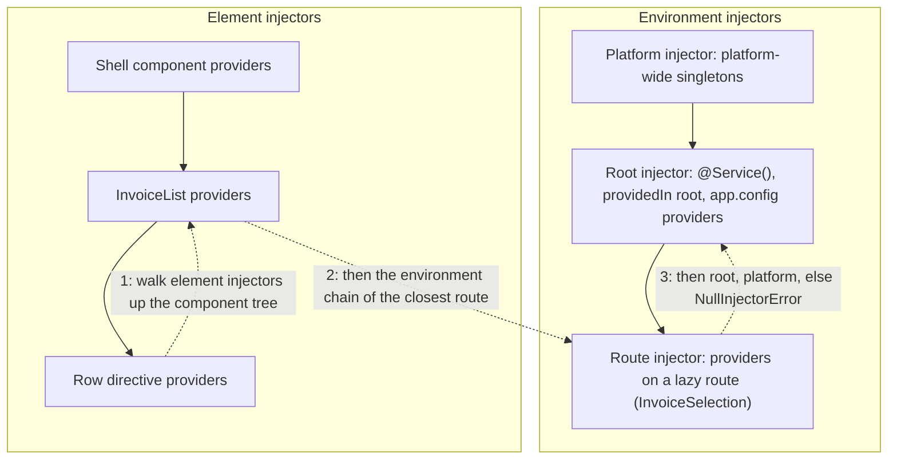
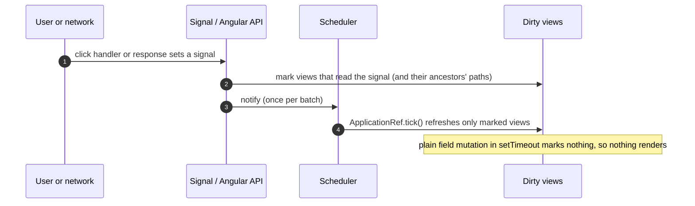

# 56 — Angular Architecture and Dependency Injection

> Angular is a platform: compiler, router, HTTP, forms, testing and build in one versioned box, and dependency injection holds it together. Learn where objects come from and how the framework decides what to re-render, and the rest of Angular follows.

**Prerequisites:** [21 Architecture Styles](21-frontend-architecture-styles-and-boundaries.md), [22 Component Architecture](22-component-architecture-and-patterns.md) · **Related:** [57 Angular Signals](57-angular-signals-reactivity-and-rxjs.md) · [58 Angular at Scale](58-angular-at-scale.md) · [59 React vs Angular](59-react-vs-angular-architecture-comparison.md) · [60 Monorepos](60-monorepos-build-tooling-and-bundlers.md)

---

## TL;DR

- **Angular 22 (June 2026) is the current major; 22.3 shipped on 18 November 2026.** Majors now arrive every **12 months**, each supported for 24 (12 active plus 12 LTS). v22 requires TypeScript 6 and drops Node 20 (§1.1).
- **The modern defaults are all on in a new v22 app:** standalone components, **zoneless** change detection, **OnPush** by default (the old default is now called `Eager`), strict template checking, the Fetch backend for `HttpClient`, Vitest, and stable signal APIs from inputs to `resource` and Signal Forms (§1.2).
- **DI is the architecture.** `app.config.ts` is the composition root. Services are root singletons (`@Service()`, new in v22) or scoped deliberately: to a lazy route, to a component subtree, or loaded on demand with `injectAsync()`. Features extend the shell through **multi providers**, not imports (§2, §4).
- **Two injector trees.** Lookup walks the *element* injectors up the DOM, then the *environment* injectors (route → root → platform). Which tree a provider lives in explains most "why are there two instances?" bugs (§4.1).
- **Change detection is explicit.** In a zoneless OnPush app, a view updates when a signal it reads changes, an input reference changes, an event fires in its template, or `markForCheck()` runs. Mutating a plain field in `setTimeout` no longer updates the screen, by design (§6).
- **Upgrading is safe; modernising is opt-in.** `ng update` preserves behaviour: it marks components `Eager`, leaves `strictTemplates` off where it was off, and keeps Zone.js where the app relied on it. Those markers are your modernisation backlog (§6.4).

---

## 1. Angular in 2026

### 1.1 Versions and support

| Version | Released | Status (Nov 2026) | Active until | LTS until |
|---|---|---|---|---|
| **22.x** (22.3.0, 18 Nov 2026) | 3 Jun 2026 | Active | Jun 2027 | Jun 2028 |
| 21.x | 19 Nov 2025 | LTS | ended 3 Jun 2026 | Jun 2027 |
| 20.x | 28 May 2025 | LTS, ending | ended 19 Nov 2025 | 28 Nov 2026 |
| 23.x | ~Jun 2027 (planned) | — | — | — |

Until v22, Angular shipped a major every six months. It now ships one a year, with four to six minors in between. Minors carry real features: 22.2 added template error boundaries (`@boundary`) and router resources, both in developer preview. Deprecated APIs remain for at least one major, roughly twelve months, before removal.

> [!NOTE]
> TypeScript 7 (the native compiler, July 2026) ships without the programmatic API that Angular's compiler builds on. Angular 22 runs on TypeScript 6.0; the 7.x API is expected in 7.1. Pin TypeScript to the range your Angular version declares ([55](55-react-ecosystem-atlas-2026.md)).

### 1.2 How we got here: the last five majors

| Change | Arrived | Default since | What it replaced |
|---|---|---|---|
| Standalone components | v14 (preview) → v15 | v19 | NgModules as the unit of compilation |
| Built-in control flow (`@if`, `@for`, `@switch`, `@defer`) | v17 | v17 | `*ngIf`, `*ngFor`, `ngSwitch` |
| Signal inputs, `model()`, `output()`, signal queries | v17.1–v17.3 | stable v19 | `@Input`, `@Output`, `@ViewChild` decorators |
| Zoneless change detection | v18 (experimental) → stable v20.2 | **v21** | Zone.js patching every async API |
| Vitest test runner | v21 | v21 | Karma + Jasmine |
| `resource()`, `httpResource()` | v19 (experimental) | stable **v22** | Hand-rolled loading/error state around `HttpClient` |
| Signal Forms | v21 (experimental) | stable **v22** | Reactive Forms (still supported) |
| OnPush change detection | always available | **v22** | "Check always" (now `ChangeDetectionStrategy.Eager`) |
| `@Service()`, `injectAsync()` | v22 | v22 | `@Injectable({ providedIn: 'root' })` (still supported) |
| Angular Aria (headless accessible directives) | v21 (preview) | stable **v22** | Hand-rolled ARIA patterns |
| Strict template checking | v9 (opt-in) | **v22** | Loose template type checking |

The pattern: each capability lands as a preview, stabilises over one or two majors, then becomes the default, with an automatic migration that keeps existing apps on their old behaviour until you choose to move.

---

## 2. Anatomy of a modern Angular application

```text
src/
  main.ts                         # bootstrapApplication(App, appConfig)
  app/
    app.ts                        # root component: renders the shell
    app.config.ts                 # composition root: every global provider in one file
    app.routes.ts                 # top-level routes; features load lazily
    core/                         # app-wide singletons: session, interceptors, guards, error handler, tokens
    shell/                        # layout + navigation; knows features only through tokens
    ui/                           # presentational, reusable components (no data access)
    features/
      invoices/
        invoices.routes.ts        # lazy entry; route-scoped providers
        invoices.nav.ts           # the feature's eager contribution to the shell
        invoice-api.ts            # data access for this feature
        invoice-selection.ts      # state scoped to the section
        invoice-list.ts, invoice-detail.ts
        pdf-exporter.ts           # heavy, loaded on demand
```

Since v20, the CLI and style guide drop the `.component`/`.service` suffixes (`invoice-list.ts`, class `InvoiceList`). The generated `tsconfig.json` doesn't contain `"strict": true` either, because TypeScript 6 is strict by default.

### 2.1 The composition root

```ts
// app.config.ts: the composition root. Everything global is visible in one file
import { ApplicationConfig, ErrorHandler, inject, provideAppInitializer, provideBrowserGlobalErrorListeners } from '@angular/core';
import { provideHttpClient, withInterceptors } from '@angular/common/http';
import { provideRouter, withComponentInputBinding } from '@angular/router';
import { routes } from './app.routes';
import { APP_CONFIG } from './core/app-config';
import { AuthSession } from './core/auth-session';
import { ReportingErrorHandler } from './core/error-handler';
import { requestContextInterceptor, unauthorizedInterceptor } from './core/http-interceptors';
import { INVOICE_NAV } from './features/invoices/invoices.nav';

export const appConfig: ApplicationConfig = {
  providers: [
    provideBrowserGlobalErrorListeners(),
    provideRouter(routes, withComponentInputBinding()),             // params, query params, data → inputs
    provideHttpClient(withInterceptors([requestContextInterceptor, unauthorizedInterceptor])), // Fetch by default
    { provide: APP_CONFIG, useValue: { apiBaseUrl: '/api', release: '2026.11.3' } },
    { provide: ErrorHandler, useClass: ReportingErrorHandler },
    provideAppInitializer(() => inject(AuthSession).restore()),     // bootstrap waits for the session
    INVOICE_NAV,
  ],
};
```

What's *not* here is as informative as what is:

- **No `provideZonelessChangeDetection()`.** Zoneless is the default.
- **No `withFetch()`.** The Fetch backend is the default since v22 and `withFetch` is deprecated; `withXhr()` opts back into XHR, but not for SSR.
- **No `NgModule`s.**

Every cross-cutting decision (HTTP pipeline, error reporting, initialisation, configuration) is one readable list. Review it like you'd review `main()` in a backend service.

The whole sample app in this chapter was built with Angular 22.3 (`ng build`), and its DI behaviour was checked with `ng test` (Vitest 5). The initial bundle came out at 275 kB raw, 75 kB over the wire, with router and HTTP, no Zone.js, and every feature in lazy chunks.

---

## 3. Components and templates

### 3.1 The signal-based component

```ts
// A component's public API: signal inputs, a two-way model, host bindings, projected content
import { Component, model } from '@angular/core';

@Component({
  selector: 'app-toggle',
  host: { role: 'switch', '[attr.aria-checked]': 'checked()', '(click)': 'checked.set(!checked())', tabindex: '0' },
  template: `<ng-content />`,
})
export class Toggle { readonly checked = model(false); }   // parent binds [(checked)]="compact"
```

| API | Declares | Notes |
|---|---|---|
| `input<T>()`, `input.required<T>()` | Inputs as `InputSignal<T>` | `transform` for coercion; required inputs are checked at compile time |
| `model<T>()` | Two-way binding `[(x)]` | A writable signal the parent can bind |
| `output<T>()` | Events | `OutputEmitterRef`; no RxJS needed |
| `viewChild()`, `viewChildren()`, `contentChild()`, `contentChildren()` | Queries as signals | `.required` variants throw if absent |
| `host: {}` | Host bindings and listeners | Prefer it to `@HostBinding`/`@HostListener` |
| `afterNextRender()`, `afterRenderEffect()` | DOM work after render | The safe place to measure layout; never runs on the server |
| `inject(DestroyRef).onDestroy()` | Cleanup | Works in services and directives too |

Template-only members are conventionally `protected`. Since 22.2, templates can also read `private` members.

### 3.2 Template syntax

```html
@let total = items().length;                      <!-- template-local variable -->
<p>{{ total }} items</p>

@if (show()) { <div animate.enter="fade-in" animate.leave="fade-out">Hello</div> }

@for (inv of invoices(); track inv.id) {           <!-- track is mandatory -->
  <app-invoice-row [invoice]="inv" />
} @empty {
  <p>No invoices match.</p>
}

@defer (on idle(500); prefetch on hover) {         <!-- lazy chunk, loaded when the browser is idle -->
  <app-revenue-chart />
} @placeholder (minimum 200ms) { <p>Chart placeholder</p> }
  @loading (after 100ms; minimum 300ms) { <p>Loading chart…</p> }
  @error { <p>Chart failed to load.</p> }

@boundary {                                        <!-- developer preview since 22.2 -->
  <app-risky-widget />
} @error (let e = $error, retry = $reset; when isTimeout(e)) {
  <p role="alert">The widget timed out. <button type="button" (click)="retry()">Try again</button></p>
} @error {
  <p role="alert">This section failed to render.</p>
}
```

Every block above compiled under Angular 22.3:

- **`@defer`** splits its contents into a lazy chunk. It's covered with hydration in [58](58-angular-at-scale.md).
- **`@boundary`** is Angular's answer to React error boundaries ([40](40-resilience-and-reliability.md)). It catches errors thrown while initialising or change-detecting what it wraps, but not errors from projected `<ng-content>`. At page level, the router's `withErrorBoundaries()` (developer preview in 22.3) renders a route's `errorComponent` when a routed component throws ([58](58-angular-at-scale.md)).
- **`animate.enter`/`animate.leave`** apply CSS classes on insertion and removal, the native replacement for most `@angular/animations` use ([24](24-animation-and-motion-systems.md)).

### 3.3 Templates are type-checked like code

Strict template type checking is the default in v22. Binding a number to a string input fails the build:

```text
✘ [ERROR] TS2322: Type 'number' is not assignable to type 'string'. [plugin angular-compiler]
```

That check covers inputs, outputs, `@for` items, `@let` values and pipe arguments. Upgraded apps get `strictTemplates: false` written into their config by the v22 migration if they weren't already strict. Turning it on, and fixing what it finds, is one of the highest-value modernisation tasks.

---

## 4. Dependency injection in depth

### 4.1 Two trees of injectors



When code calls `inject(X)`:

1. **Element injectors first.** Angular starts at the requesting component or directive and walks up through the `providers` (and, for the component's own view, `viewProviders`) of each ancestor in the rendered tree.
2. **Then environment injectors.** Next comes the environment injector the component was created in: the route's, for a lazy route that declares `providers`. From there it climbs to root, then platform.
3. **No match throws `NullInjectorError`**, unless the call said `{ optional: true }`.

Consequences that matter:

- A service provided in a component's `providers` gives **one instance per component instance**. That's right for per-widget state (each data table owns its sort state). It's wrong for something you meant to share.
- A service in a lazy route's `providers` gives **one instance for that section of the app**, created when the route is first activated.
- Root services are **singletons for the app's lifetime.** On the server, that means one per request, because each SSR request bootstraps its own application. Module-level variables, by contrast, *are* shared across requests ([58](58-angular-at-scale.md)).

### 4.2 Declaring services: `@Service()` and `@Injectable()`

v22 adds `@Service()` as the ergonomic default for root singletons:

```ts
// core/auth-session.ts: a root singleton holding session state as signals
import { computed, inject, Service, signal } from '@angular/core';
import { HttpClient } from '@angular/common/http';
import { firstValueFrom } from 'rxjs';

export interface SessionUser { id: string; name: string; tenantId: string; permissions: readonly string[] }

@Service()                                       // root-provided; inject() only, no constructor DI
export class AuthSession {
  private readonly http = inject(HttpClient);
  private readonly user = signal<SessionUser | null>(null);

  readonly currentUser = this.user.asReadonly();
  readonly isAuthenticated = computed(() => this.user() !== null);

  can(permission: string): boolean {
    return this.user()?.permissions.includes(permission) ?? false;
  }

  /** Called once by an app initializer; the BFF answers from its HttpOnly session cookie. */
  async restore(): Promise<void> {
    try {
      this.user.set(await firstValueFrom(this.http.get<SessionUser>('/bff/session')));
    } catch {
      this.user.set(null);                       // anonymous is a valid state, not a crash
    }
  }

  clear(): void { this.user.set(null); }
}
```

| | `@Service()` | `@Injectable({ providedIn: 'root' })` |
|---|---|---|
| Root singleton without config | Yes (default) | Needs `providedIn: 'root'` |
| `inject()` | Yes | Yes |
| Constructor parameter injection | **No.** Compile error NG2028 | Yes |
| Opt out of auto-providing | `@Service({ autoProvided: false })` | Omit `providedIn` |
| Custom construction | `@Service({ factory: () => … })` (runs in an injection context) | `useFactory`, `useClass`, `useExisting`, `useValue` |
| Non-root scopes (`'platform'`) | No | Yes |
| Status | New in v22 | Supported, not deprecated |

Adding a constructor parameter to a `@Service` class is caught by the compiler:

```text
✘ [ERROR] NG2028: @Service class cannot use constructor dependency injection. Use the `inject` function instead.
```

My rule for teams: **`@Service()` for new services, `@Injectable()` where you need constructor injection (some libraries and tests), alternative providers or non-root scopes.** For consistency, `ng generate @angular/core:service-migration` converts `@Injectable` to `@Service` where it can (run `inject-migration` first so constructors don't block it). Doing that is housekeeping, not a fix, so schedule it rather than mixing it into feature work.

### 4.3 Tokens, provider recipes and multi providers

Use `InjectionToken` for anything that isn't a class: configuration, feature flags, strategy functions, extension points.

```ts
// core/app-config.ts: typed configuration as an injection token, not a global import
import { InjectionToken } from '@angular/core';

export interface AppConfig {
  apiBaseUrl: string;
  release: string;
}
export const APP_CONFIG = new InjectionToken<AppConfig>('APP_CONFIG');

// Features contribute navigation to the shell without the shell importing them (multi provider)
export interface NavItem { label: string; path: string; permission?: string }
export const NAV_ITEMS = new InjectionToken<readonly NavItem[]>('NAV_ITEMS');
```

| Recipe | Use for |
|---|---|
| `{ provide: T, useValue: v }` | Configuration, constants, test doubles |
| `{ provide: T, useClass: Impl }` | Swapping an implementation (`ErrorHandler`, a storage adapter) |
| `{ provide: T, useFactory: () => … }` | Construction that depends on other injectables or the environment; `inject()` works inside |
| `{ provide: T, useExisting: Other }` | Aliasing: one instance, two tokens (a narrow interface over a wide service) |
| `{ provide: T, multi: true, useValue: … }` | **Extension points.** Each provider adds to an array instead of replacing it |
| `new InjectionToken<T>('desc', { factory: () => … })` | A token with a tree-shakable default, overridable anywhere |

Multi providers are how a modular application stays modular. The shell renders navigation without importing a single feature:

```ts
// features/invoices/invoices.nav.ts: the feature's eager contribution, kept apart from its lazy code
import { Provider } from '@angular/core';
import { NAV_ITEMS } from '../../core/app-config';

export const INVOICE_NAV: Provider = {
  provide: NAV_ITEMS,
  multi: true,
  useValue: [{ label: 'Invoices', path: '/invoices', permission: 'invoice:read' }],
};
```

```ts
// shell/shell.ts: renders navigation contributed by features, filtered by permission
import { Component, computed, inject } from '@angular/core';
import { RouterLink, RouterLinkActive, RouterOutlet } from '@angular/router';
import { NAV_ITEMS } from '../core/app-config';
import { AuthSession } from '../core/auth-session';

@Component({
  selector: 'app-shell',
  imports: [RouterOutlet, RouterLink, RouterLinkActive],
  template: `
    <nav aria-label="Main">
      @for (item of visibleNav(); track item.path) {
        <a [routerLink]="item.path" routerLinkActive="active" ariaCurrentWhenActive="page">{{ item.label }}</a>
      }
    </nav>
    <main id="main"><router-outlet /></main>
  `,
})
export class Shell {
  private readonly session = inject(AuthSession);
  private readonly nav = inject(NAV_ITEMS).flat();      // multi provider: an array of contributions
  protected readonly visibleNav = computed(() =>
    this.nav.filter((i) => !i.permission || this.session.can(i.permission)));
}
```

> [!TIP]
> Keep a feature's *eager* contribution (`invoices.nav.ts`) in a different file from its *lazy* entry (`invoices.routes.ts`). In the first build of this chapter's sample, the nav provider lived in the routes file. Importing it from `app.config.ts` would have pulled the route-scoped store into the main bundle. Moving it made the lazy `invoices-routes` chunk own that code again (679 bytes instead of a 74-byte stub).

### 4.4 Scoping state to a feature

```ts
// features/invoices/invoice-selection.ts: state scoped to the invoices section, not the whole app
import { computed, Service, signal } from '@angular/core';

@Service({ autoProvided: false })                // must be provided: here, by the feature's route
export class InvoiceSelection {
  private readonly ids = signal<ReadonlySet<string>>(new Set());
  readonly count = computed(() => this.ids().size);
  has(id: string) { return this.ids().has(id); }
  toggle(id: string) {
    this.ids.update((s) => { const n = new Set(s); if (!n.delete(id)) n.add(id); return n; });
  }
  clear() { this.ids.set(new Set()); }
}
```

```ts
// features/invoices/invoices.routes.ts: a lazy feature with its own environment injector
import { Routes } from '@angular/router';
import { InvoiceSelection } from './invoice-selection';

export const INVOICE_ROUTES: Routes = [
  {
    path: '',
    providers: [InvoiceSelection],                  // one instance for the whole section
    children: [
      { path: '', loadComponent: () => import('./invoice-list').then((m) => m.InvoiceList), title: 'Invoices' },
      { path: ':invoiceId', loadComponent: () => import('./invoice-detail').then((m) => m.InvoiceDetail), title: 'Invoice' },
    ],
  },
];
```

The list and detail pages share one `InvoiceSelection`. Nothing outside `/invoices` can inject it: the root injector throws "No provider", which the test suite checks.

How long that instance lives is a decision, not a detail. **By default a route injector outlives the visit:** leave `/invoices`, come back, and you get the same instance with the same selection. Add `withAutoCleanupInjectors()` (stable since 22.2) to `provideRouter` and the router destroys injectors of routes that are no longer active, running their `DestroyRef` callbacks. The next visit then gets a fresh instance. I verified both behaviours with `RouterTestingHarness`: one instance across a visit-away-and-back by default, two with the feature on. A custom `RouteReuseStrategy` decides per route through `shouldDestroyInjector`.

| Where you provide | Lifetime | Use for |
|---|---|---|
| `@Service()` / `providedIn: 'root'` | App (one per SSR request on the server) | Session, API clients, cross-feature caches |
| Lazy route `providers` | From first activation; for the app's lifetime by default, or until the route is left with `withAutoCleanupInjectors()` | Section-level state and feature-specific implementations |
| Component `providers` | Per component instance, shared with its children | Per-widget state (table, wizard, editor) |
| Component `viewProviders` | Per instance; visible to its template, not to projected content | State a component's internals need, hidden from content projected into it |
| `injectAsync()` | Loaded and created on first use (or prefetch) | Heavy, rarely used services |

### 4.5 Resolution modifiers

```ts
const analytics = inject(ANALYTICS, { optional: true });           // a plugin may be absent
const parent = inject(TreeNode, { skipSelf: true, optional: true }); // recursive components: my parent, not me
const local = inject(FormFieldState, { self: true });               // only my own providers
const hostOnly = inject(ControlContainer, { host: true });          // stop at the host component
```

`skipSelf` plus `optional` is the idiom for recursive structures such as trees, nested menus and outline editors. Each node finds its parent node through DI rather than through `@Input` chains.

### 4.6 The injection context

`inject()` works only while Angular is constructing something: field initialisers and constructors of components, directives, pipes and services; provider factories; route guards, resolvers and interceptors (all functions); `provideAppInitializer` callbacks. Outside those moments, wrap the call in `runInInjectionContext(injector, fn)`.

Functional guards and interceptors make DI part of plain functions:

```ts
// core/guards.ts: guards are UX; the API still authorises every request
import { inject } from '@angular/core';
import { CanMatchFn, Router } from '@angular/router';
import { AuthSession } from './auth-session';

export function requirePermission(permission: string): CanMatchFn {
  return (_route, segments) => {
    const session = inject(AuthSession);
    if (session.can(permission)) return true;
    const returnTo = '/' + segments.map((s) => s.path).join('/');
    return inject(Router).createUrlTree(['/login'], { queryParams: { returnTo } });
  };
}
```

```ts
// core/http-interceptors.ts: functional interceptors, composed in order
import { HttpErrorResponse, HttpInterceptorFn } from '@angular/common/http';
import { inject } from '@angular/core';
import { Router } from '@angular/router';
import { catchError, throwError } from 'rxjs';
import { APP_CONFIG } from './app-config';
import { AuthSession } from './auth-session';

export const requestContextInterceptor: HttpInterceptorFn = (req, next) => {
  const { release } = inject(APP_CONFIG);
  return next(req.clone({
    setHeaders: { 'X-Request-Id': crypto.randomUUID(), 'X-Client-Release': release },
  }));
};

export const unauthorizedInterceptor: HttpInterceptorFn = (req, next) => {
  const router = inject(Router);
  const session = inject(AuthSession);
  return next(req).pipe(
    catchError((err: unknown) => {
      if (err instanceof HttpErrorResponse && err.status === 401 && !req.url.startsWith('/bff/session')) {
        session.clear();
        void router.navigate(['/login'], { queryParams: { returnTo: router.url } });
      }
      return throwError(() => err);
    }),
  );
};
```

`canMatch` rather than `canActivate` on a lazy route means navigation never downloads the feature's code for an unauthorised user. Preloading is the exception: the preloader ignores `canMatch` (only the deprecated `canLoad` stops it), so a preloading strategy has to check permissions itself ([58](58-angular-at-scale.md)). Either way it's a UX control, and lazy chunks are public files. The API authorises every request ([45](45-authentication-and-authorization.md)). In current versions `CanMatchFn` also receives a third argument, a partial snapshot of the route matched so far.

### 4.7 Lazy services with `injectAsync()`

```ts
// features/invoices/invoice-detail.ts (excerpt): route params as required inputs, lazy service on demand
export class InvoiceDetail {
  readonly invoiceId = input.required<string>();     // from :invoiceId, via withComponentInputBinding()

  private readonly api = inject(InvoiceApi);
  private readonly pdf = injectAsync(() => import('./pdf-exporter').then((m) => m.PdfExporter), { prefetch: onIdle });

  protected readonly invoice = httpResource<Invoice>(() => this.api.url(`/${encodeURIComponent(this.invoiceId())}`));

  protected async download(inv: Invoice): Promise<void> {
    const blob = await (await this.pdf()).export(inv);   // chunk is usually prefetched by now
    window.open(URL.createObjectURL(blob));
  }
}
```

`injectAsync` returns a function that resolves to the instance. The service's module becomes its own chunk (`pdf-exporter` in the build output), and `prefetch: onIdle` fetches it when the browser is idle, so the click rarely waits. The lazy service must be auto-provided (`@Service()` or `providedIn: 'root'`). This is the DI-level counterpart of `@defer`: lazy *behaviour*, not lazy UI.

### 4.8 Initialisation and global error handling

- **`provideAppInitializer(fn)`** delays bootstrap until `fn`'s promise resolves. Keep these few and fast, because every millisecond here is time to first render. Restoring the session qualifies. Fetching the user's whole dashboard does not.
- **`provideEnvironmentInitializer(fn)`** runs when an environment injector is created, for root or a lazy route. It's useful for registering a feature's side effects (telemetry, icons) only when the feature loads.
- **`ErrorHandler`** is the single funnel for uncaught errors. `provideBrowserGlobalErrorListeners()` (generated by the CLI) forwards `window` errors and unhandled rejections into it ([41](41-observability-and-diagnostics.md)).

```ts
// core/error-handler.ts: one place where uncaught errors become telemetry
import { ErrorHandler, inject, Service } from '@angular/core';
import { APP_CONFIG } from './app-config';

@Service({ autoProvided: false })                 // provided explicitly as ErrorHandler in app.config
export class ReportingErrorHandler implements ErrorHandler {
  private readonly config = inject(APP_CONFIG);
  handleError(error: unknown): void {
    console.error(error);                          // keep the dev experience
    reportToTelemetry(error, { release: this.config.release });
  }
}
```

### 4.9 DI makes testing cheap

Because every dependency is a token, tests replace them in one place. These tests ran green under `ng test` (Vitest 5.1):

```ts
// core/core.spec.ts (excerpt)
it('keeps route-scoped services out of the root injector', () => {
  expect(() => TestBed.inject(InvoiceSelection)).toThrow(/No provider/);
});

it('adds request context headers in the interceptor', () => {
  TestBed.inject(HttpClient).get('/api/ping').subscribe();
  const req = TestBed.inject(HttpTestingController).expectOne('/api/ping');
  expect(req.request.headers.get('X-Client-Release')).toBe('test-1');
  req.flush({});
});

it('redirects to login when the permission is missing', () => {
  const guard = requirePermission('invoice:read');
  const result = TestBed.runInInjectionContext(() => guard({} as Route, [{ path: 'invoices' } as UrlSegment], {} as never));
  expect(TestBed.inject(Router).serializeUrl(result as UrlTree)).toBe('/login?returnTo=%2Finvoices');
});
```

---

## 5. The compiler and the build

- **Ahead-of-time compilation always.** Templates compile to instruction functions at build time. There is no template parser in production bundles, and template errors are build errors. The compiler also generates DI factories, which is why `inject()` and tree-shakable providers cost nothing at runtime.
- **Tree-shakable providers.** A `@Service()` that nothing injects isn't in the bundle. Providers listed in `app.config.ts` always are. Prefer auto-provided services and token factories to eager provider lists.
- **`@angular/build`.** The application builder uses esbuild for production builds and Vite for the dev server (HMR for styles and templates). There's no Webpack in a new project. `ng build` prints per-chunk raw and estimated transfer sizes. Read them in code review, and enforce `budgets` in `angular.json` ([39](39-web-performance-and-core-web-vitals.md)).
- **Extended diagnostics** catch template mistakes the type checker can't, such as a signal interpolated without calling it, or a two-way binding written backwards (`([x])`). Treat them as errors in CI.
- **Tooling for agents.** `ng mcp` runs the Angular CLI's MCP server, which exposes best-practice guidance, documentation search and migration tools (including an OnPush/zoneless migration planner) to coding assistants ([65](65-ai-powered-react-interfaces.md)).

---

## 6. Change detection: from Zone.js to zoneless and OnPush

### 6.1 What Zone.js did, and why it left

Zone.js monkey-patched every asynchronous browser API (`setTimeout`, promises, `addEventListener`, XHR) so Angular knew when *something* had happened. Then it checked the component tree, all of it unless a branch was OnPush. It was magical and expensive:

- A sizeable polyfill on every page.
- Change detection after every timer and network callback, including ones that changed nothing.
- Stack traces full of zone frames.
- Third-party libraries triggering refreshes on every animation frame.

Signals let Angular know *what* changed, not just *that* something ran. So since v21, new applications don't load Zone.js at all.

### 6.2 What schedules an update now



| Triggers a refresh | Does not |
|---|---|
| Setting a signal that a template (or `computed` used by it) reads | Mutating a plain class field from `setTimeout`, a promise, or a third-party callback |
| An event bound in a template or `host` (`(click)`) | Listeners added with `addEventListener` or `Renderer2.listen` outside templates, unless they set a signal |
| A new input *reference* from the parent | Mutating an input object in place (`this.items.push(x)`) |
| `ChangeDetectorRef.markForCheck()` (the `async` pipe calls it) | Reactive Forms `setValue`/`patchValue` on their own; their observables emit, but nothing schedules a view refresh |
| `ComponentRef.setInput()`, attaching a view, a `resource` resolving | Changing a value inside `untracked()` without a later signal write |

### 6.3 OnPush is the default; `Eager` is the old default

In v22, a component without `changeDetection` is **OnPush**: it's refreshed only when one of the left-hand triggers above applies to it. `ChangeDetectionStrategy.Eager` (formerly `Default`, deprecated since 21.2) checks the component whenever a change detection pass reaches it.

There's a trap during migration. **An `Eager` component inside a clean OnPush parent isn't reached.** A tick skips a clean OnPush subtree entirely, so the eager child's plain-field changes stay invisible until something marks the parent. Signals don't have this problem: a signal change marks the path from the root down to the views that read it.

### 6.4 Migrating an existing application

The upgrade schematics have already made it safe: v21 added `provideZoneChangeDetection()` where Zone.js was relied on, and v22 stamped `Eager` on components with no strategy. Modernise from there:

1. **Measure first.** Record INP and long-task data from RUM ([39](39-web-performance-and-core-web-vitals.md)) and component render counts in Angular DevTools.
2. **Make components OnPush-safe, leaf-first.**
   - Convert template state to signals (or the `async` pipe).
   - Replace in-place mutation with new references.
   - Replace `@Input` setters with `input()` plus `computed()`.
   - Then delete the `Eager` marker. Each remaining `Eager` is your backlog, searchable in one grep.
3. **Handle the stragglers.**
   - Third-party callbacks and web sockets should write to signals.
   - Reactive Forms state the template depends on goes through `toSignal(form.valueChanges)` or Signal Forms ([57](57-angular-signals-reactivity-and-rxjs.md)).
   - `NgZone.onStable` waits become `afterNextRender`.
   - Code waiting for "app stable" should use `PendingTasks`.
4. **Remove Zone.js.** Delete `provideZoneChangeDetection()` and drop `zone.js` from polyfills and the test setup. Then run the E2E suite and a production canary. `NgZone.run()` calls become harmless no-ops and can go later.

The CLI's MCP server includes an `onpush_zoneless_migration` tool that analyses a codebase and proposes this plan file by file. It's useful for sizing the work, and every change it proposes still needs review.

---

## 7. Structuring an Angular codebase

**Layers, with dependency direction enforced:**

| Layer | Contains | May depend on |
|---|---|---|
| `core` | Session, interceptors, guards, error handling, tokens | `ui`, external libraries |
| `ui` | Presentational components and directives: inputs in, outputs out, no data access | Nothing app-specific |
| `features/*` | Routes, pages, feature state, data access | `core`, `ui`, other features' *public* API only |
| `shell` | Layout and navigation | `core`, `ui`, tokens (never features directly) |

In an Nx monorepo these become libraries with tags, and `@nx/enforce-module-boundaries` turns the table into a lint error ([60](60-monorepos-build-tooling-and-bundlers.md)). In a single app, an ESLint `no-restricted-imports` rule per folder gets you most of the way there.

**Rules that keep it healthy:**

- **No `SharedModule`, no barrel of everything.** Standalone components import exactly what they use; a shared barrel re-creates the coupling NgModules had.
- **Features don't import each other's internals.** If two features need the same thing, it moves down to `core` or a domain library, or one exposes a public API (an `index.ts` with a token or a component).
- **The shell knows features only through tokens.** Navigation, dashboards widgets and command palette entries all arrive as multi providers.
- **Data access lives in the feature**, behind one service per resource (`InvoiceApi`), so URLs and DTO shapes are in one place ([33](33-api-integration-bff-and-contracts.md)).

---

## Decision framework

**Problem.** Where should a piece of state or behaviour live in an Angular application, and how should an existing app adopt the zoneless and OnPush defaults?

**Constraints.** Lifetime of the state; who shares it; bundle impact; SSR (per-request isolation); testability; how much legacy code depends on Zone.js or eager checking.

| Need | Choose | Why |
|---|---|---|
| App-wide singleton (session, API client) | `@Service()` | Tree-shakable, root-scoped, minimal ceremony |
| Needs constructor injection, `useClass` or a non-root scope | `@Injectable()` | Full provider flexibility |
| Configuration or a strategy function | `InjectionToken` (with a default `factory` if sensible) | Typed, overridable per environment and in tests |
| Features extending the shell | Multi provider on a token | Inversion of control; no feature imports in the shell |
| State shared across one section | Lazy route `providers` + `@Service({ autoProvided: false })` | Scoped and isolated from other features |
| State per widget instance | Component `providers` | One instance per component, shared with its children |
| Heavy, rarely used capability | `injectAsync()` with `prefetch` | Separate chunk, loaded on idle or first use |
| Existing Zone.js app | Keep `provideZoneChangeDetection()`; migrate leaf components to signals; remove `Eager` markers; then drop Zone.js | Incremental and measurable, with no big-bang risk |

**Criteria.** The narrowest scope that serves every consumer. Explicit construction in `app.config.ts` only for truly global concerns. No module-level mutable state (it leaks across SSR requests and tests).

**Failure modes.**

- Accidental duplicate instances, from providing a "singleton" in a component.
- State that survives longer than expected (route injectors).
- `inject()` called outside an injection context.
- A shell that imports features.
- OnPush components that never update because state is mutated in place.
- `Eager` children stranded under OnPush parents.

**Migration path.** Upgrade first (the schematics preserve behaviour). Turn on strict templates and fix errors. Convert services to `inject()` (`ng generate @angular/core:inject-migration` does most of it). Move template state to signals leaf-first, deleting `Eager` markers as you go. Remove Zone.js last.

### The hard decision: should components reach data directly, or through a facade?

DI makes it easy to put a service between every component and the API, and many enterprise codebases standardised on that: one facade per feature, wrapping the API client and the feature's state. With `httpResource`, signals and SignalStore all stable in v22, the question is open again, and teams argue about it in code review every week.

**Components reach data directly.** A component declares what it reads with `httpResource` over a thin, typed API service, and writes through the same service.

- *For:* the data dependency is visible where it's used. Requests are cancelled with the component. There's no layer to maintain, and deleting a screen deletes its data code.
- *Against:* state shared by sibling components has to be lifted somewhere. `httpResource` has no shared cache, so two components reading the same invoice make two requests. Tests stub HTTP rather than a service.

**Components go through a facade.** A feature-scoped service exposes signals (`invoices()`, `selected()`) and intent methods (`select(id)`, `void(id, reason)`). Components read and call; they never see HTTP.

- *For:* one place for caching, optimistic updates and rollback, and permission checks. Components stay presentational. The data source can change without touching them. Tests provide a fake facade in one line ([4.9](#49-di-makes-testing-cheap)).
- *Against:* facades grow into god objects. Many degenerate into pass-throughs, with every method a one-line call to the API. They hide which component needs which data. They also inherit the lifetime questions of wherever they're provided (§4.4).

**How I decide.** Read-only data that one component owns goes direct. Introduce a facade, scoped to the feature's route, when any of these is true:

- two or more components share *mutable* state for the same entity;
- a write needs coordination: optimistic update, rollback, or refreshing several views;
- the feature is consumed by other teams, so its data source must stay private.

Give the facade signals and intent methods, not Subjects and observables. Review it against one smell: if most of its methods only forward a call, delete it and let components use the API service. When the facade accumulates enough state transitions to need conventions, that's the point to make it an NgRx SignalStore ([57](57-angular-signals-reactivity-and-rxjs.md)), which is a facade with rules.

---

## Pitfalls and anti-patterns

- **Providing a root service again in a component's `providers`.** You now have two instances, and half the app sees stale state.
- **Expecting a route-scoped service to reset on every visit.** By default route injectors outlive the visit. Use `withAutoCleanupInjectors()`, or provide the service in the routed component, when state must start fresh.
- **Calling `inject()` in a method or a `setTimeout`.** It throws outside an injection context. Inject in field initialisers, or use `runInInjectionContext`.
- **Module-level `let cache = …` in a service file.** Shared across all SSR requests and across tests. Keep state in services.
- **Mutating objects that feed OnPush components** (`items.push`). Produce new references or use signals.
- **Hoping `setTimeout` will refresh the view.** In a zoneless app it won't. Set a signal.
- **Big `provideAppInitializer` work.** It delays first render for everyone. Load the session, not the world.
- **Turning off strict templates to "unblock the upgrade" and never turning them back on.**
- **A `core` folder that slowly absorbs every feature's helpers.** Core is for app-wide infrastructure, not shared business logic.
- **Importing a feature's eager contribution from its lazy routes file**, which drags lazy code into the main bundle.

---

## Architect's checklist

- [ ] On Angular 22.x, with a plan for each yearly major and LTS dates tracked; TypeScript pinned to the supported 6.x range
- [ ] `app.config.ts` lists every global provider; nothing global is registered elsewhere
- [ ] New services use `@Service()` and `inject()`; scoped services use `autoProvided: false` with an explicit provider
- [ ] Configuration and extension points are `InjectionToken`s; the shell consumes features only through tokens
- [ ] Lazy features use `canMatch` for permission gating and own their route-scoped providers
- [ ] Strict templates are on; extended diagnostics fail CI
- [ ] Zoneless and OnPush are the target; remaining `Eager` components and `provideZoneChangeDetection()` are tracked as backlog
- [ ] No module-level mutable state; SSR request isolation verified
- [ ] `provideAppInitializer` work is minimal and measured
- [ ] Layer boundaries (`core`, `ui`, `features`, `shell`) are enforced by lint rules or Nx tags
- [ ] Bundle budgets are set in `angular.json`; chunk sizes are reviewed in PRs

---

## Interview angles

**Q1. Walk me through how Angular resolves `inject(InvoiceSelection)` in a component.**
It first walks the element injector hierarchy: the requesting component's own providers, then each ancestor component's or directive's providers up the rendered tree. If nothing matches, it moves to the environment injector the component was created in, which for a lazy route with `providers` is that route's injector, then root, then platform. If nothing provides the token it throws `NullInjectorError`, unless the call was optional. The practical consequences: providing a service in a component creates one instance per component instance; route providers create one per section; root services are app-wide, which on the server means per request.

**Q2. What does `@Service()` change compared with `@Injectable({ providedIn: 'root' })`?**
It's a v22 shorthand for an auto-provided root singleton that only supports `inject()`. Constructor parameters are a compile error. It can opt out of auto-providing (`autoProvided: false`) so you scope it explicitly, or supply a `factory`. It doesn't support `useClass`/`useExisting`-style recipes or non-root scopes; for those, and for constructor injection, you keep `@Injectable`, which isn't deprecated. I'd adopt it for new code and leave working `@Injectable` services alone.

**Q3. Explain zoneless change detection and what breaks when you remove Zone.js.**
Without Zone.js, Angular no longer learns about every async callback. It refreshes when it has a reason: a signal read by a template changes, a template-bound event fires, an input reference changes, `markForCheck` is called (the `async` pipe does this), or a view is attached. Code that mutated plain fields in `setTimeout`, promise callbacks, third-party callbacks or `addEventListener` handlers stops updating the screen. So do pages that rely on Reactive Forms value changes alone. The fix is to route state through signals (or `toSignal`), then remove `provideZoneChangeDetection()` and the polyfill, and verify with E2E tests and a canary.

**Q4. Your team upgraded to v22 and now has `Eager` on 400 components. What's the plan?**
Nothing is broken. The migration preserved behaviour, and the markers are a precise backlog. I'd start with measurement (render counts, INP), then convert leaf components first: signals or `async` pipe for template state, new references instead of mutation, `input()` with `computed()` instead of setters. Remove each `Eager` marker as its component becomes OnPush-safe. I'd watch for the stranded-child problem: an `Eager` component under an OnPush parent won't be checked unless the parent is dirty. So work leaf-up, and track the count as a metric until it reaches zero.

**Q5. How do you keep a large Angular app modular without NgModules?**
Standalone components import exactly what they use, so the module boundary moves to folders and libraries. I'd define layers (`core`, `ui`, features, `shell`) with lint-enforced dependency rules, or Nx tags in a monorepo. Features are lazy routes that own their providers and expose only a small public API. The shell consumes features through injection tokens and multi providers (navigation, widgets, commands), so adding a feature never edits the shell. Data access stays inside each feature behind a service.

---

> [!TIP]
> **Runnable code:** [E56](E56-angular-architecture-and-dependency-injection.md) has this chapter's code as an Angular 22 workspace, with specs for providers, interceptor order, guards and route injectors. `node extract-examples.mjs 56` writes it out as a project; then run `npm ci` and `npm test` in it.

## Further reading

- Angular docs, *Release practices* (cadence, support, deprecations): <https://angular.dev/reference/releases>
- Angular docs, *Dependency injection*: <https://angular.dev/guide/di> · *Creating and using services* (`@Service`): <https://angular.dev/guide/di/creating-and-using-services>
- Angular docs, *Hierarchical injectors*: <https://angular.dev/guide/di/hierarchical-dependency-injection> · *Lazy loading services*: <https://angular.dev/guide/di/lazy-loading-services>
- Angular docs, *Zoneless*: <https://angular.dev/guide/zoneless> · *Error boundaries with @boundary*: <https://angular.dev/guide/templates/error-boundaries>
- Ninja Squad, *What's new in Angular 22.0*: <https://blog.ninja-squad.com/2026/06/03/what-is-new-angular-22.0>
- InfoQ, *Angular v22 released*: <https://infoq.com/news/2026/08/angular-v22-released>

---

[← Previous: 55 — React Ecosystem Atlas 2026](55-react-ecosystem-atlas-2026.md) · [Index](README.md) · [Next: 57 — Angular Signals, Reactivity and RxJS →](57-angular-signals-reactivity-and-rxjs.md)
