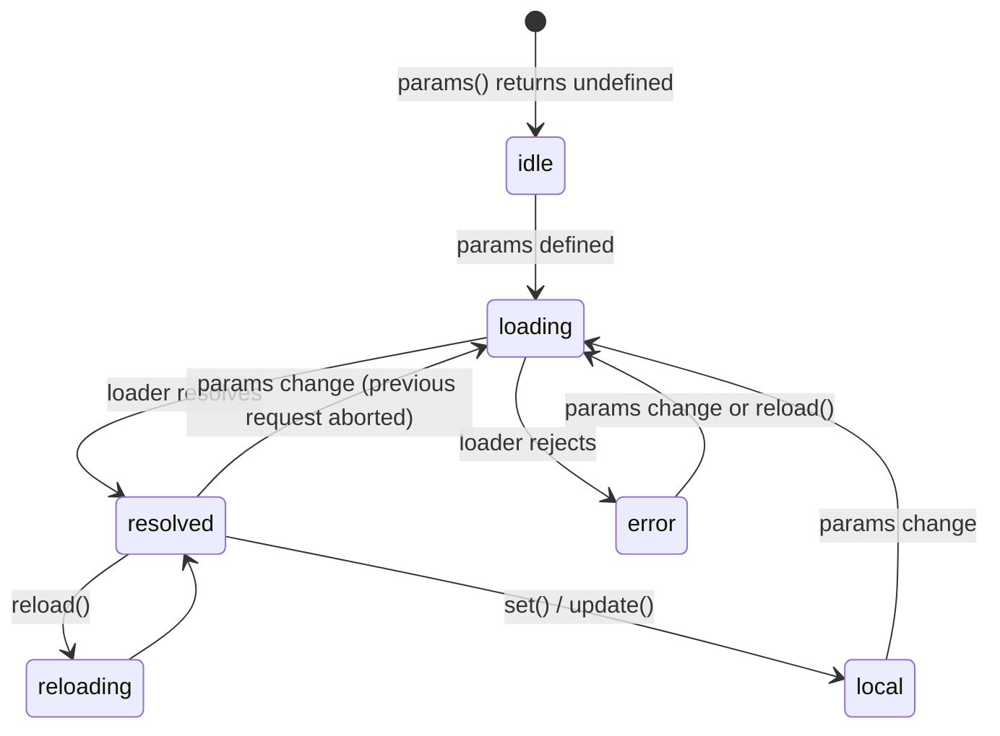

# 57 — Angular Signals, Reactivity and RxJS

> Signals hold the values your templates show. RxJS describes things that happen over time. Most Angular confusion from 2016 to 2024 came from using one tool for both jobs. In 2026 Angular has a clear answer for each, and an architect's work is keeping them in their lanes.

**Prerequisites:** [56 Angular Architecture](56-angular-architecture-and-dependency-injection.md), [28 State and Data Ownership](28-state-and-data-ownership-architecture.md) · **Related:** [26 Forms](26-forms-and-validation.md) · [29 Client State](29-client-state-management.md) · [30 Server State](30-server-state-and-data-fetching.md) · [58 Angular at Scale](58-angular-at-scale.md) · [59 React vs Angular](59-react-vs-angular-architecture-comparison.md)

---

## TL;DR

- **Signals are the state primitive.**
  - `signal` holds a value.
  - `computed` derives one: lazy, memoised, glitch-free.
  - `linkedSignal` is derived *and* writable, so it resets when its source changes.
  - `effect` pushes signal state out to non-signal APIs, and is never used to derive state.
- **Async state is a `Resource`.** `resource`, `rxResource` and `httpResource` became stable in Angular 22. A resource turns reactive params into a value with a status: `idle`, `loading`, `reloading`, `resolved`, `error` or `local`. It aborts stale requests and chains to other resources with `ctx.chain()`.
  - `debounced()` (experimental) settles a signal after a quiet period.
- **A resource is not a cache.** Each instance fetches for itself. When many components need the same server data with stale-while-revalidate and key-based invalidation, use TanStack Query for Angular (`@tanstack/angular-query`, non-experimental since September 2026), or a store.
- **Signal Forms are stable in v22.**
  - The model is a signal and the validation schema is plain code: `required`, `email`, `applyWhen`, `applyEach`, `validateHttp`, Standard Schema.
  - Templates bind with `[formField]`, and `submit()` maps server errors onto fields.
  - Reactive Forms remain supported, with a compat bridge.
- **RxJS keeps the jobs signals are bad at:** events over time, cancellation and concurrency (`switchMap`, `exhaustMap`), retries with backoff, WebSockets, and combining streams. Convert to a signal at the edge (`toSignal`), and keep `subscribe()` out of components.
- **State management, smallest first:**
  1. Component signals.
  2. A service with signals.
  3. An NgRx SignalStore for a feature with real transitions.
  4. NgRx Store (Redux) for large event-sourced domains that already use it.

  All the code in this chapter was compiled and tested on Angular 22.3 and `@ngrx/signals` 22.0.1: 13 Vitest tests, green.

---

## 1. The primitives

### 1.1 `signal`, `computed`, `linkedSignal`, `effect`

```ts
// reactivity/invoice-filters.ts: synchronous state as signals; derived state as computed; resets as linkedSignal
import { computed, effect, linkedSignal, Service, signal } from '@angular/core';
import { InvoiceStatus } from '../features/invoices/invoice.model';

export type StatusFilter = InvoiceStatus | 'all';

@Service({ autoProvided: false })
export class InvoiceFilters {
  readonly status = signal<StatusFilter>(readSaved()?.status ?? 'all');
  readonly query = signal('');

  // Writable, but resets to 1 whenever status or query change
  readonly page = linkedSignal({ source: () => [this.status(), this.query()] as const, computation: () => 1 });

  readonly params = computed(() => ({ status: this.status(), q: this.query().trim(), page: this.page() }));
  readonly isFiltered = computed(() => this.status() !== 'all' || this.params().q !== '');

  // An effect syncs signal state to a non-signal API (storage). It never derives state.
  private readonly persist = effect(() => {
    try { localStorage.setItem('invoice-filters', JSON.stringify({ status: this.status() })); } catch { /* private mode */ }
  });

  reset() { this.status.set('all'); this.query.set(''); }
}
```

| Primitive | Semantics | Use for | Don't use for |
|---|---|---|---|
| `signal(v)` | Writable value; notifies readers on change (`Object.is` by default, or `equal`) | Source state | Values derivable from other signals |
| `computed(fn)` | Read-only; lazy; recomputes only when a dependency changed; never sees inconsistent intermediate states | Derived state, filtering, formatting | Side effects; async work |
| `linkedSignal(...)` | Derived *and* writable; recomputed when its source changes, overridable in between | "Reset when the source changes": page number, selected item, editable copy of an input | Plain derivation (use `computed`) |
| `effect(fn)` | Runs after its dependencies change, scheduled with change detection; `onCleanup` for teardown | Syncing to non-signal APIs: storage, analytics, imperative widgets, logging | Setting other signals to "keep them in sync". That's `computed` or `linkedSignal` |
| `afterRenderEffect(...)` | Like `effect`, but after the DOM has rendered, in read/write phases | Measuring layout, driving canvas or chart libraries | Anything that must run on the server (it doesn't) |
| `untracked(fn)` | Reads without subscribing | Reading configuration or logging inside `computed`/`effect` | Hiding a dependency you actually need |

The test suite checks `linkedSignal`'s contract: set `page` to 3, change the status, and it's back to 1.

> [!IMPORTANT]
> **An effect that writes signals is a design smell.** It works, but it makes data flow implicit: A changes, an effect notices, B changes, a template re-renders a second time. Almost every such effect is a `computed` (B is a function of A) or a `linkedSignal` (B defaults from A but can be edited). Keep effects for leaving the signal world.

### 1.2 Signals in the component API

Inputs are signals (`input()`, `input.required()`), two-way bindings are `model()`, and queries (`viewChild`, `contentChildren`) are signals. Derived values from inputs are just `computed`. There's no `ngOnChanges` bookkeeping:

```ts
export class InvoiceTotals {
  readonly lines = input.required<readonly InvoiceLine[]>();
  readonly currency = input('EUR');
  protected readonly totalMinor = computed(() =>
    this.lines().reduce((sum, l) => sum + l.quantity * l.unitPriceMinor, 0));
}
```

Because OnPush is the default and templates read signals, a component like this re-renders exactly when `lines` or `currency` change ([56](56-angular-architecture-and-dependency-injection.md)).

---

## 2. Async state: resources

### 2.1 The model



A resource takes a reactive `params` function and an async `loader` (a Promise), `stream` (a signal of values), or for `rxResource`, an Observable `stream`. The loader receives `{ params, abortSignal, previous }`. When params change mid-flight, Angular aborts the previous `abortSignal`. The test confirms it: the first request's signal is `aborted` the moment the id changes, and the resource then resolves with the second value.

| Member | Meaning |
|---|---|
| `value()` | The current value; **throws** in `error` status, so check `hasValue()` or `error()` first |
| `status()` | `'idle' \| 'loading' \| 'reloading' \| 'resolved' \| 'error' \| 'local'` |
| `isLoading()`, `error()`, `hasValue()` | Convenience signals for templates |
| `set()`, `update()` | Local writes (optimistic UI); status becomes `local` |
| `reload()` | Re-run the loader with the same params |
| `snapshot()` | The full state as one value, for composition |
| `defaultValue` (option) | What `value()` returns while loading or in error, instead of `undefined` |
| `id` (option) | A TransferState key, so a value fetched during SSR isn't fetched again in the browser |

### 2.2 `httpResource`, chaining and debouncing

```ts
// reactivity/invoice-search.ts: debounced input → chained HTTP resource; no subscriptions to manage
import { CurrencyPipe } from '@angular/common';
import { httpResource } from '@angular/common/http';
import { Component, debounced, inject } from '@angular/core';
import { InvoiceApi } from '../features/invoices/invoice-api';
import { InvoicePage } from '../features/invoices/invoice.model';
import { InvoiceFilters, StatusFilter } from './invoice-filters';

@Component({
  selector: 'app-invoice-search',
  imports: [CurrencyPipe],
  providers: [InvoiceFilters],
  template: `
    <label for="q">Search</label>
    <input id="q" type="search" [value]="filters.query()" (input)="filters.query.set($any($event.target).value)" />
    <select aria-label="Status" [value]="filters.status()" (change)="filters.status.set($any($event.target).value)">
      <option value="all">All</option><option value="open">Open</option><option value="paid">Paid</option><option value="void">Void</option>
    </select>

    @switch (results.status()) {
      @case ('error') { <p role="alert">Search failed. <button type="button" (click)="results.reload()">Retry</button></p> }
      @default {
        <p aria-live="polite">{{ results.isLoading() ? 'Searching…' : (results.value()?.total ?? 0) + ' results' }}</p>
        <ul [attr.aria-busy]="results.isLoading()">
          @for (inv of results.value()?.items ?? []; track inv.id) {
            <li>{{ inv.number }} · {{ inv.customer }} · {{ inv.totalMinor / 100 | currency: inv.currency }}</li>
          }
        </ul>
        <button type="button" (click)="filters.page.set(filters.page() + 1)">Next page</button>
      }
    }
  `,
})
export class InvoiceSearch {
  protected readonly filters = inject(InvoiceFilters);
  private readonly api = inject(InvoiceApi);

  // Experimental (22.0): a Resource that settles 300 ms after the last keystroke
  private readonly settledQuery = debounced(() => this.filters.params().q, 300);

  protected readonly results = httpResource<InvoicePage>(({ chain }) => ({
    url: this.api.url(),
    params: {
      q: chain(this.settledQuery),             // while the debounce is pending, this resource is 'loading'
      page: this.filters.page(),
      ...statusParam(this.filters.status()),
    },
  }), { defaultValue: { total: 0, items: [] } });
}
```

What this replaces: a `Subject`, `debounceTime`, `distinctUntilChanged`, `switchMap`, `catchError`, a loading flag, an error flag, `takeUntilDestroyed`, and the bugs between them. What each piece does:

- **`httpResource`** goes through `HttpClient`, so interceptors, the XSRF token, testing and SSR transfer caching all apply. Sub-functions (`httpResource.text`, `.blob`, `.arrayBuffer`) parse other response types. The ref also exposes `headers()`, `statusCode()` and `progress()`.
- **`ctx.chain(other)`** returns the other resource's value when it's `resolved` or `local`. Otherwise it throws a status code that puts *this* resource into `loading` (or `idle`, or `error` with a `ResourceDependencyError`). The test shows a dependent resource staying `loading` until its dependency resolves. Use it from the params context: the standalone `chain` export is private (`ɵchain`). Its return type is the dependency's value type, which includes `undefined` unless the dependency has a `defaultValue`.
- **`debounced(source, wait)`** returns a `Resource` that is `loading` during the quiet period. It is experimental in 22.x, so wrap it in one helper so a rename is a one-line change.

> [!WARNING]
> **A resource is not a cache.** Two components with the same `httpResource` URL make two requests. There's no deduplication, no stale-while-revalidate across navigations, and no invalidation by key. The only exception is the SSR transfer cache during hydration. For shared server state, either lift the resource into a service that both components inject, or use a query library: `@tanstack/angular-query` (`injectQuery`, `injectMutation`) gives Angular the same cache model as TanStack Query in React ([30](30-server-state-and-data-fetching.md)).

### 2.3 Mutations

Resources are for reads. For writes, call the API, then reconcile:

- **Optimistic:** `resource.set(predicted)` → call → `resource.set(saved)` on success, roll back on failure.
- **Pessimistic:** call → `resource.reload()` (or `set(saved)`).
- **Concurrency:** for "the last click wins" or "ignore clicks while saving", an RxJS operator (`switchMap`, `exhaustMap`) or NgRx `rxMethod` states the policy in one word (section 5).

Write requests that may be retried need an idempotency key ([33](33-api-integration-bff-and-contracts.md)).

### 2.4 Router resources (developer preview)

Angular 22.2 added `resources` on route definitions: `provideRouter(routes, withRouterResources())`. The router starts a route's resources during navigation, and children can read their ancestors' resources. It waits for them unless they're wrapped in `nonBlocking()`. It's the Angular counterpart of route loaders ([31](31-routing-architecture.md)), and it's still a preview. Adopt it in one feature behind a wrapper, and keep component-level resources as the default until it stabilises.

---

## 3. Signal Forms

### 3.1 Model, schema, template

Signal Forms (stable in v22, `@angular/forms/signals`) invert the Reactive Forms design. The data model is a signal you own. The form is a typed tree of fields derived from it. Validation and conditional logic are functions in a schema:

```ts
// reactivity/create-invoice-form.ts: Signal Forms. The model is a signal; the schema is code
import { HttpErrorResponse } from '@angular/common/http';
import { Component, inject, signal } from '@angular/core';
import {
  applyEach, applyWhen, email, form, FormField, FormRoot, hidden, maxLength, min, minDate, required, validate,
} from '@angular/forms/signals';
import { firstValueFrom } from 'rxjs';
import { InvoiceApi } from '../features/invoices/invoice-api';

export interface InvoiceLine { description: string; quantity: number; unitPriceMinor: number }
export interface InvoiceDraft {
  customer: { name: string; email: string; type: 'smb' | 'enterprise'; poNumber: string };
  dueDate: Date;
  lines: InvoiceLine[];
  notes: string;
}

export const emptyDraft = (): InvoiceDraft => ({
  customer: { name: '', email: '', type: 'smb', poNumber: '' },
  dueDate: new Date(Date.now() + 30 * 864e5),
  lines: [{ description: '', quantity: 1, unitPriceMinor: 0 }],
  notes: '',
});

export function createInvoiceForm(model = signal(emptyDraft()), api = inject(InvoiceApi)) {
  return form(model, (p) => {
    required(p.customer.name, { message: 'Customer name is required' });
    required(p.customer.email, { message: 'Billing email is required' });
    email(p.customer.email, { message: 'Enter a valid email address' });
    hidden(p.customer.poNumber, { when: ({ valueOf }) => valueOf(p.customer.type) !== 'enterprise' });
    applyWhen(p.customer, ({ value }) => value().type === 'enterprise', (c) => {
      required(c.poNumber, { message: 'Enterprise customers need a PO number' });
    });
    minDate(p.dueDate, () => startOfToday(), { message: 'The due date cannot be in the past' });
    validate(p.lines, ({ value }) => (value().length === 0 ? { kind: 'noLines', message: 'Add at least one line' } : undefined));
    applyEach(p.lines, (line) => {
      required(line.description, { message: 'Describe the line item' });
      min(line.quantity, 1, { message: 'Quantity must be at least 1' });
      min(line.unitPriceMinor, 0);
    });
    maxLength(p.notes, 500);
  }, {
    submission: {
      action: async (f) => {
        try {
          await firstValueFrom(api.create(f().value()));
          return undefined;                                       // success: no errors
        } catch (e) {
          if (e instanceof HttpErrorResponse && e.status === 409) {
            return { fieldTree: f.customer.poNumber, kind: 'duplicate', message: 'This PO number was already invoiced' };
          }
          throw e;                                                // unexpected: let the error handler see it
        }
      },
    },
  });
}
```

```html
<form [formRoot]="invoiceForm" novalidate>
  <label for="name">Customer</label>
  <input id="name" [formField]="invoiceForm.customer.name" />
  @for (e of invoiceForm.customer.name().errors(); track e.kind) { <p class="error">{{ e.message }}</p> }

  @if (!invoiceForm.customer.poNumber().hidden()) {
    <label for="po">PO number</label>
    <input id="po" [formField]="invoiceForm.customer.poNumber" />
  }

  @for (line of invoiceForm.lines; track $index) {
    <fieldset>
      <legend>Line {{ $index + 1 }}</legend>
      <input aria-label="Description" [formField]="line.description" />
      <input aria-label="Quantity" type="number" [formField]="line.quantity" />
    </fieldset>
  }
  <button type="submit" [disabled]="invoiceForm().submitting()">Create invoice</button>
</form>
```

The key ideas:

- **The form is the model's shape.** `invoiceForm.customer.poNumber` is a typed field. Call it to get its state: `value`, `errors`, `valid`, `pending`, `touched`, `dirty`, `disabled`, `hidden`, `readonly`, `required`, `submitting`. A typo in a path is a compile error, not a runtime `null`.
- **Logic is declarative and reactive.**
  - `applyWhen` scopes rules to a condition.
  - `applyEach` applies a schema to every array item.
  - `hidden`/`disabled`/`readonly` take `{ when }`. Passing a bare function is deprecated.
  - Hidden and disabled fields don't contribute to validity.
- **`[formField]` binds native inputs and custom controls.** Custom controls implement `FormValueControl` (a `value = model()`), so there's no `ControlValueAccessor`. `form[formRoot]` handles `submit`: it prevents the default and calls `submit()` with the form's `submission` options.
- **Server errors are first-class.** The `action` returns errors addressed to fields (`fieldTree: f.customer.poNumber`), and they appear in that field's `errors()`. Concurrent submits are refused, and `submit()` resolves `false` when validation fails or the action returns errors.

The tests cover the three behaviours that matter:

1. An empty draft is invalid, and `submit()` resolves `false` **without an HTTP request**.
2. Switching the customer to `enterprise` reveals `poNumber`, and it becomes `required`.
3. A `409` from the server surfaces as `{ kind: 'duplicate', … }` on the PO field.

### 3.2 Beyond the basics

| Need | API |
|---|---|
| Async, server-side validation (username taken) | `validateAsync`, or `validateHttp(path, { request, onSuccess, onError, debounce })`, which runs an `httpResource` and sets the field's `pending()` state |
| Reuse a Zod/Valibot schema shared with the server | `validateStandardSchema(path, schema)` ([26](26-forms-and-validation.md)) |
| Cross-field rules (end after start) | `validate` on the parent path, reading children with `valueOf` |
| Reusable rule sets | `schema(fn)` + `apply(path, schema)` |
| Debounce validation | `debounce(path, ms)` |
| Migrating a Reactive Forms app | `@angular/forms/signals/compat`, so existing `FormControl`s can live inside a Signal Form during the transition |
| Expose a form to in-browser AI agents | `experimentalWebMcpTool` option / `provideExperimentalWebMcpForms()`. Experimental; review what the tool can submit ([65](65-ai-powered-react-interfaces.md)) |

> [!NOTE]
> **Reactive Forms in a zoneless app.** `setValue`/`patchValue` update form state and emit observables, but they don't schedule a view refresh on their own. A template that renders `form.value` from a plain getter can go stale. Read form state through `toSignal(control.valueChanges)` or the `async` pipe, or move the form to Signal Forms ([56](56-angular-architecture-and-dependency-injection.md)).

---

## 4. RxJS: what it's still for

### 4.1 The division of labour

| Job | Use | Why |
|---|---|---|
| Current value of something (state) | Signal | Synchronous reads, fine-grained template updates |
| A value derived from state | `computed` | Memoised, no subscriptions |
| A value loaded from the server for some params | `resource` / `httpResource` / `rxResource` | Status, cancellation, chaining built in |
| **Events over time:** keystrokes as a stream, WebSocket messages, drag gestures | RxJS | Time is part of the meaning |
| **Concurrency policy:** cancel previous, ignore while busy, queue | `switchMap` / `exhaustMap` / `concatMap` | One operator states a policy that would be 20 lines of flags |
| Retry with backoff, timeouts, polling | `retry({ delay })`, `timeout`, `timer` | Composable, testable with marbles |
| Combining several async sources | `combineLatest`, `merge`, `withLatestFrom` | Explicit about ordering |

### 4.2 Interop at the edges

```ts
// reactivity/invoice-events.ts: events over time stay RxJS; the latest state becomes a signal at the edge
import { computed, inject, Service } from '@angular/core';
import { toSignal } from '@angular/core/rxjs-interop';
import { retry, scan, share, timer } from 'rxjs';
import { webSocket } from 'rxjs/webSocket';
import { APP_CONFIG } from '../core/app-config';

export type InvoiceEvent = { type: 'invoice.paid' | 'invoice.voided'; invoiceId: string; at: string };

@Service()
export class InvoiceEvents {
  private readonly url = inject(APP_CONFIG).apiBaseUrl.replace(/^http/, 'ws') + '/events';

  readonly events$ = webSocket<InvoiceEvent>(this.url).pipe(
    retry({ delay: (_err, attempt) => timer(Math.min(1000 * 2 ** attempt, 30_000) + Math.random() * 500) }), // backoff + jitter
    share(),                                               // one socket, however many subscribers
  );

  /** The 20 most recent events, as a signal for templates. Subscribes for the app's lifetime. */
  readonly recent = toSignal(
    this.events$.pipe(scan((acc, e) => [e, ...acc].slice(0, 20), [] as InvoiceEvent[])),
    { initialValue: [] },
  );
  readonly unreadCount = computed(() => this.recent().length);
}
```

| API | Direction | Notes |
|---|---|---|
| `toSignal(obs, { initialValue })` | Observable → Signal | Subscribes **immediately**, unsubscribes when its injection context is destroyed; `requireSync: true` for sources that emit synchronously (BehaviorSubject) |
| `toObservable(signal)` | Signal → Observable | Emits via an effect, so values arrive asynchronously and intermediate sets are coalesced |
| `rxResource({ params, stream })` | Observable-based resource | For APIs that return Observables (`HttpClient`, Firebase, sockets) |
| `takeUntilDestroyed()` | Lifecycle | For the rare manual `subscribe()` in a component or service |
| `outputFromObservable(obs)` / `outputToObservable(output)` | Outputs | Bridge component events and streams |
| `pendingUntilEvent()` | SSR stability | Keeps the app "unstable" until the stream emits, so SSR waits for it (developer preview) |

The rules I hold teams to:

- **No `subscribe()` in components** except with `takeUntilDestroyed()`, and preferably not at all.
- **No `BehaviorSubject` as component state.** That's a signal now.
- **Streams live in services; signals cross into templates.**
- **`toSignal` in a root service subscribes for the app's lifetime.** Fine for app-wide feeds. In a component, it ends when the component is destroyed.

---

## 5. State management

### 5.1 The ladder

| Rung | Shape | Use when |
|---|---|---|
| 1. Component signals | `signal`/`computed` fields | State used by one component and its children (via inputs) |
| 2. Service with signals | `@Service()` with private writable signals, public read-only signals and methods | Shared by a feature or the app; simple transitions |
| 3. NgRx SignalStore | `signalStore(withState, withComputed, withMethods, withEntities, withHooks…)` | A feature with entity collections, async workflows, optimistic updates, or several developers working on it |
| 4. NgRx Store (Redux) | Actions, reducers, effects, selectors | Large apps already on it, or a genuine need for event sourcing and time-travel debugging |
| Server state alongside | `httpResource` per screen, or `@tanstack/angular-query` for a shared cache | Data that lives on the server ([30](30-server-state-and-data-fetching.md)) |

Climb one rung at a time, when the current rung hurts. The most common mistake I see isn't too little state management; it's a global store holding server data that should have been a resource or a query.

### 5.2 A SignalStore for a feature

```ts
// reactivity/invoice-store.ts: NgRx SignalStore for a feature with real state transitions
import { computed, inject } from '@angular/core';
import { patchState, signalStore, withComputed, withHooks, withMethods, withState } from '@ngrx/signals';
import { setAllEntities, updateEntity, withEntities } from '@ngrx/signals/entities';
import { rxMethod } from '@ngrx/signals/rxjs-interop';
import { firstValueFrom, pipe, switchMap, tap } from 'rxjs';
import { HttpClient } from '@angular/common/http';
import { InvoiceApi } from '../features/invoices/invoice-api';
import { Invoice, InvoicePage, InvoiceStatus } from '../features/invoices/invoice.model';

type LoadState = 'idle' | 'loading' | 'loaded' | { error: string };

export const InvoiceStore = signalStore(
  withEntities<Invoice>(),
  withState({ status: 'all' as InvoiceStatus | 'all', load: 'idle' as LoadState }),
  withComputed(({ entities, status }) => ({
    visible: computed(() => (status() === 'all' ? entities() : entities().filter((i) => i.status === status()))),
    openTotalMinor: computed(() => entities().filter((i) => i.status === 'open').reduce((s, i) => s + i.totalMinor, 0)),
  })),
  withMethods((store, http = inject(HttpClient), api = inject(InvoiceApi)) => ({
    setStatus(status: InvoiceStatus | 'all') { patchState(store, { status }); },
    // rxMethod: switchMap cancels the previous request when the trigger fires again
    loadPage: rxMethod<number>(pipe(
      tap(() => patchState(store, { load: 'loading' })),
      switchMap((page) => http.get<InvoicePage>(api.url(), { params: { page } }).pipe(
        tap({
          next: (res) => patchState(store, setAllEntities(res.items), { load: 'loaded' }),
          error: (e: unknown) => patchState(store, { load: { error: String(e) } }),
        }),
      )),
    )),
    async voidInvoice(id: string, reason: string) {
      const before = store.entityMap()[id];
      patchState(store, updateEntity({ id, changes: { status: 'void' } }));       // optimistic
      try {
        const saved = await firstValueFrom(api.void(id, reason));
        patchState(store, updateEntity({ id, changes: saved }));
      } catch (e) {
        if (before) patchState(store, updateEntity({ id, changes: { status: before.status } })); // roll back
        throw e;
      }
    },
  })),
  withHooks({ onInit(store) { store.loadPage(1); } }),
);
```

Provide it on the feature's route (`providers: [InvoiceStore]`) so it's scoped like any other service ([56](56-angular-architecture-and-dependency-injection.md)). The test drives it through `HttpTestingController`: the store loads a page on init, flips the invoice to `void` immediately, gets a `422`, and is back at `open` with the rejection propagated.

What SignalStore adds over a hand-written service:

- **Protected state.** Only the store's methods can patch it; consumers see read-only signals.
- **Composable features.** `withEntities` gives normalised collections with `setAllEntities`, `updateEntity` and friends. You can also write your own `signalStoreFeature`s (pagination, undo, request status) and reuse them across stores.
- **Other building blocks:** `rxMethod` for concurrency policies; `withLinkedState`, `withProps` and `signalMethod` for the cases in between; and an events plugin (`@ngrx/signals/events`) when a feature wants Redux-style events without the full Store.

---

## Decision framework

**Problem.** Which reactive primitive or state tool should hold this piece of state or logic?

**Constraints.** Is it synchronous state or an event stream? Is it local or shared? Is it server data or client data? Does it need cancellation or concurrency policy? Does it need SSR transfer? Does it need offline or optimistic behaviour? Team familiarity with RxJS?

| Situation | Choose |
|---|---|
| A value one component owns | `signal` |
| A value computed from others | `computed` |
| A default that follows a source but can be overridden | `linkedSignal` |
| Mirror state into storage, analytics or a non-Angular widget | `effect` (`afterRenderEffect` for DOM) |
| Server data for the current params, one screen | `httpResource` / `resource` (+ `id` for SSR transfer) |
| Server data shared across screens, with cache and invalidation | `@tanstack/angular-query`, or a store wrapping resources |
| Input that should settle before querying | `debounced()` (experimental) or RxJS `debounceTime` in a service |
| WebSockets, event streams, retries, polling | RxJS in a service → `toSignal` at the edge |
| Forms, new | Signal Forms |
| Forms, existing Reactive Forms | Keep; bridge with `toSignal` in zoneless apps; migrate via `signals/compat` when touched |
| Feature state with collections and workflows | NgRx SignalStore |
| Existing NgRx Store app | Keep for its domain; new features may use SignalStore |

**Criteria.** Prefer the primitive whose semantics match the problem (state, derivation, event stream). Prefer the lowest rung of the state ladder that handles current needs. Prefer stable APIs on critical paths: `debounced` and router resources are still experimental or preview.

**Failure modes.**

- Effects used to sync signals into other signals.
- `BehaviorSubject` plus `subscribe()` in components.
- Treating `httpResource` as a cache.
- Reading `value()` of a resource in error status (it throws).
- `toSignal` without `initialValue` producing `undefined` flicker.
- A global store full of server data.
- Reactive Forms state rendered from getters in zoneless apps.

**Migration path.** Run the signal schematics first: `ng generate @angular/core:signal-input-migration`, `signal-queries-migration` and `output-migration`, or the combined `@angular/core:signals`. Then:

- `BehaviorSubject` state becomes signals.
- Hand-rolled loading flags become resources.
- Reactive Forms become Signal Forms one form at a time.
- Stores become SignalStore where a feature is rewritten.

Each step stands on its own.

---

## Pitfalls and anti-patterns

- **`effect(() => this.b.set(this.a() * 2))`.** That's `computed`. Effects that write signals create extra render passes and hidden data flow.
- **Reading `resource.value()` without checking status.** In `error` status it throws. Use `hasValue()`, or a `defaultValue`.
- **Assuming two `httpResource`s with the same URL share data.** They don't. Lift the resource into a service or use a query cache.
- **Calling `debounced()`, `withRouterResources()` or `@boundary` stable.** They're experimental or developer preview in 22.x. Wrap them.
- **`toSignal(obs)` with no `initialValue`** on an async source. The template sees `undefined` first. Provide a value, or `requireSync` for synchronous sources.
- **`toSignal` inside a method.** It needs an injection context and creates a new subscription per call.
- **Signal Forms errors without messages.** Built-in validators report a `kind`; give users a `message`, and keep the error list accessible (associated with the input via `aria-describedby`) ([36](36-accessibility-engineering.md)).
- **Putting every piece of server data in a SignalStore.** Server data has a lifecycle (stale, refetch, invalidate) that resources and query caches already model.
- **Nested `subscribe()` calls** instead of `switchMap`, which leaves race conditions and leaked subscriptions.

---

## Architect's checklist

- [ ] Template state is signals; derived values are `computed`; resets are `linkedSignal`
- [ ] Effects only leave the signal world (storage, analytics, imperative widgets); a lint rule or review flags effects that `set()` signals
- [ ] Reads use `httpResource`/`resource` with status-aware templates; SSR-fetched resources have an `id` or rely on the HTTP transfer cache
- [ ] Shared server state has a single owner: a service-level resource or `@tanstack/angular-query`
- [ ] Mutations state their concurrency policy (`switchMap`/`exhaustMap`/`rxMethod`) and send idempotency keys where retried
- [ ] New forms use Signal Forms with messages on every validator; server errors map to fields
- [ ] Reactive Forms in zoneless apps read state through signals or the `async` pipe
- [ ] RxJS lives in services; components have no bare `subscribe()`
- [ ] Experimental and preview APIs (`debounced`, router resources, `@boundary`, WebMCP) are wrapped and tracked
- [ ] The state ladder is documented: which features use services, SignalStore or Store, and why

---

## Interview angles

**Q1. When would you use `linkedSignal` instead of `computed` or `effect`?**
When a value should default from a source but remain editable: a page number that resets when filters change, a selected item that resets when the list changes, an editable draft of an input. `computed` can't be written to. An effect that sets a signal would work, but it adds an extra change-detection pass and hides the data flow. `linkedSignal` expresses "derived until overridden" directly.

**Q2. Explain how `resource` handles race conditions.**
The loader receives an `AbortSignal`. When the params signal changes while a load is in flight, Angular aborts the previous signal and starts a new load, so a slow earlier response can't overwrite a newer one. Passing the abort signal to `fetch` (or using `httpResource`, which cancels via `HttpClient`) also cancels the network request. Status moves through `loading`, `resolved` or `error`, `reloading`, and `local` after a manual `set()`. Dependent resources can chain with `ctx.chain()` and stay `loading` until their dependency resolves.

**Q3. Is RxJS still needed in a signals-based Angular app?**
Yes, for what it's good at: events over time, concurrency policy, retries with backoff, polling, WebSockets, and combining asynchronous sources. Signals are for state: the current value of things. The boundary is usually a service that owns a stream and exposes a signal via `toSignal`, or an `rxResource`/`rxMethod` that applies an operator such as `switchMap`. What goes away is RxJS as a state container: `BehaviorSubject` fields and `subscribe()` in components.

**Q4. How do Signal Forms differ from Reactive Forms, and how would you migrate?**
Reactive Forms own the data inside a tree of `FormControl` objects and expose it through observables. Signal Forms leave the data in a signal you own and derive a typed field tree from it. Validation and conditional logic (`required`, `applyWhen`, `applyEach`, `validateHttp`, Standard Schema) are declared in a schema function. Templates bind with `[formField]`, custom controls just expose a `model()`, and `submit()` maps server errors onto fields. To migrate, I'd write new forms with Signal Forms and move existing ones when they're next changed, using the compat entry point to embed existing controls during the transition. In zoneless apps I'd fix Reactive Forms rendering first, by reading through signals.

**Q5. A team put all API data into an NgRx Store with effects. What would you change?**
I'd separate server state from client state. Server data has its own lifecycle (freshness, refetching, invalidation, deduplication), which resources or a query cache model directly. Keeping it in a global store means hand-writing that lifecycle in effects and reducers. I'd move read paths to `httpResource` per screen, or `@tanstack/angular-query` where data is shared. Genuine client state (filters, selections, workflows) stays in a SignalStore or the existing Store. Then I'd delete effects as their data moves. The store gets smaller and more meaningful.

---

## Further reading

- Angular docs, *Signals*: <https://angular.dev/guide/signals> · *linkedSignal*: <https://angular.dev/guide/signals/linked-signal> · *Effects*: <https://angular.dev/guide/signals/effect>
- Angular docs, *Async reactivity with resources*: <https://angular.dev/guide/signals/resource> · *Reactive data fetching with httpResource*: <https://angular.dev/guide/http/http-resource>
- Angular docs, *Signal Forms*: <https://angular.dev/guide/forms/signals/overview> · *Form submission*: <https://angular.dev/guide/forms/signals/form-submission>
- Angular docs, *Signals interop* (RxJS): <https://angular.dev/ecosystem/rxjs-interop>
- NgRx docs, *SignalStore*: <https://ngrx.io/guide/signals/signal-store> · TanStack Query for Angular: <https://tanstack.com/query/latest/docs/framework/angular/overview>

---

[← Previous: 56 — Angular Architecture and Dependency Injection](56-angular-architecture-and-dependency-injection.md) · [Index](README.md) · [Next: 58 — Angular at Scale →](58-angular-at-scale.md)
