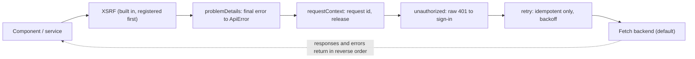
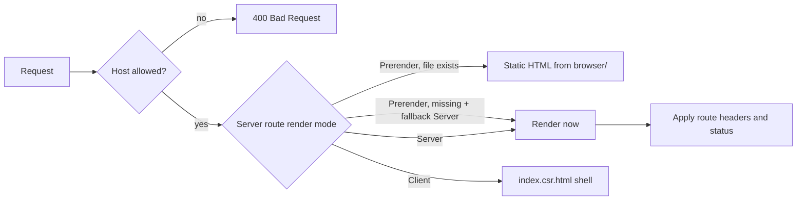

# 58 — Angular at Scale

> Small Angular apps are easy to get right. At scale the decisions that compound are what loads first, what renders where, what runs in CI, and how you move to the next major without stopping product work. Angular has a built-in answer for each of them, and most of an architect's job is making sure the team actually uses it.

**Prerequisites:** [56 Angular Architecture](56-angular-architecture-and-dependency-injection.md), [57 Angular Signals](57-angular-signals-reactivity-and-rxjs.md) · **Related:** [17 SSR and Hydration](17-ssr-streaming-and-hydration.md) · [32 Rendering Strategy](32-rendering-strategy-architecture.md) · [39 Web Performance](39-web-performance-and-core-web-vitals.md) · [42 Testing](42-testing-architecture.md) · [43 Security](43-frontend-security-architecture.md) · [60 Monorepos](60-monorepos-build-tooling-and-bundlers.md) · [61 Micro-frontends](61-micro-frontends-and-module-federation.md)

---

## TL;DR

- **Routing.** Use lazy `loadChildren`/`loadComponent` everywhere, and `canMatch` so navigation never loads a feature the user can't open. Then layer on:
  - component input binding;
  - a preloading strategy that respects Save-Data *and permissions*: the preloader ignores `canMatch`, which I confirmed with a test;
  - View Transitions;
  - scroll restoration;
  - `withAutoCleanupInjectors()` (stable since 22.2).

  Router resources and router error boundaries are useful but still in developer preview.
- **HTTP.** Order the interceptors deliberately. Error mapping goes first, so it sees the final error. Retry goes last, so it sees raw status codes. Put error mapping inside retry and retries silently stop, which I also demonstrated in a test. Retries apply only to idempotent requests, with per-request overrides through `HttpContextToken`. XSRF protection is built in for same-origin mutations. Two 2025–26 advisories against it are a reason to stay on patched releases.
- **Rendering per route** with `app.routes.server.ts`:
  - `Prerender` for public pages, with `getPrerenderParams` and an on-demand fallback for new slugs.
  - `Server` for per-request HTML, with headers and status codes declared per route.
  - `Client` for personalised pages with no SEO value.

  I built and probed all three.
- **Hydration in v22.** Full hydration, incremental hydration (`@defer (…; hydrate on interaction)`) and event replay are all on by default. Clicks on not-yet-hydrated content are replayed, which I verified in headless Chromium.
- **SSR security is configuration, plus prompt patching.**
  - `security.allowedHosts`: unknown `Host` headers get a 400, which closes an SSRF hole. At least seven Angular SSR and HTTP advisories between November 2025 and October 2026 were URL-parsing and header-trust bugs of this kind (§3.5).
  - `autoCsp` gives you a hash-based CSP, but it can't be combined with SSR.
  - For SSR, use a per-request nonce. The server must stamp it on build-time scripts, and on every script and style tag of a prerendered page, which never saw a nonce.

  My strict-CSP setup ran with zero violations on prerendered and server-rendered pages, but only after I fixed a blocked stylesheet the first version missed.
- **Testing.** Vitest is the default runner (jsdom, or real browsers via the `browsers` option). Combine it with TestBed, `RouterTestingHarness`, `HttpTestingController`, component harnesses and Playwright for E2E. `refactor-jasmine-vitest` migrates existing Jasmine specs.
- **Scale tooling.** Nx 24 for monorepos and enforced boundaries. Native Federation (esbuild plus import maps) when independent deployment is a genuine requirement. Angular Aria and the CDK under your design system.
- **Upgrades.** One major a year, each supported for 24 months. Upgrade in the first minor or two after a major lands, one major at a time, with the ecosystem aligned (Material, NgRx, Nx, Federation all ship matching majors).

---

## 1. Routing at scale

### 1.1 A production router configuration

```ts
// core/router-config.ts: router features for a large app, in one place
import { provideRouter, withAutoCleanupInjectors, withComponentInputBinding, withInMemoryScrolling, withPreloading, withViewTransitions } from '@angular/router';
import { routes } from '../app.routes';
import { LikelyNextPreloading } from './preloading';

export const routerProviders = provideRouter(
  routes,
  withComponentInputBinding(),                                   // params, query params and data as inputs
  withInMemoryScrolling({ scrollPositionRestoration: 'enabled', anchorScrolling: 'enabled' }),
  withViewTransitions({ skipInitialTransition: true }),          // cross-fade between pages where supported
  withPreloading(LikelyNextPreloading),
  withAutoCleanupInjectors(),                                    // route-scoped services die with their route
);
```

There's a trap in how preloading and guards interact. `canMatch` stops a route from matching, so *navigation* never loads a feature the user can't open. The preloader, though, doesn't run guards. In the 22.3 source, only the deprecated `canLoad` stops a route from being preloaded. I tested it: with `PreloadAllModules`, a `canMatch`-gated feature was downloaded for a user the guard would refuse. That's wasted bytes, and it also proves the point from [56](56-angular-architecture-and-dependency-injection.md): lazy chunks are public files. Never put secrets in them, and let the API authorise every request.

So a preloading strategy has to check permissions itself:

```ts
// app.routes.ts (excerpt): the gated route says which permission the preloader should check
{
  path: 'invoices',
  canMatch: [requirePermission('invoice:read')],      // navigation never loads the chunk without the permission
  loadChildren: () => import('./features/invoices/invoices.routes').then((m) => m.INVOICE_ROUTES),
  data: { preload: true, permission: 'invoice:read' }, // preloading ignores canMatch: the strategy checks this
},
```

```ts
// core/preloading.ts: preload what users are likely to need, unless the network or their permissions say not to
import { inject, Service } from '@angular/core';
import { PreloadingStrategy, Route } from '@angular/router';
import { EMPTY, Observable, timer, switchMap } from 'rxjs';
import { AuthSession } from './auth-session';

type NetworkInformationLike = { saveData?: boolean; effectiveType?: string };

@Service()
export class LikelyNextPreloading implements PreloadingStrategy {
  private readonly session = inject(AuthSession);

  preload(route: Route, load: () => Observable<unknown>): Observable<unknown> {
    const conn = (navigator as Navigator & { connection?: NetworkInformationLike }).connection;
    const constrained = conn?.saveData || /(^|-)2g$/.test(conn?.effectiveType ?? '');
    if (constrained || route.data?.['preload'] !== true) return EMPTY;
    // The preloader ignores canMatch, so gated routes declare their permission and we check it here
    const permission = route.data?.['permission'] as string | undefined;
    if (route.canMatch?.length && (!permission || !this.session.can(permission))) return EMPTY;
    return timer(2_000).pipe(switchMap(load));        // after first paint has settled
  }
}
```

Three tests (`preloading.spec.ts`) pin this down:

- `PreloadAllModules` loads the gated feature for a refused user.
- `LikelyNextPreloading` doesn't load it in five seconds for a user without the permission.
- For a user with the permission, it loads at the two-second mark and not before.

In a test you start the preloader yourself with `TestBed.inject(RouterPreloader).setUpPreloading()`, because TestBed doesn't run the bootstrap listener that normally does it. A gated route that doesn't declare its permission is never preloaded, which is the safe default. `PreloadAllModules` is fine for a twenty-route app with no gated features. For a two-hundred-route one it's wasteful, and for one with gated features it's wrong.

### 1.2 Route-level features worth knowing

| Feature | Status (22.3) | What it does |
|---|---|---|
| `title` on routes + a custom `TitleStrategy` | Stable | Consistent `<title>` ("Invoice INV-1 · Acme") from one place; announce page changes for screen readers ([36](36-accessibility-engineering.md)) |
| `redirectTo` as a function, `RedirectCommand` | Stable | Redirects that read params or query, or that come from guards and resolvers with navigation options |
| Route `providers` | Stable | Feature-scoped DI ([56](56-angular-architecture-and-dependency-injection.md)) |
| `withAutoCleanupInjectors()` | Stable (22.2) | Destroys route injectors when the route is no longer active or stored |
| `resources` on routes + `withRouterResources()`, `nonBlocking()` | Developer preview (22.2) | Route-level data loading with resources; navigation waits unless `nonBlocking` |
| `errorComponent` + `withErrorBoundaries()` | Developer preview (22.3) | The outlet renders a route's `errorComponent` when its component throws |
| `withViewTransitions()` | Stable | Uses the View Transitions API on navigation ([24](24-animation-and-motion-systems.md)) |

Resolvers still work, but they block navigation until data arrives. For new code, prefer loading in the component with `httpResource`, which streams state into the page ([57](57-angular-signals-reactivity-and-rxjs.md)). Use router resources once they stabilise.

---

## 2. HTTP at scale

### 2.1 The interceptor pipeline, and why order matters



`withInterceptors([a, b, c])` sends requests through `a`, `b`, `c` and then the backend. Responses and errors come back through `c`, `b`, `a`. `provideHttpClient()` registers Angular's own XSRF interceptor ahead of yours. Two behaviours decide the order. I wrote tests for both, because my first draft of this section got the second one wrong.

1. **Errors travel outward.** An interceptor sees an error only after everything after it has handled it. So the interceptor that turns `HttpErrorResponse` into your UI's error type has to come *first*. Put it after retry and retries silently stop. Retry then sees an `ApiError` instead of an `HttpErrorResponse`, doesn't recognise it as retryable, and gives up on the first 503.
2. **A retry re-subscribes; it doesn't re-run interceptors.** Calling `next(req)` runs the next interceptor straight away and hands back an Observable. When `retry` re-subscribes, only that Observable's work repeats: the backend call and any operators in the pipe. The function bodies of later interceptors don't run again. Headers set anywhere in the chain are therefore identical on every attempt; my test checks the request id. An interceptor that must re-read something per attempt, such as a token that may have been refreshed, wraps its work in `defer(() => …)`.

```ts
// app.config.ts (excerpt)
provideHttpClient(withInterceptors([          // requests run top to bottom, responses and errors bottom to top
  problemDetailsInterceptor,                  // outermost: sees the final error, hands components ApiError
  requestContextInterceptor,                  // request id and release header, identical on every retry
  unauthorizedInterceptor,                    // sees raw 401s (not retryable, so retry passes them straight out)
  retryInterceptor,                           // innermost: re-subscribes the backend call, sees raw status codes
])),
```

```ts
// core/http-interceptors.ts (excerpt): one error shape for the UI, based on RFC 9457 Problem Details
export interface ProblemDetails { type: string; title: string; status: number; detail?: string; instance?: string; [extension: string]: unknown }

export class ApiError extends Error {
  override readonly name = 'ApiError';
  constructor(readonly problem: ProblemDetails) { super(problem.title); }
}

const isProblem = (body: unknown): body is ProblemDetails =>
  typeof body === 'object' && body !== null && typeof (body as ProblemDetails).title === 'string' && typeof (body as ProblemDetails).status === 'number';

export const problemDetailsInterceptor: HttpInterceptorFn = (req, next) =>
  next(req).pipe(
    catchError((err: unknown) => {
      if (!(err instanceof HttpErrorResponse)) return throwError(() => err);
      const problem: ProblemDetails = isProblem(err.error)
        ? err.error
        : { type: 'about:blank', title: err.status === 0 ? 'Network error' : err.statusText || 'Request failed', status: err.status };
      return throwError(() => new ApiError(problem));
    }),
  );
```

`interceptor-order.spec.ts` holds three tests:

- **Per-attempt work.** With `[requestContext, retry, once, perAttempt]`, a 503 then a 200 produced the call log `['body', 'deferred', 'deferred']`, and both attempts carried the same `X-Request-Id`.
- **Mapping outside retry.** With `[problemDetails, retry]`, two 503s were retried at 200 ms and 400 ms. The third failure reached the caller as an `ApiError` carrying the server's Problem Details title.
- **Mapping inside retry.** With `[retry, problemDetails]`, the first 503 was final.

Problem Details as the API's error contract is covered in [33](33-api-integration-bff-and-contracts.md).

### 2.2 Retries that can't hurt you

```ts
// core/retry-interceptor.ts: retries only what is safe to retry, with backoff; callers opt out via HttpContext
import { HttpContextToken, HttpErrorResponse, HttpInterceptorFn } from '@angular/common/http';
import { retry, timer } from 'rxjs';

export const RETRY_ATTEMPTS = new HttpContextToken<number>(() => 2);
const RETRYABLE_STATUS = new Set([0, 429, 502, 503, 504]);       // network failure, throttled, gateway errors

export const retryInterceptor: HttpInterceptorFn = (req, next) => {
  const idempotent = req.method === 'GET' || req.method === 'HEAD' || req.headers.has('Idempotency-Key');
  const attempts = req.context.get(RETRY_ATTEMPTS);
  if (!idempotent || attempts === 0) return next(req);
  return next(req).pipe(
    retry({
      count: attempts,
      delay: (err: unknown, n) => {
        if (!(err instanceof HttpErrorResponse) || !RETRYABLE_STATUS.has(err.status)) throw err;
        const retryAfter = Number(err.headers.get('Retry-After'));
        return timer(Number.isFinite(retryAfter) && retryAfter > 0 ? retryAfter * 1000 : 200 * 2 ** (n - 1));
      },
    }),
  );
};
```

Four Vitest cases with `HttpTestingController` and fake timers check the policy:

- A `GET` that returns 503 is retried after 200 ms and then succeeds.
- A `POST` without an `Idempotency-Key` is never retried.
- A caller can opt out per request with `new HttpContext().set(RETRY_ATTEMPTS, 0)`.
- A 404 is not retried.

`HttpContextToken` is how per-request policy (skip auth, retry count, cache hints) travels through the chain without headers leaking to the server ([40](40-resilience-and-reliability.md)).

### 2.3 XSRF and cookies

With cookie sessions (the BFF pattern, [45](45-authentication-and-authorization.md)), `HttpClient` reads the `XSRF-TOKEN` cookie and sends its value as an `X-XSRF-TOKEN` header. It does this on every request except `GET`, `HEAD` and `QUERY`, and only to the page's own origin. `withXsrfConfiguration({ cookieName, headerName })` renames the cookie and header; `withNoXsrfProtection()` turns the feature off. Don't. Two advisories show that "only to the page's own origin" is harder than it sounds:

| Advisory | Published | Problem | Fixed in |
|---|---|---|---|
| CVE-2025-66035 (GHSA-58c5-g7wp-6w37) | 26 Nov 2025 | Protocol-relative URLs (`//evil.example/x`) were treated as same-origin, so the token was sent to another host | 19.2.16, 20.3.14, 21.0.1 |
| CVE-2026-111753 (GHSA-jfgx-762w-99vr) | 20 Oct 2026 | The first fix used a regular expression that disagreed with the browser's URL parser about backslashes, control characters and embedded tabs | 20.3.34, 21.0.3 (later 21.x and all 22.x already compared origins with the URL parser) |

In 22.3 the interceptor resolves the request URL against the page's origin with the standard URL parser and compares origins, which is the robust check. Three rules follow:

- Never pass user-controlled URLs to `HttpClient` mutations.
- Keep API URLs relative, or take them from configuration.
- Treat a framework security release as a deploy within days, not a backlog item.

---

## 3. Rendering: SSR, prerendering and hydration

### 3.1 Choose the render mode per route

```ts
// app.routes.server.ts: the rendering strategy per route, separate from the route tree
import { inject } from '@angular/core';
import { PrerenderFallback, RenderMode, ServerRoute } from '@angular/ssr';
import { Catalog } from './pages/catalog';

export const serverRoutes: ServerRoute[] = [
  { path: '', renderMode: RenderMode.Prerender },
  { path: 'pricing', renderMode: RenderMode.Prerender },
  {
    path: 'products/:slug',
    renderMode: RenderMode.Prerender,
    getPrerenderParams: async () => (await inject(Catalog).popularSlugs()).map((slug) => ({ slug })),
    fallback: PrerenderFallback.Server,                     // unknown slugs are rendered on demand
  },
  { path: 'account', renderMode: RenderMode.Client },        // personalised, no SEO value: ship the shell
  {
    path: 'invoices/:id',
    renderMode: RenderMode.Server,
    headers: { 'Cache-Control': 'private, no-store' },     // per-user HTML must never reach a shared cache
  },
  { path: '**', renderMode: RenderMode.Server, status: 404 },
];
```

`ng build` reported "Prerendered 4 static routes" (home, pricing, and the two popular products). I then ran the generated Express server and probed it:

| Request | Result |
|---|---|
| `/`, `/pricing`, `/products/alpha` | 200, served from prerendered files |
| `/products/zeta` (published after the build) | 200, rendered on demand by the `Server` fallback; the product's data arrives in the page's TransferState |
| `/account` | 200, an empty `<app-root></app-root>` shell, rendered in the browser |
| `/invoices/42` | 200 with `Cache-Control: private, no-store` |
| `/nope` | **404** with the not-found page |
| `/` with `Host: evil.example` | **400** "Header host … is not allowed" (`security.allowedHosts`) |



Decision rules: anything public and shared across users is prerendered (or server-rendered with CDN caching). Anything per-user is `Server` with `private, no-store`, or `Client` when SEO and first-paint content don't matter. Per-route modes let one application serve a marketing site and an authenticated app without two frameworks ([32](32-rendering-strategy-architecture.md)).

### 3.2 What hydration ships, and what v22 turns on

Server-rendered HTML carries:

- `ngh` annotations, which let the client reuse the DOM instead of re-creating it;
- an `ng-server-context="ssr"` marker;
- a `<script id="ng-state" type="application/json">` holding the TransferState: HTTP responses from `HttpClient` and `resource` values with an `id`.

In v22, `provideClientHydration()` enables, by default:

- **Full DOM hydration.** No flicker, no double render.
- **Incremental hydration.** `@defer` blocks with `hydrate` triggers stay dehydrated server HTML until their trigger fires. `withIncrementalHydration()` is deprecated because it's the default; `withNoIncrementalHydration()` opts out.
- **Event replay**, enabled automatically by incremental hydration. Interactions before hydration are queued and replayed.
- **The HTTP transfer cache.** Requests made during SSR aren't repeated in the browser.

```html
@defer (on viewport; hydrate on interaction) {
  <app-reviews />
} @placeholder {
  <p>Customer reviews</p>
}
```

In the prerendered home page, the deferred `<app-reviews>` was **server-rendered with its real content**, not the placeholder, and marked for replay (`ngb="d0"`, `jsaction="click:;keydown:;"`). In headless Chromium, clicking its "Helpful (0)" button before any hydration produced "Helpful (1)": the click hydrated the block and was replayed.

Hydration triggers (`on idle`, `on viewport`, `on interaction`, `on hover`, `on immediate`, `on timer`, `when`, `never`) apply only to the initial load. Later client renders use the block's regular `@defer` trigger, so `@placeholder` is still required.

### 3.3 Rules for hydration-safe code

- **No DOM access during render on the server.** Use `afterNextRender` or `afterRenderEffect` for anything that measures or touches the DOM; neither runs on the server.
- **Valid HTML only.** Browsers repair invalid nesting (a `<div>` inside a `<p>`), which leaves a DOM that doesn't match the annotations and produces hydration errors.
- **`ngSkipHydration`** is the escape hatch for a component that manipulates the DOM directly. It costs that subtree a re-render.
- **Make SSR wait for async work.** The server serialises when the app is stable. Resources and `HttpClient` count automatically; other work registers with `PendingTasks` (`pendingUntilEvent()` for Observables).
- **On the server, read the request through DI.** `REQUEST`, `RESPONSE_INIT` and `REQUEST_CONTEXT` (from `@angular/core`) expose the incoming request, the response status and headers, and anything your server passed to `handle(req, context)`. Never use module globals, which are shared across requests ([17](17-ssr-streaming-and-hydration.md)).

### 3.4 SSR security

**SSRF protection.** During SSR, relative `HttpClient` URLs are resolved against the incoming request's URL. Angular builds that URL from the `Host` header and, if you allow it, from `X-Forwarded-*`. A forged header could point server-side requests at internal hosts or a cloud metadata endpoint. The engine now validates these headers and answers 400 when the host isn't on the allowlist.

- **The allowlist.** Set it with `security.allowedHosts` in `angular.json`, the engine's `allowedHosts` option, or the `NG_ALLOWED_HOSTS` environment variable. Exact names and `*.example.com` subdomain wildcards work. `'*'` turns the check off, so never use it in production.
- **Forwarded headers.** `X-Forwarded-*` headers are ignored unless you list them in `trustProxyHeaders`. Do that only behind a proxy that overwrites them.
- **Format checks.** Ports, protocols and prefixes in forwarded headers are checked too.

**Content Security Policy.**

- **Client-rendered or static builds:** turn on `security.autoCsp`. The CLI hashes inline scripts and emits `<meta http-equiv="Content-Security-Policy" content="script-src 'strict-dynamic' 'sha256-…' https: 'unsafe-inline';object-src 'none';base-uri 'self';">` with a hashed loader script. The `https:` and `'unsafe-inline'` sources are only there for old browsers. Browsers that support hashes ignore `'unsafe-inline'`, and browsers that support `'strict-dynamic'` ignore `https:`.
- **SSR:** the build refuses: "Cannot set both SSR and auto-CSP at the same time". Use a **per-request nonce** instead.

Providing `CSP_NONCE` alone isn't enough.

- **Server-rendered pages.** Angular put the nonce on the `<style>` elements and the event-replay bootstrap script it writes while rendering. It left out the scripts that come from the built template (the event-dispatch contract and the main bundle). It also left out the small script that critical-CSS inlining adds to switch stylesheets on.
- **Prerendered pages.** These are worse off. They were rendered at build time, with no request and so no nonce at all.

My first version stamped only `<script>` tags. The prerendered product page then lost its component styles to a CSP violation: its heading turned from purple to black. The fix is to stamp every `<script>` and `<style>` tag that lacks a nonce on the way out:

```ts
// server.ts (excerpt): one nonce per request, in the header, in Angular's DI, and on every script and style tag
app.use((req, res, next) => {
  const nonce = randomBytes(16).toString('base64');
  res.setHeader('Content-Security-Policy', `script-src 'nonce-${nonce}' 'strict-dynamic'; style-src 'self' 'nonce-${nonce}'; object-src 'none'; base-uri 'self'`);
  angularApp
    .handle(req, { nonce })
    .then(async (response) => {
      if (!response) return next();
      if (!response.headers.get('content-type')?.startsWith('text/html')) return writeResponseToNodeResponse(response, res);
      // Build-time scripts and prerendered pages never saw this request's nonce: stamp every tag that lacks one
      const html = (await response.text()).replace(/<(script|style)(?![^>]*\bnonce=)/g, `<$1 nonce="${nonce}"`);
      return writeResponseToNodeResponse(new Response(html, response), res);
    })
    .catch(next);
});
```

```ts
// app.config.server.ts (excerpt): the same nonce for the styles and scripts Angular creates while rendering
{ provide: CSP_NONCE, useFactory: () => (inject(REQUEST_CONTEXT) as { nonce?: string } | null)?.nonce ?? null },
```

With both pieces in place, headless Chromium loaded two prerendered and two server-rendered pages with **zero CSP violations**. The component style applied, the app bootstrapped, and a click on a dehydrated block was replayed. One more trap turned up: `base-uri 'none'` breaks Angular's `<base href>`, so use `'self'`. Three more things to know:

- **Don't cache nonce-bearing HTML in a shared cache.** Every visitor would get the same nonce. Stamping also means prerendered pages go through the Node handler on every request, so they lose the free CDN caching that made prerendering attractive. If most of your pages are prerendered, either compute a hash-based policy per page at deploy time and keep them static, or rewrite nonces at the edge ([43](43-frontend-security-architecture.md)).
- **Trusted Types.** Angular supports Trusted Types through named policies. Send `require-trusted-types-for 'script'; trusted-types angular angular#bundler`, and add `angular#unsafe-bypass` only if you call `bypassSecurityTrust*`. Enforcing them turns DOM-XSS sinks into errors.
- **The engine.** Use `AngularNodeAppEngine` (or `AngularAppEngine` on other runtimes). `CommonEngine` is deprecated, and the April advisory below affected it but not the newer engines.

### 3.5 What the 2026 advisories teach

Together with the two XSRF advisories in §2.3, these make seven Angular advisories in eleven months:

| Advisory | Package | Published | What went wrong | Fixed in |
|---|---|---|---|---|
| CVE-2026-27739 (GHSA-x288-3778-4hhx) | `@angular/ssr` | 25 Feb 2026 | `Host` and `X-Forwarded-*` were trusted when the request URL was rebuilt, allowing SSRF and header injection (CVSS 4.0: 9.2). The fix introduced `allowedHosts` | 19.2.21, 20.3.17, 21.1.5 |
| CVE-2026-33397 (GHSA-vfx2-hv2g-xj5f) | `@angular/ssr` | 19 Mar 2026 | Open redirect through a single backslash in `X-Forwarded-Prefix`, an incomplete fix for the earlier CVE-2026-27738 | 20.3.21, 21.2.3 |
| CVE-2026-41423 (GHSA-45q2-gjvg-7973) | `@angular/platform-server` | 16 Apr 2026 | Protocol-relative and backslash URLs made the server adopt an attacker's origin (CVSS 3.1: 9.3). It affected `renderModule`, `renderApplication` and `CommonEngine`, not `AngularAppEngine` or `AngularNodeAppEngine` | 19.2.21, 20.3.19, 21.2.9 |
| CVE-2026-46417 (GHSA-rfh7-fxqc-q52v) | `@angular/platform-server` | 19 May 2026 | Absolute-form request URLs let an attacker replace the server-side hostname | 19.2.22, 20.3.21, 21.2.13 |
| CVE-2026-50168 (GHSA-xrxm-cp7j-8xf6) | `@angular/platform-server` | 15 Jun 2026 | A parser differential (a doubled port) bypassed the host allowlist (CVSS 3.1: 8.2) | 19.2.23, 20.3.22, 21.2.15, 22.0.0-rc.2 |

All of v22's stable releases include these fixes. Three lessons generalise beyond Angular:

1. **It's one bug class.** Each time, two pieces of code disagreed about what a URL or header meant: a regular expression against the WHATWG parser, a forwarded header against the real host, one parser against another. More broadly, server rendering turns request parsing into attack surface. React's Flight-protocol advisories teach the same lesson from a different angle ([44](44-rsc-security-threat-model.md)).
2. **Fixes arrive in waves, and some need a second wave.** Three of the seven were follow-ups to earlier fixes. The defence is operational:
   - Stay on a supported major.
   - Let a bot (Renovate or Dependabot) open framework patch updates, and merge them on green CI.
   - Watch the Angular and Angular CLI security advisories.
3. **Defend in depth at the edge.**
   - Put a proxy in front that sets `Host` and strips client-supplied `X-Forwarded-*`.
   - Restrict the SSR server's egress to the APIs it actually needs, so a parser bug can't reach your metadata endpoint or internal network.

---

## 4. Performance at scale

- **Budgets in CI.** New projects ship with `initial` 500 kB warning / 1 MB error and `anyComponentStyle` 4 kB / 8 kB budgets. Tighten the initial budget to what your RUM data justifies, and fail the build on regressions ([39](39-web-performance-and-core-web-vitals.md)). The CSR sample in [56](56-angular-architecture-and-dependency-injection.md) starts at 75 kB over the wire with the router and HTTP.
- **`@defer` for below-the-fold and heavy components**, with `prefetch on idle`/`on hover` so the chunk is ready before it's needed. Combined with `hydrate` triggers, SSR pages ship HTML for everything but JavaScript only for what the user touches.
- **`NgOptimizedImage`** (`ngSrc`). It requires `width`/`height` (no layout shift), warns about missing `priority` on the LCP image, and supports `placeholder` and CDN loaders with `srcset` generation.
- **Zoneless + OnPush** keep change detection proportional to what changed ([56](56-angular-architecture-and-dependency-injection.md)). Angular DevTools' profiler shows each change-detection cycle, which components it checked and how long each took.
- **Analyse bundles.** `ng build --stats-json` produces esbuild metafiles for an analyser. Look for duplicated dependencies, moment-style locale bloat, and code that should be behind `@defer` or `injectAsync`.
- **Keep startup work out of `provideAppInitializer`.** Everything there delays first render for every user.

---

## 5. Testing

| Layer | Tooling | Notes |
|---|---|---|
| Unit and component | **Vitest** via `ng test` (`@angular/build:unit-test`) + TestBed | Default since v21; jsdom by default; `fixture.whenStable()` replaces `detectChanges()` habits in zoneless apps |
| Real-browser component tests | The same builder with `browsers` (`ng g @schematics/angular:vitest-browser`) | For focus, layout, pointer events and anything jsdom fakes |
| Routing | `RouterTestingHarness` | Navigate and assert on the routed component and injectors |
| HTTP | `provideHttpClientTesting()` + `HttpTestingController` | Assert requests, flush responses and errors |
| Component interaction | CDK component harnesses, including Angular Aria's (`TabsHarness` from `@angular/aria/tabs/testing`, and so on) | Tests that survive DOM refactors in the design system |
| End to end | Playwright | Critical journeys, SSR and hydration, cross-browser ([42](42-testing-architecture.md)) |

The tests behind chapters 56–58 (24 in all) ran under `ng test` (Vitest 5.1) in about a second and a half. They cover:

- DI scoping and route injector lifetime;
- interceptors and their ordering;
- guards and preloading;
- resources, Signal Forms and a SignalStore;
- this accessibility test:

```ts
// ui/report-tabs.spec.ts (excerpt): behaviour, not markup
const tabs = Array.from(el.querySelectorAll<HTMLElement>('[role="tab"]'));
expect(tabs.map((t) => t.getAttribute('aria-selected'))).toEqual(['true', 'false', 'false']);
expect(tabs[1].getAttribute('tabindex')).toBe('-1');                   // roving tabindex
tabs[0].dispatchEvent(new KeyboardEvent('keydown', { key: 'ArrowRight', bubbles: true }));
await fixture.whenStable();
expect(fixture.componentInstance.period()).toBe('quarter');            // selection follows focus
```

**Migrating from Karma/Jasmine.** `ng update` doesn't swap your runner. `ng g @schematics/angular:refactor-jasmine-vitest` rewrites Jasmine-specific APIs (`spyOn`, `jasmine.createSpyObj`, matchers). Then point the `test` target at `@angular/build:unit-test`. Migrate a library at a time, and keep both runners in CI until the old one is empty.

---

## 6. Monorepos, libraries and micro-frontends

**Nx (24.x) for multi-app Angular estates:**

- `@nx/angular` generators for applications, libraries and components;
- `nx affected` to build and test only what changed;
- remote caching;
- `@nx/enforce-module-boundaries`, which turns architecture rules ("features may not import other features", "ui may not import data-access") into lint errors via library tags ([60](60-monorepos-build-tooling-and-bundlers.md)).

**Libraries.**

- *Workspace libraries* compile with the app and are the default.
- *Publishable libraries* use `ng-packagr` (22.x). It emits Angular's partial-compilation format, which the consuming app's compiler links at build time, so a library built with one Angular version keeps working in apps on later supported versions.
- Use secondary entry points (`@acme/ui/table`) so consumers import only what they use.

**Micro-frontends with Native Federation.** `@angular-architects/native-federation` (22.x, the v4 line) implements the Module Federation model on browser standards: ES modules wired by an import map. It plugs into Angular's esbuild builder:

```js
// projects/mfe1/federation.config.mjs, as generated by: ng g @angular-architects/native-federation:init --project mfe1 --port 4201 --type remote
import { withNativeFederation, fromPackageJson } from '@angular-architects/native-federation/config';

export default withNativeFederation({
  name: 'mfe1',
  exposes: { './Component': './projects/mfe1/src/app/app.component.ts' },   // expose a feature's routes in real remotes
  shared: fromPackageJson({ singleton: true, strictVersion: true, requiredVersion: 'auto', build: 'package' })
    .patch(['@angular/*'], { includeSecondaries: { keepAll: true } }),     // every Angular entry point shared: one Angular
  skip: ['rxjs/ajax', 'rxjs/fetch', 'rxjs/testing', 'rxjs/webSocket'],
  features: { denseChunking: true, denseExternals: true, strictImports: false },
});
```

In v4 the host gets its loader from `initFederation` instead of a global import. The top-level `loadRemoteModule` export is deprecated, because it resolves against whichever `initFederation` ran last, which breaks in tests and multi-host setups. Routes are built from the result, since they exist before any injector does (type-checked against 22.2.5):

```ts
// shell main.ts: read the manifest, then bootstrap with the loader that initFederation returns
import { initFederation, type NativeFederationResult } from '@angular-architects/native-federation';

initFederation('federation.manifest.json')
  .then((nf: NativeFederationResult) => import('./bootstrap').then((m) => m.bootstrap(nf)))
  .catch((err: unknown) => console.error(err));
```

```ts
// shell app.routes.ts: a remote's routes mount like any lazy feature
import type { Routes } from '@angular/router';
import type { NativeFederationResult } from '@angular-architects/native-federation';

export const routes = ({ loadRemoteModule }: NativeFederationResult): Routes => [
  {
    path: 'invoices',
    loadChildren: () => loadRemoteModule<{ INVOICE_ROUTES: Routes }>('invoices', './routes').then((m) => m.INVOICE_ROUTES),
  },
];
```

`bootstrap(nf)` passes `routes(nf)` to `provideRouter` and provides `nf` under an `InjectionToken` for anything else that loads remotes. `federation.manifest.json` maps remote names to their `remoteEntry.json` URLs, so each environment points at its own deployments without a rebuild.

Reach for federation when teams need **independent deployment**, not to split a codebase that a monorepo would organise more cheaply. Angular, the CDK and your design system must be shared singletons with one version policy, or you'll ship two Angulars ([61](61-micro-frontends-and-module-federation.md)). To embed Angular widgets in non-Angular pages, `@angular/elements` packages components as custom elements.

---

## 7. Accessibility and design systems

Build the design system in layers:

1. **Behaviour: Angular Aria (stable in v22).** Headless directives that implement WAI-ARIA patterns: accordion, combobox, grid, listbox, menu, tabs, toolbar and tree. They handle roles, states, keyboard interaction and focus, and you supply the markup and CSS.
2. **Infrastructure: the CDK.** Overlay, a11y (`FocusTrap`, `LiveAnnouncer`, `FocusMonitor`), drag-and-drop, virtual scrolling, layout breakpoints.
3. **Look: your components**, or Angular Material (22.x, Material 3) when its design language is acceptable.

```ts
// ui/report-tabs.ts: Angular Aria supplies roles, keyboard handling and focus; the design system supplies markup and CSS
import { Component, model } from '@angular/core';
import { Tab, TabContent, TabList, TabPanel, Tabs } from '@angular/aria/tabs';

@Component({
  selector: 'app-report-tabs',
  imports: [Tabs, TabList, Tab, TabPanel, TabContent],
  template: `
    <div ngTabs>
      <div ngTabList aria-label="Report period" selectionMode="follow" [(selectedTab)]="period">
        <button ngTab value="month" type="button">This month</button>
        <button ngTab value="quarter" type="button">Quarter</button>
        <button ngTab value="year" type="button">Year</button>
      </div>
      <div ngTabPanel value="month"><ng-template ngTabContent><p>Month report</p></ng-template></div>
      <div ngTabPanel value="quarter"><ng-template ngTabContent><p>Quarter report</p></ng-template></div>
      <div ngTabPanel value="year"><ng-template ngTabContent><p>Year report</p></ng-template></div>
    </div>
  `,
  styles: `[ngTab][aria-selected='true'] { border-bottom: 2px solid currentColor; }`,
})
export class ReportTabs {
  readonly period = model<string | undefined>('month');
}
```

Style from ARIA state (`[aria-selected='true']`), not from custom classes. The visual state and the announced state then can't drift apart ([35](35-enterprise-design-system-architecture.md), [36](36-accessibility-engineering.md)).

---

## 8. Internationalisation

| | `@angular/localize` (built in) | Runtime library (Transloco 8, etc.) |
|---|---|---|
| How it works | `i18n` attributes and `$localize` strings are extracted (`ng extract-i18n`) and **compiled into one build per locale** | Translations load at runtime as JSON; one build serves all locales |
| Performance | No runtime lookup cost; each locale's bundle contains only its strings | Lookup cost and translation payloads; lazy-load per feature scope |
| Switching language | Navigate to the other locale's build (`/fr/…`) | Live, without reload |
| SSR | The server engine serves localized builds | Works; load translations on the server and transfer them |
| Choose when | Public, SEO-relevant sites; few locales; strict performance | Many locales, translations edited by non-developers, in-app language switching |

Either way: ICU plural and select for grammar, `Intl` for numbers, dates and lists, and pseudo-localisation in CI to catch truncation and concatenation ([37](37-internationalization-and-localization.md)).

---

## 9. Upgrades and long-term maintenance

**The calendar.** From v22 there is one major a year, with four to six minors each; v22 shipped on 3 June 2026, so expect v23 around June 2027. Each major is supported for 24 months, 12 active and 12 LTS. Deprecated APIs stay for at least one major (about a year) before removal. As of late November 2026:

- v22 is active until June 2027;
- v21's LTS ends in June 2027;
- v20's LTS ends on **28 November 2026**;
- v2–v19 are already unsupported.

After 28 November only v21 and v22 get security fixes. Given the advisory record in §3.5, that matters.

**The playbook:**

1. **Plan it.** Read the interactive update guide (angular.dev/update-guide) for your from/to versions. Confirm Node and TypeScript requirements: v22 needs TypeScript 6 and dropped Node 20.
2. **Align the ecosystem.** Angular Material/CDK, NgRx, Nx and Native Federation ship matching majors. Check each one's compatibility table before you start.
3. **Run `ng update @angular/core @angular/cli`, one major at a time.** Required migrations run automatically and preserve behaviour. The v22 set:
   - adds `ChangeDetectionStrategy.Eager` to components and `strictTemplates: false` where it wasn't set;
   - adds `withXhr()` where the XHR backend was in use, and `withNoIncrementalHydration()` where incremental hydration was off;
   - adds the third argument at `canMatch` call sites.

   One change deserves a code review of its own. Template `?.` now follows JavaScript and yields `undefined` instead of Angular's old `null`. The migration wraps existing expressions in `$safeNavigationMigration(…)` to keep the old result, which matters wherever code compares against `null` or a `string | null` input meets `undefined`. Remove the wrappers deliberately, one feature at a time.
4. **Ship that, then modernise separately.** Optional migrations go in their own PRs: `signals`, `inject-migration`, `service-migration`, `control-flow-migration`, `standalone-migration`, `route-lazy-loading-migration`, `cleanup-unused-imports`. Track the `Eager` count, `strictTemplates: false` and the `$safeNavigationMigration` wrappers as debt.
5. **Release with a canary** behind feature flags, watching error rates and Core Web Vitals ([62](62-cicd-release-engineering-and-feature-flags.md)).

**When to upgrade.** Aim for the major's first or second minor: about one to three months after release, once the ecosystem has caught up. Never later than the previous major's LTS end. The yearly cadence makes this one planned quarter-sized project per year, not a crisis every six months.

---

## Decision framework

**Problem.** How should a large Angular application render, load, test, and evolve?

**Constraints.** SEO and first-paint needs per route; personalisation; hosting (static, Node, serverless); CSP and compliance requirements; team topology (one team, many teams, independent release trains); the existing test stack; upgrade capacity.

| Decision | Choose | When |
|---|---|---|
| Render mode | `Prerender` | Public, shared content; add `getPrerenderParams` + `fallback: Server` for growing catalogues |
| | `Server` | Per-request or per-user HTML; set `private, no-store`; consider streaming and caching at the edge for public pages |
| | `Client` | Authenticated, personalised pages without SEO value |
| Hydration | Defaults (full + incremental + replay) | Always with SSR; add `hydrate` triggers to heavy below-the-fold blocks |
| CSP | `autoCsp` | CSR/static builds |
| | Per-request nonce stamped on every script and style tag | SSR and prerendered pages served by Node; never in shared caches |
| Interceptor order | Error mapping first, retry last | Always; test the order, because a wrong one fails silently |
| Preloading | A strategy that checks intent, network and permissions | Any app with gated features; `PreloadAllModules` only for small, ungated apps |
| Code organisation | One app + lint boundaries | One team, one release train |
| | Nx monorepo + tags | Many teams, shared libraries, one or few deployables |
| | Native Federation | Independent deployment and ownership are hard requirements |
| i18n | `@angular/localize` | Few locales, SEO, performance-first |
| | Runtime library | Many locales, live switching, translator workflows |
| Tests | Vitest (jsdom) + browser mode where needed + Playwright | New projects and migrated suites |

**Criteria.** Prefer framework defaults unless a measured need says otherwise. Every deviation (zone-based change detection, a custom builder, micro-frontends) needs an owner and an exit plan.

**Failure modes.**

- `RenderMode.Server` pages cached publicly.
- `allowedHosts: ['*']` without a validating proxy.
- `autoCsp` assumed to cover SSR.
- Nonces cached by a CDN.
- `PreloadAllModules`, or any strategy that ignores permissions, on an app with gated features.
- Resolvers blocking every navigation.
- Micro-frontends adopted for organisational fashion.
- Error mapping placed inside retry, so transient failures are never retried.
- Framework security patches left in the backlog.
- Skipping majors until LTS has expired.

**Migration path.**

1. Upgrade to the current major and take every patch release.
2. Turn on strict templates.
3. Move tests to Vitest.
4. Add server routes and prerender the public pages.
5. Adopt incremental hydration on heavy blocks.
6. Set `allowedHosts` and a CSP, then verify the CSP in a real browser.
7. Enforce module boundaries.
8. Consider federation only after the monorepo boundaries hold.

---

## Pitfalls and anti-patterns

- **Prerendering per-user pages.** The build has no user, so it bakes in the anonymous view. Use `Server` or `Client`.
- **Forgetting `Cache-Control` on `Server` routes.** A CDN that caches one user's invoice page serves it to the next user.
- **Assuming `canMatch` stops preloading.** It stops navigation. The preloader downloads gated features anyway unless your strategy checks permissions.
- **Mapping errors before retrying.** An error-mapping interceptor placed after retry hides status codes from it, and retries silently stop.
- **Assuming `CSP_NONCE` covers everything in SSR.** Build-time scripts need the nonce too, and prerendered pages have none at all: stamp both scripts and styles, or the policy blocks the app or its styles.
- **`base-uri 'none'` in an Angular CSP.** It blocks `<base href>`; use `'self'`.
- **Touching `window`/`document` during server render.** It crashes SSR or causes hydration mismatches. Use `afterNextRender`.
- **Leaving `@defer` placeholders as layout jumps.** Use `hydrate` triggers on SSR pages so the real content is server-rendered.
- **Retrying non-idempotent requests in an interceptor.** That's how customers are charged twice.
- **One giant `shared` library in Nx.** Boundaries mean nothing if everything depends on `shared`.
- **Micro-frontends without a shared-dependency policy.** Two Angular versions on one page doubles the bytes and breaks DI singletons.
- **Treating `ng update` as the whole upgrade.** Ecosystem alignment, optional migrations and a canary are the other three quarters.

---

## Architect's checklist

- [ ] Every feature is lazy; permission-gated features use `canMatch`; preloading respects Save-Data, route intent and permissions
- [ ] Router features (`withComponentInputBinding`, scrolling, View Transitions, `withAutoCleanupInjectors`) are configured in one place
- [ ] Interceptor order is documented and tested (error mapping first, retry last); retries apply only to idempotent requests; XSRF protection is on
- [ ] `app.routes.server.ts` assigns a render mode to every route; `Server` routes set cache headers; the catch-all returns 404
- [ ] `security.allowedHosts` is set (no `'*'`); `trustProxyHeaders` only behind a header-overwriting proxy; SSR egress is restricted to the APIs it needs
- [ ] Framework patch releases are merged within days; the team watches the Angular and Angular CLI security advisories
- [ ] CSP: `autoCsp` for CSR/static; for SSR a per-request nonce on every script and style tag, prerendered pages included, verified in a real browser; `base-uri 'self'`; Trusted Types enforced
- [ ] Heavy below-the-fold blocks use `@defer` with `prefetch` and `hydrate` triggers; the LCP image uses `NgOptimizedImage` with `priority`
- [ ] Budgets fail CI on regressions; bundle analysis runs on release branches
- [ ] Tests run on Vitest; real-browser tests where jsdom isn't enough; Playwright covers SSR, hydration and critical journeys
- [ ] Monorepo boundaries are enforced with tags; publishable libraries use secondary entry points
- [ ] Micro-frontends (if any) have a single shared-dependency version policy
- [ ] An upgrade calendar tracks the current major, LTS end dates and ecosystem compatibility; optional migrations are scheduled

---

## Interview angles

**Q1. How would you configure rendering for an Angular app with a marketing site, a product catalogue and an authenticated dashboard?**
With server routes per section. Marketing pages are `Prerender`. The catalogue is `Prerender` with `getPrerenderParams` for popular items and `fallback: PrerenderFallback.Server`, so new items render on demand and can be cached at the edge. Dashboard pages are `Server` with `Cache-Control: private, no-store`, or `Client` if their HTML has no first-paint value. A catch-all `Server` route returns `status: 404`. Hydration stays on by default, and heavy below-the-fold widgets get `@defer` with `hydrate on viewport` or `on interaction`.

**Q2. What does incremental hydration change, and what does event replay protect against?**
Without it, the client must hydrate the whole page before any of it is interactive, which means downloading and running all its JavaScript. With incremental hydration, `@defer` blocks with `hydrate` triggers are server-rendered with real content but stay dehydrated until their trigger fires, so their code loads only when needed. Event replay records interactions made before hydration and replays them afterwards, so a click on a not-yet-hydrated button isn't lost. In v22 both are on by default with `provideClientHydration()`.

**Q3. How would you harden an Angular SSR deployment?**
In layers, starting with the request.

- **Hosts and headers.** Set `security.allowedHosts` (never `'*'`), so a forged `Host` gets a 400 instead of steering server-side requests. Leave `X-Forwarded-*` untrusted unless a proxy in front overwrites them, and only then list them in `trustProxyHeaders`. Restrict the server's egress to the APIs it needs.
- **The engine.** Use `AngularNodeAppEngine`, not the deprecated `CommonEngine`.
- **The CSP.** `autoCsp` can't be combined with SSR, so generate a per-request nonce. Send it in a `'strict-dynamic'` policy, provide it as `CSP_NONCE`, and stamp it on every script and style tag the response still lacks one on. That covers build-time scripts and prerendered pages, which Angular never nonces. Then verify in a real browser; that is how I found prerendered styles being blocked. Nonce-bearing HTML stays out of shared caches.
- **Operations.** Angular had seven SSR and HTTP advisories in eleven months, several of them follow-ups to incomplete fixes. Patch releases go out within days, on a supported major.

**Q4. Where do error mapping and retry go in an Angular interceptor chain, and why?**
Requests pass through interceptors in array order and errors come back in reverse. Error mapping, which turns `HttpErrorResponse` into the app's error type, goes first, so it sees the final outcome. Retry goes last, so it sees raw status codes; if mapping sits inside it, retry never recognises a 503 and stops retrying, silently. One subtlety I confirmed in a test: a retry re-subscribes to the downstream Observable rather than re-running downstream interceptors. Headers set anywhere in the chain are identical on every attempt, and an interceptor that must re-read state per attempt (a refreshed token) has to use `defer`. Only idempotent requests are retried: `GET`, `HEAD`, or mutations that carry an `Idempotency-Key`.

**Q5. How do you keep a large Angular estate current with yearly majors?**
Treat the upgrade as a planned project each year, in the first minor or two after a release. First align the ecosystem (Material, NgRx, Nx, Federation). Then run `ng update` one major at a time and let the required migrations preserve behaviour. Ship that, and run optional modernisation migrations separately with their own PRs and owners. Canary with error and Web Vitals monitoring. I'd keep a calendar of LTS end dates, so no app drifts past support: v20's ends on 28 November 2026.

---

## Further reading

- Angular docs, *Server and hybrid rendering*: <https://angular.dev/guide/ssr> · *Incremental hydration*: <https://angular.dev/guide/incremental-hydration>
- Angular docs, *Security* (CSP, `autoCsp`, `allowedHosts`, Trusted Types): <https://angular.dev/best-practices/security>
- Angular security advisories: <https://github.com/angular/angular/security/advisories> · Angular CLI (SSR) advisories: <https://github.com/angular/angular-cli/security/advisories>
- Angular docs, *Release practices*: <https://angular.dev/reference/releases> · *Update guide*: <https://angular.dev/update-guide>
- Angular docs, *Angular Aria*: <https://angular.dev/guide/aria/overview>
- Native Federation docs (v4): <https://native-federation.com/docs/v4/angular-adapter/getting-started/> · *Runtime*: <https://native-federation.com/docs/v4/angular-adapter/runtime/>
- Nx docs, *Enforce module boundaries*: <https://nx.dev/features/enforce-module-boundaries>

---

[← Previous: 57 — Angular Signals, Reactivity and RxJS](57-angular-signals-reactivity-and-rxjs.md) · [Index](README.md) · [Next: 59 — React vs Angular: An Architect's Comparison →](59-react-vs-angular-architecture-comparison.md)
