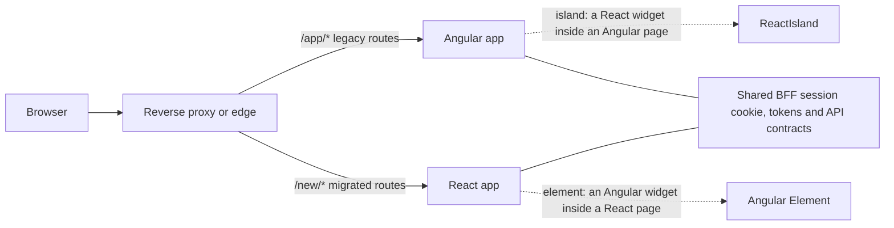

# 59 — React vs Angular: An Architect's Comparison

> Most React-versus-Angular arguments set today's version of one against a years-old memory of the other. Compared as they ship in late 2026, the two have converged on more than either community admits. The differences that remain are about where code runs, who assembles the stack, and how upgrades are governed. Syntax is the least of it.

**Prerequisites:** [08 React Mental Model](08-react-mental-model-and-rules.md), [56 Angular Architecture](56-angular-architecture-and-dependency-injection.md), [57 Angular Signals](57-angular-signals-reactivity-and-rxjs.md) · **Related:** [12 Hooks](12-hooks-in-depth.md) · [15 Concurrent React](15-concurrent-react-suspense-and-transitions.md) · [18 Server Components](18-react-server-components-and-server-functions.md) · [28 State Ownership](28-state-and-data-ownership-architecture.md) · [54 Choosing a React Framework](54-choosing-a-react-framework.md) · [58 Angular at Scale](58-angular-at-scale.md) · [61 Micro-frontends](61-micro-frontends-and-module-federation.md) · [64 Migration Playbooks](64-migration-playbooks.md)

---

## TL;DR

- **They converged.** Both are TypeScript-first and component-based, with a compiler at the centre. Both test with Vitest and Playwright, and both server-render with hydration. Several libraries now work in either: TanStack Query, Standard Schema validators, Nx, Native Federation and Storybook.
- **Reactivity is the real technical difference.**
  - React re-runs component functions and reconciles. The Compiler skips the work whose inputs didn't change.
  - Angular runs a component's class once and tracks which views read which signals. Only those views refresh.
  - Each model has its own bug classes and its own performance tools.
- **Server Components are the biggest architectural difference.** React can keep components, their dependencies and their data access on the server entirely. Angular has nothing equivalent. Its closest tool is `@defer (hydrate never)`: server HTML with no JavaScript on first load.
- **Platform vs assembly.** Angular ships the router, HTTP client, forms, i18n, SSR, the test builder and automated migrations on one release train. With React you or your framework assemble those, and each piece has its own cadence.
- **The baseline-size folklore is out of date.** I measured four production builds:

  | Initial JavaScript, Brotli | Bare app | With a router |
  |---|---|---|
  | Zoneless Angular 22.3 | 29 kB | 58 kB |
  | React 19.3 | 58 kB | 85 kB (with React Router 8.5) |

  App code dominates either way.
- **Hiring.** In the 2026 Stack Overflow survey, 41.5% of respondents used React and 16.0% used Angular. That ratio matters more for most organisations than any benchmark.
- **Interop works in both directions.** I verified a React island inside Angular, and an Angular Element inside React 19. Migrate strangler-style, and give the dual-framework period an end date.

---

## 1. What is no longer a difference

Before comparing, retire the outdated arguments. Each of these was true at some point and isn't now:

| Old claim | Where things stand (React 19.3, Angular 22.3) |
|---|---|
| "Angular is heavy" | Zoneless by default since v21, so no zone.js. A bare app ships 29 kB Brotli, half of React DOM's baseline (§5) |
| "Angular means RxJS everywhere" | Signals, `computed`, `linkedSignal` and resources carry state. RxJS is for genuine streams ([57](57-angular-signals-reactivity-and-rxjs.md)) |
| "Angular change detection checks everything" | OnPush is the default since v22, and signal-driven views refresh individually |
| "React is just the view layer" | React 19 has actions, form state, `use`, document metadata, resource preloading, `<Activity>`, `<ViewTransition>` and Server Components ([16](16-react-19-features-and-the-compiler.md)) |
| "React has no structure" | Frameworks (Next.js 16.4, React Router 8.5, TanStack Start) supply routing, data loading, mutations and server rendering ([54](54-choosing-a-react-framework.md)) |
| "React needs manual memoisation everywhere" | The React Compiler (1.0 since October 2025) memoises automatically. Manual hooks remain for edge cases ([16](16-react-19-features-and-the-compiler.md)) |
| "Angular is for enterprises, React for startups" | Both run large estates. What differs is how much of the stack you assemble and govern yourself |

Shared ground now includes:

- **Testing:** Vitest, Playwright and Storybook.
- **Server state:** TanStack Query, version 5.108 for both, stable for Angular since September 2026.
- **Validation:** Standard Schema validators. Angular Signal Forms take them through `validateStandardSchema`.
- **Headless accessibility:** React Aria and Radix on one side, Angular Aria and the CDK on the other.
- **Repo tooling:** Nx and Native Federation.

A design system's tokens, an API's OpenAPI types and domain logic in plain TypeScript can all be shared across the two.

---

## 2. Reactivity: re-run and reconcile vs track and refresh

```mermaid
flowchart TB
  subgraph R["React 19.3: re-run and reconcile"]
    R1["setState or dispatch"] --> R2["schedule a render at a priority (lane)"]
    R2 --> R3["re-run the component function and its children"]
    R3 --> R4["Compiler-memoised values and elements skip unchanged work"]
    R4 --> R5["reconcile against the previous tree"]
    R5 --> R6["commit DOM changes, then run effects"]
  end
  subgraph A["Angular 22.3: track and refresh"]
    A1["signal.set or update"] --> A2["mark dependent computeds and template views dirty"]
    A2 --> A3["schedule change detection (zoneless)"]
    A3 --> A4["refresh only the views marked dirty"]
    A4 --> A5["re-run those views' template update code"]
    A5 --> A6["patch changed DOM, then run afterRender hooks"]
  end
```



The unit of re-execution differs. In React it's the component function and everything below it, minus whatever memoisation skips. In Angular it's a view's template update code. The class body ran once, when the component was created. Here is the same component in both:

```tsx
// React: the component function re-runs when its state or props change; derived values are plain expressions
import { useState } from 'react';

export type Status = 'open' | 'paid' | 'void';
export interface Invoice { id: string; status: Status; amountCents: number }

const money = new Intl.NumberFormat('en-GB', { style: 'currency', currency: 'GBP' });

export function InvoiceSummary({ invoices }: { invoices: readonly Invoice[] }) {
  const [status, setStatus] = useState<Status>('open');
  const visible = invoices.filter((i) => i.status === status);        // the Compiler memoises this on [invoices, status]
  const total = visible.reduce((sum, i) => sum + i.amountCents, 0);
  return (
    <section>
      <select value={status} onChange={(e) => setStatus(e.currentTarget.value as Status)}>
        <option value="open">Open</option>
        <option value="paid">Paid</option>
        <option value="void">Void</option>
      </select>
      <p>{visible.length} invoices, {money.format(total / 100)}</p>
    </section>
  );
}
```

```ts
// Angular: the class runs once; signals track who reads them, and only those bindings update
import { Component, computed, input, signal } from '@angular/core';
import { CurrencyPipe } from '@angular/common';

export type Status = 'open' | 'paid' | 'void';
export interface Invoice { id: string; status: Status; amountCents: number }

@Component({
  selector: 'app-invoice-summary',
  imports: [CurrencyPipe],
  template: `
    <section>
      <select [value]="status()" (change)="onStatus($event)">
        <option value="open">Open</option>
        <option value="paid">Paid</option>
        <option value="void">Void</option>
      </select>
      <p>{{ visible().length }} invoices, {{ total() / 100 | currency: 'GBP' : 'symbol' : '1.2-2' : 'en-GB' }}</p>
    </section>
  `,
})
export class InvoiceSummary {
  readonly invoices = input.required<readonly Invoice[]>();
  readonly status = signal<Status>('open');
  readonly visible = computed(() => this.invoices().filter((i) => i.status === this.status()));
  readonly total = computed(() => this.visible().reduce((sum, i) => sum + i.amountCents, 0));

  onStatus(event: Event) {
    this.status.set((event.target as HTMLSelectElement).value as Status);
  }
}
```

The React version type-checks against React 19.3. The Angular version passes a test: it renders "2 invoices, £150.50", and after the select changes to Paid, "1 invoices, £999.00". The code looks almost the same. The consequences differ:

| | React | Angular |
|---|---|---|
| What must be pure | The whole component body, since it can run any number of times, or twice in Strict Mode | `computed` functions and template expressions; the constructor runs once |
| Derived state | Plain expressions in render (memoised by the Compiler) | `computed()` |
| Resetting state when an input changes | A `key` on the component | `linkedSignal()` |
| Typical bugs | Stale closures, effects used to derive state, missing effect cleanup, needless re-renders without the Compiler | Reading a signal outside a reactive context and expecting updates, effects that write signals, forgotten RxJS teardown, services provided at the wrong level |
| Keeping input responsive under heavy updates | Interruptible rendering: `startTransition`, `useDeferredValue` | Change detection is synchronous: keep `computed` cheap, debounce, `@defer`, or move work to a worker |
| Profiling | React DevTools Profiler, React Performance Tracks in Chrome DevTools | Angular DevTools profiler and its signal graph |

**Concurrency is a real gap.** React can interrupt a large transition render to handle a keystroke, then restart it with the latest state. For very large interactive surfaces (huge tables, graph editors), that property is architectural. Angular compensates with granularity: a change usually touches less of the tree, so there is less work to interrupt. With equally heavy updates, though, Angular has no equivalent of a transition ([15](15-concurrent-react-suspense-and-transitions.md)).

---

## 3. Composition, reuse and dependency injection

### 3.1 Concept map

| Concern | React 19.3 | Angular 22.3 |
|---|---|---|
| Component | Function returning JSX | Class with `@Component` and a compiled template |
| Inputs, outputs, two-way | Props, callback props, value plus `onChange` | `input()`, `output()`, `model()` with `[(x)]` |
| Local and derived state | `useState`/`useReducer`; expressions | `signal()`; `computed()` |
| Synchronising with the outside world | `useEffect`, `useLayoutEffect`, `useEffectEvent` | `effect()`, `afterRenderEffect()`, `afterNextRender()` |
| DOM access | `ref` with `useRef` | `viewChild()`, `ElementRef` |
| Logic reuse | Custom hooks | Services, `inject()`-based functions, directives and host directives |
| UI composition | `children`, render props, compound components | Content projection (`<ng-content>`), `ng-template` with outlets |
| Control flow | JavaScript expressions, `map` with `key` | `@if`, `@for` (with a required `track`), `@switch` |
| Lazy UI | `lazy()` with `<Suspense>` | `@defer` with triggers and prefetching |
| Hidden but alive UI | `<Activity mode="hidden">` | No direct equivalent; keep the view and toggle visibility, or cache routes with a `RouteReuseStrategy` |
| Async data in components | `use(promise)`, Suspense, TanStack Query, framework loaders, Server Components | `resource()`, `httpResource()`, `rxResource()`, TanStack Query for Angular |
| Forms | Actions, `useActionState`, `useFormStatus`, React Hook Form, TanStack Form | Signal Forms (`form()`, `[formField]`), Reactive Forms |
| Error containment | Error boundaries; framework `error` files | `ErrorHandler`; `@boundary` and route `errorComponent` (both developer preview) |
| Dependency injection | Imports for singletons, context for values that vary by subtree | Hierarchical injectors: root, route, component |
| Styling | Your choice: CSS Modules, Tailwind, CSS-in-JS | Component styles with emulated encapsulation, built in |
| Routing, HTTP, i18n | From the framework or libraries | `@angular/router`, `HttpClient`, `@angular/localize` built in |

### 3.2 DI vs imports and context

Angular gives every dependency an injector, a lifetime and a test seam. React gives you modules and context, and the test seams are wherever you put them: usually the network (MSW) and a fresh `QueryClient` per test.

```ts
// Angular: the dependency is injected; the seams for tests are providers and HttpTestingController
import { Component, input } from '@angular/core';
import { httpResource } from '@angular/common/http';
import type { Invoice, Status } from './invoice-summary';

@Component({
  selector: 'app-invoice-count',
  template: `
    @if (invoices.hasValue()) {
      <p>{{ invoices.value().length }} {{ status() }} invoices</p>
    } @else if (invoices.error()) {
      <p role="alert">Couldn't load invoices.</p>
    } @else {
      <p>Loading…</p>
    }
  `,
})
export class InvoiceCount {
  readonly status = input.required<Status>();
  readonly invoices = httpResource<Invoice[]>(() => ({ url: '/api/invoices', params: { status: this.status() } }));
}
```

```tsx
// React: the dependency is an import; the seams for tests are the QueryClient and the network (MSW)
import { queryOptions, useSuspenseQuery } from '@tanstack/react-query';
import type { Invoice, Status } from './invoice-summary';

async function getJson<T>(url: string, signal: AbortSignal): Promise<T> {
  const res = await fetch(url, { signal, headers: { accept: 'application/json' } });
  if (!res.ok) throw new Error(`GET ${url} failed with ${res.status}`);
  return res.json() as Promise<T>;
}

export const invoicesQuery = (status: Status) =>
  queryOptions({
    queryKey: ['invoices', status],
    queryFn: ({ signal }) => getJson<Invoice[]>(`/api/invoices?status=${status}`, signal),
    staleTime: 30_000,
  });

export function InvoiceCount({ status }: { status: Status }) {
  const { data } = useSuspenseQuery(invoicesQuery(status));   // suspends until loaded; errors go to the boundary
  return <p>{data.length} {status} invoices</p>;
}
```

The Angular test drives the `status` input and checks each state. It sees "Loading…", then flushes `/api/invoices?status=open` and gets "2 open invoices". After the input changes, it flushes `/api/invoices?status=paid`. The React version type-checks against TanStack Query 5.108.4. The two designs handle state differently:

- **Loading and error states.** Angular puts them in the template, from the resource's status signals. React pushes them up to `<Suspense>` and error boundaries, which compose across components but need those boundaries placed with care ([15](15-concurrent-react-suspense-and-transitions.md)).
- **Caching.** `httpResource` doesn't cache across components. Two components asking for the same URL make two requests unless a shared service or TanStack Query sits between them. React teams almost always add a cache, so the request-deduplication question is answered before it's asked.

The DI difference matters most at scale. In Angular, "which instance does this feature get, and when does it die?" has an answer in the code, through route providers and `withAutoCleanupInjectors()`. In React it's a convention your platform team writes down: where providers mount, and which state lives in which store ([28](28-state-and-data-ownership-architecture.md), [29](29-client-state-management.md)).

---

## 4. Server rendering and the server boundary

| | React (Next.js 16.4, React Router 8.5, TanStack Start) | Angular 22.3 |
|---|---|---|
| Rendering modes | Static, dynamic, Partial Prerendering and Cache Components (Next.js); per-route modes in other frameworks | Per-route `Prerender`, `Server` and `Client` in `app.routes.server.ts` |
| Components that never ship to the client | Server Components | None. `@defer (hydrate never)` keeps a block's JavaScript off the initial load, but it can't use server-only resources |
| Server code callable from the client | Server functions (`'use server'`) | None built in; call your API or BFF |
| HTML delivery | Streamed progressively as Suspense boundaries resolve | The whole document in one chunk once the app is stable. The response is a stream, but it carries one chunk |
| Hydration | Selective: Suspense boundaries hydrate independently, and an interaction prioritises its boundary and is replayed | Full by default, plus incremental (`hydrate` triggers) and event replay, all on by default |
| Security record, Nov 2025–Oct 2026 | Nine React Server Components advisories (two remote code execution) ([44](44-rsc-security-threat-model.md)) | Seven SSR and HTTP advisories: SSRF, open redirect, XSRF leakage ([58](58-angular-at-scale.md)) |

Server Components are the reason to prefer React for server-first products. Examples are content-heavy commerce, where most components are display-only, and data-dense pages whose dependencies (markdown, syntax highlighting, date libraries) shouldn't ship. Angular's incremental hydration closes some of that gap for interactivity cost, but not for bundle composition: every component's code is still client code that loads eventually. In return, Angular's server surface is smaller, because there's no RPC protocol to parse. Its advisories were about URLs and headers, not deserialisation.

---

## 5. Measured baselines

I built four minimal production apps. Two use React 19.3.1 with Vite 8.3.8, and two use Angular 22.3 with the CLI, zoneless and OnPush. Each pair has one app with a single stateful component and one with a router and a lazy route. I measured the JavaScript each `index.html` loads initially, with gzip at level 9 and Brotli at quality 11. (The Angular CLI's "estimated transfer size" matches the Brotli figure.)

| App | Raw | gzip | Brotli |
|---|---|---|---|
| React 19.3.1, one component with state | 219.6 kB | 68.0 kB | 58.3 kB |
| React 19.3.1 + React Router 8.5.2 (data router, one lazy route) | 316.6 kB | 99.0 kB | 85.4 kB |
| Angular 22.3, one component with a signal | 97.6 kB | 32.7 kB | 29.4 kB |
| Angular 22.3 + router (one lazy route) | 206.8 kB | 64.7 kB | 57.8 kB |

How to read these:

- **Angular's baseline is now the smaller one.** Ivy's tree-shaking plus zoneless change detection took out what used to make Angular heavy. React DOM's baseline buys a concurrent renderer, selective hydration, Suspense, actions and resource hoisting, whether a page uses them or not.
- **The router choice moves React more than React does.** React Router's data router added 27 kB Brotli to a bare app; Angular's router added 28 kB. Measure your own stack. For React that means the framework, router, data library and design system together.
- **Real apps dwarf both baselines.** App code, a design system, charts and editors usually come to several times these numbers. In React, Server Components can keep much of that off the client, and no baseline table captures that. Budget per route in CI ([39](39-web-performance-and-core-web-vitals.md)).
- **Running both on one page costs both baselines.** A React island inside an Angular page adds React DOM's 58 kB on top of Angular's. That is acceptable for a migration period, not as a steady state.

---

## 6. Governance and upgrade economics

| | React | Angular |
|---|---|---|
| Steward | The React Foundation (under the Linux Foundation) since February 2026. Members include Meta, Microsoft, Amazon, Vercel and Expo | Google's Angular team |
| Release model | Minors without a fixed cadence: 19.0 (Dec 2024), 19.1 (Mar 2025), 19.2 (Oct 2025), 19.3 (Sep 2026). No React 20 announced | One major a year from v22 (June 2026), 4–6 minors each, 24 months of support |
| Scope of one upgrade | React itself rarely breaks within 19.x. Framework, router and data-library upgrades are separate projects on their own cadences | Everything in the platform moves together; the ecosystem (Material, NgRx, Nx, Federation) ships matching majors |
| Upgrade tooling | Per-library codemods and upgrade guides | `ng update` with automatic migrations that preserve behaviour ([58](58-angular-at-scale.md)) |
| What you govern | The assembly: which framework, router, state, forms and styling. Every choice needs an ADR and an owner ([63](63-architecture-governance-and-adrs.md)) | Mostly the escape hatches: when to deviate from defaults, and the yearly upgrade calendar |

There's a real trade here. React's flexibility lets each product choose the best tool, and makes a forty-app estate drift into forty stacks unless a platform team holds the line. Angular's single train prevents drift. In exchange, the upgrade is a mandatory yearly project, and you accept the platform's opinions: its router, forms and HTTP client.

---

## 7. People and organisational fit

- **Hiring pool.** The 2026 Stack Overflow survey had 10,281 respondents to its web-frameworks question. React was at 41.5% and Angular at 16.0%, with Next.js at 20.6% and Vue at 17.2%. In 2025 the figures were 44.7% and 18.2%. Both fell, but the ratio held at roughly 2.5 to 1. For most organisations this matters more than any technical row in this chapter.
- **Onboarding.** Angular's learning curve is front-loaded (DI, templates, the CLI) but uniform: an Angular developer joining from another company recognises the codebase. React's curve is gentler at first. The real onboarding cost is your particular assembly.
- **Many teams.** Angular's conventions and Nx's boundary rules give large organisations with rotating contractors a consistent shape at low governance cost. React estates get the same effect only through a strong platform team: templates, lint rules, a golden path ([46](46-enterprise-saas-architecture.md), [60](60-monorepos-build-tooling-and-bundlers.md)).
- **Mobile.** React Native and Expo share skills, and some code, with the web app ([53](53-react-native-and-expo.md)). Angular's options (Ionic with Capacitor, NativeScript) work, but they aren't first-party.
- **Ecosystem breadth.** For specialised UI (rich-text and code editors, diagramming, data grids, AI chat kits), React usually has more and better-maintained options. Check before you choose: a missing editor or grid can cost more than any framework difference.

---

## 8. A decision matrix

Weights depend on the organisation, so treat the ones below as an example to re-weight, not data. Scores run from 1 to 5.

| Criterion | Weight | React | Angular | Why |
|---|---|---|---|---|
| Server-first rendering, zero-JS components | 3 | 5 | 3 | Server Components vs incremental hydration |
| Consistency across many teams | 3 | 3 | 5 | Assembled stack vs one platform |
| Upgrade predictability | 2 | 3 | 4 | Many cadences vs one train with automatic migrations |
| Hiring pool | 3 | 5 | 3 | About 2.5 to 1 in survey usage |
| Ecosystem for specialised UI | 2 | 5 | 3 | Editors, grids, AI UI kits |
| Mobile with shared skills | 1 | 5 | 2 | React Native and Expo |
| Forms-heavy line-of-business screens | 2 | 4 | 5 | Signal Forms, DI and typed templates out of the box |
| Baseline bundle | 1 | 3 | 4 | Measured in §5 |

With these weights, React scores 71 and Angular 63. Re-weight for an internal operations suite with fifteen teams and no SEO or mobile needs, and the result flips. With server-first at 1, consistency at 5, mobile at 0 and forms at 3, it comes out React 66 and Angular 70. That's the point of the matrix. It makes the argument about weights, which is a business conversation, rather than about frameworks.

How I'd call common situations:

- **Consumer product with SEO, a content-heavy catalogue and a companion app:** React, on Next.js or React Router with Expo.
- **Internal suite of many line-of-business apps built by many teams, often with contractors:** Angular, with Nx.
- **An existing healthy Angular estate that wants better performance:** stay. Adopt zoneless, incremental hydration, signals and per-route render modes ([58](58-angular-at-scale.md)). Switching frameworks is rarely the cheapest performance fix.
- **An existing React estate drifting into many stacks:** the problem is governance, not React. Standardise on one framework and golden path before considering anything else ([63](63-architecture-governance-and-adrs.md)).

---

## 9. Coexistence and migration



| Strategy | Use when | Cost |
|---|---|---|
| **Route-level strangler** (proxy splits paths) | Default for any migration: whole pages move at once | Full page loads at the seam; shared session (BFF cookie) and design tokens needed |
| **Islands** (React inside Angular) | One widget needs the other ecosystem (an editor or a chart) | Both runtimes on that page; no SSR for the island |
| **Elements** (Angular inside React) | Keep using an Angular widget while its pages migrate | Angular's runtime on those pages; events become DOM events |
| **Micro-frontends** (Native Federation, Module Federation) | Teams deploy independently and long-term | Highest operational cost ([61](61-micro-frontends-and-module-federation.md)) |

Both bridges are small. I tested each in the Angular workspace's Vitest suite (Vitest 5.1, jsdom).

```ts
// interop/react-island.ts: host a React component inside an Angular template
import { afterRenderEffect, Component, DestroyRef, ElementRef, inject, input } from '@angular/core';
import { createElement, type ComponentType } from 'react';
import { createRoot, type Root } from 'react-dom/client';

@Component({ selector: 'app-react-island', template: '' })
export class ReactIsland<P extends object> {
  readonly component = input.required<ComponentType<P>>();
  readonly props = input.required<P>();
  private readonly host: HTMLElement = inject(ElementRef).nativeElement;
  private root: Root | undefined;

  constructor() {
    afterRenderEffect(() => {                      // browser only; re-runs when either input changes
      this.root ??= createRoot(this.host);
      this.root.render(createElement(this.component(), this.props()));
    });
    inject(DestroyRef).onDestroy(() => this.root?.unmount());
  }
}
```

```html
<!-- usage in an Angular template: Angular's pure-function memoisation keeps the props object stable between changes -->
<app-react-island [component]="ApprovalCounter" [props]="{ label: label(), onApprove: approved }" />
```

The island test covered three things:

- **Mounting and props both ways.** A React counter mounted. Clicking it called back into an Angular signal, and changing the Angular `label` signal re-rendered the React component *without* resetting its state.
- **Unmounting.** Removing the island with `@if` unmounted the React root.
- **SSR.** `afterRenderEffect` never runs on the server, so islands are client-only by design.

The reverse direction uses Angular Elements:

```ts
// The Angular widget, registered once as a custom element
customElements.define('acme-approval-badge', createCustomElement(ApprovalBadge, { injector }));
```

```tsx
// In React 19: props go to the element's properties; Angular outputs arrive as DOM events
import type { DetailedHTMLProps, HTMLAttributes } from 'react';

declare module 'react' {                          // the global JSX namespace is gone: augment React's
  namespace JSX {
    interface IntrinsicElements {
      'acme-approval-badge': DetailedHTMLProps<HTMLAttributes<HTMLElement>, HTMLElement> & {
        label?: string;
        count?: number;
        onapprove?: (event: CustomEvent<number>) => void;
      };
    }
  }
}

export function Approvals({ record }: { record: (count: number) => void }) {
  return <acme-approval-badge label="Sign off" count={2} onapprove={(e) => record(e.detail)} />;
}
```

React 19 supports custom elements properly, and the test showed it:

- `count` was set as a *property*. The element had no `count` attribute, so typed values survive.
- The Angular `approve` output arrived through `onapprove` with its value in `event.detail`.

Event names are case-sensitive: `onapprove` listens for `approve`. The declaration above type-checks against `@types/react` 19.3. The runtime test used `createElement` with the same props, to avoid JSX setup in the Angular workspace.

**Rules for the dual-framework period:**

1. **Give it an end date, and track it.** Every quarter both runtimes coexist, you pay twice for upgrades, security patches and onboarding.
2. **Share the session, not state.** Both apps talk to the same BFF with the same cookie ([45](45-authentication-and-authorization.md)). Cross-framework state goes through the URL or the server, never through `window` globals.
3. **Share tokens and contracts.** Generate design tokens for both from one source, and generate API types for both from one OpenAPI spec ([33](33-api-integration-bff-and-contracts.md), [35](35-enterprise-design-system-architecture.md)).
4. **Budget both runtimes.** Any page that loads both pays both baselines (§5).
5. **Migrate by route, verify by journey.** Playwright journeys that cross the seam catch broken sessions and navigation first ([42](42-testing-architecture.md), [64](64-migration-playbooks.md)).

---

## 10. Switching mental models

**React developers in Angular** tend to:

- write effects to derive values. Use `computed`; effects are for the outside world;
- expect the component body to re-run. Only `computed`s and templates re-evaluate, and the constructor runs once;
- subscribe manually and forget teardown. Prefer `toSignal`, resources, or `takeUntilDestroyed`;
- reach for a global store for everything. Scope state with route and component providers first ([56](56-angular-architecture-and-dependency-injection.md)).

**Angular developers in React** tend to:

- mutate objects in state. React compares by reference, so create new objects;
- rebuild DI with context providers for every service. Plain imports are fine for singletons, and context is for values that vary by subtree;
- put RxJS at the centre. TanStack Query and plain async functions cover most of what `HttpClient` plus operators did;
- treat `useEffect` as `ngOnInit`. Most data loading belongs in a framework loader, a Server Component or a query, not in an effect ([13](13-effects-and-synchronization.md));
- hand-memoise everything. With the Compiler on, write plain code and measure.

---

## Decision framework

**Problem.** Choose a framework for a new product, keep the current one, or plan a move between them.

**Constraints.**

- SEO and server-first needs, and whether display-only components dominate.
- The number of teams and how they're staffed.
- Mobile plans.
- Specialised UI dependencies such as editors and grids.
- The existing estate and its health.
- The hiring market where you recruit.
- Your capacity for yearly upgrades versus continuous stack governance.

| Situation | Recommendation |
|---|---|
| New server-first consumer product | React with a framework that has stable Server Components support |
| New multi-team internal platform | Angular with Nx, unless the hiring market or mobile plans say React |
| Healthy Angular estate with performance or DX complaints | Modernise in place (zoneless, signals, incremental hydration, Vitest) |
| Angular estate that must move (hiring, ecosystem, strategy) | Route-level strangler with a dated end state; islands only for blocking widgets |
| React estate with stack drift | Governance first: one framework, one golden path, ADRs |
| One widget from the other ecosystem | An island or an element, inside the performance budget |

**Criteria.** Weighted business criteria (§8), measured performance on your own pages, and the total cost over three years: hiring, upgrades, governance and migration.

**Failure modes.**

- Choosing from a benchmark of a bare app.
- Migrating for performance problems that modernisation would fix.
- Big-bang rewrites.
- Coexistence with no end date.
- Sharing state through globals across frameworks.
- An assembled React stack with no owner.
- An Angular estate skipping yearly upgrades until LTS expires.

**Migration path.**

1. Write the ADR with the weights.
2. Prove the seam with one route behind the proxy, the shared BFF session and shared tokens.
3. Move routes in order of business value and change frequency.
4. Retire islands and elements as their host pages move.
5. Delete the old runtime on the dated end state.

---

## Pitfalls and anti-patterns

- **Comparing today's React with old Angular, or the reverse.** Zoneless signals and the React Compiler both changed the performance story.
- **Treating Server Components as a checkbox.** They change bundle composition and the security surface. Adopt them with the threat model in [44](44-rsc-security-threat-model.md).
- **Assuming `httpResource` caches like TanStack Query.** It doesn't share or deduplicate across components.
- **Porting Angular services into React context one to one.** That rebuilds DI badly. Use imports, queries and scoped stores.
- **Porting React effects into Angular effects.** Most of them should be `computed` or resources.
- **Mounting islands without unmounting them.** The React root leaks unless it's tied to `DestroyRef`.
- **Setting attributes on custom elements from React out of habit.** React 19 sets properties when the element defines them, so define the element before React renders it.
- **Running two frameworks indefinitely.** Every quarter of coexistence doubles upgrade and security work.

---

## Architect's checklist

- [ ] The comparison uses current versions (React 19.3, Angular 22.3) and measurements from your own pages
- [ ] Decision weights are written down in an ADR and agreed with product and engineering leadership
- [ ] The team's dominant bug classes are known for the chosen model (stale closures and effects, or untracked reads and DI scope) and covered by lint rules and review guides
- [ ] Server-first needs are explicit: if Server Components are a reason to choose React, the threat model and patch cadence are in place
- [ ] Server state has one caching strategy (TanStack Query in either framework, or shared services in Angular)
- [ ] Any interop uses a tested bridge that unmounts with its host, and both runtimes are inside the page budget
- [ ] Migrations run route by route behind a proxy, with a shared BFF session, shared tokens and generated API types
- [ ] The dual-framework period has an end date that is tracked in planning
- [ ] Onboarding material covers the mental-model traps in §10 for developers switching in either direction

---

## Interview angles

**Q1. Compare React's and Angular's reactivity models. What changes for performance work?**
React re-runs component functions when state or props change and reconciles the result. The Compiler memoises so unchanged work is skipped, and transitions make large renders interruptible. Angular runs the class once. Signals record which computeds and views read them, so a change refreshes only the dirty views' template code, synchronously. In React, performance work means keeping renders cheap and interruptible: Compiler coverage, transitions, virtualisation. In Angular it means keeping each change narrow and each computation cheap: signals, OnPush, `@defer`, and debouncing or workers for heavy work. The bug classes differ too: stale closures and effect misuse in React, untracked reads and DI scoping in Angular.

**Q2. Leadership wants to move forty Angular apps to React "because of hiring". How do you respond?**
I take the concern seriously. Survey usage is about 2.5 to 1 in React's favour, and that matters. But I'd quantify it against the cost: migrating forty apps is years of dual runtimes, double upgrade and security work, and feature freezes. I'd ask what's actually failing. If it's hiring, Angular developers are fewer but available, and React developers onboard to modern signal-based Angular faster than its reputation suggests. If it's performance or developer experience, modernising in place is cheaper. If the move is still right, I'd run it as a route-level strangler with a shared BFF session, shared tokens, and an end date per app, starting where change is most frequent.

**Q3. What does each framework have at the architecture level that the other lacks?**
React has Server Components and server functions: components and data access that never ship to the client, progressive HTML streaming, and selective hydration. Angular has none of these. Its incremental hydration defers client code but can't remove it. Angular has a platform: hierarchical DI with route-scoped lifetimes, a built-in router, HTTP client, forms and i18n, one release train, and automatic migrations through `ng update`. In React those are assembled from frameworks and libraries that your organisation has to govern.

**Q4. How would you embed a React widget in an Angular page, and the reverse? What does it cost?**
For React inside Angular, I'd write a small host component. It creates a React root in `afterRenderEffect`, renders the component with props from signal inputs, and unmounts in `DestroyRef`. I tested that: props flow both ways, React state survives input changes, and the root unmounts with the view. It's client-only, because `afterRenderEffect` doesn't run on the server. For Angular inside React, I'd use Angular Elements. React 19 sets custom-element properties rather than attributes, and outputs arrive as DOM events through `on` plus the event name. The cost is both runtimes on the page, roughly 58 kB Brotli for React DOM on top of Angular in my measurements. That's acceptable during a migration, and I'd budget and date it.

**Q5. Is "Angular is heavy" still true?**
Not for the framework baseline. In my measurements, a zoneless Angular 22.3 app shipped 29 kB Brotli against React 19.3's 58 kB. With a router the two were 58 and 85 kB. Zoneless change detection removed zone.js, and Ivy tree-shakes what you don't use. What remains true is that every Angular component's code eventually ships to the client, while React Server Components can keep display-only code on the server. So the honest answer is: compare your own pages, including the framework, data layer and design system, and decide whether server-only components matter for your product.

---

> [!TIP]
> **Runnable code:** [E56](E56-angular-architecture-and-dependency-injection.md) has the Angular halves of the comparisons and both interop directions, with specs (in `src/app/compare/` and `src/app/interop/` of the Angular workspace). `node extract-examples.mjs 56` writes it out as a project; then run `npm ci` and `npm test` in it.

## Further reading

- React docs, *Thinking in React*: <https://react.dev/learn/thinking-in-react> · *React 19: support for custom elements*: <https://react.dev/blog/2024/12/05/react-19#support-for-custom-elements>
- Angular docs, *Signals*: <https://angular.dev/guide/signals> · *Angular elements*: <https://angular.dev/guide/elements> · *Incremental hydration*: <https://angular.dev/guide/incremental-hydration>
- Angular, *Release practices*: <https://angular.dev/reference/releases>
- Stack Overflow Developer Survey 2026: <https://survey.stackoverflow.co/2026/>
- TanStack Query (React and Angular adapters): <https://tanstack.com/query>

---

[← Previous: 58 — Angular at Scale](58-angular-at-scale.md) · [Index](README.md) · [Next: 60 — Monorepos, Build Tooling and Bundlers →](60-monorepos-build-tooling-and-bundlers.md)
