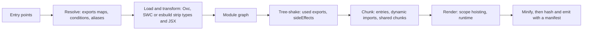

# 60 — Monorepos, Build Tooling and Bundlers

> Build tooling is the part of the architecture every engineer touches every day and almost nobody owns. When it's right it's invisible: installs are boring, builds are cached, and a package's public API is what its exports map says. When it's wrong, a team loses an afternoon a week and nobody can say where it went.

**Prerequisites:** [04 TypeScript at Scale](04-typescript-at-scale.md), [21 Architecture Styles](21-frontend-architecture-styles-and-boundaries.md) · **Related:** [05 Networking and Delivery](05-networking-caching-and-delivery.md) · [35 Design Systems](35-enterprise-design-system-architecture.md) · [39 Web Performance](39-web-performance-and-core-web-vitals.md) · [43 Security](43-frontend-security-architecture.md) · [58 Angular at Scale](58-angular-at-scale.md) · [61 Micro-frontends](61-micro-frontends-and-module-federation.md) · [62 CI/CD](62-cicd-release-engineering-and-feature-flags.md)

---

## TL;DR

- **Monorepo by default** for code that changes together: apps, their design system and shared libraries. The costs are CI scale and ownership, and both are solvable. Split only where release cadence or access control genuinely differ.
- **pnpm 12** (the Rust rewrite, August 2026) with workspaces and **catalogs**, so each dependency is declared once. Its supply-chain defaults are real: a one-day release cooldown, blocked install scripts and blocked exotic subdependencies. I tested the cooldown. By default it picked the day-old version. When I explicitly asked for a too-new one, pnpm wrote an exemption into `pnpm-workspace.yaml`, where code review can see it. Set the policy explicitly to make it strict.
- **A task runner with caching.**
  - **Turborepo 2.11** for JS-only repos that want little configuration. In my run, an unchanged rebuild took 11 ms ("FULL TURBO"), and `--affected` scoped work to changed packages.
  - **Nx 24** for large or polyglot estates that need generators, boundaries and distributed CI.
- **Bundlers in 2026:**
  - **Vite 8** (Rolldown and Oxc) is the default for most apps and frameworks.
  - **Turbopack** comes with Next.js.
  - **Rspack 2** suits webpack migrations and heavy Module Federation use.
  - **The Angular CLI** uses esbuild.
  - **tsdown or Rslib** build libraries.
- **Tree-shaking needs your help.** ESM, `sideEffects: false` and unbundled library output. In my test, dropping `sideEffects: false` kept an unused module's top-level side effect in the app bundle.
- **Lint at two speeds.** oxlint as the fast first pass, then ESLint 10 (flat config only, per-directory config lookup) for type-aware and plugin rules. Architecture boundaries are lint rules too. `turbo boundaries` caught a phantom dependency in my own setup.
- **Publish with checks.** An `exports` map with `types`, ESM-only, peer dependencies for frameworks, and `publint` plus `@arethetypeswrong/cli` in CI. publint caught a real bug in my first build: the exports pointed at `.js` files while the build emitted `.mjs`. Publish through trusted publishing (OIDC), and remember that provenance proves where a package was built, not that the build was benign.

---

## 1. Repository strategy

| | Monorepo | Polyrepo | Hybrid |
|---|---|---|---|
| Atomic changes across app and library | One PR | Coordinated releases | Within each monorepo |
| Shared tooling and versions | One place (catalogs, shared configs) | Copied, drifting | Per monorepo |
| CI cost | Needs caching and affected-only runs | Small per repo | Medium |
| Ownership and access control | CODEOWNERS, boundaries | Repository permissions | Both |
| Good for | A product and its design system, platform libraries | Independent products, open-source packages, regulated code | Several product lines |

The monorepo's benefit is *atomicity*. A design-system change and its consumers' fixes land in one reviewed commit, and CI proves they work together. Its costs are real but technical:

- **CI time**, solved by caching and affected-only runs (§3).
- **Boundary erosion**, solved by enforced import rules (§6).
- **Ownership**, solved by CODEOWNERS plus a clear package map.

A polyrepo's benefit is *independence*, which you need when release cadences, access rules or lifecycles genuinely differ. Choose deliberately, and write the decision down ([63](63-architecture-governance-and-adrs.md)).

```text
acme/                                 # the workspace used in this chapter
├── apps/
│   └── web/                          # Vite 8 React app: consumes @acme/ui through workspace:*
├── packages/
│   ├── ui/                           # component library: tsdown build, exports map, sideEffects: false
│   └── eslint-config/                # shared lint rules as a package, not a relative import
├── package.json                      # packageManager: pnpm@12.23.0, scripts call turbo
├── pnpm-workspace.yaml               # workspaces, catalog, allowBuilds, release-age policy
└── turbo.json                        # task graph and cache outputs
```

---

## 2. Package management with pnpm 12

pnpm 12 is a rewrite in Rust that keeps pnpm 11's commands, settings and lockfile format. pnpm 11 (April 2026) made the bigger behavioural changes:

- **Requirements:** Node 22 or later.
- **Configuration:** `.npmrc` holds only registry and auth settings. Everything else lives in `pnpm-workspace.yaml` or the global `config.yaml`.
- **Builds:** a single `allowBuilds` map replaced the older build allow-lists.
- **Defaults:** supply-chain protections are on.

```yaml
# pnpm-workspace.yaml
packages:
  - apps/*
  - packages/*

# One version of each shared dependency for the whole repo; packages refer to it as "catalog:"
catalog:
  react: 19.3.1
  react-dom: 19.3.1
  '@types/react': 19.3.0
  '@types/react-dom': 19.3.0
  typescript: 6.0.3
  vite: 8.3.8
  '@vitejs/plugin-react': 6.3.0
  tsdown: 0.23.7
  eslint: 10.15.0
  typescript-eslint: 8.74.0
  eslint-plugin-react-hooks: 7.1.1

# Dependency install scripts are blocked unless listed here (pnpm 11+ replaced onlyBuiltDependencies with allowBuilds)
allowBuilds:
  esbuild: false

# Recommended: state the release-age policy explicitly, which also makes it strict
minimumReleaseAge: 1440
```

```json
{
  "name": "@acme/web",
  "private": true,
  "type": "module",
  "dependencies": {
    "@acme/ui": "workspace:*",
    "react": "catalog:",
    "react-dom": "catalog:"
  }
}
```

**Catalogs** replace version-sync tools: upgrade React in one line, and every package moves together. **`workspace:*`** links the local package, and pnpm rewrites it to a real version range on publish.

### 2.1 Supply-chain defaults, tested

| Setting (pnpm 11+) | Default | Effect |
|---|---|---|
| `minimumReleaseAge` | `1440` minutes, non-strict | New versions aren't resolved until they are a day old |
| `blockExoticSubdeps` | `true` | Transitive dependencies can't come from git or tarball URLs |
| `strictDepBuilds` | `true` | Unapproved install scripts fail the install instead of being skipped silently |
| `allowBuilds` | none | The explicit list of packages allowed to run install scripts |
| `verifyDepsBeforeRun` | `install` | Before `pnpm run`, checks that installed dependencies match the lockfile and installs if they don't |
| `trustLockfile` | — | When `false`, every install re-applies the release-age, trust and subdependency policies to the whole lockfile |

I tested the cooldown against a real release: `@biomejs/biome` 2.6.9 had been out for 20 hours.

| Command | Result |
|---|---|
| `pnpm add -D @biomejs/biome` (built-in default) | Installed **2.6.8**, the newest version older than a day |
| `pnpm add -D @biomejs/biome@2.6.9` (built-in default) | Installed 2.6.9 and wrote **11 entries** (the package and its platform binaries) to `minimumReleaseAgeExclude` in `pnpm-workspace.yaml`. It printed "set minimumReleaseAgeStrict to true to gate these updates with a prompt" |
| Same, with `minimumReleaseAge: 1440` set explicitly | **`ERR_PNPM_NO_MATURE_MATCHING_VERSION`**, listing each version with its publish time and the cutoff |

The design is sensible. A deliberate override is allowed but recorded in a file that goes through code review. What I'd do:

- **Set the policy explicitly**, so it's strict.
- **Put `pnpm-workspace.yaml` under CODEOWNERS**, so every exemption gets a security reviewer.
- **Watch for registry mirrors that strip publish times.** The abbreviated npm metadata that installs fetch has no `time` field. pnpm fetches what it needs, but some private mirrors don't serve it, and by default pnpm then skips the check (`minimumReleaseAgeIgnoreMissingTime: true`).

For context, npm 12 (July 2026) also turned install scripts and git dependencies off by default. A cooldown matters because worm-style attacks publish malicious versions in short bursts. Mini Shai-Hulud published 84 malicious versions across 42 packages in six minutes ([52](52-tanstack-start-and-router.md), [43](43-frontend-security-architecture.md)).

---

## 3. Task orchestration and caching

A task runner gives you a graph (build `ui` before `web`), a content hash per task (inputs, dependencies, environment) and a cache keyed by that hash, local and remote.

```json
{
  "$schema": "https://turborepo.com/schema.json",
  "tasks": {
    "build": { "dependsOn": ["^build"], "outputs": ["dist/**"] },
    "typecheck": { "dependsOn": ["^build"] }
  }
}
```

Measured on the workspace above with Turborepo 2.11.13:

| Run | What happened | Time |
|---|---|---|
| Cold | Both builds executed | 705 ms |
| No changes | Both restored from cache, `>>> FULL TURBO` | 11 ms |
| `ui/package.json` edited, then reverted | Rebuilt, then restored from cache again: the hash matched the earlier state | 20 ms |
| `apps/web` edited, `turbo run build --affected` | "Packages in scope: @acme/web"; `ui` replayed from cache | 420 ms |

The cache is only as correct as the declared inputs. Undeclared environment variables, generated files outside `outputs` and timestamps baked into output are the usual causes of a wrong cache hit. A wrong hit is worse than a miss, because it ships stale code. Turborepo 2 runs tasks in strict environment mode: only declared variables, plus framework prefixes it infers such as `VITE_*` and `NEXT_PUBLIC_*`, reach a task and its hash. That prevents the classic wrong hit but moves the failure, because an undeclared variable is simply missing from the build. Declare every variable that changes output, such as the API URL and feature-flag keys.

| | pnpm `-r` alone | Turborepo 2.11 | Nx 24 |
|---|---|---|---|
| Task graph | Topological order | `turbo.json` | Inferred from config and plugins |
| Local and remote cache | No | Yes (Vercel or self-hosted) | Yes (Nx Cloud or self-hosted) |
| Affected-only runs | Filters by changed packages | `--affected` | `nx affected` |
| Boundaries | No | `turbo boundaries` | `@nx/enforce-module-boundaries` with tags |
| Code generation | No | Basic | Rich generators (Angular, React, Node) |
| Distributed CI | No | No | Nx Agents |
| Choose when | Fewer than five packages | JS/TS repos wanting speed with little config | Large, polyglot or Angular-heavy estates; strict governance |

---

## 4. How bundlers work



What each step means for an architect:

- **Resolution** follows `exports` maps and conditions (`browser`, `import`, `development`, `react-server`). A wrong condition loads the wrong build, such as a Node build in the browser or a client build in Server Components.
- **Transforms** strip types; they don't check them. Type-checking is a separate CI task (§5).
- **Tree-shaking** works on ESM's static imports. It drops exports nothing uses, and whole modules if the package promises they have no side effects. CommonJS, dynamic property access and top-level code with side effects all defeat it.
- **Chunking** follows dynamic `import()`. Shared chunks are where duplicate-dependency bloat hides: two versions of a date library behind two routes.
- **Content hashing** enables immutable caching (`Cache-Control: max-age=31536000, immutable`). The manifest is the map that server rendering and preloading use ([05](05-networking-caching-and-delivery.md)).

### 4.1 Tree-shaking, demonstrated

The `@acme/ui` package exports `Button`, `formatMoney` and `registerAnalytics`. Its `analytics.ts` module has a top-level side effect:

```ts
// packages/ui/src/analytics.ts: a module with a top-level side effect
(globalThis as { __acmeAnalyticsQueue?: unknown[] }).__acmeAnalyticsQueue = ['ACME_ANALYTICS_LOADED'];

export function registerAnalytics(id: string): void {
  (globalThis as { __acmeAnalyticsQueue?: unknown[] }).__acmeAnalyticsQueue?.push(id);
}
```

The app imports only `formatMoney`. I built it with Vite 8.3.8 (Rolldown) twice:

| `@acme/ui` package.json | `Button` in the app bundle | Analytics side effect in the app bundle |
|---|---|---|
| `"sideEffects": false` | No | No |
| No `sideEffects` field | No: Rolldown proved the module pure | **Yes**: `globalThis.__acmeAnalyticsQueue=[…]` shipped, though nothing used it |

The bundler can drop pure modules on its own. A module with top-level effects stays unless the package promises otherwise. So libraries should:

- declare `"sideEffects": false`, or list the files that genuinely have effects, such as CSS: `"sideEffects": ["**/*.css"]`;
- ship *unbundled* ESM (one file per module), so the consumer's bundler can drop whole files;
- keep registration side effects (custom elements, polyfills, global listeners) behind an explicit import or function call.

### 4.2 Dev servers

| Model | Who | Trade-off |
|---|---|---|
| Unbundled native ESM, on-demand transforms | Vite 8 (default), Angular CLI dev server | Instant start. Very large apps make thousands of requests on a full reload |
| Bundled dev | Turbopack (Next.js), Rspack and webpack dev servers, Vite 8.1+ `experimental.bundledDev` | Fewer requests and faster reloads at scale, and more work per change, done incrementally |

Vite reported that its experimental bundled dev mode, introduced in 8.1, started a 10,000-component test app about 15× faster. Linear saw 10× fewer network requests. If your dev server stalls on full reloads, try it before switching tools.

### 4.3 The 2026 landscape

| Tool | Version (Nov 2026) | Engine | Use it for |
|---|---|---|---|
| **Vite** | 8.3 | Rolldown (bundling), Oxc (transforms, minify), Lightning CSS | Default for SPAs, libraries in library mode, and frameworks built on it (React Router, TanStack Start, Astro, Vue, Svelte) |
| **Turbopack** | in Next.js 16.x | Rust, incremental | Next.js apps; the default bundler since Next.js 16 |
| **Rspack / Rsbuild** | 2.3 | Rust, webpack-compatible API | Migrating large webpack configs; Module Federation estates ([61](61-micro-frontends-and-module-federation.md)); Rsbuild 2 adds Server Components support |
| **webpack** | 5.113 | JavaScript | Legacy builds you haven't migrated yet |
| **esbuild** | in the Angular CLI | Go | Angular apps through `@angular/build` ([58](58-angular-at-scale.md)) |
| **tsdown / Rslib** | 0.23 / 1.0 | Rolldown / Rspack | Building libraries with type declarations |

Vite 8 (March 2026) replaced its two-bundler design, esbuild for development and Rollup for production, with Rolldown for both. That brought 10–30× faster production builds while keeping plugin compatibility. Development and production now also share the same Oxc transforms, which removes a class of works-in-dev, breaks-in-prod differences.

---

## 5. TypeScript at build scale

- **Separate type-checking from building.** Bundlers strip types and never check them. Run `tsc --noEmit` (or `turbo run typecheck`) as its own cached task.
- **Fast declarations.** Use `isolatedDeclarations`: every exported function and value carries an explicit type, so tools can emit `.d.ts` files without whole-program analysis. My `@acme/ui` package compiles with it on, and tsdown generated its declarations in the same 96 ms build.
- **TypeScript 7** (July 2026) is the native compiler, roughly 8–12× faster. It has no programmatic API until 7.1, so tools that import the compiler (typescript-eslint, Angular, Vue and Svelte tooling) still need TypeScript 6. pnpm told me "7.0.2 is available" when it installed 6.0.3. Most monorepos should keep TypeScript 6 as the package tools import and adopt the native compiler for CI type-checking where the toolchain allows ([04](04-typescript-at-scale.md)).
- **Project references or package boundaries.** Each package type-checks against its dependencies' published declarations, not their source. That keeps checks incremental and makes the `exports` map the real contract.

---

## 6. Linting and boundaries at scale

**Two speeds.**

- **oxlint (1.95)** checked the workspace in under a tenth of a second. It still caught the important React rules, `set-state-in-effect` and `exhaustive-deps`.
- **ESLint 10** runs the type-aware and plugin rules.

ESLint 10 (February 2026) removed the old `.eslintrc` system entirely. It also looks up configuration from each linted file's directory, so packages in a monorepo can add rules without a root config listing every path.

```js
// packages/eslint-config/index.js: shared rules, consumed as a workspace package
import { defineConfig } from 'eslint/config';
import tseslint from 'typescript-eslint';
import reactHooks from 'eslint-plugin-react-hooks';

export default defineConfig(
  { ignores: ['**/dist/**'] },
  {
    files: ['**/*.{ts,tsx}'],
    extends: [tseslint.configs.recommended, reactHooks.configs.flat.recommended],
    rules: {
      // Architecture as a lint rule: packages are consumed through their public entry point only
      'no-restricted-imports': ['error', {
        patterns: [{ group: ['@acme/*/src/*', '@acme/*/dist/*'], message: 'Import @acme packages through their public entry point.' }],
      }],
    },
  },
);
```

```js
// apps/web/eslint.config.js: ESLint 10 uses the nearest config to each linted file
import { defineConfig } from 'eslint/config';
import acme from '@acme/eslint-config';

export default defineConfig(acme, {
  files: ['src/**/*.{ts,tsx}'],
  rules: { 'no-console': 'error' },
});
```

I ran this against a file that broke every rule. It reported four findings: the deep import `@acme/ui/src/format`, a synchronous `setState` in an effect (a React Compiler-derived rule in `eslint-plugin-react-hooks` 7), a missing effect dependency, and `console.log`. `no-console` fired only in `apps/web`: the same call in `packages/ui` passed, because that package's nearest config didn't add the rule.

**Boundaries caught my own mistake.** My first version of the app's lint config imported `../../eslint.config.js` and used `eslint` without declaring it. It worked only because pnpm hoisted ESLint from the root. `turbo boundaries` flagged both: "cannot import package `eslint` because it is not a dependency" and "import `../../eslint.config.js` leaves the package". Turning the shared config into a workspace package fixed both: "no issues found". Phantom dependencies and cross-package relative imports are how monorepos rot. Make the tooling refuse them.

| Concern | Tools |
|---|---|
| Import boundaries between layers and packages | `no-restricted-imports`, `@nx/enforce-module-boundaries` (tags), `turbo boundaries`, `eslint-plugin-boundaries`, dependency-cruiser |
| Dead files, exports and dependencies | knip |
| Formatting | Prettier, or Biome (formatter and linter in one, 2.6) |
| Version consistency | pnpm catalogs (or syncpack without them) |

---

## 7. Publishing packages

### 7.1 The package shape

```json
{
  "name": "@acme/ui",
  "version": "1.4.0",
  "type": "module",
  "sideEffects": false,
  "exports": {
    ".": {
      "types": "./dist/index.d.ts",
      "default": "./dist/index.js"
    },
    "./package.json": "./package.json"
  },
  "files": ["dist"],
  "peerDependencies": {
    "react": "^19.0.0"
  }
}
```

```ts
// packages/ui/tsdown.config.ts
import { defineConfig } from 'tsdown';

export default defineConfig({
  entry: ['src/index.ts'],
  format: 'esm',
  platform: 'neutral',     // a browser library: emit .js/.d.ts (the node default emits .mjs/.d.mts)
  dts: true,
  unbundle: true,          // one output file per module, so consumers' bundlers can drop what they don't import
  external: ['react', 'react/jsx-runtime'],
});
```

Rules behind that shape:

- **ESM-only is fine in 2026.** Node 20.19+ and 22.12+ can `require()` ES modules, and every bundler consumes ESM.
- **List `types` first in each `exports` condition**, so TypeScript resolves declarations before falling through.
- **Make frameworks peer dependencies.** A library that bundles or depends on its own React creates two Reacts and broken hooks.
- **No deep imports.** Anything not in `exports` is private. Lint that inside the repo (§6), and let the exports map enforce it outside.

### 7.2 Check the package, not the source

My first build of `@acme/ui` used tsdown's default platform, `node`, which emits `index.mjs` and `index.d.mts`. The `exports` map still said `index.js`, so the app's build failed: "Rolldown failed to resolve import @acme/ui". `publint` named the cause precisely:

```text
Errors:
1. pkg.exports["."].types is ./dist/index.d.ts but the file does not exist.
2. pkg.exports["."].default is ./dist/index.js but the file does not exist.
```

After the fix (`platform: 'neutral'`), publint printed "All good!". `@arethetypeswrong/cli --pack --profile esm-only` was green for both `node16` (from ESM) and `bundler` resolution. Both tools inspect the *packed tarball*, which is what consumers install, so run them in CI on every library change.

### 7.3 Versioning and releases

- **Semantic versioning for component APIs.** Removing a prop, changing a default or changing DOM structure that consumers style is a major change. Deprecate one minor ahead, with a console warning in development ([35](35-enterprise-design-system-architecture.md)).
- **Release tooling.** Use Changesets (3.x), or pnpm's own release flow (`pnpm change`, `pnpm version -r`, release lanes; added in 11.11–11.14). Both record intended bumps in PRs and generate changelogs. Nx has `nx release`.
- **Publishing.** Use npm trusted publishing (OIDC from CI), not long-lived tokens; npm revoked classic tokens in December 2025. Publish with provenance. But know the limit: in the 2026 worm attacks, malware running *inside* an authorised workflow minted its own tokens and published with valid provenance. Provenance proves where a package was built, not that the build was benign. Protect the workflow:
  - pinned actions;
  - a minimal job environment for the publish step;
  - required reviews on release branches;
  - a cooldown on the consumer side (§2.1).

---

## Decision framework

**Problem.** Choose the repository layout, package manager, task runner, bundler and publishing pipeline for a frontend estate.

**Constraints.**

- Number of apps and packages, and whether code is shared.
- Teams and how they're organised.
- Frameworks in use: Next.js, React Router, Angular.
- Existing webpack investment.
- CI budget.
- Publishing needs: internal or public.
- Supply-chain requirements.

| Decision | Choose | When |
|---|---|---|
| Repository | Monorepo | Apps and the libraries they share change together |
| | Polyrepo | Independent lifecycles, access control or open-source distribution |
| Package manager | pnpm 12 with catalogs and an explicit `minimumReleaseAge` | Default |
| Task runner | pnpm `-r` | Fewer than five packages |
| | Turborepo | JS/TS monorepos wanting caching and affected runs with little config |
| | Nx | Large, polyglot or Angular estates; generators, tags and distributed CI |
| App bundler | The framework's own | Next.js uses Turbopack, Angular esbuild, React Router and TanStack Start use Vite |
| | Vite 8 | SPAs and everything without a framework opinion |
| | Rspack / Rsbuild | Large webpack configs to migrate; Module Federation-heavy estates |
| Library build | tsdown or Rslib, unbundled ESM with declarations | Any shared package |
| Lint | oxlint first, then ESLint 10 for type-aware and plugin rules | Repos where lint time matters |

**Criteria.** Cold and warm CI times, cache hit rate, time to green for a typical PR, install-time policy violations caught, and published-package correctness (publint and attw in CI).

**Failure modes.**

- A monorepo without caching, so every PR builds everything.
- Undeclared environment inputs giving wrong cache hits.
- Phantom dependencies working only because of hoisting.
- Deep imports into other packages' source.
- Libraries without `sideEffects` or with bundled single-file output.
- Two copies of React from a library's dependencies.
- Exports maps that don't match the build output.
- Release-age policies silently disabled by a mirror.
- Long-lived publish tokens.

**Migration path.**

1. Move to pnpm with catalogs and set the supply-chain policy.
2. Add a task runner, caching the slowest tasks first.
3. Add boundary rules in warn mode, then error.
4. Move libraries to unbundled ESM with publint and attw in CI.
5. Migrate webpack apps to Rspack (config-compatible) or Vite (plugin rewrite).
6. Adopt trusted publishing.

---

## Pitfalls and anti-patterns

- **A cache keyed on the wrong inputs.** A build that reads an environment variable the cache key doesn't include can restore a staging build in production. Turborepo's strict environment mode narrows this, because undeclared variables never reach the task. Custom CI caches and loosely configured runners don't.
- **Barrel files everywhere.** Production tree-shaking copes, but dev servers load every re-exported module, and circular imports through barrels break HMR. Keep barrels at package entry points only.
- **Shipping a library as one bundled file.** Consumers can't drop what they don't use. Ship one file per module.
- **`sideEffects: false` on a package that registers things on import.** The registration silently disappears. List those files instead.
- **Relying on hoisting.** A dependency that isn't declared works until the day it doesn't. pnpm's strictness and `turbo boundaries` exist to catch it.
- **One lint config with hundreds of path overrides.** With ESLint 10, put package-specific rules next to the package.
- **Treating provenance as proof of safety.** It's evidence of origin, not intent.
- **Upgrading TypeScript tooling all at once.** TypeScript 7 for checking, TypeScript 6 for API consumers, until your linters and frameworks support 7.1.

---

## Architect's checklist

- [ ] Repository layout and the reasons for any split are recorded in an ADR
- [ ] pnpm catalogs pin shared dependencies; `workspace:*` links internal packages
- [ ] `minimumReleaseAge` is set explicitly (strict); `allowBuilds` is reviewed; `pnpm-workspace.yaml` has CODEOWNERS
- [ ] The task graph declares outputs and environment inputs; remote cache is on; PRs run affected-only
- [ ] Boundaries are enforced (no deep imports, no phantom dependencies, layer rules)
- [ ] Type-checking runs as its own cached task; libraries use `isolatedDeclarations`
- [ ] Libraries ship unbundled ESM, `sideEffects`, `exports` with `types` first, and peer dependencies for frameworks
- [ ] `publint` and `@arethetypeswrong/cli` run on packed tarballs in CI
- [ ] Publishing uses trusted publishing with provenance, pinned actions and protected release workflows
- [ ] Bundle analysis and per-route budgets run on release branches ([39](39-web-performance-and-core-web-vitals.md))

---

## Interview angles

**Q1. How does tree-shaking work, and why does it fail?**
The bundler builds a module graph from ESM's static imports, marks the exports something uses, and drops the rest. It can drop a whole module only if it can prove the module has no side effects, or the package declares `"sideEffects": false`. It fails with CommonJS, dynamic property access and top-level side effects, and with libraries shipped as a single bundled file. In my test with Vite 8, an unused pure component was dropped either way. An unused module's top-level `globalThis` assignment shipped until the package declared `sideEffects: false`.

**Q2. You're setting up a monorepo for eight apps and thirty packages. What do you put in place?**
- **Dependencies:** pnpm workspaces with catalogs, so every shared dependency has one version, plus an explicit release-age policy and reviewed `allowBuilds`.
- **Tasks:** a task runner, Turborepo or Nx depending on scale and stack, with declared outputs and environment inputs, remote caching, and affected-only CI.
- **Boundaries:** enforced from day one, with no deep imports and no phantom dependencies. Shared configs are packages, not relative paths.
- **Ownership:** CODEOWNERS per package.
- **Libraries:** ESM, unbundled, with checked exports.

Then I'd measure time-to-green for a typical PR and the cache hit rate, and treat both as SLOs.

**Q3. How do you manage dependency supply-chain risk in a frontend repo?**
- **Install time:** a cooldown, via pnpm's `minimumReleaseAge` set explicitly so it's strict. Install scripts blocked except an allow-list. No git or tarball subdependencies. A lockfile verified against those policies.
- **Review:** exemptions recorded in `pnpm-workspace.yaml` under CODEOWNERS. Renovate with its own minimum release age.
- **Inventory:** an SBOM per release (`pnpm sbom`).
- **Publishing:** trusted publishing with provenance and locked-down workflows, because a compromised workflow can still publish validly signed malware.

**Q4. Vite, Turbopack or Rspack?**
Mostly the framework decides: Turbopack for Next.js, Vite for React Router, TanStack Start, Astro and most SPAs, and esbuild through the Angular CLI. Without a framework opinion, Vite 8 is the default: Rolldown builds, a large plugin ecosystem, and one pipeline for development and production. Rspack is for estates with large webpack configurations or heavy Module Federation use, because it keeps webpack's API while being much faster.

**Q5. How do you publish a component library that consumers can tree-shake and type-check?**
ESM-only, unbundled output, `"sideEffects": false` (or the list of CSS files), an `exports` map with `types` first, React as a peer dependency, and declarations generated through `isolatedDeclarations`. Then I'd run publint and arethetypeswrong on the packed tarball in CI. That catches the classic mismatch where the exports map points at files the build didn't emit, which is exactly what publint caught in my first build. Releases go through Changesets or pnpm's release flow, with semver tied to the component API.

---

## Further reading

- pnpm, *pnpm 11.0* and *pnpm 12.0* release posts: <https://pnpm.io/blog/releases/11.0> · <https://pnpm.io/blog/releases/12.0> · *Dependency resolution settings*: <https://pnpm.io/settings/dependency-resolution>
- Vite, *Vite 8.0 is out!*: <https://vite.dev/blog/announcing-vite8> · *Vite 8.1*: <https://vite.dev/blog/announcing-vite8-1>
- Rspack, *Announcing Rspack 2.0*: <https://rspack.rs/blog/announcing-2-0>
- ESLint, *ESLint v10.0.0 released*: <https://eslint.org/blog/2026/02/eslint-v10.0.0-released/>
- Turborepo docs: <https://turborepo.com/docs> · Nx docs: <https://nx.dev>
- publint: <https://publint.dev> · Are the Types Wrong?: <https://arethetypeswrong.github.io>

---

[← Previous: 59 — React vs Angular: An Architect's Comparison](59-react-vs-angular-architecture-comparison.md) · [Index](README.md) · [Next: 61 — Micro-Frontends and Module Federation →](61-micro-frontends-and-module-federation.md)
