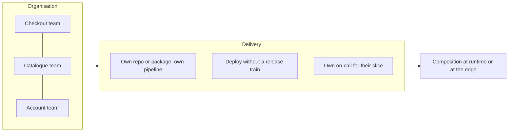
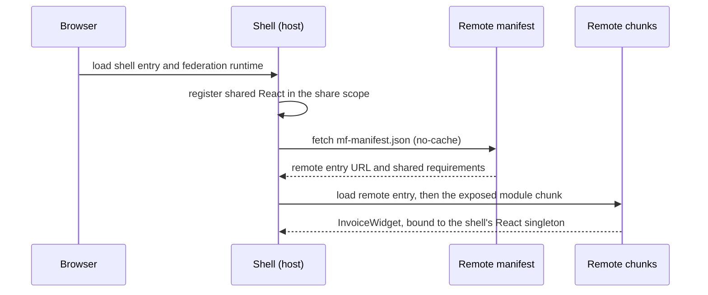

# 61 — Micro-Frontends and Module Federation

> Micro-frontends are an answer to an organisational question: how do several teams ship one product without waiting for each other? Asked as a technical question ("how do we split the codebase?"), they're almost always the wrong answer. A monorepo with boundaries splits a codebase more cheaply. Choose micro-frontends for independent *deployment*, and pay their runtime costs knowingly.

**Prerequisites:** [21 Architecture Styles](21-frontend-architecture-styles-and-boundaries.md), [60 Monorepos](60-monorepos-build-tooling-and-bundlers.md) · **Related:** [31 Routing](31-routing-architecture.md) · [35 Design Systems](35-enterprise-design-system-architecture.md) · [40 Resilience](40-resilience-and-reliability.md) · [41 Observability](41-observability-and-diagnostics.md) · [58 Angular at Scale](58-angular-at-scale.md) · [59 React vs Angular](59-react-vs-angular-architecture-comparison.md) · [62 CI/CD](62-cicd-release-engineering-and-feature-flags.md)

---

## TL;DR

- **The test.** If the teams would release together anyway, don't split at runtime. Micro-frontends buy independent deployment. Everything else they're credited with, a monorepo with enforced boundaries delivers more cheaply.
- **Prefer the simplest composition that gives independent deployment:**
  1. A **route-level split** behind a proxy, such as Next.js Multi-Zones or one app per path.
  2. **Runtime federation** only for fragments that genuinely share a page.
  3. **Iframes** only when you need hard isolation.
- **Module Federation 2.0** (stable early 2026) is bundler-agnostic: webpack, Rspack/Rsbuild, Vite and Modern.js, with manifests, type hints, runtime plugins and preloading. The Next.js App Router isn't supported. Angular uses Native Federation ([58](58-angular-at-scale.md)).
- **What I verified** with Rsbuild 2.3 and Module Federation 2.9:
  - **Sharing works.** One shared React instance spanned host and remote.
  - **Independent deployment works.** A remote's new version appeared without rebuilding the shell.
  - **Outages need configuration.** With the default share strategy, a remote outage blanked the entire shell. `shareStrategy: 'loaded-first'` plus an error boundary contained it.
  - **Version mismatches are silent by default.** A remote built for React ^19.3 ran on the shell's 19.2.9 with only a console warning. `strictVersion` made it fail closed.
- **Runtime cost is real.** In my build each remote entry carried 33 kB gzip of federation code. Sharing the host's runtime (`provideExternalRuntime` / `externalRuntime`) cut it to 15 kB.
- **Governance makes or breaks it.**
  - One shared-dependency policy, checked in CI against manifests.
  - Contracts: typed props, DOM events and URLs.
  - A shell team that owns the frame.
  - Observability per remote.

---

## 1. What micro-frontends are for



They help when:

- several teams own clearly separate slices of one product;
- coordinating releases costs more than integrating at runtime;
- slices have different lifecycles, such as a legacy area being replaced, or an acquisition being folded in.

They hurt when they're used to:

- organise code, which a monorepo with boundaries does better ([60](60-monorepos-build-tooling-and-bundlers.md));
- mix frameworks for fashion;
- improve performance. They make it harder, not easier.

The costs never go away:

- duplicate or mismatched dependencies;
- runtime integration failures that no build catches;
- consistency across teams in design, accessibility and performance;
- more complex local development and testing;
- per-slice operations.

---

## 2. Composition options

| Approach | How it composes | Independent deploy | Shared page | Isolation | Typical use |
|---|---|---|---|---|---|
| **Route-level split** | A proxy or edge routes paths to separate apps; full page loads between them | Yes | No | Strong | The default: `/checkout`, `/account` and `/catalogue` as separate apps |
| **Build-time packages** | Teams publish npm packages, and the shell rebuilds to adopt them | No | Yes | Weak | Shared design system and libraries, which aren't micro-frontends |
| **Server or edge composition** | Fragments stitched into HTML on the server (edge includes, fragment services) | Yes | Yes | Medium | Content-heavy pages with independently owned regions |
| **Runtime federation** | The browser loads remote modules from other deployments and shares dependencies | Yes | Yes | Weak: same JS realm | Widgets owned by other teams inside one SPA |
| **Custom elements** | Teams ship web components, often built with Angular Elements or Lit | Yes, if loaded at runtime | Yes | Medium (Shadow DOM) | Cross-framework widgets ([59](59-react-vs-angular-architecture-comparison.md)) |
| **Iframes** | Separate documents | Yes | Visually | Strong | Third-party or untrusted content; hard security isolation |

**Vertical before horizontal.** Split by page or journey first, which is a vertical split. Put fragments from different teams on the same page, a horizontal split, only when it's truly necessary, for example a platform-owned header or a recommendation widget from another team. Every horizontal split adds a runtime contract and a failure mode to every page it appears on.

### 2.1 Route-level splits with Next.js Multi-Zones

Next.js's own micro-frontend model is **Multi-Zones**: separate Next.js apps, each serving a set of paths under one domain.

- **Assets.** Each zone sets an `assetPrefix`, so its `/_next/` assets don't collide with another zone's.
- **Routing.** A proxy routes the paths, or one app does it with `rewrites`. Use `proxy.ts` when the routing decision depends on a feature flag, for example during a migration.
- **Navigation.** Navigation inside a zone is a soft client-side navigation. Navigation *between* zones is a hard one, and cross-zone links should use a plain `<a>` rather than `<Link>`.
- **Server Actions.** These need `experimental.serverActions.allowedOrigins` to list the user-facing domain.

Pages that users visit together should live in the same zone.

The same pattern works for any framework. Have a proxy route `/app/*` to one deployment and `/new/*` to another, share the session through a BFF cookie, and share design tokens. That is also the safest migration seam ([59](59-react-vs-angular-architecture-comparison.md), [64](64-migration-playbooks.md)).

---

## 3. Module Federation 2.0

Module Federation lets one build (the *host* or shell) load modules from another, separately deployed build (a *remote*) at runtime. It negotiates *shared* dependencies so both use one copy of React. Version 2.0, stable in early 2026, separated the runtime from webpack. It also added:

- a manifest (`mf-manifest.json`);
- dynamic TypeScript type hints for remotes;
- runtime plugins and preloading;
- Node.js and SSR support;
- devtools that show which shared versions are in use.



| Bundler or framework | Module Federation in 2026 |
|---|---|
| Rspack / Rsbuild 2 | Module Federation 1.5 built into Rspack; 2.0 through `@module-federation/rsbuild-plugin` (2.9) |
| webpack 5 | `@module-federation/enhanced` (2.9) |
| Vite | `@module-federation/vite` (1.25) |
| Modern.js (ByteDance) | First-class; the Module Federation team's recommended React framework for federation |
| Next.js | `nextjs-mf` has been in maintenance since November 2024 and supports the Pages Router only. Use Multi-Zones for the App Router |
| Angular | Native Federation (import maps, esbuild) ([58](58-angular-at-scale.md)) |

### 3.1 A host and a remote

```ts
// remote/rsbuild.config.ts: the invoices team's app exposes one widget
import { defineConfig } from '@rsbuild/core';
import { pluginReact } from '@rsbuild/plugin-react';
import { pluginModuleFederation } from '@module-federation/rsbuild-plugin';

export default defineConfig({
  server: { port: 3001 },
  output: { assetPrefix: 'http://localhost:3001/' },        // remotes must emit absolute URLs for their chunks
  plugins: [
    pluginReact(),
    pluginModuleFederation({
      name: 'invoices',
      exposes: { './InvoiceWidget': './src/InvoiceWidget.tsx' },
      shared: {                                              // fail closed if the shell offers an incompatible React
        react: { singleton: true, requiredVersion: '^19.3.0', strictVersion: true },
        'react-dom': { singleton: true, requiredVersion: '^19.3.0', strictVersion: true },
      },
      dts: false,
      experiments: { externalRuntime: true },          // don't ship a second copy of the runtime
    }),
  ],
});
```

```ts
// host/rsbuild.config.ts: the shell discovers the remote through its manifest at runtime
import { defineConfig } from '@rsbuild/core';
import { pluginReact } from '@rsbuild/plugin-react';
import { pluginModuleFederation } from '@module-federation/rsbuild-plugin';

export default defineConfig({
  server: { port: 3000 },
  plugins: [
    pluginReact(),
    pluginModuleFederation({
      name: 'shell',
      shareStrategy: 'loaded-first',   // don't fetch every remote at startup just to compare shared versions
      remotes: { invoices: 'invoices@http://localhost:3001/mf-manifest.json' },
      shared: {
        react: { singleton: true, requiredVersion: '^19.3.0' },
        'react-dom': { singleton: true, requiredVersion: '^19.3.0' },
      },
      dts: false,
      experiments: { provideExternalRuntime: true },   // remotes reuse the shell's federation runtime
    }),
  ],
});
```

```tsx
// host/src/bootstrap.tsx: every remote is lazy and behind its own boundary
import { Component, lazy, Suspense, type ReactNode, version } from 'react';
import { createRoot } from 'react-dom/client';

// The remote is a lazy import: the shell renders even when the remote is down
const InvoiceWidget = lazy(() => import('invoices/InvoiceWidget'));

class RemoteBoundary extends Component<{ children: ReactNode; name: string }, { failed: boolean }> {
  state = { failed: false };
  static getDerivedStateFromError() { return { failed: true }; }
  componentDidCatch(error: unknown) { console.error(`[remote:${this.props.name}]`, error); }
  render() {
    return this.state.failed ? <p role="alert">Invoices are unavailable right now.</p> : this.props.children;
  }
}

function Shell() {
  return (
    <main>
      <h1>Acme shell (React {version})</h1>
      <RemoteBoundary name="invoices">
        <Suspense fallback={<p>Loading invoices…</p>}>
          <InvoiceWidget tenant="acme-uk" />
        </Suspense>
      </RemoteBoundary>
    </main>
  );
}

createRoot(document.getElementById('root')!).render(<Shell />);
```

Both apps use the asynchronous-boundary pattern: `index.tsx` contains only `import('./bootstrap')`, so the federation runtime can negotiate shared modules before any React code runs. In production, report the boundary's errors to your telemetry with the remote's name and version ([41](41-observability-and-diagnostics.md)).

### 3.2 What I verified

I built both apps (Rsbuild 2.3.4, `@module-federation/rsbuild-plugin` 2.9.4, React 19.3.1). Each was served from its own origin, with `no-cache` on `mf-manifest.json` and immutable caching for hashed chunks. I loaded the shell in headless Chromium.

| Scenario | Result |
|---|---|
| Normal load | The shell rendered the remote widget. Clicking its button twice showed "Approved: 2", so hooks worked across the boundary on one React instance. The remote's own React chunks were never requested |
| Remote redeployed (v1 to v2), shell untouched | The reloaded shell showed "widget v2". Independent deployment works because the manifest isn't cached |
| Remote server down, **default** `shareStrategy` (`version-first`) | **The whole shell failed to render.** The uncaught error was `[ Federation Runtime ]: Failed to get manifest. #RUNTIME-003` |
| Remote server down, `shareStrategy: 'loaded-first'` | The shell rendered, and the boundary showed "Invoices are unavailable right now." |
| Shell on React 19.2.9, remote requires `^19.3.0`, singleton | The remote **ran on 19.2.9**. The only signal was a console warning: "Version 19.2.9 from shell of shared singleton module react does not satisfy the requirement of invoices which needs ^19.3.0" |
| Same, with `strictVersion: true` in the remote | The remote failed to load with that message as an error, and the boundary fallback rendered |
| Remote entry size | 33.0 kB gzip by default; **15.0 kB** with the shell providing the federation runtime |

The documentation confirms the outage behaviour. `version-first`, the default, "automatically" loads all remote entry files during initialisation, to pick the highest shared versions. An offline remote then trips the `errorLoadRemote` hook before sharing completes, and initialisation "may hang or fail". So with the defaults, **any remote's outage is an outage of your shell**. Use `loaded-first`, a boundary around every remote, and an `errorLoadRemote` runtime plugin that supplies a fallback module. Then test the outage in CI by blocking the remote's origin in a Playwright run ([40](40-resilience-and-reliability.md)).

---

## 4. Shared dependencies: the policy that decides everything

| Share? | What | Why |
|---|---|---|
| **Singleton, always** | `react`, `react-dom`, the router, anything holding module-level state or context (state libraries, CSS-in-JS runtimes, i18n instances) | Two copies break hooks, context and identity checks |
| **Shared, with ranges** | The design system's runtime and large utilities used by most remotes | Avoids duplicate bytes, if versions are kept aligned |
| **Not shared** | App-specific libraries | Sharing couples release cycles for no benefit |

Choose the version policy deliberately:

- **One major per framework across the estate.** Upgrade it as a coordinated programme, not by individual teams.
- **Choose `loaded-first` vs `version-first`.** `loaded-first` is cheaper and more resilient, and the shell's version wins. `version-first` picks the highest version but fetches every remote at startup and couples their availability.
- **Choose warn vs fail.** Without `strictVersion`, a remote can silently run on a version it was never tested with. With it, the remote fails closed and its boundary shows the fallback. For React I'd use `strictVersion` on majors and accept a minor-version range the platform team tests against.
- **Check it before deployment, not in the browser.** Each remote's `mf-manifest.json` lists its shared requirements. A CI step that compares a remote's requirements with what production shells provide turns the silent mismatch into a failed deploy.
- **Upgrade in order.** When remotes need a newer React, upgrade the shell first, since it provides the singleton. Then let remotes raise their `requiredVersion`.

---

## 5. Ownership and contracts

| Owner | Owns |
|---|---|
| **Shell or platform team** | The frame: routing between slices, session and auth, design tokens and the global stylesheet, error boundaries, telemetry, the shared-dependency policy, performance budgets |
| **Domain teams** | Their vertical slices or remotes: features, data, their own on-call |

Contracts between them:

- **Exposed modules.** Typed props, using Module Federation's generated type hints or a published types package. Treat a props change like an API change, with semver and deprecation.
- **Events.** DOM `CustomEvent`s or a small typed event bus for cross-slice notifications ("cart updated"), not shared mutable stores.
- **URLs.** Routes and query parameters are a public API between slices. Deep links must keep working across deployments.
- **State.** Cross-slice state lives on the server or in the URL. Never in `window` globals.
- **Styling.** Tokens and CSS layers from the design system, so slices look like one product and can't leak styles into each other ([23](23-styling-architecture-and-theming.md), [35](35-enterprise-design-system-architecture.md)).

---

## 6. Independent deployment in practice

- **Caching.** Manifests are `no-cache`. Chunks are content-hashed and `immutable`. That's what made the v2 rollout instant in §3.2.
- **Environments.** Point the shell at each environment's manifests through configuration or a runtime plugin, never by rebuilding the shell.
- **Rollback.** Redeploy or re-point the previous manifest. Keep old chunks available for at least the longest session length, because open tabs still reference them.
- **Canaries.** A runtime plugin can choose a remote's manifest URL per user cohort. Combine that with feature flags for anything that spans several slices ([62](62-cicd-release-engineering-and-feature-flags.md)).
- **Version skew.** An old shell will meet a new remote, and the reverse. Define a compatibility window, for example "remotes support the current and previous shell contract". Test both combinations in CI.

---

## 7. Performance and testing

**Performance.**

- Each remote adds a request chain: manifest, then remote entry, then exposed chunk. Preload critical remotes, and keep them few on the critical path.
- Share the federation runtime: in my build it cut the remote entry from 33 kB to 15 kB gzip.
- Budget the *composed* page, not each remote in isolation. Duplicated libraries appear whenever versions drift ([39](39-web-performance-and-core-web-vitals.md)).

**Testing.**

- **Contract tests in each remote's pipeline.** Check the type hints, and run consumer-driven tests of the props and events contract.
- **An integration environment with production manifests.** Playwright journeys there must also cover a remote being down and a remote with a mismatched shared version ([42](42-testing-architecture.md)).
- **Local development.** Run your slice against the deployed shell and the other remotes, overriding one manifest at a time.

---

## Decision framework

**Problem.** Several teams need to ship parts of one product independently.

**Constraints.**

- How often the teams' releases conflict today.
- Whether slices share pages or only a domain.
- The frameworks involved.
- Requirements for SEO and server rendering.
- How much runtime cost and operational complexity the organisation can absorb.
- Whether there's a platform team to own the shell.

| Situation | Choose |
|---|---|
| Teams own separate journeys or pages | **Route-level split** (proxy, Next.js Multi-Zones) |
| One team, or teams that release together | **Monorepo with boundaries**: no micro-frontends ([60](60-monorepos-build-tooling-and-bundlers.md)) |
| Another team's widget must share a page and deploy independently | **Module Federation 2** (React) or **Native Federation** (Angular), with `loaded-first`, boundaries and a version policy |
| Cross-framework widget | **Custom elements** loaded at runtime, or federation exposing a mount function |
| Untrusted or third-party UI | **Iframe** with a narrow `postMessage` contract |
| Content regions owned by different teams, SEO-critical | **Server or edge composition** |

**Criteria.** Release lead time per team, change failure rate attributable to integration, the composed page's Core Web Vitals, and incident blast radius: does one slice's outage take down others?

**Failure modes.**

- Federation adopted to organise code.
- Default `version-first` making every remote a single point of failure.
- Silent singleton mismatches.
- Shared mutable state through globals.
- Each team picking its own React version.
- No shell owner.
- Testing each slice only in isolation.

**Migration path.**

1. Start with a route-level split behind a proxy.
2. Move shared code into versioned packages.
3. Introduce federation for the first genuinely shared-page widget, with the full policy: share strategy, boundaries, strict majors, manifest checks in CI.
4. Expand only when the first remote has run through an outage drill and a dependency upgrade.

---

## Pitfalls and anti-patterns

- **Micro-frontends as a code-organisation tool.** You get runtime coupling instead of build-time coupling, which is harder to see and harder to test.
- **Default `version-first` sharing in production.** I watched it turn one remote's outage into a blank shell.
- **No `strictVersion` on framework majors.** Remotes run on versions they were never tested with, and the only evidence is a console warning.
- **Remotes without error boundaries.** One remote's render error unmounts the whole tree.
- **A shared store across slices.** It recreates the coupling you split to escape. Use URLs, events and the server.
- **Cached manifests.** Then "independent deployment" waits for the CDN.
- **Deleting old chunks on deploy.** Open tabs break mid-session. Keep previous builds' chunks available.
- **Federation for the Next.js App Router.** It isn't supported. Use Multi-Zones.
- **Each remote shipping its own federation runtime.** In my build that was 18 kB gzip per remote that sharing the host's runtime removes.

---

## Architect's checklist

- [ ] An ADR records why runtime composition is needed, rather than a monorepo or route split
- [ ] Slices are vertical (by journey) wherever possible; each horizontal fragment has a named owner and contract
- [ ] Shared-dependency policy: singletons for React, router and stateful libraries; `strictVersion` on majors; one framework major across the estate
- [ ] `shareStrategy: 'loaded-first'`, an error boundary per remote, and an `errorLoadRemote` fallback; outage drills run in CI
- [ ] Remote manifests are checked in CI against what production shells provide
- [ ] Manifests are `no-cache`, chunks immutable, and previous chunks retained for rollback and open sessions
- [ ] Contracts (props, events, URLs) are typed and versioned; cross-slice state lives in URLs or on the server
- [ ] The composed page has a performance budget that includes federation runtime and request chains
- [ ] Telemetry tags every error and metric with the remote's name and version

---

## Interview angles

**Q1. When would you recommend micro-frontends, and when not?**
When several teams own separate parts of one product and coordinating releases has become the bottleneck, so independent deployment is worth a runtime integration cost. Not when the goal is code organisation, performance or framework freedom: a monorepo with enforced boundaries does organisation better, and micro-frontends make performance harder. Even when they're justified, I start with a route-level split behind a proxy and add runtime federation only for widgets that must share a page.

**Q2. How does Module Federation share React between a host and a remote, and what can go wrong?**
Both builds declare React as a shared singleton. At runtime the federation runtime registers available versions in a share scope, and each consumer gets the negotiated instance, so hooks and context work across the boundary. I verified that: a remote's stateful widget worked inside the shell, and the remote's own React chunks were never downloaded. What goes wrong is version skew. Without `strictVersion`, a remote built for React ^19.3 ran on the shell's 19.2.9 with only a console warning. I'd set `strictVersion` on majors, check remote manifests against production shells in CI, and upgrade the shell first.

**Q3. One remote is down. What happens to your shell?**
With Module Federation's default `version-first` share strategy, potentially everything. It loads every remote entry during initialisation, and in my test a single unreachable manifest stopped the shell from rendering at all. I'd use `loaded-first`, so remotes load on demand. Each remote goes inside its own error boundary with a useful fallback, an `errorLoadRemote` runtime plugin covers loader failures, and a Playwright journey in CI blocks each remote's origin to prove the shell degrades gracefully.

**Q4. How do teams deploy remotes independently without breaking each other?**
- **Caching:** manifests served `no-cache`, chunks content-hashed and immutable.
- **Rollback:** re-point a manifest, and retain old chunks for open sessions.
- **Canaries:** a runtime plugin selects manifest URLs per cohort.
- **Contracts:** typed props, events and URLs, versioned with deprecation. Each remote's pipeline runs contract tests.
- **Integration:** an environment with production manifests runs cross-slice journeys, including skew between the current and previous shell.

**Q5. How do you do micro-frontends with Next.js?**
With Multi-Zones: separate Next.js apps per set of paths under one domain. Each zone has its own `assetPrefix`, routing goes through rewrites or `proxy.ts`, and cross-zone navigation uses plain links and full page loads. Module Federation's Next.js plugin has been in maintenance since late 2024 and doesn't support the App Router. If a page truly needs another team's widget, I'd use a custom element or a client-only island loaded at runtime, inside an error boundary.

---

## Further reading

- Module Federation docs: <https://module-federation.io> · *shareStrategy*: <https://module-federation.io/configure/shareStrategy.html>
- Next.js, *How to build micro-frontends using multi-zones*: <https://nextjs.org/docs/app/guides/multi-zones>
- Native Federation (Angular): <https://native-federation.com/docs/v4/angular-adapter/getting-started/>
- Rsbuild, *Module Federation*: <https://rsbuild.rs/guide/advanced/module-federation>
- Michael Geers, *Micro Frontends in Action* (Manning), still the clearest treatment of composition patterns

---

[← Previous: 60 — Monorepos, Build Tooling and Bundlers](60-monorepos-build-tooling-and-bundlers.md) · [Index](README.md) · [Next: 62 — CI/CD, Release Engineering and Feature Flags →](62-cicd-release-engineering-and-feature-flags.md)
