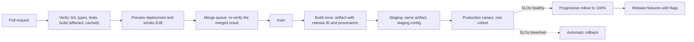

# 62 — CI/CD, Release Engineering and Feature Flags

> A frontend release isn't finished when the deploy finishes. It's finished when every open tab has moved to the new code without losing anyone's work, when the new feature has reached the people it was meant for, and when you could have turned it off in seconds if the graphs had gone the wrong way.

**Prerequisites:** [40 Resilience](40-resilience-and-reliability.md), [60 Monorepos](60-monorepos-build-tooling-and-bundlers.md) · **Related:** [17 SSR and Hydration](17-ssr-streaming-and-hydration.md) · [41 Observability](41-observability-and-diagnostics.md) · [42 Testing](42-testing-architecture.md) · [43 Security](43-frontend-security-architecture.md) · [50 Next.js in Production](50-nextjs-in-production.md) · [51 React Router v8](51-react-router-v8-framework-mode.md) · [61 Micro-frontends](61-micro-frontends-and-module-federation.md) · [63 Governance](63-architecture-governance-and-adrs.md)

---

## TL;DR

- **The pipeline is a product with an SLO.**
  - PR feedback in under ten minutes, through affected-only, cached tasks ([60](60-monorepos-build-tooling-and-bundlers.md)).
  - A merge queue keeps `main` green.
  - A preview deployment for every PR.
- **Build once, deploy many.** One artifact moves from staging to production. Configuration that differs per environment is loaded at runtime, not baked in with `VITE_*` or `NEXT_PUBLIC_*`.
- **Separate deploy from release** with feature flags.
  - **OpenFeature** (CNCF incubating) is the vendor-neutral API.
  - **Evaluate on the server and bootstrap the result** into the page, so there's no flicker.
  - **Defaults are a product decision, not a technicality.** I tested it: an unknown flag returned its default with `FLAG_NOT_FOUND`, and a provider that never became ready still rendered the safe default.
- **Progressive delivery.** Canaries by cohort, release-tagged telemetry, automated rollback on SLOs, and kill switches.
- **Version skew is release engineering's problem.** I simulated a deploy under an open tab:
  - **Old chunks deleted:** the [40](40-resilience-and-reliability.md) recovery handler reloaded once into the new build.
  - **Old chunks retained:** the old tab simply kept working.
  - **Reload already used:** the loop guard handed the error to the boundary.
  - **Testing gotcha:** the browser's HTTP cache hid the bug until I tested in a fresh context.
- **Continuous dependency updates with cooldowns.** Renovate's `minimumReleaseAge` or Dependabot's `cooldown`, with auto-merge for patches and minors on green CI. Majors are planned work. Security fixes skip the queue.
- **CI is part of the supply chain.**
  - Least-privilege tokens.
  - Actions pinned to commit SHAs.
  - OIDC instead of stored secrets.
  - Signed provenance for every artifact.

---

## 1. The delivery pipeline



| Stage | Budget | Gate |
|---|---|---|
| Verify (PR) | Under 10 minutes at p90 | Required checks: lint, types, unit and component tests, build, publint for libraries |
| Preview | Under 5 minutes after verify | Smoke journeys on the preview URL; visual diffs on design-system changes |
| Merge queue | Same checks on the merged commit | Keeps `main` deployable even when two green PRs conflict semantically |
| Staging | Minutes | Full E2E on critical journeys; contract tests against staging APIs ([42](42-testing-architecture.md)) |
| Canary | 15–60 minutes | Error rate, Core Web Vitals and business metrics, all tagged by release |
| Rollout | Hours | The same SLOs, plus support-ticket and session-replay spot checks |

### 1.1 A workflow that does the basics right

```yaml
# .github/workflows/ci.yml: one pipeline for PRs, the merge queue and main
name: ci
on:
  pull_request:
  merge_group:                  # the merge queue re-runs checks on the exact merged result
  push:
    branches: [main]

permissions:
  contents: read                # least privilege by default; jobs opt in to more

concurrency:
  group: ci-${{ github.workflow }}-${{ github.ref }}
  cancel-in-progress: ${{ github.event_name == 'pull_request' }}

jobs:
  verify:
    runs-on: ubuntu-latest
    timeout-minutes: 15
    steps:
      - uses: actions/checkout@3d3c42e5aac5ba805825da76410c181273ba90b1 # v7.0.1
        with:
          fetch-depth: 0        # affected-only runs compare against the base commit
      - uses: pnpm/action-setup@73e46992e05b19abd31f2f3c20e0e7370d762115 # v6.1.1
      - uses: actions/setup-node@949feb2413d6458794dcd2491c4babbbce0c15c1 # v7.1.0
        with:
          node-version: 24
          cache: pnpm
      - run: pnpm install --frozen-lockfile
      - run: pnpm exec turbo run lint typecheck test build --affected
        env:
          TURBO_SCM_BASE: ${{ github.event.pull_request.base.sha || github.event.merge_group.base_sha || github.event.before }}
          TURBO_TOKEN: ${{ secrets.TURBO_TOKEN }}       # remote cache
          TURBO_TEAM: acme
      - run: pnpm --filter "./packages/*" exec publint --strict

  build-release:
    if: github.event_name == 'push'
    needs: verify
    runs-on: ubuntu-latest
    permissions:
      contents: read
      id-token: write           # OIDC: no long-lived cloud or registry secrets
      attestations: write       # signed provenance for the artifact
    steps:
      - uses: actions/checkout@3d3c42e5aac5ba805825da76410c181273ba90b1 # v7.0.1
      - uses: pnpm/action-setup@73e46992e05b19abd31f2f3c20e0e7370d762115 # v6.1.1
      - uses: actions/setup-node@949feb2413d6458794dcd2491c4babbbce0c15c1 # v7.1.0
        with:
          node-version: 24
          cache: pnpm
      - run: pnpm install --frozen-lockfile
      - run: pnpm exec turbo run build --filter=@acme/web
        env:
          RELEASE_ID: ${{ github.sha }}             # baked into the bundle for telemetry, not configuration
      - run: tar -czf web-${{ github.sha }}.tgz -C apps/web/dist .
      - uses: actions/attest-build-provenance@4d101475d8b20a2381f78447822ac1eab6504dd8 # v4.2.2
        with:
          subject-path: web-${{ github.sha }}.tgz
      - uses: actions/upload-artifact@cf430e030ddbb5b0abf93d22962f4752f3646cd9 # v7.0.2
        with:
          name: web-${{ github.sha }}
          path: web-${{ github.sha }}.tgz
```

What makes this workflow defensible:

- **Every action is pinned to a full commit SHA**, resolved from each action's latest release tag in November 2026. A tag can be moved to malicious code; a SHA can't.
- **Permissions default to read.** Only the release job can mint OIDC tokens and write attestations.
- **Merge-queue runs (`merge_group`) use the same checks**, so the queue tests what will actually land.
- **The artifact gets signed provenance.** Deploy jobs then fetch *this* tarball by SHA and never rebuild it.

I checked that the YAML parses and that every `uses:` is a 40-character SHA. It hasn't been run on GitHub. Have Renovate or Dependabot keep the SHAs current (§6).

---

## 2. Build once, deploy many

If staging and production need different builds, you never test what you ship. The usual culprit is configuration baked in at build time: `VITE_*`, `NEXT_PUBLIC_*` and `import.meta.env` values are compiled into the bundle ([43](43-frontend-security-architecture.md)). Keep build-time variables for things that are the same everywhere, such as the release ID. Load anything environment-specific at runtime:

```ts
// config.ts: one artifact, many environments: configuration is fetched at startup, not baked in
export interface RuntimeConfig { apiBaseUrl: string; flagsUrl: string; release: string }

export async function loadConfig(): Promise<RuntimeConfig> {
  const res = await fetch('/config.json', { cache: 'no-store' });  // written per environment by the deploy
  if (!res.ok) throw new Error(`Runtime config unavailable (${res.status})`);
  return res.json() as Promise<RuntimeConfig>;
}
```

With server rendering, the BFF or server injects the same object into the HTML instead, which saves a request. Either way, runtime configuration is public: it holds URLs and public keys, never secrets.

**Preview environments.** Every PR gets a URL with seeded, synthetic data: never production personal data. Put previews behind authentication if they can reach real backends. Point them at staging APIs or contract stubs. Destroy them when the PR closes.

---

## 3. Feature flags: separate deploy from release

### 3.1 Kinds of flags

| Kind | Example | Lifetime | Owner |
|---|---|---|---|
| **Release** | `checkout-v2`: ship dark, then ramp up | Days to weeks, then delete | The feature team |
| **Experiment** | Two copy variants, measured | One test cycle | Product and analytics |
| **Operational** (kill switch) | Turn off recommendations when their service degrades | Permanent, reviewed yearly | Service owner and on-call |
| **Permission or plan** | An enterprise-only feature | Permanent | Product; usually belongs in entitlements, not flags ([45](45-authentication-and-authorization.md)) |

### 3.2 OpenFeature: one API, any provider

OpenFeature (a CNCF incubating project since November 2023) standardises the flag-evaluation API: SDKs for the web, React, Node and other platforms, with a pluggable *provider* for your vendor or your own service. The app depends on the API. Switching from one vendor to another, or to a self-hosted flagd, is a provider swap.

```ts
// flags.mts: evaluate per request on the server, bootstrap the result, render the same answer on the client
import { InMemoryProvider as ServerInMemoryProvider, OpenFeature as ServerFeatures } from '@openfeature/server-sdk';
import { InMemoryProvider, OpenFeature, OpenFeatureProvider, useBooleanFlagValue } from '@openfeature/react-sdk';
import { createElement as h } from 'react';
import { renderToString } from 'react-dom/server';

// 1. Server: one provider for the process; the evaluation context is per request
await ServerFeatures.setProviderAndWait(new ServerInMemoryProvider({
  'checkout-v2': {
    variants: { on: true, off: false },
    defaultVariant: 'off',
    disabled: false,
    contextEvaluator: (ctx) => (ctx['tenant'] === 'acme-uk' ? 'on' : 'off'),   // targeting rule
  },
}));
const flags = ServerFeatures.getClient('web-bff');

for (const tenant of ['acme-uk', 'acme-us']) {
  const d = await flags.getBooleanDetails('checkout-v2', false, { targetingKey: `user-of-${tenant}`, tenant });
  console.log(`server  ${tenant}: value=${d.value} variant=${d.variant} reason=${d.reason}`);
}
const typo = await flags.getBooleanDetails('checkout-v3', false, { targetingKey: 'u1' });
console.log(`server  unknown flag: value=${typo.value} reason=${typo.reason} errorCode=${typo.errorCode}`);

// 2. The page carries the server's answers; the client provider starts from them, so SSR and hydration agree
const bootstrap = { 'checkout-v2': (await flags.getBooleanValue('checkout-v2', false, { targetingKey: 'u1', tenant: 'acme-uk' })) };
await OpenFeature.setProviderAndWait(new InMemoryProvider({
  'checkout-v2': { variants: { on: true, off: false }, defaultVariant: bootstrap['checkout-v2'] ? 'on' : 'off', disabled: false },
}));

function Checkout() {
  const v2 = useBooleanFlagValue('checkout-v2', false);         // false is the safe default if anything goes wrong
  return h('p', null, v2 ? 'New checkout' : 'Classic checkout');
}
console.log('client  render:', renderToString(h(OpenFeatureProvider, null, h(Checkout))));

// 3. A provider that never becomes ready: the component still renders, with the default
OpenFeature.setProvider('stalled', { metadata: { name: 'stalled' }, runsOn: 'client', initialize: () => new Promise<void>(() => {}),
  resolveBooleanEvaluation: () => ({ value: true }) } as never);
console.log('stalled render:', renderToString(h(OpenFeatureProvider, { domain: 'stalled' }, h(Checkout))));
```

The file type-checks and runs on Node 22 with `@openfeature/server-sdk` 1.23, `web-sdk` 1.10 and `react-sdk` 1.4:

```text
server  acme-uk: value=true variant=on reason=TARGETING_MATCH
server  acme-us: value=false variant=off reason=TARGETING_MATCH
server  unknown flag: value=false reason=ERROR errorCode=FLAG_NOT_FOUND
client  render: <p>New checkout</p>
stalled render: <p>Classic checkout</p>
```

The design rules that output implies:

- **Evaluate on the server, bootstrap the client.** The server knows the user and tenant at request time. Serialising its answers into the page means the first client render matches the server HTML: no flicker, no hydration mismatch ([17](17-ssr-streaming-and-hydration.md)). In production, swap the in-memory bootstrap for your vendor's bootstrap option or an OFREP-based provider seeded with these values.
- **Every flag read names a safe default.** A typo, an outage or a stalled SDK produces the default, as the last two lines show. So the default must be the behaviour you're comfortable with when the flag system is down. For a release flag that's usually "off". For a kill switch, "feature on, unless explicitly killed".
- **Log the reason.** `ERROR`/`FLAG_NOT_FOUND` in telemetry is how you find typos and dead flags before users do. Tag every error and performance event with the flags in effect ([41](41-observability-and-diagnostics.md)).
- **Mind the evaluation context.** Use a stable `targetingKey`, a pseudonymous user ID, so assignment is consistent across server and client and across devices. Send only the attributes that targeting needs, and no personal data beyond that.

### 3.3 Flag debt

Every flag is a branch in production. Unremoved flags rot: both paths need testing, nobody remembers which is live, and the old path still runs for some cohort.

- Every flag has an **owner and an expiry date** when it's created. The flag service or a lint rule enforces both.
- When a release flag reaches 100%, a **clean-up ticket is created automatically**, and the code path and the flag are deleted together.
- **Test both paths** while the flag lives. OpenFeature's `OpenFeatureTestProvider` sets values per test.
- **Track flag count and age** as a health metric. A growing count of flags older than 90 days is debt with interest ([63](63-architecture-governance-and-adrs.md)).

---

## 4. Progressive delivery and rollback

- **Canary by cohort, not only by traffic percentage.** Start with internal users, then one region or a low-risk tenant tier, then 5%, 25% and 100%. Cohort canaries let you contact the affected users, which a random 5% doesn't.
- **Watch release-tagged signals.**
  - JavaScript error rate and unhandled rejections.
  - Chunk-load failures.
  - Core Web Vitals (especially INP) for the new release against the old one.
  - API error rates from the new client.
  - The business metric the change was meant to move ([39](39-web-performance-and-core-web-vitals.md), [41](41-observability-and-diagnostics.md)).
- **Automate rollback.** When the canary breaches an SLO for N minutes, roll back without paging anyone first. For a frontend, rollback means re-pointing the HTML (or the micro-frontend manifest) to the previous release. That only works if the previous release's assets are still there (§5).
- **Coordinate with APIs through expand and contract.** Deploy the API change that accepts both shapes, then the client, then remove the old shape. Never ship a client that needs an API version not yet deployed everywhere ([33](33-api-integration-bff-and-contracts.md)).
- **Kill switches beat rollbacks** for feature-level problems: one flag flip instead of a deploy.

---

## 5. Version skew

Open tabs run the build they loaded. After a deploy they request chunks, call server functions and send API payloads shaped by the *old* release. To test the remedies in [40](40-resilience-and-reliability.md), I built two versions of a small Vite 8 app with a lazily loaded report, using its chunk-recovery handler unchanged. I opened the app on build v1, deployed v2 underneath it, and clicked to load the report. Each scenario ran in a fresh headless Chromium context.

| Scenario | What happened |
|---|---|
| **v1 chunks deleted** by the deploy; recovery handler on | `vite:preloadError` fired. The handler reloaded **once**, and the tab came back on "Build v2", where the report loaded |
| **v1 chunks retained** alongside v2 | The old tab loaded "Report from build v1" with **no reload**: the best experience, since nothing was interrupted |
| v1 chunks deleted, **the tab had already reloaded within the last minute** | The loop guard held. The error reached the boundary: "Failed to fetch dynamically imported module: …/assets/report-CYGQfXQs.js" |

**The browser cache can hide skew.** My first run reused one browser, which had already cached the v1 chunk in an earlier scenario. The "deleted" chunk loaded anyway and the test passed for the wrong reason. Test skew in a fresh browser context, as real users on cold caches experience it.

The layered defence:

1. **Retain old assets** for at least the longest realistic session, plus margin. Deploys add files; a separate job garbage-collects files older than the window.
2. **Recover once** on chunk-load failure (the handler above), guarded against loops.
3. **Use framework skew protection.**
   - Next.js: `deploymentId` triggers a hard navigation on mismatch ([50](50-nextjs-in-production.md)).
   - React Router 8: a manifest change reloads the destination document on navigation ([51](51-react-router-v8-framework-mode.md)).
   - Platforms that route a client to its original deployment for a window.
4. **Keep APIs backward compatible** with at least the previous client (expand and contract), and persist drafts, so a forced reload never loses work ([40](40-resilience-and-reliability.md)).
5. **Measure it.** Track the chunk-load failure rate after each deploy, and the distribution of client releases in RUM. Old releases should fade within your retention window.

---

## 6. Dependency updates

Small, continuous updates are cheaper and safer than annual upgrade projects. Put them on rails:

```json
{
  "$schema": "https://docs.renovatebot.com/renovate-schema.json",
  "extends": ["config:recommended"],
  "minimumReleaseAge": "3 days",
  "lockFileMaintenance": { "enabled": true, "schedule": ["before 6am on monday"] },
  "packageRules": [
    {
      "description": "Low-risk updates merge themselves once CI is green",
      "matchUpdateTypes": ["patch", "minor"],
      "matchCurrentVersion": "!/^0/",
      "automerge": true
    },
    {
      "description": "Framework packages move together",
      "groupName": "react",
      "matchPackageNames": ["react", "react-dom", "@types/react", "@types/react-dom"]
    },
    {
      "description": "Majors wait longer and need a human to start them",
      "matchUpdateTypes": ["major"],
      "minimumReleaseAge": "14 days",
      "dependencyDashboardApproval": true
    }
  ]
}
```

That config passes Renovate's own validator (`renovate-config-validator`, Renovate 44.262): "Config validated successfully". For Dependabot, the equivalent has been generally available since July 2025:

```yaml
# .github/dependabot.yml
version: 2
updates:
  - package-ecosystem: npm
    directory: "/"
    schedule:
      interval: weekly
    cooldown:
      default-days: 3
      semver-major-days: 14
    groups:
      react:
        patterns: ["react", "react-dom", "@types/react*"]
  - package-ecosystem: github-actions       # keeps the pinned action SHAs current
    directory: "/"
    schedule:
      interval: weekly
```

Policies that make this safe:

- **A cooldown at both layers**: in the update bot, and in the package manager (pnpm's `minimumReleaseAge`, [60](60-monorepos-build-tooling-and-bundlers.md)). Most malicious versions are found and pulled within days. Dependabot's cooldown applies to version updates only, so security updates still arrive immediately.
- **Auto-merge only what CI can judge.** Patches and minors of non-zero-major packages qualify, provided tests cover behaviour and not just compilation.
- **Majors are planned work** with an owner. Framework majors follow their published cadence: React's, Next.js's, and Angular's yearly train ([58](58-angular-at-scale.md)).
- **Framework security releases are a fast lane.** A React, Next.js or Angular advisory with a server-side impact deploys within days, not at the next sprint ([44](44-rsc-security-threat-model.md), [A3](A3-security-advisories-timeline.md)).

---

## 7. Securing the pipeline

| Risk | Control |
|---|---|
| A compromised action or tag | Pin actions to full SHAs; let the update bot bump them; allow-list actions at organisation level |
| Over-privileged tokens | `permissions: contents: read` by default; grant `id-token` and `attestations` only where needed |
| Long-lived secrets | OIDC federation to cloud providers and to npm (trusted publishing); no deploy keys in repository secrets |
| Untrusted PR code with secrets | Don't run privileged workflows on fork PRs. Avoid `pull_request_target` with a checkout of PR code |
| Tampered artifacts | Build once, attest provenance, verify the attestation before deploying |
| Malicious dependencies | Cooldowns, blocked install scripts (`allowBuilds`), reviewed lockfile changes, an SBOM per release ([43](43-frontend-security-architecture.md)) |
| Leaky previews | Authentication on preview URLs; synthetic data; staging or stubbed backends |

Provenance tells you where and how an artifact was built. It doesn't tell you the build was benign: in 2026's worm attacks, compromised workflows published validly signed malware ([60](60-monorepos-build-tooling-and-bundlers.md)). The controls above are what make the provenance meaningful.

---

## Decision framework

**Problem.** Design how frontend changes move from a pull request to every user, safely and quickly.

**Constraints.**

- Team count and deploy frequency.
- Hosting: a static CDN, Node servers or an edge platform.
- Server rendering, which brings server functions and skew.
- Compliance and audit needs.
- Whether you have a flag vendor or must self-host.
- Mobile or embedded clients that can't be force-updated.

| Decision | Choose | When |
|---|---|---|
| Branching | Trunk-based with short-lived branches and a merge queue | Default |
| Environments | PR previews, one staging, production with canaries | Default; add per-tenant canaries for B2B |
| Configuration | Runtime (`/config.json` or server-injected) | Whenever environments differ; build-time only for constants |
| Flags | OpenFeature API with your vendor's provider, server-evaluated and bootstrapped | Any product doing gradual releases or experiments |
| | Self-hosted provider (flagd, OFREP) | Data residency or cost constraints |
| Rollout | Cohort canaries with SLO-based automatic rollback | User-facing changes |
| Skew | Retain assets, recover once, framework skew protection, expand-and-contract APIs | Always, together |
| Dependencies | Renovate or Dependabot with cooldowns, grouped updates, auto-merge for patch and minor | Default |

**Criteria.** The DORA four (deployment frequency, lead time, change failure rate, time to restore), plus frontend-specific signals:

- PR time-to-green at p90;
- chunk-load failure rate after deploys;
- the age distribution of client releases;
- flag count and age;
- the dependency-update backlog.

**Failure modes.**

- Rebuilding per environment.
- Secrets in `NEXT_PUBLIC_*`.
- Flags without defaults, owners or expiry.
- Client-only flag evaluation that flickers.
- Rollbacks that fail because old assets were deleted.
- Testing skew in a warm browser.
- Auto-merging majors.
- Unpinned actions with write permissions.

**Migration path.**

1. Add a merge queue and required checks.
2. Make builds environment-agnostic, using runtime config.
3. Introduce OpenFeature with server evaluation for the next big feature.
4. Retain old assets and add chunk recovery.
5. Add release-tagged telemetry and canaries.
6. Automate rollback.
7. Pin actions and move to OIDC and provenance.
8. Turn on the update bot with cooldowns.

---

## Pitfalls and anti-patterns

- **"Works in staging" with a different build.** If the artifact differs, staging proved nothing about production.
- **Deleting old assets on deploy.** It breaks open tabs and makes rollback impossible. Garbage-collect on a schedule instead.
- **Evaluating flags only in the browser.** The page renders the default, then flips: flicker, layout shift and hydration mismatches.
- **The wrong defaults.** A release flag that defaults to "on" ships the unfinished feature the moment the flag service is down.
- **Flags as permanent architecture.** Entitlements belong in the authorisation model, not in a flag that someone can flip.
- **Testing version skew in a warm browser.** The HTTP cache hides deleted chunks, and the test passes for the wrong reason.
- **Rollback without expand and contract.** Rolling the client back onto an API that already removed the old shape is a second outage.
- **Dependency updates in quarterly batches.** Every batch is a migration. Continuous, small and cooled-down updates are cheaper.
- **`pull_request_target` workflows that check out PR code.** That hands untrusted code your secrets.

---

## Architect's checklist

- [ ] PR checks finish under 10 minutes at p90; a merge queue protects `main`; every PR has a preview with synthetic data
- [ ] One artifact per release, promoted through environments; per-environment configuration is loaded at runtime
- [ ] Artifacts carry a release ID and signed provenance; deploys verify and never rebuild
- [ ] Flags go through OpenFeature, are evaluated on the server, bootstrapped to the client, and read with safe defaults
- [ ] Every flag has an owner, an expiry and a clean-up path; flag count and age are tracked
- [ ] Canaries run by cohort with release-tagged telemetry; rollback is automatic on SLO breach
- [ ] Old assets are retained for the session window; chunk-load recovery and framework skew protection are on; skew is tested in a fresh browser context
- [ ] APIs change by expand and contract; drafts survive forced reloads
- [ ] The update bot runs with cooldowns, grouping and auto-merge rules; framework security releases have a fast lane
- [ ] Actions are pinned to SHAs, tokens are least-privilege, cloud and npm access use OIDC, and previews are protected

---

## Interview angles

**Q1. What does "separate deploy from release" mean, and how do you implement it?**
Deploying puts code in production. Releasing exposes it to users. I'd deploy continuously with new behaviour behind feature flags, then release by targeting cohorts: internal users first, then a region or tenant tier, then a percentage ramp. I'd use OpenFeature as the API so the vendor is replaceable. Flags are evaluated on the server with the request's context and bootstrapped into the page, so there's no flicker. Every flag read names a safe default, because an outage or a typo yields the default. In my test, an unknown flag came back as the default with `FLAG_NOT_FOUND`, and a stalled provider still rendered the default.

**Q2. A deploy goes out and support reports "the app broke when I clicked Reports". What happened, and how do you prevent it?**
Version skew. The tab was running the previous build and lazy-loaded a chunk the deploy had deleted. The fixes are layered:
- Retain old hashed assets for longer than a session.
- Reload once on chunk-load failure, with a loop guard.
- Use framework skew protection where available: Next.js's `deploymentId`, React Router's manifest reload.
- Keep APIs backward compatible.
- Persist drafts, so a reload never loses work.

When I simulated it, retained chunks let the old tab carry on, deleted chunks triggered one recovery reload into the new build, and the guard stopped a loop. One more lesson: test skew in a fresh browser, because a cached chunk hides the failure.

**Q3. How do you make one build deployable to every environment?**
Anything that differs by environment is loaded at runtime: a `/config.json` written by the deploy, or a config object the server injects into the HTML. Build-time variables are reserved for constants like the release ID. Then the artifact tested in staging is byte-for-byte the one in production. It carries signed provenance, and deploy jobs verify that provenance rather than rebuilding. Runtime config is public, so it never contains secrets.

**Q4. How do you keep dependencies current without importing a supply-chain attack?**
- **Cooldowns at two layers:** Renovate's `minimumReleaseAge` or Dependabot's `cooldown` in the bot, and pnpm's `minimumReleaseAge` at install, because most malicious versions are pulled within days.
- **Auto-merge** for patches and minors on green CI, grouped framework updates, and majors as planned work behind dashboard approval.
- **A fast lane** for security fixes.
- **Install-time controls:** blocked install scripts and reviewed lockfile diffs.
- **The bot also keeps pinned action SHAs current.**

**Q5. How would you secure a frontend CI/CD pipeline?**
- **Actions:** pinned to full commit SHAs and updated by a bot.
- **Permissions:** read-only by default, with OIDC and attestation rights only on the release job.
- **Secrets:** none long-lived. OIDC to the cloud and npm trusted publishing.
- **Artifacts:** built once with signed provenance, verified before deploy.
- **Untrusted code:** never run with secrets, so no `pull_request_target` checkouts of fork code.
- **Previews:** protected, with synthetic data only.

Provenance proves origin, not innocence, so the workflow itself must be locked down.

---

## Further reading

- OpenFeature docs: <https://openfeature.dev/docs/reference/intro> · React SDK package: <https://www.npmjs.com/package/@openfeature/react-sdk>
- GitHub, *Dependabot supports configuration of a minimum package age*: <https://github.blog/changelog/2025-07-01-dependabot-supports-configuration-of-a-minimum-package-age/>
- Renovate docs, *minimumReleaseAge*: <https://docs.renovatebot.com/configuration-options/#minimumreleaseage>
- Vite docs, *Load error handling*: <https://vite.dev/guide/build#load-error-handling>
- Next.js docs, *deploymentId*: <https://nextjs.org/docs/app/api-reference/config/next-config-js/deploymentId>
- Nicole Forsgren, Jez Humble and Gene Kim, *Accelerate* (IT Revolution), the research behind the DORA metrics

---

[← Previous: 61 — Micro-Frontends and Module Federation](61-micro-frontends-and-module-federation.md) · [Index](README.md) · [Next: 63 — Architecture Governance: ADRs, Fitness Functions, Ownership and Tech Debt →](63-architecture-governance-and-adrs.md)
