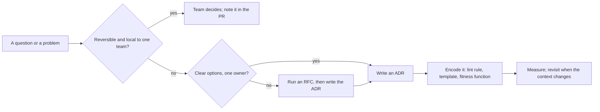
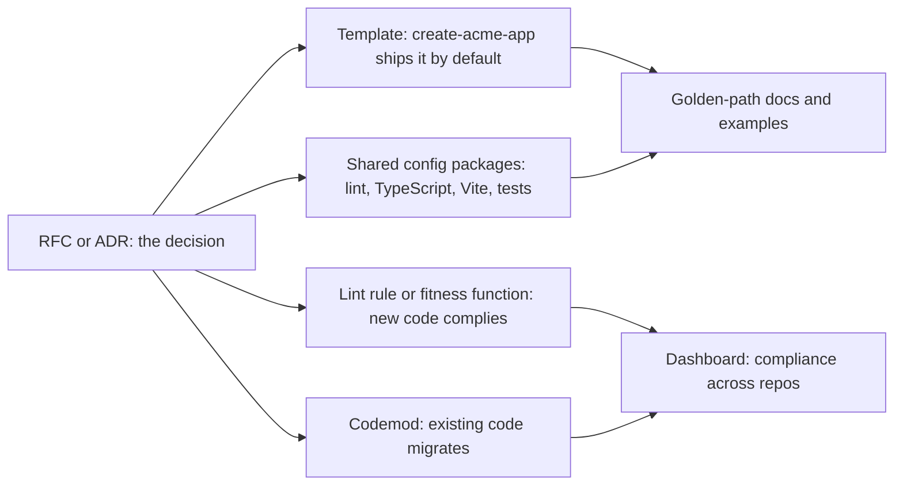

# 63 — Architecture Governance: ADRs, Fitness Functions, Ownership and Tech Debt

> Governance has a bad name because most people have only met the heavyweight kind: review boards, templates nobody reads, approval for its own sake. The useful kind is small. It writes down the decisions that are expensive to reverse, turns the important ones into automated checks, gives every piece of code an owner, and prices technical debt in terms the business can weigh.

**Prerequisites:** [21 Architecture Styles](21-frontend-architecture-styles-and-boundaries.md), [60 Monorepos](60-monorepos-build-tooling-and-bundlers.md) · **Related:** [35 Design Systems](35-enterprise-design-system-architecture.md) · [39 Web Performance](39-web-performance-and-core-web-vitals.md) · [42 Testing](42-testing-architecture.md) · [62 CI/CD](62-cicd-release-engineering-and-feature-flags.md) · [64 Migration Playbooks](64-migration-playbooks.md) · [72 The Principal Frontend Engineer](72-the-principal-frontend-engineer.md)

---

## TL;DR

- **Govern decisions, not people.** Spend process only on decisions that are expensive to reverse or that cross team boundaries. Everything else is the team's call.
- **ADRs** record one decision each: context, options, the decision, consequences and status. They live next to the code, take an hour to write, and are never deleted, only superseded.
- **RFCs** are for proposals that need input from several teams before anyone decides. They have a named decider and a deadline, and they end in an ADR.
- **Fitness functions** turn architecture rules into CI checks: import boundaries, bundle budgets, accessibility, dependency policy, flag age. My bundle-budget check, about thirty lines over Vite's manifest, passed the app at a 75 kB budget and failed it at 60 kB. A rule without a check is a wish.
- **Ownership** means every package, route and shared library has an owning team in CODEOWNERS and the service catalogue, and that team is paged when it breaks.
- **Tech debt is a loan.** Its cost is the interest: slower changes, incidents and onboarding time in the code you actually touch. Pay down hotspots, which are high churn combined with high complexity, not whatever offends someone's taste. Report it in delivery terms, not code-quality terms.
- **The paved road wins arguments.** A template, a shared config and a codemod that make the right thing the easy thing beat any policy document.

---

## 1. What governance is for

Architecture governance exists to answer three questions at scale:

1. **Which decisions do we make once, together?** Frameworks, rendering strategy, the design system, auth, the build and deploy platform, observability. They're expensive to reverse, and inconsistency between teams costs everyone.
2. **How do we know the decisions still hold?** Architecture erodes one convenient import at a time.
3. **Who fixes it when it doesn't?** Unowned code is code nobody improves.



Two failure modes bracket the right amount:

- **No governance.** Five state libraries, three date pickers and a design system nobody uses. Every team re-litigates the same choices.
- **Gatekeeping.** Every change waits on a review board, so teams route around it and the board reviews only the decisions people couldn't hide.

The test I use: if a decision would take more than a sprint to undo, or would force another team to change, write it down and make it checkable. Otherwise trust the team.

---

## 2. Architecture Decision Records

An ADR records one decision at the moment it's made. It is short, dated and immutable. When the decision changes, you write a new ADR that supersedes the old one, so the history of *why* survives.

```text
docs/adr/
├── 0001-record-architecture-decisions.md
├── 0007-adopt-pnpm-catalogs-and-release-age-policy.md
├── 0009-server-side-feature-flag-evaluation.md       # Status: Accepted
├── 0011-route-level-micro-frontend-split.md          # Status: Superseded by 0014
└── 0014-module-federation-for-shared-widgets.md
```

### 2.1 A worked example

This ADR comes from Acme, the fictional company used in the case studies ([67](67-case-study-enterprise-saas-dashboard.md)–[71](71-case-study-legacy-react-modernization.md)). Its numbers are illustrative.

```markdown
# ADR-0009: Evaluate feature flags on the server and bootstrap the client

- Status: Accepted (2026-10-02)
- Deciders: Web platform lead (decider); checkout, catalogue and account tech leads (consulted)
- Supersedes: none · Related: ADR-0004 (BFF session model)

## Context
Flags are evaluated in the browser with the vendor SDK. Pages render the default and then flip, causing
layout shift (CLS p75 rose from 0.04 to 0.11 on flagged pages) and hydration mismatches in SSR routes.
Two vendors are under evaluation for 2027, and we don't want the choice to touch application code.

## Options
1. Keep client-only evaluation and hide flagged UI until the SDK is ready.
2. Evaluate on the server per request with OpenFeature, serialise the values into the page,
   and start the client provider from them.
3. Move flags into build-time configuration.

## Decision
Option 2. Application code depends only on the OpenFeature API. Every flag read names a safe default.
Each flag has an owner and an expiry date in the flag service.

## Consequences
- No flicker on flagged pages; SSR and hydration agree.
- The BFF needs the flag provider and adds about 2 ms per request (local evaluation, no network call).
- Changing vendors becomes a provider swap. A two-week spike confirmed both candidates have providers.
- Flags older than 90 days fail the flag-age fitness function (see §4).

## Verification
Playwright journey "checkout with checkout-v2 on and off" in CI; CLS p75 on flagged pages tracked in RUM.
```

What makes an ADR useful:

- **Options with honest trade-offs.** An ADR that lists only the winning option is a press release.
- **Consequences, including the bad ones.** The reader in two years needs to know what you knowingly gave up.
- **Numbers where there are numbers.** "CLS rose from 0.04 to 0.11" ends arguments that "flicker is bad" doesn't.
- **A verification line.** How will we know the decision is being followed and is still right?

Keep ADRs in the repository they govern, reviewed like code. Link to them from the code that embodies them, for example a comment on the flag provider setup pointing to ADR-0009.

---

## 3. RFCs and architecture review

### 3.1 When to use an RFC

Use an RFC when the right answer isn't clear yet and several teams must contribute before anyone decides: a new rendering strategy, a design-system rewrite, a migration that touches every app.

| Section | Purpose |
|---|---|
| Summary and motivation | The problem in two paragraphs, with evidence |
| Goals and non-goals | Non-goals prevent the RFC from growing into everything |
| Proposal | Enough detail to estimate and to find the hard parts |
| Alternatives considered | Including "do nothing", with its cost |
| Migration and rollout | How existing code gets there, and how long the two worlds coexist ([64](64-migration-playbooks.md)) |
| Risks and open questions | What would make us stop |
| Decider and deadline | One named person; a date after which silence is consent |

The two lines people leave out are the ones that matter most:

- **A decider.** Consensus is welcome, but someone must be able to say "we're doing option B", so the RFC doesn't stall at 80% agreement.
- **A deadline.** Without one, the loudest objection made in week six sets the outcome.

After the decision, people who disagreed are asked to commit, and the RFC becomes an ADR.

### 3.2 Architecture review without a bottleneck

Review based on risk, not on everything:

- **Mandatory review triggers:** a new framework or major dependency, a new data store or cache layer, changes to authentication or session handling, a new public API or SDK, raising a performance budget, anything handling payment or personal data.
- **Office hours, not a gate.** A weekly slot where any team can bring a design. Reviews take 30 minutes and produce written feedback in the PR or the RFC.
- **Review against the handbook's checklists.** Each chapter's checklist is a review aid. A reviewer's job is to find the missing failure mode, not to impose their taste.
- **Time-box the reviewer too.** Feedback within two working days, or the team proceeds.

---

## 4. Fitness functions: rules that run

A fitness function is an automated check of an architectural characteristic. The term comes from Ford, Parsons and Kua's *Building Evolutionary Architectures*. If a rule matters, it should fail a build, page someone or show up on a dashboard. Otherwise it decays into tribal knowledge.

| Characteristic | Fitness function | Where it runs | Chapter |
|---|---|---|---|
| Module boundaries | `no-restricted-imports`, `@nx/enforce-module-boundaries`, `turbo boundaries` | Every PR | [60](60-monorepos-build-tooling-and-bundlers.md) |
| Performance | Per-entry JavaScript budgets; Lighthouse CI on key routes; RUM Core Web Vitals by release | PR; release; production | [39](39-web-performance-and-core-web-vitals.md) |
| Accessibility | axe checks in Playwright journeys; lint rules for JSX accessibility | PR | [36](36-accessibility-engineering.md) |
| Security | Dependency policy (release age, install scripts), CSP header present, no secrets in client bundles | PR; deploy | [43](43-frontend-security-architecture.md) |
| Published packages | publint and arethetypeswrong on packed tarballs | PR | [60](60-monorepos-build-tooling-and-bundlers.md) |
| Flag debt | Fail when a flag passes its expiry or a release flag stays at 100% for 30 days | Nightly | [62](62-cicd-release-engineering-and-feature-flags.md) |
| Dependency health | Update-bot backlog age; framework within supported versions | Weekly report | [62](62-cicd-release-engineering-and-feature-flags.md) |
| Reliability | Error budget burn by release; chunk-load error rate after deploys | Production | [40](40-resilience-and-reliability.md), [41](41-observability-and-diagnostics.md) |

### 4.1 A bundle budget, end to end

Vite can write a manifest of every chunk and its static imports. With that, a budget check is a short script:

```js
// scripts/check-budgets.mjs: a fitness function. Fails CI when an entry's initial JavaScript exceeds its budget.
import { readFileSync } from 'node:fs';
import { gzipSync } from 'node:zlib';
import { join } from 'node:path';

const [distDir, budgetsFile] = process.argv.slice(2);
const manifest = JSON.parse(readFileSync(join(distDir, '.vite/manifest.json'), 'utf8'));
const budgets = JSON.parse(readFileSync(budgetsFile, 'utf8'));     // { "index.html": { "initialJsGzipKb": 75 } }

// Initial JS = the entry chunk plus everything it imports statically (dynamic imports load later)
function initialFiles(key, seen = new Set()) {
  if (seen.has(key)) return seen;
  seen.add(key);
  for (const dep of manifest[key].imports ?? []) initialFiles(dep, seen);
  return seen;
}

let failed = false;
for (const [entry, budget] of Object.entries(budgets)) {
  const files = [...initialFiles(entry)].map((k) => manifest[k].file);
  const gzipKb = files.reduce((sum, f) => sum + gzipSync(readFileSync(join(distDir, f)), { level: 9 }).length, 0) / 1000;
  const ok = gzipKb <= budget.initialJsGzipKb;
  failed ||= !ok;
  console.log(`${ok ? 'PASS' : 'FAIL'} ${entry}: ${gzipKb.toFixed(1)} kB gzip initial JS (budget ${budget.initialJsGzipKb} kB, ${files.length} file${files.length === 1 ? '' : 's'})`);
}
process.exit(failed ? 1 : 0);
```

On the workspace app from [60](60-monorepos-build-tooling-and-bundlers.md), with `build: { manifest: true }` in its Vite config:

```text
PASS index.html: 67.8 kB gzip initial JS (budget 75 kB, 1 file)      → exit 0
FAIL index.html: 67.8 kB gzip initial JS (budget 60 kB, 1 file)      → exit 1
```

Budgets live in the app's repository, next to the code they constrain, and **raising one is an architecture decision**: it needs a reason in the PR and a reviewer from the platform team. Lowering one is always welcome. Count initial JavaScript per entry and per route, because the total across all chunks punishes good code splitting.

### 4.2 Writing good fitness functions

- **Fast and deterministic** on PRs. Slow or flaky checks get disabled. Put Lighthouse-style lab tests on release branches and the real verdict in RUM.
- **Actionable messages.** "Import @acme packages through their public entry point" beats "rule violated".
- **Ratchets for legacy code.** Record today's violations as a baseline and fail only on new ones. Then shrink the baseline. A rule that fails 400 times on day one gets switched off.
- **Owned.** Each check has an owning team that keeps it accurate and fixes false positives quickly.

---

## 5. Ownership

| Mechanism | What it answers |
|---|---|
| `CODEOWNERS` | Who must review changes to this path |
| Service catalogue (for example Backstage) | Who owns this app or package, where its runbook and dashboards are, who is on call |
| Package `owner` metadata and README | Who to ask, and what the support policy is |
| On-call rota per frontend surface | Who is paged when its error budget burns |
| Deprecation policy for internal libraries | How long consumers have, and who does the migration work |

```text
# .github/CODEOWNERS (excerpt): the last matching rule wins
*                                   @acme/web-platform
/apps/checkout/                     @acme/checkout
/apps/catalogue/                    @acme/catalogue
/packages/ui/                       @acme/design-system
/packages/eslint-config/            @acme/web-platform
/pnpm-workspace.yaml                @acme/web-platform @acme/security      # dependency policy and its exemptions
/.github/workflows/                 @acme/web-platform @acme/security
/docs/adr/                          @acme/architecture
```

Ownership rules that work:

- **Shared code has a platform owner with capacity.** A design system or a shared data layer without a funded team becomes everyone's problem and nobody's priority ([35](35-enterprise-design-system-architecture.md)).
- **Owners do the migration, or fund it.** When the platform team changes a shared library incompatibly, it ships the codemod and the migration PRs. Consumers shouldn't pay for platform decisions ([64](64-migration-playbooks.md)).
- **You build it, you run it.** Frontend teams own their error budgets and are paged for their surfaces, with runbooks ([40](40-resilience-and-reliability.md), [41](41-observability-and-diagnostics.md)).
- **Orphans get adopted or deleted.** A quarterly review assigns every unowned path to a team, or schedules it for deletion.

---

## 6. Technical debt economics

Ward Cunningham's metaphor is precise: debt is borrowing time now against future work. Its cost is the *interest*, the extra effort every future change in that code costs. Debt in code nobody touches costs almost nothing. Debt in the checkout flow, which changes weekly, can cost a team a day a week.

| | Deliberate | Inadvertent |
|---|---|---|
| **Prudent** | "We'll ship with the old table and migrate after launch" | "Now we know how this should have been designed" |
| **Reckless** | "No time for tests" | "What's a layering rule?" |

*Martin Fowler's technical-debt quadrant: only the prudent, deliberate kind is a good loan.*

### 6.1 Find the expensive debt

Prioritise **hotspots**: files with high change frequency *and* high complexity. Adam Tornhill's *Your Code as a Crime Scene* describes the method. A first approximation needs only git:

```bash
# Change frequency per file over the last year: the top of this list is where debt costs the most
git log --since="12 months ago" --format= --name-only -- 'apps/*/src/**' | sort | uniq -c | sort -rn | head -20
```

Cross-reference that list with complexity (file length, cyclomatic complexity, test coverage) and with incident and bug data. The intersection is where paying down debt buys the most speed.

### 6.2 Price it in delivery terms

| Signal | How to measure | Example (illustrative) |
|---|---|---|
| Change lead time in an area | PR open-to-merge and merge-to-deploy, by path | Checkout PRs take 3.1 days against a 1.2-day median |
| Change failure rate in an area | Incidents and rollbacks traced to the area | 4 of the last 6 incidents touched the legacy cart store |
| Onboarding cost | Time for a new engineer's first change in the area | Two weeks in the old admin, two days elsewhere |
| Defect density | Bugs per change, by area | 3× the product average |

Then make a proposal a leader can weigh: "Replacing the legacy cart store takes four engineer-weeks. It should bring checkout lead time from about three days to about the product median, and remove the source of two-thirds of our recent incidents." That's an investment decision, not a plea for "clean code" ([72](72-the-principal-frontend-engineer.md)).

### 6.3 Paying it down

- **Continuously, within normal work.** A standing share of capacity (many teams use 15–20%) beats periodic "tech-debt sprints", which lose to the next deadline.
- **Boy-scout rule with limits.** Improve what you touch, inside the PR's scope. Big refactors get their own plan.
- **Ratchets and codemods** for anything repetitive. A rule plus a codemod migrates hundreds of call sites in an afternoon ([64](64-migration-playbooks.md)).
- **Delete.** Unused features, dead flags and unreachable code are debt with no upside. knip finds dead exports and dependencies ([60](60-monorepos-build-tooling-and-bundlers.md)).

---

## 7. The paved road

The strongest governance tool is making the recommended way the easiest way:



- **Templates.** A new app starts with the router, data layer, design system, telemetry, CSP, budgets and CI already wired. Teams can leave the road, but they have to write down why.
- **Shared configuration as packages**, versioned and updated by the update bot ([60](60-monorepos-build-tooling-and-bundlers.md)).
- **Codemods with every breaking change** in a shared library.
- **A compliance dashboard** showing which repositories are on current framework versions, the shared configs and the budgets. Visibility does most of the enforcing.

---

## Decision framework

**Problem.** Keep architecture coherent across many teams without slowing them down.

**Constraints.** Number of teams and repositories, regulatory requirements (audit trails for decisions), the platform team's capacity, and how much variation the product can tolerate.

| Decision type | Mechanism | Owner |
|---|---|---|
| Local and reversible | Team decision, noted in the PR | The team |
| Cross-team or hard to reverse, options clear | ADR | A named decider, with consulted teams |
| Cross-team and unclear | RFC with decider and deadline, ending in an ADR | Architecture or platform lead |
| A rule that must hold | Fitness function in CI or production monitoring | The rule's owning team |
| A standard everyone should adopt | Template, shared config, codemod, dashboard | Platform team |

**Criteria.** Decision lead time (from question to recorded decision), the share of repositories on the paved road, fitness-function pass rates and false-positive rates, and DORA metrics by area. Governance that slows delivery without improving those numbers is overhead.

**Failure modes.**

- ADRs written after the fact to justify a decision.
- RFCs with no decider or deadline.
- Review boards as mandatory gates for everything.
- Rules that no check enforces.
- Fitness functions that are slow or flaky.
- Shared libraries without a funded owner.
- Tech debt argued in aesthetic terms.
- Migrations pushed onto consumers with no codemod.

**Migration path.**

1. Start an ADR log with the five decisions people ask about most.
2. Add CODEOWNERS and a service catalogue entry for every app and package.
3. Convert the three most-violated rules into fitness functions with baselines.
4. Introduce RFCs for cross-team proposals.
5. Build the paved-road template.
6. Report hotspots and lead time by area every quarter.

---

## Pitfalls and anti-patterns

- **The ivory-tower architect.** Decisions without the people who live with them don't survive contact with the codebase. Consult the people affected, then decide.
- **ADRs as documentation of everything.** If every choice gets an ADR, none get read. Reserve them for decisions that are expensive to reverse.
- **Editing old ADRs.** The reasoning at the time is the point. Supersede them instead.
- **Rules without automation.** "We don't import across features" lasts until the first deadline.
- **Fitness functions with no baseline.** A new rule that fails hundreds of times on day one gets switched off.
- **"Tech debt sprint" as the strategy.** It gets cancelled by the next launch, and the debt it targets is often not the debt that costs the most.
- **Platform teams without migration duties.** If upgrading the shared library is every consumer's problem, consumers stop upgrading.
- **Governance metrics nobody reviews.** A dashboard is only governance if someone acts on it each month.

---

## Architect's checklist

- [ ] An ADR log exists in the repository; significant decisions have context, options, consequences and a verification line
- [ ] Cross-team proposals go through RFCs with a named decider and a deadline
- [ ] Architecture review is risk-triggered, time-boxed and written down
- [ ] Boundaries, budgets, accessibility, dependency policy and flag age are enforced by fitness functions with baselines
- [ ] Every app, package and shared path has an owner in CODEOWNERS and the service catalogue, with on-call and runbooks
- [ ] Shared libraries have funded owners who ship codemods with breaking changes
- [ ] Hotspots and lead time by area are reported quarterly; debt proposals are framed in delivery terms
- [ ] A paved-road template and shared config packages encode current decisions; a dashboard shows adoption

---

## Interview angles

**Q1. How do you make architecture decisions stick across twenty teams?**
I write down only the decisions that are expensive to reverse or that cross teams, as ADRs with options, consequences and a verification line. Then I encode each one somewhere it runs: a lint rule, a fitness function, a template or a shared config. Finally I make the paved road the easy path, with codemods for existing code and a dashboard for adoption. Documents alone don't make decisions stick. Defaults, automation and visibility do.

**Q2. What's a fitness function? Give a frontend example.**
An automated check of an architectural characteristic, run continuously. Examples are import-boundary lint rules, axe checks in end-to-end journeys, and a dependency release-age policy. My favourite is a per-entry JavaScript budget. The script walks the bundler's manifest from each entry through its static imports, sums the gzip sizes and fails the build when the total exceeds the budget. I tested one: the app passed at 75 kB and failed at 60 kB. Raising a budget then becomes a reviewed decision instead of drift.

**Q3. How do you decide which tech debt to pay down?**
By interest, not by principal. I look for hotspots: code that changes often *and* is complex, cross-referenced with incidents and lead time for that area. Debt in code nobody touches can wait. Then I price the proposal in delivery terms, such as lead time, change failure rate and onboarding cost, so leadership can weigh it against features. I fund it continuously with a share of capacity rather than one-off sprints.

**Q4. What goes into a good ADR?**
- **The context**, with evidence, preferably numbers.
- **The real options**, including doing nothing.
- **The decision.**
- **Its consequences**, including what we knowingly give up.
- **A status and the deciders.**
- **A verification line**: how we'll know it's followed and still right.

It's short, dated, lives next to the code, and is superseded, not edited, when things change.

**Q5. How do you run an RFC process that doesn't stall?**
Every RFC has a named decider and a deadline, and lists non-goals and alternatives, including the cost of doing nothing. Feedback is written and time-boxed. After the deadline the decider decides. Dissenters' concerns are recorded in the resulting ADR's consequences, and everyone commits. The RFC exists to improve the decision, not to reach unanimity.

---

## Further reading

- Michael Nygard, *Documenting Architecture Decisions* (2011), the original ADR post: <https://cognitect.com/blog/2011/11/15/documenting-architecture-decisions>
- ADR templates and tooling (MADR and others): <https://adr.github.io>
- Neal Ford, Rebecca Parsons, Patrick Kua and Pramod Sadalage, *Building Evolutionary Architectures*, 2nd ed. (O'Reilly)
- Martin Fowler, *Technical Debt Quadrant*: <https://martinfowler.com/bliki/TechnicalDebtQuadrant.html>
- Adam Tornhill, *Your Code as a Crime Scene*, 2nd ed. (Pragmatic Bookshelf)
- Will Larson, *Staff Engineer: Leadership beyond the management track*

---

[← Previous: 62 — CI/CD, Release Engineering and Feature Flags](62-cicd-release-engineering-and-feature-flags.md) · [Index](README.md) · [Next: 64 — Migration Playbooks →](64-migration-playbooks.md)
