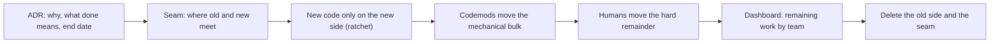

# 64 — Migration Playbooks

> Every frontend estate is always partly migrated. The skill isn't avoiding migrations. It's running them so the product keeps shipping, the two worlds coexist for a known and short time, and the last 10% actually gets finished.

**Prerequisites:** [63 Governance](63-architecture-governance-and-adrs.md) · **Related:** [16 React 19 and the Compiler](16-react-19-features-and-the-compiler.md) · [47 Next.js App Router](47-nextjs-app-router-architecture.md) · [58 Angular at Scale](58-angular-at-scale.md) · [59 React vs Angular](59-react-vs-angular-architecture-comparison.md) · [60 Monorepos](60-monorepos-build-tooling-and-bundlers.md) · [61 Micro-frontends](61-micro-frontends-and-module-federation.md) · [62 CI/CD](62-cicd-release-engineering-and-feature-flags.md) · [71 Legacy Modernization Case Study](71-case-study-legacy-react-modernization.md)

---

## TL;DR

- **Strangler fig by default.** Grow the new system around the old one, one seam at a time: a route, a component, a data source. Big-bang rewrites fail more often than they succeed, because they freeze features while the business keeps moving.
- **Every migration has five artifacts:**
  - an ADR with the reason;
  - a seam where old and new meet;
  - a codemod for the mechanical part;
  - a ratchet (a lint rule or fitness function that stops new legacy code);
  - a dashboard that shows the remaining work and an end date.
- **Codemods do the boring 80%.** I wrote one for React 19's removed root API: `ReactDOM.render`/`hydrate` to `createRoot`/`hydrateRoot`. It handled default, namespace and named imports, and dropped imports that were no longer used. It added a non-null assertion in TypeScript, so the output type-checks. And it *reported*, rather than guessed at, the two cases that need a human: render callbacks, and calls inside functions that might create several roots.
- **Upgrade one major at a time, to the last minor first.** React 18.3 warns about everything 19 removes. Fix the warnings, then take the major, and only then turn on new features like the Compiler.
- **The playbooks below** cover React 16/17/18 to 19.3, CRA to Vite, Pages to App Router, webpack to Rspack or Vite, JavaScript to TypeScript, Enzyme and Jest to Testing Library and Vitest, legacy Redux to server-state tools, runtime CSS-in-JS to zero-runtime styling, AngularJS out, and framework-to-framework moves.

---

## 1. How migrations succeed



### 1.1 The seams

| Seam | Old and new meet at… | Good for |
|---|---|---|
| **Route** | A proxy, the router or Multi-Zones sends some paths to the new app | Framework changes, rewrites of whole areas ([61](61-micro-frontends-and-module-federation.md)) |
| **Component** | An island or adapter renders new components inside old pages, or the reverse | Design-system adoption, cross-framework widgets ([59](59-react-vs-angular-architecture-comparison.md)) |
| **Data** | An adapter layer presents one interface over the old and new stores or APIs | State-management and API migrations |
| **Build** | Both toolchains coexist for a while; packages move one at a time | Bundler and test-runner migrations |
| **Flag** | A feature flag picks old or new per cohort | Risky behaviour changes, with instant rollback ([62](62-cicd-release-engineering-and-feature-flags.md)) |

### 1.2 Rules that keep a migration finite

1. **Define done and an end date in the ADR.** For example: "No imports of `legacy-store` remain; package deleted; target end of Q2" ([63](63-architecture-governance-and-adrs.md)).
2. **Stop the bleeding first.** A ratchet: a lint rule that forbids new usage, with a baseline for existing usage. Otherwise the old side grows while you migrate it.
3. **Migrate by value and churn.** Start with code that changes often, which is where the old way costs the most. Code that never changes can go last, or be deleted.
4. **Owners fund the migration.** The platform team that wants the change ships the codemods and does the bulk of the PRs ([63](63-architecture-governance-and-adrs.md)).
5. **Make progress visible.** Count the remaining usages per team on a dashboard, updated by CI.
6. **Finish.** The last 10% is where migrations die. Schedule it explicitly, and delete the seam when it's done. Two half-systems cost more than either whole one.

---

## 2. Codemods

A codemod is a program that rewrites code through its syntax tree, so it can change thousands of call sites consistently. Tools in 2026:

| Tool | Approach | Best for |
|---|---|---|
| **jscodeshift** (17.x) | JavaScript transforms over recast ASTs, preserving formatting where it can | Most JavaScript and TypeScript transforms; the React team's codemods use it |
| **ast-grep** (0.51) | Pattern-based rules in YAML, written in Rust and fast | Simple find-and-replace by structure; lint-style rules |
| **ts-morph** | The TypeScript compiler API with type information | Changes that need types, such as "every caller of this function" |
| **Codemod registry** (`npx codemod`) | Runs published recipes | Official upgrade recipes, for example `react/19/migration-recipe` |
| **OpenRewrite / Moderne** | Recipe catalogues run across many repositories | Estate-wide upgrades |

### 2.1 A worked codemod: React 19's root API

React 19 removed `ReactDOM.render` and `ReactDOM.hydrate`. The official recipe handles this. Writing your own shows what a good codemod does: transform the safe cases and *report* the unsafe ones.

```js
// replace-root-api.cjs: ReactDOM.render/hydrate (removed in React 19) to createRoot/hydrateRoot
// Usage: npx jscodeshift --parser=tsx -t replace-root-api.cjs src/
module.exports = function transform(file, api) {
  const j = api.jscodeshift;
  const root = j(file.source);
  const isTs = /\.tsx?$/.test(file.path);
  const namespaces = new Set();               // import ReactDOM from 'react-dom' / import * as ReactDOM
  const named = new Map();                    // import { render, hydrate as h } from 'react-dom': local -> imported
  const needed = new Set();                   // createRoot / hydrateRoot

  const reactDomImports = root.find(j.ImportDeclaration, { source: { value: 'react-dom' } });
  reactDomImports.forEach((p) => {
    for (const s of p.node.specifiers ?? []) {
      if (s.type === 'ImportDefaultSpecifier' || s.type === 'ImportNamespaceSpecifier') namespaces.add(s.local.name);
      else if (s.type === 'ImportSpecifier' && ['render', 'hydrate'].includes(s.imported.name)) named.set(s.local.name, s.imported.name);
    }
  });

  // Non-null assertion for getElementById/querySelector in TypeScript, so the result type-checks
  const container = (node) =>
    isTs && node.type === 'CallExpression' && node.callee.type === 'MemberExpression' &&
    ['getElementById', 'querySelector'].includes(node.callee.property.name) ? j.tsNonNullExpression(node) : node;

  root.find(j.CallExpression).forEach((p) => {
    const { callee, arguments: args } = p.node;
    let method;
    if (callee.type === 'MemberExpression' && callee.object.type === 'Identifier' && namespaces.has(callee.object.name)) method = callee.property.name;
    else if (callee.type === 'Identifier' && named.has(callee.name)) method = named.get(callee.name);
    if (method !== 'render' && method !== 'hydrate') return;
    if (args.length !== 2) {                  // a render callback has no direct equivalent: leave it for a human
      api.report(`${file.path}:${p.node.loc?.start.line}: ${method}() with ${args.length} arguments left unchanged`);
      return;
    }
    const [element, target] = args;
    // ReactDOM.render could be called repeatedly on one container; createRoot must not be. Flag calls inside functions.
    if (j(p).closest(j.Function).size() > 0) {
      api.report(`${file.path}:${p.node.loc?.start.line}: ${method}() inside a function: create the root once per container and reuse it`);
    }
    if (method === 'render') {
      needed.add('createRoot');
      p.replace(j.callExpression(j.memberExpression(j.callExpression(j.identifier('createRoot'), [container(target)]), j.identifier('render')), [element]));
    } else {
      needed.add('hydrateRoot');
      p.replace(j.callExpression(j.identifier('hydrateRoot'), [container(target), element]));
    }
  });
  if (needed.size === 0) return file.source;

  // Drop react-dom specifiers that are no longer referenced, and the import if it ends up empty
  const stillUsed = (name) => root.find(j.Identifier, { name }).filter((p) => p.parent.node.type !== 'ImportSpecifier' && p.parent.node.type !== 'ImportDefaultSpecifier' && p.parent.node.type !== 'ImportNamespaceSpecifier').size() > 0;
  reactDomImports.forEach((p) => {
    p.node.specifiers = (p.node.specifiers ?? []).filter((s) => stillUsed(s.local.name));
    if (p.node.specifiers.length === 0) j(p).remove();
  });

  const clientImport = j.importDeclaration([...needed].sort().map((n) => j.importSpecifier(j.identifier(n))), j.literal('react-dom/client'));
  const lastImport = root.find(j.ImportDeclaration).at(-1);
  if (lastImport.size()) lastImport.insertAfter(clientImport); else root.get().node.program.body.unshift(clientImport);
  return root.toSource({ quote: 'single' });
};
```

I ran it with jscodeshift 17.4 on three fixtures:

| Input | Output |
|---|---|
| `import ReactDOM from 'react-dom'` … `ReactDOM.render(<App />, document.getElementById('root'))` in `main.tsx` | `createRoot(document.getElementById('root')!).render(<App />)`; the unused `ReactDOM` import removed; `createRoot` imported from `react-dom/client` |
| `import { hydrate, render } from 'react-dom'` with `hydrate(<App />, el)` and a three-argument `render` in `entry.jsx` | `hydrateRoot(document.getElementById('app'), <App />)`; `hydrate` removed from the import. The three-argument `render(…, () => console.log('mounted'))` **left unchanged and reported** |
| `import * as ReactDOM` with a `render` inside an exported function and a `createPortal` in `portal.tsx` | `createRoot(el).render(<Modal />)`; the namespace import kept for `createPortal`. **Reported**: "render() inside a function: create the root once per container and reuse it" |

What the reports protect against:

- **Render callbacks.** The callback form has no `createRoot` equivalent, so a person must move it into an effect in the root component.
- **Calls inside functions.** `ReactDOM.render` could be called repeatedly on the same container to update it. Calling `createRoot` repeatedly creates competing roots. A codemod can't know how often a function runs, so it says so.

Run your formatter after any codemod, because recast's whitespace choices won't match your style. Review the diff as you would any large refactor: by sampling, and with the full test suite.

### 2.2 Codemod discipline

- **Fixtures first.** Write input and expected-output pairs for every pattern, including the ones you'll refuse to transform. Run them in CI with the codemod.
- **Report, don't guess.** A transform that's right 99% of the time and silently wrong 1% of the time is worse than one that's right 90% of the time and flags the rest.
- **Small batches.** One codemod per PR, per package, so reviews stay possible and reverts stay cheap.
- **Ship codemods with breaking changes** in internal libraries. That's what makes the platform team's change cheap for everyone else ([63](63-architecture-governance-and-adrs.md)).

---

## 3. The playbooks

Each playbook lists the order of work, the traps, and how to know you're done.

### 3.1 React 16, 17 or 18 to React 19.3

| Step | Work |
|---|---|
| 1. Get to 18.3 | Upgrade one major at a time. React 18.3 exists to warn about everything 19 removes. Run the app and the tests, and fix every warning |
| 2. Root and StrictMode | Move to `createRoot`/`hydrateRoot`, using the codemod above or `npx codemod@latest react/19/replace-reactdom-render`. Turn on `<StrictMode>` and fix the double-invocation bugs it reveals (effects without cleanup) |
| 3. Removed APIs | Replace string refs, legacy context (`contextTypes`), `findDOMNode`, `defaultProps` on function components (use default parameters) and `react-dom/test-utils` (`act` now comes from `react`). `npx codemod@latest react/19/migration-recipe` runs the official set |
| 4. Types | `npx types-react-codemod@latest preset-19 ./src`. Watch for `useRef()` needing an argument, ref callbacks that implicitly return a value (now read as cleanup), and the global `JSX` namespace becoming `React.JSX` |
| 5. Dependencies | Upgrade libraries that pinned React 18 peers: routers, form libraries, UI kits, testing tools. This is usually the longest step |
| 6. Take 19.3 | Upgrade, run everything, ship behind a canary ([62](62-cicd-release-engineering-and-feature-flags.md)) |
| 7. Then adopt new features | The Compiler, Actions, `use`, `<Activity>` and so on, each as its own change ([16](16-react-19-features-and-the-compiler.md)) |

**Adopting the React Compiler** is its own migration:

1. Turn on `eslint-plugin-react-hooks` 7's rules first. They flag code the Compiler can't optimise: mutation during render, reading refs in render, setting state in effects.
2. Then enable the Compiler for one directory, or by opt-in with `compilationMode: 'annotation'` and a `'use memo'` directive.
3. Measure render counts and interaction latency, and expand directory by directory.
4. Remove manual `useMemo`/`useCallback` only where profiling shows they're redundant. They still matter for effect dependencies and some library APIs ([71](71-case-study-legacy-react-modernization.md) works through a full example).

### 3.2 Create React App to Vite or a framework

The React team sunset CRA on 14 February 2025. Pick the destination first:

- **Vite** if the app is a client-side SPA that will stay one. It's the smallest change.
- **A framework** if you want server rendering, data loading or route-level code splitting: React Router 8 framework mode, TanStack Start or Next.js ([54](54-choosing-a-react-framework.md)).

For Vite:

1. Move `public/index.html` to the project root, and add `<script type="module" src="/src/main.tsx">`.
2. Rename `REACT_APP_*` variables to `VITE_*` (read with `import.meta.env`), or map them with `define` for a transition period.
3. Replace CRA's SVG-as-component import with `vite-plugin-svgr`, move the `proxy` setting to `server.proxy`, and handle any `process.env` references.
4. Move tests from Jest to Vitest (§3.6).
5. Delete `react-scripts` and the ejected config. Confirm bundle budgets and Core Web Vitals before and after ([39](39-web-performance-and-core-web-vitals.md)).

### 3.3 Next.js Pages Router to App Router

Both routers run side by side in one app, so migrate by route:

1. **Shared layout first.** Recreate `_app` and `_document` as `app/layout.tsx`. Move global providers into a client component.
2. **Leaf pages next,** usually the simplest content pages. Replace each data-fetching method:
   - `getStaticProps` and `getServerSideProps` become async Server Components.
   - `next/head` becomes the metadata API.
   - `next/router` becomes `next/navigation`.
3. **API routes** become route handlers, or Server Functions where the caller is your own UI ([18](18-react-server-components-and-server-functions.md)).
4. **Middleware becomes `proxy.ts`** (Next.js 16). Check that matchers and authentication still apply. Never rely on proxy alone for authorisation ([47](47-nextjs-app-router-architecture.md), [48](48-nextjs-rendering-and-caching.md)).
5. **Caching is the real migration.** Decide each route's cache behaviour explicitly with Cache Components (`'use cache'`, `cacheLife`, `cacheTag`) rather than porting `revalidate` values blindly.
6. **Security floor.** Stay on patched Next.js and React releases, because App Router routes bring the Server Components surface ([44](44-rsc-security-threat-model.md), [A3](A3-security-advisories-timeline.md)).

Done means `pages/` is empty and removed, and the App Router–only security and caching review has been completed.

### 3.4 webpack to Rspack or Vite

| Destination | Choose when | How |
|---|---|---|
| **Rspack / Rsbuild** | Large, customised webpack configs, Module Federation, many webpack loaders | Mostly config-compatible: swap the package, run, fix the few unsupported plugins. The fastest win for big estates |
| **Vite** | Simpler configs, or a framework built on Vite | Rewrite the config and replace loaders with plugins. Larger change, larger ecosystem |

In either case:

1. Snapshot today's output: the bundle-analyser report, budgets, source maps, environment variables.
2. Migrate one app, and compare its output with the snapshot.
3. Then roll out app by app through the monorepo task runner ([60](60-monorepos-build-tooling-and-bundlers.md)).

### 3.5 JavaScript to TypeScript

1. Add `tsconfig.json` with `allowJs: true` and `checkJs: false`, and get the build green.
2. Convert leaf modules (utilities, API clients) first. Generate types for API contracts from OpenAPI rather than writing them by hand ([33](33-api-integration-bff-and-contracts.md)).
3. Ratchet strictness: `strict: true` for new directories through per-directory configs or project references, plus a baseline of `// @ts-expect-error` comments for old code that a fitness function counts down ([04](04-typescript-at-scale.md), [63](63-architecture-governance-and-adrs.md)).
4. Tools like `ts-migrate` can bulk-rename files and insert `any` and `@ts-expect-error` where needed. Treat that output as a starting baseline, not a finished conversion.

### 3.6 Enzyme and Jest to Testing Library and Vitest

Enzyme's last release (3.11.0) predates React 18 and has no official adapter for React 18 or 19, so it blocks React upgrades. Migrate the tests before the upgrade:

1. **New tests in Testing Library only** (the ratchet).
2. **Rewrite Enzyme tests by behaviour, not line by line.** `wrapper.find(Button).props().onClick()` becomes `await user.click(screen.getByRole('button', { name: 'Save' }))`. Shallow rendering has no equivalent, and that's the point: test what users see ([42](42-testing-architecture.md)).
3. **Jest to Vitest is mostly mechanical.**
   - `jest.fn` becomes `vi.fn`, and module mocks move to `vi.mock`.
   - Set `test.environment: 'jsdom'`, or use browser mode for real-browser tests.
   - Keep `@testing-library/jest-dom` matchers through its Vitest entry.
4. **Run both runners in CI** until the old one has no tests left, then delete it.

### 3.7 Legacy Redux to server-state tools

Most legacy Redux stores are mostly caches of server data, written by hand.

1. **Split by data kind.** Server state (lists, entities, anything fetched) moves to TanStack Query or RTK Query. True client state (UI, drafts, wizards) stays in a small store: Zustand, Redux Toolkit or context ([28](28-state-and-data-ownership-architecture.md), [29](29-client-state-management.md), [30](30-server-state-and-data-fetching.md)).
2. **One slice at a time, behind the data seam.** Components call a hook (`useInvoices()`) whose implementation switches from the store to the query. Components don't change twice.
3. **Delete reducers, actions and sagas** for each migrated slice in the same PR. Measure the drop in code and the improvement in loading and error handling.
4. **Keep Redux Toolkit** where a large, genuinely complex client state exists. RTK is modern Redux; the migration is away from hand-written caches, not away from Redux on principle.

### 3.8 Runtime CSS-in-JS to zero-runtime styling

Runtime CSS-in-JS (styled-components, Emotion) generates styles during render. That costs main-thread time, complicates streaming, and needs `'use client'` in Server Component apps. styled-components' maintainer put it into maintenance mode in March 2025. Releases have continued (6.7 as of November 2026), but he still doesn't recommend it for new projects.

| Destination | Fits |
|---|---|
| CSS Modules with design tokens as CSS variables | Most apps; the lowest-risk move |
| Tailwind CSS | Teams that want utility classes; works well with design-system tokens |
| Zero-runtime CSS-in-JS (vanilla-extract, StyleX, Panda, Linaria and similar) | Teams that want typed, co-located styles without runtime cost |

**Order of work:**

1. Tokens become CSS custom properties.
2. Leaf components first, then layouts.
3. Remove the runtime provider last.
4. Watch specificity and ordering with CSS layers, and visual-diff every step ([23](23-styling-architecture-and-theming.md), [35](35-enterprise-design-system-architecture.md)).

### 3.9 AngularJS out

AngularJS reached end of life on 31 December 2021. Anything still running it has no security fixes.

- **Route-level strangler (preferred).** New routes are built in Angular, or React, behind a proxy with a shared session. Old routes move in order of value ([61](61-micro-frontends-and-module-federation.md)).
- **ngUpgrade** (`@angular/upgrade`, still published at 22.3) runs AngularJS and Angular in one app, with components downgraded and upgraded across the boundary. It's powerful, but it couples both frameworks' change detection and bundles. Use it only when route-level splitting is impossible, and keep the hybrid period short.

### 3.10 Framework to framework (Angular and React)

Treat it as a product decision first ([59](59-react-vs-angular-architecture-comparison.md)). Then:

1. Start with a route-level strangler behind a proxy, with a shared BFF session and generated tokens and API types.
2. Use islands or Angular Elements only for widgets that block a page from moving. Give every island an owner and a removal date.
3. Move routes by business value and change frequency.
4. Keep the performance budget honest while both runtimes ship on shared pages.
5. Delete the old framework on the end date.

---

## Decision framework

**Problem.** Move code from an old technology or pattern to a new one without stopping product work.

**Constraints.** Size of the codebase, test coverage (low coverage means smaller batches and more flags), team capacity, deadlines imposed from outside (end of support, security), and how risky the behaviour changes are.

| Situation | Approach |
|---|---|
| Mechanical API change across many files | Codemod with fixtures, in small PRs, with reports for the unsafe cases |
| Behaviour change with user impact | Flag seam with cohort rollout and instant rollback |
| Framework or architecture change | Route-level strangler with a shared session; islands only where necessary |
| Toolchain change (bundler, test runner) | Build seam: both toolchains coexist; migrate package by package |
| Data-layer change | Data seam: one hook interface, implementation switched underneath |
| End-of-life dependency | Treat as a security deadline: plan backwards from the end-of-support date |

**Criteria.** Remaining usages over time (the burn-down), incidents attributable to the migration, change lead time in migrated areas compared with unmigrated ones, and the date the old side was deleted.

**Failure modes.**

- Big-bang rewrites.
- Migrations without a ratchet, so the old side keeps growing.
- Codemods that guess instead of reporting.
- Hybrid states with no end date.
- Migrating code nobody changes before code everybody changes.
- Upgrading several majors at once.
- Turning on new features in the same release as the upgrade.

**Migration path for the migration itself.**

1. Write the ADR with the definition of done and the date.
2. Add the ratchet.
3. Build and test the seam on one slice.
4. Run the codemods.
5. Hand-migrate the remainder, in order of churn.
6. Delete the old side and the seam.
7. Record the before-and-after metrics in the ADR.

---

## Pitfalls and anti-patterns

- **"We'll rewrite it properly."** The rewrite has to catch up with a moving target while delivering nothing. Strangle instead.
- **Skipping the last minor before a major.** You miss the deprecation warnings designed to make the major easy.
- **Upgrading and modernising in one step.** If something breaks, you can't tell which change caused it.
- **Codemods without fixtures.** They work on the first package and silently mangle the fifth.
- **Hybrid forever.** Two routers, two state libraries or two frameworks without a removal date become permanent architecture.
- **Migrating cold code first.** It feels productive, but the cost of the old way is in the hot code.
- **Ignoring the dependency graph.** A React upgrade is usually blocked by a library pinned to the old peer range. Audit that before you start.
- **Leaving the seam behind.** Adapters and flags that outlive the migration are new legacy.

---

## Architect's checklist

- [ ] Each migration has an ADR with a definition of done, an owner and an end date
- [ ] A ratchet stops new usage of the old way from day one
- [ ] The seam (route, component, data, build or flag) is chosen and tested on one slice first
- [ ] Codemods have fixtures, run in small batches, and report the cases they don't transform
- [ ] Majors are taken one at a time, from the last minor, with warnings fixed first
- [ ] New features (the Compiler, new APIs) are adopted after the upgrade, not with it
- [ ] Remaining work is on a dashboard by team; the order follows churn and value
- [ ] The old side and the seam are deleted, and the before-and-after metrics are recorded

---

## Interview angles

**Q1. How would you migrate a large app from React 17 to 19?**
First to 18.3, because it warns about everything 19 removes. Then fix those warnings with the official codemod recipe plus targeted codemods: the root API, string refs, legacy context, `defaultProps` on function components, the moved `act` import and the type changes. The longest step is usually dependencies pinned to old peer ranges, so I'd audit them early. Then take 19.3 behind a canary. Only after that would I turn on the Compiler, directory by directory, with the hooks lint rules first and render-count measurements before and after.

**Q2. What makes a good codemod?**
- **Fixtures** for every pattern, including the ones it refuses to transform.
- **Transform the safe cases and report the rest** with file and line.
- **Output that type-checks and passes lint** after formatting.

My root-API codemod, for example, adds a non-null assertion for `getElementById` in TypeScript files. It reports a three-argument render callback rather than dropping the callback, and it reports calls inside functions, because those might create several roots for one container. It runs in small PRs, and its fixtures run in CI.

**Q3. When is a rewrite justified instead of a strangler migration?**
Rarely. Maybe when the old system is small, its behaviour is well specified and well tested, and the business can tolerate a feature freeze for its duration. Even then I'd build the new system behind a route-level seam and move traffic gradually, so "rewrite" means "rebuild behind a seam" rather than "switch over on launch day".

**Q4. How do you stop a migration from stalling at 90%?**
- **Make the end state explicit** in the ADR, with a date.
- **Add a ratchet** so the old side can't grow.
- **Put the remaining usages on a team-by-team dashboard.**
- **Schedule the hard tail as named work** with an owner, instead of hoping teams pick it up.
- **Have the platform team do the long tail itself** when it owns the change.
- **Celebrate deleting the old side and the seam**, because that's the moment the migration starts paying back.

**Q5. How would you move a 300-route Pages Router app to the App Router?**
Route by route, since both routers coexist:
1. Recreate the root layout and providers.
2. Migrate leaf content pages first, turning data methods into Server Components and `next/head` into metadata.
3. Move API routes to route handlers or Server Functions.
4. Turn middleware into `proxy.ts`.

The real work is caching: I'd decide each route's caching explicitly with Cache Components rather than porting old revalidation settings. The App Router also brings the Server Components attack surface, so I'd stay on patched releases and run a security review of server functions as part of the migration.

---

## Further reading

- React, *React 19 Upgrade Guide*: <https://react.dev/blog/2024/04/25/react-19-upgrade-guide>
- React codemods: <https://github.com/reactjs/react-codemod>
- React, *Sunsetting Create React App*: <https://react.dev/blog/2025/02/14/sunsetting-create-react-app>
- Next.js, *App Router migration guide*: <https://nextjs.org/docs/app/guides/migrating/app-router-migration>
- jscodeshift: <https://github.com/facebook/jscodeshift> · ast-grep: <https://ast-grep.github.io>
- Martin Fowler, *StranglerFigApplication*: <https://martinfowler.com/bliki/StranglerFigApplication.html>

---

[← Previous: 63 — Architecture Governance](63-architecture-governance-and-adrs.md) · [Index](README.md) · [Next: 65 — AI-Powered React Interfaces and AI-Assisted Engineering →](65-ai-powered-react-interfaces.md)
