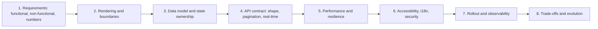
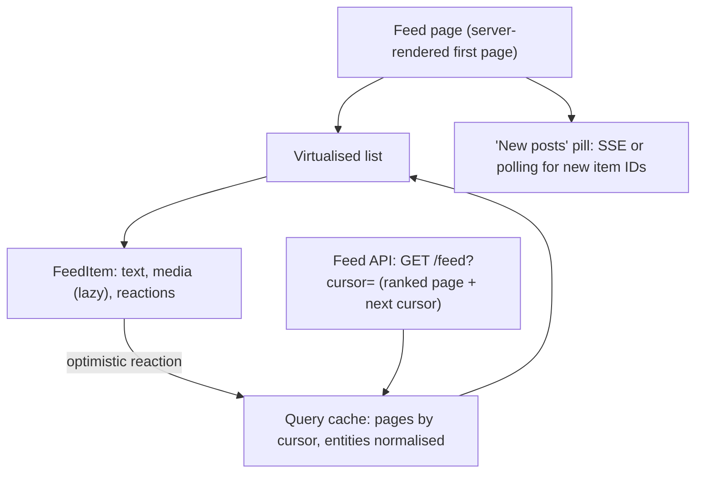
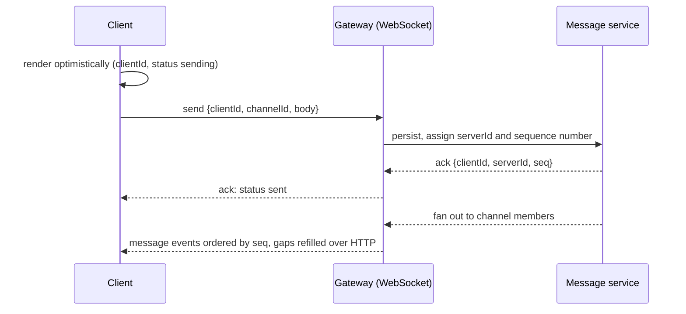

# 66 — Frontend System Design: Method and Classic Prompts

> Frontend system design is a conversation about where data lives, how it moves, what the user sees while it's moving, and what breaks first at scale. The candidates and architects who do it well aren't the ones who know the most libraries. They ask for the numbers first, draw the boundaries second, and spend their time on the two or three decisions that actually decide the outcome.

**Prerequisites:** [01 Thinking Like a Frontend Architect](01-thinking-like-a-frontend-architect.md), [28 State Ownership](28-state-and-data-ownership-architecture.md) · **Related:** [05 Networking and Delivery](05-networking-caching-and-delivery.md) · [30 Server State](30-server-state-and-data-fetching.md) · [32 Rendering Strategy](32-rendering-strategy-architecture.md) · [34 Real-Time and Offline](34-realtime-offline-and-collaboration.md) · [36 Accessibility](36-accessibility-engineering.md) · [38 React Performance](38-react-performance-engineering.md) · [39 Web Performance](39-web-performance-and-core-web-vitals.md) · [67–71 Case Studies](67-case-study-enterprise-saas-dashboard.md) · [74 Machine-Coding Drills](74-machine-coding-drills.md)

---

## TL;DR

- **Use one method every time:**
  1. Requirements and numbers.
  2. Rendering and boundaries.
  3. Data model and ownership.
  4. API contract.
  5. Performance and resilience.
  6. Accessibility, internationalisation and security.
  7. Rollout and observability.
  8. Trade-offs.

  In a 45-minute interview, spend about 5 minutes on requirements, 15 on architecture and data, 15 on deep dives, and 5 on trade-offs and evolution.
- **Ask for numbers.** Items per page, update frequency, concurrent users, devices and networks, SEO, offline. Numbers turn opinions into designs: 10 items needs no virtualisation, 10,000 does.
- **Most prompts turn on the same few decisions:**
  - where state lives (server cache, URL, local);
  - how lists scale (pagination, virtualisation);
  - how updates arrive (polling, SSE, WebSocket);
  - how the UI stays honest while data is in flight (optimistic updates, skeletons, error states).
- **Every design names its budgets:** LCP ≤ 2.5 s, INP ≤ 200 ms, CLS ≤ 0.1 at p75, plus a JavaScript budget per route.
- **Show one piece of real depth.** For a typeahead that means debouncing, cancelling stale requests and caching. The core in §3.2 passes four tests: one request per burst of keystrokes; a slow stale answer cancelled, not just ignored; cache hits after normalisation; errors reported only for the current query.

---

## 1. The method



### 1.1 Requirements: ask, don't assume

| Area | Questions |
|---|---|
| Users and scale | How many users, and how many concurrently? Which countries, devices and networks? |
| Content | How many items per view, how large, how often do they change? |
| Freshness | Is seconds-old data acceptable? Does the user need live updates? |
| Interaction | Read-heavy or write-heavy? Collaborative? Offline? |
| SEO and sharing | Must pages be indexable, or previewable when shared? |
| Constraints | Accessibility level (WCAG 2.2 AA), languages and right-to-left scripts, compliance, existing stack |
| Success | Which metric matters: engagement, conversion, task time? Which performance budgets? |

Write the answers down as a short list on the board. They are what you justify every later decision against.

### 1.2 Rendering and boundaries

Decide per route, not per app ([32](32-rendering-strategy-architecture.md)):

- **Static or cached HTML** for public, shared content.
- **Server-rendered and streamed** for personalised pages that need a fast first paint, with Server Components where display-only parts dominate ([18](18-react-server-components-and-server-functions.md)).
- **Client-rendered** behind authentication, where the first paint has no SEO value.

Draw the component tree only to the depth that shows the boundaries: server and client, Suspense and error boundaries, the lazy-loaded parts.

### 1.3 Data model and ownership

For each piece of state, name its owner ([28](28-state-and-data-ownership-architecture.md)):

| Kind | Lives in | Examples |
|---|---|---|
| Server state | A query cache (TanStack Query, framework loaders) | Feed items, products, messages |
| URL state | Route and search parameters | Filters, sort order, selected tab, pagination cursor |
| Local UI state | Components | Open menus, hover, draft input |
| Form state | A form library or `useActionState` | Checkout fields, validation |
| Real-time and collaborative state | A sync layer (WebSocket, CRDT) | Presence, cursors, shared documents ([34](34-realtime-offline-and-collaboration.md)) |

Normalise entities that appear in several places, such as users and products, so an update in one view shows up everywhere.

### 1.4 API contract

Sketch requests and responses, with the decisions that matter:

- **Pagination:** use cursors for feeds and infinite lists, because offsets skip and duplicate items when data shifts underneath them. Use page numbers only for stable, ordered datasets with "jump to page".
- **Shape:** fetch per view through a BFF or GraphQL, so the client doesn't stitch five services together ([33](33-api-integration-bff-and-contracts.md)).
- **Real-time:** polling for minute-level freshness, server-sent events for one-way updates, WebSockets for two-way and collaborative ([34](34-realtime-offline-and-collaboration.md)).
- **Idempotency** for mutations: client-generated IDs or `Idempotency-Key` headers, so retries can't duplicate orders or messages ([40](40-resilience-and-reliability.md)).

### 1.5 Performance, resilience, accessibility, security

Name the budgets and the techniques that meet them:

- **Budgets:** LCP ≤ 2.5 s, INP ≤ 200 ms and CLS ≤ 0.1 at p75, plus initial JavaScript per route ([39](39-web-performance-and-core-web-vitals.md)).
- **Techniques:**
  - virtualisation for long lists;
  - image sizing and priority hints;
  - code splitting by route and interaction;
  - prefetching likely next steps;
  - caching at the CDN, server and client layers ([05](05-networking-caching-and-delivery.md), [38](38-react-performance-engineering.md)).
- **States:** loading, empty, error and partial for every async view; retries with backoff; offline behaviour if required ([40](40-resilience-and-reliability.md)).
- **Accessibility:** the right WAI-ARIA pattern (combobox, grid, dialog, feed), keyboard paths and announcements ([36](36-accessibility-engineering.md)).
- **Security:** XSS-safe rendering of user content, CSP, authorisation on every request, rate limits ([43](43-frontend-security-architecture.md)).

### 1.6 Rollout, observability and evolution

Close by naming:

- the feature flags and canary plan;
- the RUM metrics and error tracking you'd watch;
- what you'd change at ten times the scale.

That last answer shows you can see past the first version ([41](41-observability-and-diagnostics.md), [62](62-cicd-release-engineering-and-feature-flags.md)).

---

## 2. What interviewers look for

| Level | Signals |
|---|---|
| Senior | A complete, working design; sensible defaults; covers loading and error states; knows the main APIs |
| Staff | Drives the requirements; quantifies; picks the two decisions that matter and goes deep; names failure modes and trade-offs unprompted |
| Principal | Frames it in business terms; considers the organisation (teams, ownership, migration from what exists); designs for evolution; knows when *not* to build |

---

## 3. Classic prompts

### 3.1 News feed (social or activity feed)

**Clarify:**
- items per page and media types;
- ranking (server-ranked or chronological);
- whether new items should appear live;
- reactions and comments;
- whether it must work on low-end Android over 3G.



**Key decisions:**
- **First page server-rendered** for fast LCP; later pages fetched on scroll with cursor pagination.
- **Virtualise** past a few dozen items, and keep scroll position on back navigation ([38](38-react-performance-engineering.md)).
- **Don't insert live items** under the reader's eyes. Show a "New posts" pill, and prepend when it's clicked.
- **Optimistic reactions** with rollback on failure. The counts come from the server on the next fetch.
- **Media:** responsive images with explicit dimensions (no CLS), lazy-loaded below the fold; video only on visibility, muted, never autoplay with sound.

**Accessibility:** the WAI-ARIA `feed` pattern (`role="feed"`, `article` items with `aria-posinset` and `aria-setsize` where known). Keyboard access to load more. Don't trap focus in infinite scroll; always offer a "Load more" button as an alternative.

**At ten times the scale:** edge-cached first pages per segment, image CDN transforms, and splitting reactions and comments into their own lazy islands.

### 3.2 Typeahead or autocomplete

**Clarify:**
- the data source (local list, or a server search endpoint);
- result count;
- latency targets;
- whether results are personalised;
- keyboard and screen-reader requirements.

**Key decisions:**
- **Debounce** keystrokes (100–200 ms), with a minimum length.
- **Cancel stale requests** with `AbortController`: race conditions are the classic bug.
- **Cache recent queries**, normalising case and whitespace.
- **Highlight matches** safely: build text nodes, never `innerHTML`.
- **Use the WAI-ARIA combobox pattern** with `aria-activedescendant`, and announce result counts politely ([36](36-accessibility-engineering.md)).

The core, framework-agnostic and tested:

```ts
// typeahead.ts: the core of an autocomplete, framework-agnostic: debounce, cancel stale requests, cache recent answers
export interface Suggestion { id: string; label: string }
type Fetcher = (query: string, signal: AbortSignal) => Promise<Suggestion[]>;
type Listener = { onResult: (items: Suggestion[], query: string) => void; onError?: (error: unknown) => void };

export function createTypeahead(fetcher: Fetcher, { debounceMs = 150, minLength = 2, cacheSize = 50 } = {}) {
  const cache = new Map<string, Suggestion[]>();          // Map keeps insertion order: oldest entry first (LRU)
  let timer: ReturnType<typeof setTimeout> | undefined;
  let inFlight: AbortController | undefined;

  return {
    query(text: string, { onResult, onError }: Listener) {
      const key = text.trim().toLowerCase();
      clearTimeout(timer);
      inFlight?.abort();                                   // an older request's answer is no longer wanted
      if (key.length < minLength) return onResult([], text);
      const hit = cache.get(key);
      if (hit) {
        cache.delete(key);
        cache.set(key, hit);                               // refresh recency
        return onResult(hit, text);
      }
      timer = setTimeout(async () => {
        const controller = (inFlight = new AbortController());
        try {
          const items = await fetcher(key, controller.signal);
          if (controller.signal.aborted) return;          // a newer keystroke won the race
          cache.set(key, items);
          if (cache.size > cacheSize) cache.delete(cache.keys().next().value!);
          onResult(items, text);
        } catch (error) {
          if (!controller.signal.aborted) onError?.(error);
        }
      }, debounceMs);
    },
    dispose() {
      clearTimeout(timer);
      inFlight?.abort();
    },
  };
}
```

Four Vitest tests, using fake timers, pin down the behaviour:

- **Debouncing.** Typing "re", "rea", "reac", "react" made exactly one request, for "react".
- **Stale answers.** A slow answer for "rea" arriving after "react" was never shown, and its request had been *aborted*, not just ignored.
- **Caching and short input.** "React" and "react " were served from the cache after the first fetch, and "r" (too short) returned nothing without a request.
- **Errors.** An error was reported for the current query.

In React, wrap this in a hook that disposes on unmount, and render the combobox; [74](74-machine-coding-drills.md) builds the full component.

**At ten times the scale:** a precomputed prefix index at the edge for popular queries, server-side ranking with personalisation, and request coalescing.

### 3.3 Chat application

**Clarify:**
- one-to-one, group or channels, and how many members;
- message volume per minute;
- attachments;
- delivery receipts and typing indicators;
- history depth;
- offline;
- end-to-end encryption.



**Key decisions:**
- **Optimistic send with client-generated IDs.** The acknowledgement reconciles `clientId` to `serverId`, so retries can't duplicate messages.
- **Order by server sequence number, not timestamps.** Detect gaps and refill them over HTTP after reconnecting.
- **Reconnect with backoff and jitter.** Resubscribe from the last sequence seen, and show connection state honestly.
- **Virtualised history** loading backwards with a cursor, anchored to the bottom, keeping position when older messages load.
- **Offline outbox** in IndexedDB, with a per-message status (sending, sent, failed, retry) ([34](34-realtime-offline-and-collaboration.md), [40](40-resilience-and-reliability.md)).

**Accessibility:**
- the message list is a `log` region;
- don't announce every incoming message in busy channels; give a count and a shortcut instead;
- the composer keeps focus;
- typing indicators are polite, not assertive.

**Security:** sanitise rendered message content (links, mentions, markdown) and treat attachments as untrusted. If messages are end-to-end encrypted, design key management and device lists explicitly.

### 3.4 Video or media player

**Clarify:**
- video on demand or live;
- devices, including TV and low-end phones;
- DRM;
- captions and audio description;
- analytics requirements;
- autoplay rules.

**Key decisions:**
- **Adaptive streaming** (HLS or DASH through Media Source Extensions, with a player library) and an initial bitrate chosen from network hints. Native HLS where the platform supports it.
- **Preload:** `preload="metadata"`, and a poster image as the LCP element.
- **Captions:** WebVTT tracks with styling controls; audio description tracks where required.
- **Controls:** custom ones are fully keyboard accessible (space or K to play and pause, arrow keys to seek, M to mute) with visible focus and labelled buttons. Never rely on hover alone.
- **Resilience:** buffer-health monitoring, and recovery from network changes and stalled segments.
- **Analytics:** start time, rebuffer ratio, bitrate switches and errors, sampled and batched.
- **DRM:** Encrypted Media Extensions with a licence server. Plan for platform differences early.

### 3.5 Data grid or spreadsheet

**Clarify:**
- row and column counts;
- editing;
- sorting, filtering and grouping (server or client);
- copy and paste;
- frozen columns;
- export.

**Key decisions:**
- **Virtualise rows and columns.** Fix row heights where possible; measure them if not.
- **Server-side sort and filter** beyond about 10,000 rows, with the state in the URL. Client-side for small datasets.
- **Editing:** cell-level edit state, optimistic commits with per-cell error states, and undo.
- **Keyboard:** the WAI-ARIA grid pattern (arrow-key navigation, Enter to edit, Escape to cancel) with roving `tabindex`.
- **Libraries:** headless table logic such as TanStack Table 9, rendered with your design system ([55](55-react-ecosystem-atlas-2026.md)). Build a spreadsheet engine only if the product *is* a spreadsheet.

### 3.6 E-commerce product page

**Clarify:**
- catalogue size;
- traffic peaks;
- personalisation;
- inventory freshness;
- SEO and sharing;
- markets and currencies.

**Key decisions:**
- **Cached or prerendered product HTML with streamed personalisation:** price and stock as dynamic holes, recommendations lazy.
- **The hero image as the LCP element**, with priority hints and responsive sizes.
- **Variant selection in the URL**, so every variant is shareable and indexable.
- **Add to cart** as an optimistic mutation with a server action or API, with idempotency.
- **Structured data** (Product schema) for search.

[68](68-case-study-ecommerce-storefront.md) works through this design in full.

### 3.7 Notifications centre

**Key decisions:**
- **Delivery:** server-sent events or a WebSocket for live badges, with polling as the fallback.
- **Data:** a paginated list with read and unread state on the server, and optimistic "mark as read".
- **Grouping:** batch similar notifications ("3 people commented") on the server.
- **Toasts versus the inbox.** Toasts are for the current session's immediate feedback only. Durable notifications go to the inbox.
- **Accessibility:** toasts use polite status regions, never steal focus, persist long enough to read (or until dismissed), and are reachable after they disappear.

### 3.8 Analytics dashboard

**Key decisions:**
- **Every query is cancellable**, keyed by filters in the URL.
- **Cache with stale-while-revalidate.** Shared time-range presets give better cache hits.
- **Charts render progressively,** each widget with its own Suspense and error boundary.
- **Heavy charts load lazily**, with server-side aggregation (never ship raw rows).
- **Exports run as background jobs.**
- **Accessibility:** every chart has a data table alternative and text summaries.

[67](67-case-study-enterprise-saas-dashboard.md) works through this design in full.

### 3.9 Collaborative editor or whiteboard

**Key decisions:**
- **CRDTs** (Yjs, Automerge) for offline-capable collaboration; operational transformation only with a central server and no offline.
- **Presence and cursors** in a separate, lossy channel.
- **Persistence:** snapshots plus updates.
- **Access control** enforced on the sync server.

[69](69-case-study-collaborative-project-management.md) works through this design in full.

### 3.10 Multi-step form or checkout wizard

**Key decisions:**
- **One URL per step**, so Back works and analytics are per step.
- **Server-side validation is authoritative**; client validation is for speed.
- **Drafts persist** to the server or local storage.
- **Payment through the provider's hosted fields**, which keeps you out of PCI scope.
- **Idempotent submission.**
- **Error summaries** that link to the fields, with focus moved to the summary on submit ([36](36-accessibility-engineering.md)).

---

## Decision framework

**Problem.** Produce a frontend design that meets stated requirements within a time box, and can be defended.

**Constraints.** The requirements and numbers gathered in step 1, the existing stack, team skills and the time available.

| Recurring decision | Default | Change it when |
|---|---|---|
| Rendering | Server-render the first view, hydrate interactive parts | Authenticated apps with no SEO need: client-render the shell |
| Lists | Cursor pagination plus virtualisation beyond about 50 items | Small, stable datasets: page numbers or none |
| Freshness | Stale-while-revalidate cache | Live requirements: SSE (one-way) or WebSocket (two-way) |
| Mutations | Optimistic with rollback and idempotency keys | Payments and irreversible actions: wait for the server, with clear progress |
| State | Server cache plus URL plus local | Collaborative documents: a CRDT sync layer |
| Search input | Debounce, cancel stale requests, cache | Local datasets: filter in memory, no network |

**Criteria.**

- Does the design meet each stated requirement and budget?
- Are the failure modes covered: slow network, offline, errors, partial data?
- Is it accessible and secure by construction?
- Can it evolve to ten times the scale without a rewrite?

**Failure modes.**

- Designing before asking for numbers.
- Spending the hour on the component tree.
- Ignoring loading and error states.
- Offset pagination on live feeds.
- No cancellation in search.
- Inserting live items under the reader.
- Accessibility as an afterthought.
- No observability or rollout story.

**Migration path, for a design evolving after launch.**

1. Ship the simplest version that meets the budgets.
2. Instrument it.
3. Let RUM data pick the next optimisation.
4. Revisit the rendering strategy and real-time transport when scale or product needs change. Write each change down as an ADR ([63](63-architecture-governance-and-adrs.md)).

---

## Pitfalls and anti-patterns

- **Starting with technology.** "We'll use Redux and GraphQL" before knowing whether the feed updates live.
- **Drawing every component.** Draw the boundaries (server and client, Suspense, error, lazy) and the data flow; leave leaf components out.
- **Timestamp ordering in chat.** Clock skew reorders conversations. Use server sequence numbers.
- **Ignoring the race condition in search.** Out-of-order responses show results for a query the user no longer has.
- **Infinite scroll without a footer strategy.** Users can't reach footer links, keyboard users get lost, and memory grows. Virtualise and offer "Load more".
- **Optimistic updates without rollback.** The UI lies until the next refresh.
- **Forgetting the empty state.** New users, new filters and deleted content all need one.
- **Skipping internationalisation.** Plurals, long German strings, right-to-left layouts and currency formats break layouts designed in English ([37](37-internationalization-and-localization.md)).

---

## Architect's checklist

- [ ] Requirements and numbers are written down before any design
- [ ] Rendering strategy and server/client boundaries are chosen per route
- [ ] Every piece of state has a named owner (server cache, URL, local, form, sync)
- [ ] The API contract covers pagination, real-time transport and idempotency
- [ ] Budgets (LCP, INP, CLS, JavaScript per route) are named, and the techniques to meet them are listed
- [ ] Loading, empty, error, partial and offline states are designed
- [ ] The relevant WAI-ARIA patterns, keyboard paths and announcements are specified
- [ ] XSS-safe rendering, CSP and authorisation are covered
- [ ] The rollout, observability and ten-times-scale story is stated

---

## Interview angles

**Q1. Walk me through how you approach a frontend system design question.**
- **Requirements and numbers first** (users, devices, item counts, freshness, SEO, offline, accessibility), written down.
- **Rendering per route** and the server/client boundaries.
- **The data model and who owns each piece of state.**
- **The API contract:** pagination, real-time and idempotency.
- **Deep dives** on the two or three decisions that decide the outcome: performance with named budgets, resilience states, accessibility patterns and security.
- **Rollout, observability and what changes at ten times the scale.** I keep the component tree shallow and spend the time on data flow and failure modes.

**Q2. Design the typeahead for a site-wide search box.**
- **Input:** debounced (around 150 ms) with a minimum length.
- **Requests:** each new keystroke aborts the previous one with `AbortController`, so stale answers never flash on screen. In my implementation, the slow request is actually cancelled, not just ignored.
- **Caching:** recent queries normalised for case and whitespace, with LRU eviction.
- **UI:** the WAI-ARIA combobox pattern with `aria-activedescendant`, a polite result-count announcement, and highlighting built from text nodes.
- **Server:** prefix-indexed and edge-cached for popular queries, with ranking and personalisation behind it.
- **Measurement:** latency to first suggestion and selection rate.

**Q3. How do you keep a chat app's messages correctly ordered and never duplicated?**
- **Idempotency:** the client generates an ID for each message and renders it optimistically. The server's acknowledgement maps the client ID to a server ID and a per-channel sequence number, so a retried send can't create a duplicate.
- **Ordering:** by sequence number, not timestamps, because client clocks drift.
- **Recovery:** after a reconnect, the client resubscribes from the last sequence it saw and refills any gaps over HTTP.
- **Offline:** unsent messages wait in an IndexedDB outbox with a visible per-message status.

**Q4. When would you virtualise a list, and what does it cost?**
- **When:** once the item count makes DOM size hurt memory, layout and INP, typically beyond a few dozen complex items, or whenever counts are unbounded.
- **Accessibility cost:** off-screen items aren't in the DOM, so in-page search, screen-reader navigation and "select all" need care (`aria-setsize`/`aria-posinset`, a Load more alternative).
- **Measurement cost:** variable-height rows need measuring.
- **Navigation cost:** scroll restoration needs explicit handling.

For moderate lists, `content-visibility: auto` and pagination can be simpler.

**Q5. How do you design for a slow 3G connection on a low-end phone?**
- **Budgets for that device:** small initial JavaScript per route, with server-rendered or cached HTML for the first view.
- **Images:** responsive, with explicit dimensions and lazy loading below the fold.
- **Interaction:** code split by interaction, and prefetch only on good connections (respect Save-Data).
- **Honest states:** skeletons and progress, and offline-tolerant writes where needed.
- **Validation:** RUM segmented by device and network, because lab tests on a fast laptop hide all of this ([39](39-web-performance-and-core-web-vitals.md)).

---

> [!TIP]
> **Runnable code:** [E66](E66-frontend-system-design.md) has the typeahead core, with tests for debouncing, cancellation and response ordering. `node extract-examples.mjs 66` writes it out as a project; then run `npm ci` and `npm test` in it.

## Further reading

- WAI-ARIA Authoring Practices Guide (combobox, feed, grid, dialog patterns): <https://www.w3.org/WAI/ARIA/apg/patterns/>
- web.dev, *Web Vitals*: <https://web.dev/articles/vitals>
- Alex Xu, *System Design Interview* (Byte Code LLC), for the backend half of the conversation
- The case studies in this handbook: [67](67-case-study-enterprise-saas-dashboard.md), [68](68-case-study-ecommerce-storefront.md), [69](69-case-study-collaborative-project-management.md), [70](70-case-study-enterprise-design-system.md), [71](71-case-study-legacy-react-modernization.md)

---

[← Previous: 65 — AI-Powered React Interfaces](65-ai-powered-react-interfaces.md) · [Index](README.md) · [Next: 67 — Case Study: Enterprise SaaS Dashboard →](67-case-study-enterprise-saas-dashboard.md)
