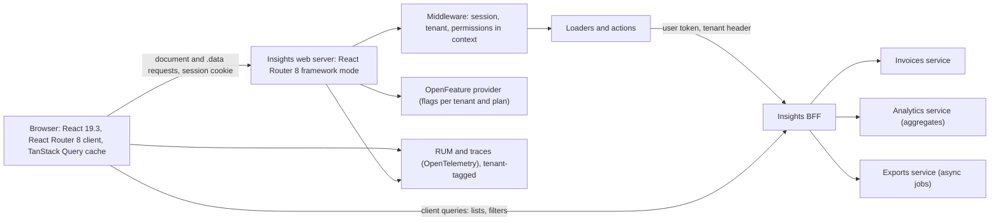
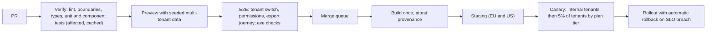

# 67 — Case Study: Enterprise SaaS Dashboard (Acme Insights)

> Multi-tenant dashboards fail in quiet ways. A chart shows last month because a cache key forgot the date range. A user who lost access still sees a page because the guard lived only in the browser. A support engineer switches tenants and, for half a second, sees the previous customer's invoices. Nothing crashes. The architecture is what makes these failures impossible rather than unlikely.

**Prerequisites:** [46 Enterprise SaaS Architecture](46-enterprise-saas-architecture.md), [51 React Router v8](51-react-router-v8-framework-mode.md), [30 Server State](30-server-state-and-data-fetching.md) · **Related:** [28 State Ownership](28-state-and-data-ownership-architecture.md) · [41 Observability](41-observability-and-diagnostics.md) · [45 Auth](45-authentication-and-authorization.md) · [55 Ecosystem Atlas](55-react-ecosystem-atlas-2026.md) · [60 Monorepos](60-monorepos-build-tooling-and-bundlers.md) · [62 CI/CD](62-cicd-release-engineering-and-feature-flags.md) · [63 Governance](63-architecture-governance-and-adrs.md)

> [!NOTE]
> Acme and its products are fictional; they tie the case studies together. The designs use the patterns, versions and verified code from earlier chapters. Figures describing Acme itself (user counts, today's LCP) are part of the scenario, and budget tables are targets. Results marked *verified* come from tests I ran.

---

## TL;DR

- **The product.** Acme Insights is multi-tenant analytics for finance teams: invoices, revenue, cash-flow dashboards and exports. It serves 2,400 tenants, from five seats to 3,000, and users switch between tenants (accountants, Acme support).
- **The stack.**
  - React 19.3 on React Router 8 framework mode, which server-renders the first view, runs loaders and actions, and uses middleware for tenant and session context.
  - A BFF session cookie.
  - TanStack Query for client-side server state and TanStack Table 9 for grids.
  - Charts loaded lazily.
  - The Prism design system ([70](70-case-study-enterprise-design-system.md)).
  - OpenFeature flags and OpenTelemetry.
  - A pnpm and Turborepo monorepo.
- **Tenancy is part of every boundary:** the URL (`/t/:tenantId/…`), the middleware context, every API call, every query key, every telemetry event and every cache.
- **Verified:** with TanStack Query 5.108, `placeholderData: keepPreviousData` showed **tenant A's customer under tenant B's table heading** while B loaded. A tenant-aware placeholder keeps data while paging within a tenant and shows a loading state across tenants. Removing the old tenant's queries on a switch leaves nothing behind.
- **Authorisation runs on the server** in loaders, actions and the API. The browser's permission checks only hide what the user can't use.
- **The deliverables:** an architecture diagram, repository layout, ADR, pipeline, operations checklist and performance report are all below.

---

## 1. The brief

| Requirement | Detail |
|---|---|
| Users | Finance staff at customer companies; external accountants with access to several tenants; Acme support with audited, time-boxed access |
| Scale | 2,400 tenants; 60,000 monthly users; peak 4,000 concurrent at month-end close |
| Data | Invoices (up to 2 million per tenant), payments, revenue aggregates, cash-flow forecasts |
| Freshness | Dashboards within 5 minutes; invoice lists immediately after the user's own changes |
| Permissions | Roles (viewer, analyst, admin) plus attribute rules (region, business unit); tenant-level feature plans |
| Compliance | SOC 2; data residency (EU and US); an audit log of every support-access session |
| Accessibility | WCAG 2.2 AA; every chart has a table alternative |
| Performance | See §8: LCP ≤ 2.0 s and INP ≤ 200 ms at p75 on the dashboard |

---

## 2. Architecture



**Why these boundaries:**

- **The first view is server-rendered with data**, so dashboards appear without a client waterfall. Later interactions (filtering, paging, sorting) use TanStack Query against the BFF, with state in the URL.
- **Middleware establishes tenant and session once per request** and passes them in the router context. Loaders can't forget the tenant, because they receive it rather than re-deriving it ([51](51-react-router-v8-framework-mode.md)).
- **The BFF enforces authorisation** for every call, so the web tier and the browser can't widen access ([33](33-api-integration-bff-and-contracts.md), [45](45-authentication-and-authorization.md)).
- **Aggregates come from the analytics service.** The browser never receives raw invoice rows to chart.
- **Exports are asynchronous jobs** with progress and notifications, never a long-running request.

---

## 3. Repository layout

```text
acme-insights/
├── apps/
│   └── insights-web/                 # React Router 8 app (routes, loaders, actions, middleware)
│       ├── app/routes/t.$tenantId/   # every tenant route lives under the tenant segment
│       ├── app/middleware/           # session.ts, tenant.ts, permissions.ts
│       └── budgets.json              # per-route JavaScript budgets (fitness function, [63])
├── packages/
│   ├── data-access/                  # typed BFF client, query-key factories, query options (tenant-aware)
│   ├── features/
│   │   ├── invoices/                 # list, detail, bulk actions: owned by the invoices team
│   │   ├── dashboards/               # widgets, chart wrappers: owned by the analytics team
│   │   └── exports/                  # export jobs UI: owned by the platform team
│   ├── charts/                       # lazy chart wrappers with table alternatives
│   └── telemetry/                    # OpenTelemetry setup, tenant and release tagging
├── docs/adr/                         # ADR-0001 … (see §5)
├── pnpm-workspace.yaml               # catalogs, allowBuilds, minimumReleaseAge: 1440
├── turbo.json
└── .github/CODEOWNERS                # features/* owned by their teams; data-access by platform
```

Boundary rules, enforced by lint and `turbo boundaries` ([60](60-monorepos-build-tooling-and-bundlers.md)):

- **Features can't import other features.** Shared code goes to `data-access`, `charts` or Prism.
- **Only `data-access` talks to the BFF.** Components never call `fetch` directly.
- **Nothing imports another package's `src/`.** Everything goes through the package's entry point.

---

## 4. Key designs

### 4.1 Tenancy in the URL, context, keys and caches

- **URL:** `/t/:tenantId/invoices?status=open&page=2`. The tenant is visible, shareable and bookmarkable. Switching tenants is a navigation, not hidden state.
- **Middleware context:** the tenant middleware resolves the user's membership and permissions for `:tenantId`, or throws a 404. Using 404 rather than 403 avoids confirming that a tenant exists.
- **API calls:** `data-access` sends the tenant explicitly on every request, and the BFF checks membership again.
- **Query keys** start with `['tenant', tenantId, …]`, through key factories. A key without a tenant fails code review and a lint rule.
- **Telemetry:** every span and RUM event carries `tenant.id` and the user's role, so incidents can be scoped ([41](41-observability-and-diagnostics.md)).

The tenant-switch bug that the key design alone doesn't prevent:

```tsx
// packages/data-access/src/invoices.ts: tenant-scoped server state.
// The tenant is part of every query key, and never "kept" across a switch.
import { QueryClient, useQuery } from '@tanstack/react-query';

export interface Invoice { id: string; customer: string }
export type Fetch = (tenantId: string, page: number) => Promise<Invoice[]>;

export const invoiceKeys = {
  all: (tenantId: string) => ['tenant', tenantId, 'invoices'] as const,
  page: (tenantId: string, page: number) => [...invoiceKeys.all(tenantId), { page }] as const,
};

/** Keeps previous data only when paging within the same tenant. */
export function useInvoices(fetchPage: Fetch, tenantId: string, page: number) {
  return useQuery({
    queryKey: invoiceKeys.page(tenantId, page),
    queryFn: () => fetchPage(tenantId, page),
    placeholderData: (previous, previousQuery) => (previousQuery?.queryKey[1] === tenantId ? previous : undefined),
  });
}

/** On tenant switch, drop every cached query of the old tenant (memory and data minimisation). */
export function onTenantSwitch(client: QueryClient, previousTenantId: string) {
  client.removeQueries({ queryKey: ['tenant', previousTenantId] });
}
```

I tested both versions with TanStack Query 5.108.4 and Testing Library. Tenant B's API was made slower than tenant A's:

| Placeholder | Paging within tenant A | Switching from tenant A to tenant B |
|---|---|---|
| `keepPreviousData` (the common recipe) | Previous page stays visible while the next loads | **The table labelled "Invoices for tenant-b" contained "Alpha Ltd", tenant A's customer, until B's data arrived** |
| Tenant-aware function (above) | Previous page stays visible, with `aria-busy="true"` | "Loading invoices…", with no foreign data; then "Beta GmbH" |
| Plus `onTenantSwitch` | Unchanged | The old tenant's queries are gone from the cache afterwards |

`keepPreviousData` is the right default for paging and filtering. Applied across tenants it becomes a data-exposure incident that no test catches unless someone writes this one. For tools that let support staff switch tenants, I'd also clear the whole client cache on a switch.

### 4.2 Authentication and authorisation

- **Session:** the BFF issues an HttpOnly, Secure, SameSite=Lax cookie, with short-lived access tokens server-side and refresh handled by the BFF ([45](45-authentication-and-authorization.md)).
- **Permissions:** roles plus attribute rules are evaluated in the BFF and returned as a per-tenant capability list. The UI uses the list to hide and disable actions. Loaders, actions and the BFF enforce it.
- **Support access:** time-boxed and audited sessions with a persistent banner, read-only unless the customer grants more.
- **Plans and entitlements** live in the authorisation model, not in feature flags. Flags are for releases and experiments ([62](62-cicd-release-engineering-and-feature-flags.md)).

### 4.3 Tables and filters

- **Server-driven:** paging, sorting and filtering go to the BFF, with all state in the URL search parameters, which makes views shareable and the back button correct.
- **TanStack Table 9** supplies headless logic; Prism renders the grid, with row virtualisation above 100 rows and the WAI-ARIA grid pattern for keyboard users ([55](55-react-ecosystem-atlas-2026.md)).
- **Bulk actions** (void 200 invoices) are server jobs with progress, idempotency keys and a summary of partial failures.

### 4.4 Dashboards and charts

- **Each widget has its own Suspense and error boundary**, so one slow or failing widget never blanks the dashboard.
- **The chart library loads lazily**, per widget, after the shell renders. A skeleton reserves its space (no CLS).
- **Aggregates are computed server-side** for the requested range and granularity. The client receives at most a few hundred points per series.
- **Every chart has a data-table toggle and a text summary** ("Revenue up 12% on last month"), generated from the same data ([36](36-accessibility-engineering.md)).
- **Time ranges are URL state** using shared presets (this month, last 90 days), which improves cache hit rates at the BFF and CDN.

### 4.5 Feature modules and ownership

Each feature package owns its routes, its data hooks (built on `data-access`), its components and its tests. Teams deploy together on one release train, because the product ships as one app. A monorepo with boundaries is enough, so there are no micro-frontends ([61](61-micro-frontends-and-module-federation.md)). If the exports UI ever needs an independent release cadence, it can become a route-level split.

---

## 5. ADR

```markdown
# ADR-0002: React Router 8 framework mode for Acme Insights

- Status: Accepted (2026-09-14) · Decider: Insights tech lead · Consulted: platform, analytics, invoices
- Related: ADR-0001 (monorepo), ADR-0004 (BFF session)

## Context
Insights is authenticated, has no SEO needs, and needs fast first views of data-heavy dashboards.
The current SPA renders a blank shell, then waterfalls five requests; dashboard LCP p75 is 3.8 s.
Teams know React and TanStack Query. We need tenant and session context on every data path.

## Options
1. Keep the SPA and parallelise requests.
2. React Router 8 framework mode: server-rendered first view, loaders, actions, middleware context.
3. Next.js App Router with Server Components.

## Decision
Option 2. Middleware gives one place for session, tenant and permission context; loaders render
dashboards with data on the first response; TanStack Query keeps client interactions fast.
Server Components' main benefit (keeping display-only code off the client) matters less for
an interactive dashboard than for content sites, and we avoid adopting its security surface now.

## Consequences
- We operate a Node server tier for the web app (previously static hosting).
- Loader data and client queries share key factories in data-access, to avoid double fetching.
- Revisit when the dashboard's interactive JavaScript budget becomes the bottleneck.

## Verification
Dashboard LCP p75 ≤ 2.0 s in RUM within one quarter; no route without the tenant middleware
(fitness function: route manifest check in CI).
```

---

## 6. Pipeline



The pipeline-specific gates for Insights:

- **Seeded previews.** The tenant-switch and support-access journeys run against at least three tenants with different plans and regions.
- **Budget fitness function** per route ([63](63-architecture-governance-and-adrs.md)).
- **Route manifest check.** Every route under `t.$tenantId` has the tenant middleware.
- **Canary by tenant tier.** Internal tenants first, then small-plan tenants, then enterprise tenants after month-end close is over.

---

## 7. Operations checklist

- [ ] SLOs: dashboard availability 99.9%; LCP p75 ≤ 2.0 s; INP p75 ≤ 200 ms; export job success ≥ 99.5%
- [ ] Alerts by tenant tier: error-rate spikes for enterprise tenants page on-call; small tenants open tickets
- [ ] Every log line, span and RUM event carries tenant, region, release and role; personal data is redacted
- [ ] Runbooks: tenant data appears wrong; dashboard slow for one tenant; export stuck; support access misuse
- [ ] Month-end close freeze: no risky releases in the last two and first two working days of the month
- [ ] Support-access sessions are audited, time-boxed and reviewed weekly
- [ ] Chunk-load error rate after deploys is monitored; old assets are retained for 7 days ([62](62-cicd-release-engineering-and-feature-flags.md))
- [ ] Data residency: EU tenants' traffic stays in EU regions, including telemetry and logs

---

## 8. Performance report

The report Insights publishes each month, with the budgets it's measured against. The targets are set from the ADR's goals; the method is RUM p75 by route, segmented by device class and region.

| Metric (p75, RUM) | Route | Budget | Alert when |
|---|---|---|---|
| LCP | Dashboard | ≤ 2.0 s | > 2.3 s for 3 days |
| LCP | Invoice list | ≤ 1.8 s | > 2.1 s for 3 days |
| INP | Invoice list (filter, sort, page) | ≤ 200 ms | > 250 ms for 3 days |
| CLS | All routes | ≤ 0.05 | > 0.1 |
| Initial JavaScript (gzip) | Dashboard shell, before lazy widgets | ≤ 180 kB | Any PR exceeding it (CI) |
| Time to switch tenant (navigation to first rows) | Invoice list | ≤ 1.0 s | > 1.5 s |
| Export job time to ready | 100,000 rows | ≤ 60 s | > 120 s |

Each monthly report has four sections:

1. **Budgets against actuals,** with trends over the last six releases.
2. **The three worst routes** by budget overrun, with owners.
3. **Regressions** attributed to specific releases, using the release tag in RUM.
4. **Actions** with dates. Raising a budget needs an ADR ([63](63-architecture-governance-and-adrs.md)).

---

## Decision framework

**Problem.** Build a multi-tenant dashboard where data must never cross tenants, permissions must hold everywhere, and data-heavy views must feel fast.

| Decision | Choice for Insights | Choose differently when |
|---|---|---|
| Rendering | Server-render the first view with loaders | Purely internal tools with no performance targets: an SPA is fine |
| Tenancy | In the URL, middleware context, keys, telemetry | Single-tenant deployments per customer: tenancy lives in infrastructure instead |
| Client server-state | TanStack Query with tenant-first keys and tenant-aware placeholders | Mostly static data: loader data alone may be enough |
| Authorisation | BFF-enforced; the UI only hides | Never otherwise |
| Charts | Lazy, server-aggregated, with table alternatives | Very large interactive datasets: canvas or WebGL charts with downsampling |
| Composition | Monorepo with feature packages | Independent release cadences: route-level split ([61](61-micro-frontends-and-module-federation.md)) |

**Failure modes.**

- Query keys without the tenant.
- `keepPreviousData` across tenants.
- Permission checks only in components.
- Raw rows shipped to the browser to chart.
- One widget's error blanking the dashboard.
- Telemetry without tenant tags.
- Releases during month-end close.

---

## Pitfalls and anti-patterns

- **Tenant in hidden client state.** A tenant chosen in a dropdown and stored only in memory makes links wrong, tabs inconsistent and caches ambiguous. Put it in the URL.
- **Placeholder data across identity changes.** It applies to tenant switches, impersonation and log-out-then-log-in alike: clear or scope the cache.
- **Exports as long requests.** They time out at the proxy and retry into duplicate jobs. Make them asynchronous and idempotent.
- **Client-side authorisation as the guard.** It's a convenience. The BFF decides.
- **Dashboards that fetch everything on mount.** Lazy-load below-the-fold widgets and their chart libraries.

---

## Architect's checklist

- [ ] The tenant is in the URL, the middleware context, every API call, every query key and every telemetry event
- [ ] Placeholder and kept data never cross tenant or identity changes; old tenants' queries are removed on a switch
- [ ] Loaders, actions and the BFF enforce permissions; the UI's capability list only shapes the interface
- [ ] Every dashboard widget has its own Suspense and error boundary, a lazy chart, server-side aggregation and a table alternative
- [ ] Table state (paging, sort, filter) lives in the URL; large lists are virtualised and keyboard accessible
- [ ] Budgets per route run in CI; RUM is segmented by route, device, region and tenant tier
- [ ] Canary releases go by tenant tier, with a month-end freeze; support access is audited

---

## Interview angles

**Q1. How do you prevent cross-tenant data exposure in a React SaaS frontend?**
I put the tenant in the URL and the server's request context, so every loader, API call and query key includes it. Then I look for the subtle paths. In my test, TanStack Query's `keepPreviousData` showed tenant A's customer under tenant B's heading while B loaded. So placeholders are tenant-aware, and a tenant switch removes the old tenant's queries. The server still enforces membership on every request, because the frontend can only reduce exposure, never guarantee isolation.

**Q2. Why server-render a dashboard that has no SEO needs?**
For the first view's speed and simplicity. A server-rendered dashboard arrives with its data in one response instead of a blank shell followed by a waterfall of requests. That's what moves LCP for data-heavy pages. Middleware also gives one place to establish session, tenant and permissions for every data path. Interactions after the first view still use a client cache for speed.

**Q3. How would you design charts for accessibility and performance?**
- **Performance:** server-side aggregation, so the client receives a few hundred points rather than raw rows, and lazy-loaded chart libraries per widget, with skeletons that reserve space.
- **Resilience:** each widget gets its own Suspense and error boundary.
- **Accessibility:** a data-table toggle and a generated text summary for every chart, keyboard access to the table, and colours that pass contrast with patterns for colour-blind users ([70](70-case-study-enterprise-design-system.md)).

**Q4. How do you roll out risky changes to a B2B product with month-end peaks?**
- **Freeze** risky releases around month-end close.
- **Canary by tenant tier:** internal tenants first, then small plans, then enterprise.
- **Watch release-tagged RUM and error rates per tier,** with automatic rollback on SLO breach.
- **Use feature flags** for anything that changes workflows, with opt-in for enterprise admins where needed. Plans and entitlements stay in the authorisation model, not in flags.

**Q5. Would you use micro-frontends for this product?**
No. The teams ship one product on one release train, so a monorepo with feature packages, enforced boundaries and CODEOWNERS gives the organisational separation without runtime integration costs. If one area needed an independent cadence, I'd split it by route first ([61](61-micro-frontends-and-module-federation.md)).

---

> [!TIP]
> **Runnable code:** [E67](E67-case-study-enterprise-saas-dashboard.md) has the tenant-scoped data module, with a test that shows the cross-tenant leak it prevents. `node extract-examples.mjs 67` writes it out as a project; then run `npm ci` and `npm test` in it.

## Further reading

- TanStack Query, *Paginated / lagged queries* and `placeholderData`: <https://tanstack.com/query/latest/docs/framework/react/guides/paginated-queries>
- React Router, *Middleware*: <https://reactrouter.com/how-to/middleware>
- WAI-ARIA Authoring Practices, *Grid pattern*: <https://www.w3.org/WAI/ARIA/apg/patterns/grid/>

---

[← Previous: 66 — Frontend System Design](66-frontend-system-design.md) · [Index](README.md) · [Next: 68 — Case Study: Large E-commerce Storefront →](68-case-study-ecommerce-storefront.md)
