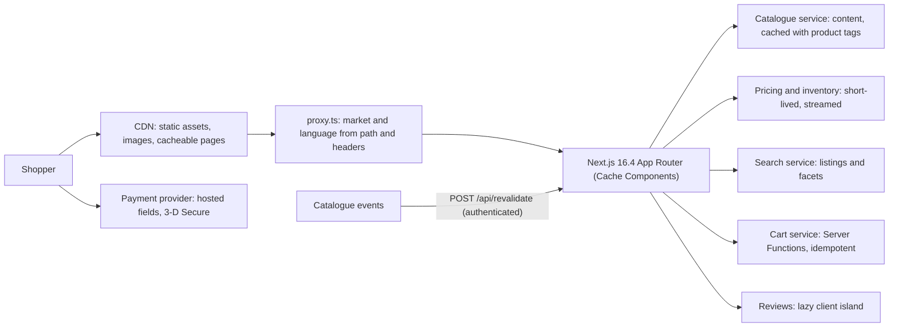

# 68 — Case Study: Large E-commerce Storefront (Acme Store)

> A storefront has two kinds of content. Some barely changes: the product's name, its photos, its description. Some changes all the time: the price, the stock and what's in the bag. Most performance and correctness problems come from caching the second kind as if it were the first, or rendering the first kind as if it were the second.

**Prerequisites:** [47 Next.js App Router](47-nextjs-app-router-architecture.md), [48 Next.js Rendering and Caching](48-nextjs-rendering-and-caching.md), [18 Server Components](18-react-server-components-and-server-functions.md) · **Related:** [05 Networking and Delivery](05-networking-caching-and-delivery.md) · [39 Web Performance](39-web-performance-and-core-web-vitals.md) · [43 Security](43-frontend-security-architecture.md) · [44 RSC Security](44-rsc-security-threat-model.md) · [49 Next.js Mutations and Auth](49-nextjs-data-mutations-and-auth.md) · [50 Next.js in Production](50-nextjs-in-production.md) · [62 CI/CD](62-cicd-release-engineering-and-feature-flags.md)

> [!NOTE]
> Acme Store is fictional. Figures describing the business are part of the scenario, and budget tables are targets. Results marked *verified* come from builds and tests I ran.

---

## TL;DR

- **The product.** Acme Store is a public storefront: 400,000 products, 12 markets, 75% mobile traffic and Black-Friday peaks at 20 times normal load. Organic search brings 45% of revenue.
- **The stack.** Next.js 16.4 App Router with Cache Components and React 19.3 Server Components for catalogue pages. Client islands handle the bag, variant picker and reviews. Checkout uses the payment provider's hosted fields. Releases go through OpenFeature flags, and RUM is segmented by market and device.
- **Two speeds of data.** Product content is cached for hours, with a tag per product that the catalogue invalidates on change. Price and stock are short-lived and stream into the page.
- **Verified with Next.js 16.4.6:**
  - **Build:** the product route built as **Partial Prerender**.
  - **Response:** the served HTML carried the product, its JSON-LD and a "Checking price…" fallback, followed in the *same response* by the streamed price.
  - **Revalidation endpoint:** it rejected unauthenticated (403) and malformed (400) calls.
  - **Caching when self-hosted:** the response was `Cache-Control: private, no-cache, no-store`. Edge-caching the shell needs a platform that understands postponed responses.
- **Verified with React 19.3:**
  - **JSON-LD.** Raw `JSON.stringify` inside `dangerouslySetInnerHTML` let a product name **execute script**. Rendering the JSON as the `<script>`'s text child was safe: React escapes "script" inside script text, including in mixed case and after `<!--`, and the JSON still round-trips.
  - **The bag.** An optimistic "add to bag" showed the item instantly and **reverted with an explanation** when the server refused.
- **The deliverables:** an architecture diagram, repository layout, ADR, pipeline, operations checklist (including a peak playbook) and performance report are all below.

---

## 1. The brief

| Requirement | Detail |
|---|---|
| Catalogue | 400,000 products; 12 markets with their own currencies and languages; 2,000 product updates per hour on average |
| Traffic | 3 million sessions a day; peaks 20× at Black Friday and drops; 75% mobile, many mid-range Android phones |
| Revenue drivers | Organic search (45%), paid search, email; product pages are the main landing pages |
| Freshness | Price and stock within 60 seconds; product content within 15 minutes of an edit |
| Checkout | Cards, wallets, buy-now-pay-later; 3-D Secure; guest checkout |
| Accessibility | WCAG 2.2 AA (a legal requirement in several markets) |
| Performance | LCP ≤ 2.0 s, INP ≤ 150 ms, CLS ≤ 0.05 at p75 on mobile product pages (§8) |

---

## 2. Architecture



**Rendering per route** ([32](32-rendering-strategy-architecture.md), [48](48-nextjs-rendering-and-caching.md)):

| Route | Strategy | Why |
|---|---|---|
| Home, campaign pages | Cached, revalidated on publish | Shared by everyone; content changes on a schedule |
| Product listing (category, search) | Cached by category and facets in the URL; personalised ranking as a streamed hole | SEO landing pages, plus some personalisation |
| Product detail | Cached content shell, live price and stock streamed, reviews and recommendations lazy | The main landing page: LCP is the product image |
| Bag, checkout, account | Dynamic, never shared-cached | Per user, and sensitive |

**Server Components** render product content, listings and navigation. That keeps markdown rendering, formatting libraries and most of the component code off the client. Client components are the islands that need interaction: the variant picker, bag, reviews and image gallery.

---

## 3. Repository layout

```text
acme-store/
├── apps/
│   └── storefront/                         # Next.js 16.4 App Router
│       ├── app/[market]/p/[slug]/page.tsx  # product detail: cached shell plus streamed price
│       ├── app/[market]/c/[...category]/   # listings: facets in search params
│       ├── app/[market]/bag/ · checkout/   # dynamic, private
│       ├── app/api/revalidate/route.ts     # catalogue webhooks invalidate by tag
│       ├── proxy.ts                        # market and language routing
│       └── budgets.json                    # per-route JavaScript budgets
├── packages/
│   ├── commerce/                           # typed clients for catalogue, pricing, cart, search
│   ├── seo/                                # metadata builders, JSON-LD, sitemaps, hreflang
│   ├── checkout/                           # hosted-fields integration, payment state machine
│   └── prism/                              # the design system ([70](70-case-study-enterprise-design-system.md))
├── docs/adr/
└── pnpm-workspace.yaml · turbo.json · .github/CODEOWNERS
```

---

## 4. Key designs

### 4.1 The product page: cached content, live price

```tsx
// app/[market]/p/[slug]/page.tsx: a cached product shell with a live price streamed into it
import { cacheLife, cacheTag } from 'next/cache';
import { notFound } from 'next/navigation';
import { Suspense } from 'react';
import { catalogue, pricing } from '../../../../lib/catalogue';

export async function generateStaticParams() {
  return (await catalogue.popularSlugs()).flatMap((slug) => [{ market: 'uk', slug }, { market: 'de', slug }]);
}

async function getProduct(market: string, slug: string) {
  'use cache';
  cacheLife('hours');                            // product content changes rarely…
  cacheTag(`product:${slug}`);                   // …and the catalogue invalidates it by tag when it does
  return catalogue.product(market, slug);
}

async function LivePrice({ market, sku }: { market: string; sku: string }) {
  'use cache';
  cacheLife('seconds');                          // prices and stock: short-lived, never hours
  cacheTag(`price:${sku}`);
  const p = await pricing.livePrice(market, sku);
  return <p data-testid="price">{p.currency} {p.amount} · {p.inStock ? 'In stock' : 'Out of stock'}</p>;
}

export default async function ProductPage({ params }: { params: Promise<{ market: string; slug: string }> }) {
  const { market, slug } = await params;
  const product = await getProduct(market, slug);
  if (!product) notFound();
  const jsonLd = { '@context': 'https://schema.org', '@type': 'Product', name: product.name, sku: product.sku };
  return (
    <main>
      <script type="application/ld+json">{JSON.stringify(jsonLd)}</script>
      <h1>{product.name}</h1>
      <p>{product.description}</p>
      <Suspense fallback={<p>Checking price…</p>}>
        <LivePrice market={market} sku={product.sku} />
      </Suspense>
    </main>
  );
}
```

```ts
// app/api/revalidate/route.ts: the catalogue calls this when a product changes
import { revalidateTag } from 'next/cache';

export async function POST(request: Request) {
  if (request.headers.get('authorization') !== `Bearer ${process.env.REVALIDATE_SECRET}`) return new Response('Forbidden', { status: 403 });
  const { slug } = (await request.json()) as { slug?: unknown };
  if (typeof slug !== 'string' || !/^[a-z0-9-]+$/.test(slug)) return new Response('Bad request', { status: 400 });
  revalidateTag(`product:${slug}`, 'max');      // stale-while-revalidate: serve the old page once, then the new one
  return Response.json({ revalidated: `product:${slug}` });
}
```

I built and served this with Next.js 16.4.6 and `cacheComponents: true`. The real product page is richer: a gallery, variants, reviews and recommendations, all following the same pattern.

| Check | Result |
|---|---|
| `next build` | The product route and its pre-generated paths were marked **◐ Partial Prerender**: static HTML with dynamic, server-streamed content |
| `GET /uk/p/desk-lamp` | 200. The HTML held the `<h1>`, the JSON-LD and the "Checking price…" fallback. Further down, the same response streamed `GBP 49.00 · In stock` into place |
| Response headers | `x-nextjs-prerender: 1`, `x-nextjs-postponed: 1`, and `Cache-Control: private, no-cache, no-store, max-age=0, must-revalidate` |
| `GET /uk/p/no-such-thing` | 404 |
| `POST /api/revalidate` | 403 without the secret; 200 `{"revalidated":"product:desk-lamp"}` with it; 400 for `../etc` |

**What the headers mean for edge caching.** Self-hosted with `next start`, a partially prerendered page is served with `no-store`, because the response contains a dynamic part. A generic CDN therefore won't cache it. The Next.js server still reuses the prerendered shell and streams only the hole, so you get the fast shell either way.

To serve the shell from the edge as well, you need a platform or deployment adapter that understands postponed responses. Otherwise, cache the routes that are fully static (home, campaigns) at the CDN and let product pages stream from the origin. Check this on *your* hosting before promising edge-cached product pages ([50](50-nextjs-in-production.md)).

**Two speeds, two cache lifetimes.** Product content is cached for hours and invalidated by tag when the catalogue changes it. Price and stock use `cacheLife('seconds')`, short enough that Cache Components treats them as dynamic and streams them. That's what made the route a partial prerender rather than fully static.

Never cache a personalised or market-specific price under a key that doesn't include the market and the customer segment. A price leaking between markets is a legal problem, not a performance one.

### 4.2 Structured data without an XSS

Product names and descriptions come from merchants and feeds, so treat them as untrusted. I tested three ways of embedding JSON-LD with React 19.3's server renderer. The product's name was `Desk lamp </script><script>window.pwned = true</script>`, and each page was loaded in jsdom with scripts enabled:

| Pattern | Result |
|---|---|
| `<script dangerouslySetInnerHTML={{ __html: JSON.stringify(data) }} />` | **The injected script ran** (`window.pwned === true`), and the page had two `<script>` elements |
| The same, with `<`, `>` and `&` escaped as `\u003c`, `\u003e`, `\u0026` | One inert script; `JSON.parse` of its content equalled the original data |
| `<script type="application/ld+json">{JSON.stringify(data)}</script>` (a text child) | One inert script, and the JSON round-tripped. React writes `</script>` inside script text as `</\u0073cript>`. That held for `</SCRIPT>`, `</ScRiPt >` and payloads after `<!--` |

So, with React 19:

- **Render JSON-LD as a text child.** React's script-text escaping handles the breakout.
- **Anywhere a string goes into HTML raw** (`dangerouslySetInnerHTML`, a framework head API that takes a string, a template outside React), escape `<`, `>` and `&` first:

```ts
/** JSON is not HTML-safe: a "</script>" inside any string value would end the script element. Escape <, > and &. */
export function serializeJsonLd(data: unknown): string {
  return JSON.stringify(data).replace(/[<>&]/g, (c) => '\\u' + c.charCodeAt(0).toString(16).padStart(4, '0'));
}
```

### 4.3 SEO

- **Metadata API** for titles, descriptions and Open Graph, built from product data in `packages/seo`, with canonical URLs per market and `hreflang` alternates.
- **Variant URLs.** Each variant (colour, size) is its own URL with a canonical pointing at the product, so variants are shareable without splitting ranking.
- **Listings.** Facets that create useful landing pages ("oak chairs") are crawlable paths. Combinations that don't (price ranges, sort orders) are query parameters with `noindex` or a canonical to the base listing.
- **Sitemaps** are generated per market and chunked (50,000 URLs per file) from the catalogue, with `lastmod` from product updates.
- **Monitoring.** Track index coverage, structured-data errors and Core Web Vitals per template in search tooling and RUM.

### 4.4 The bag: optimistic, but the server decides

```tsx
// cart.tsx: an optimistic "add to bag" with React 19 actions; the server's answer always wins
import { useOptimistic, useState } from 'react';

export function AddToBag({ addItem }: { addItem: () => Promise<number> }) {
  const [count, setCount] = useState(0);                                   // confirmed by the server
  const [shown, addOptimistic] = useOptimistic(count, (current, delta: number) => current + delta);
  const [error, setError] = useState<string | null>(null);

  async function add() {
    setError(null);
    addOptimistic(1);                                                      // instant feedback
    try {
      setCount(await addItem());                                           // the server returns the real count
    } catch {
      setError('We couldn’t add that to your bag. Please try again.');     // optimistic value reverts on its own
    }
  }

  return (
    <form action={add}>
      <button type="submit">Add to bag</button>
      <output aria-live="polite">{shown} in bag</output>
      {error && <p role="alert">{error}</p>}
    </form>
  );
}
```

Both tests passed with React 19.3 and Testing Library:

- **The server confirms:** "1 in bag" appeared before the server answered and stayed.
- **The server refuses** (out of stock): "1 in bag" appeared, then the alert, then "0 in bag".

In production, `addItem` is a Server Function that:

- takes an **idempotency key**, so a retry can't add two;
- **re-reads price and stock** on the server, never trusting the client's price;
- **returns the authoritative bag** ([49](49-nextjs-data-mutations-and-auth.md)).

### 4.5 Checkout

- **Payment data never touches our servers.** Use the provider's hosted fields or payment element, which keeps Acme in the lightest PCI scope.
- **A payment state machine:** cart, details, payment, 3-D Secure challenge, confirmation, with every state recoverable after a reload. Submissions carry idempotency keys.
- **One step per URL** with server-side validation. Error summaries link to fields, and focus moves to the summary on submit ([36](36-accessibility-engineering.md)).
- **Address autocomplete** as an accessible combobox, with manual entry always available.
- **Fraud and bot protection** at the edge, with rate limits on bag and checkout Server Functions.

### 4.6 Images and the LCP element

On product pages, the main photo is the LCP element:

- **Serve it** through the image optimiser with explicit `width` and `height`, `priority`, and `sizes` that match the layout.
- **Fetch it first.** Thumbnails and gallery images load lazily, and nothing render-blocking sits in front of the hero image.
- **Use modern formats** (AVIF and WebP) negotiated by the image CDN, and cap the maximum dimensions served to mobile ([39](39-web-performance-and-core-web-vitals.md)).

### 4.7 Security floor

Server Components and Server Functions make the storefront part of the React Server Components attack surface ([44](44-rsc-security-threat-model.md)). Acme stays at or above the patched floor: React 19.3.1 and Next.js 16.4.5 or later. Framework security releases go through the fast lane in [62](62-cicd-release-engineering-and-feature-flags.md). Every Server Function authenticates, authorises, validates its input and is rate limited. Proxy is never the only authorisation check.

---

## 5. ADR

```markdown
# ADR-0005: Cache product content by tag; stream price and stock

- Status: Accepted (2026-08-21) · Decider: Storefront architect · Consulted: catalogue, pricing, SEO, SRE

## Context
Product pages are the top landing pages. Today they are server-rendered on every request
(TTFB p75 900 ms on mobile) because price and stock must be fresh. Content changes rarely.

## Options
1. Render every request (today).
2. Full-page cache with short TTL (60 s): stale prices for up to a minute, poor hit rate on the long tail.
3. Cache Components: product content cached for hours with a product tag invalidated by catalogue events;
   price and stock as short-lived cached components streamed into the page.

## Decision
Option 3. Catalogue events call an authenticated revalidation endpoint per product tag.
Price and stock never share the content cache.

## Consequences
- The page shell is prerendered and reused; only price and stock are computed per request.
- Edge-caching the shell depends on hosting support for postponed responses; until then, the CDN caches
  static routes and assets only.
- Revalidation webhooks become a production dependency: monitored, retried, and alerting on backlog.

## Verification
Build output shows product routes as Partial Prerender; TTFB p75 ≤ 400 ms and LCP p75 ≤ 2.0 s on
mobile product pages; price freshness check (synthetic) ≤ 60 s.
```

---

## 6. Pipeline

```mermaid
flowchart LR
  PR["PR"] --> V["Verify: lint, types, unit, component (affected)"]
  V --> SEO["SEO checks: metadata, canonical, hreflang, JSON-LD parse"]
  SEO --> PV["Preview: seeded catalogue in two markets"]
  PV --> E2E["E2E: browse, search, add to bag, checkout (test cards), axe"]
  E2E --> LH["Lab performance on PDP and PLP templates (mobile profile)"]
  LH --> MQ["Merge queue, then build once"]
  MQ --> CAN["Canary: one small market, then 10% traffic"]
  CAN --> ALL["Rollout; peak freeze windows enforced"]
```



Storefront-specific gates:

- **The build output must show product routes as partially prerendered.** A route that silently becomes fully dynamic fails the build.
- **The JSON-LD is parsed in CI**, with injection fixtures in product names.
- **Per-route JavaScript budgets** run as a fitness function ([63](63-architecture-governance-and-adrs.md)).
- **Peak freezes** around Black Friday and drops: only fixes, behind flags.

---

## 7. Operations checklist

- [ ] **Peak playbook:**
  - load test at 25× baseline two weeks before;
  - warm caches for top products;
  - check origin shield and autoscaling limits;
  - pre-agree kill switches for recommendations, reviews and personalisation.
- [ ] Revalidation pipeline monitored: webhook failures, backlog and time-to-fresh for product edits
- [ ] Price-freshness synthetic check (≤ 60 s) and a cross-market price-leak check (prices compared per market)
- [ ] Payment provider outage runbook: fallback provider or queue-and-email, a clear message to shoppers, an incident banner
- [ ] Inventory oversell alarm; checkout re-validates stock before payment
- [ ] SEO monitoring: index coverage, structured-data errors and canonical anomalies per market
- [ ] Framework security releases within days; React and Next.js versions on the patched floor (A3)
- [ ] RUM by market, device class and template; error rate by release; chunk-load errors after deploys

---

## 8. Performance report

Targets for mobile at p75 (RUM), reported monthly per market and per template:

| Metric | Template | Budget | Alert when |
|---|---|---|---|
| LCP | Product detail | ≤ 2.0 s | > 2.3 s for 2 days in any top-5 market |
| LCP | Product listing | ≤ 2.2 s | > 2.5 s for 2 days |
| INP | Product detail (variant picker, add to bag) | ≤ 150 ms | > 200 ms |
| CLS | All templates | ≤ 0.05 | > 0.1 |
| TTFB | Product detail | ≤ 400 ms | > 600 ms |
| Initial JavaScript (gzip) | Product detail | ≤ 120 kB | Any PR exceeding it |
| Price freshness | Product detail | ≤ 60 s | > 90 s (synthetic) |
| Checkout conversion impact | Releases touching checkout | No significant drop | Automatic rollback on canary |

Each report covers four things:

1. **Budgets against actuals** by market and template.
2. **The worst templates and markets**, with owners.
3. **Conversion correlation:** sessions with good and poor LCP and INP, compared.
4. **Regressions attributed to releases.**

Changing a budget needs an ADR.

---

## Decision framework

| Decision | Choice for Acme Store | Choose differently when |
|---|---|---|
| Framework | Next.js App Router with Cache Components | Few products and no personalisation: a static site generator or Astro with islands |
| Product content | Cached, invalidated by tag from catalogue events | Content that changes every minute: shorter lifetimes, or dynamic |
| Price and stock | Short-lived, streamed into the shell | Prices identical for everyone and changing daily: cache with the content |
| Edge caching | Static routes and assets at the CDN; product shells where the platform supports postponed responses | A platform with full support: cache the shell at the edge too |
| Bag | Optimistic UI with server-authoritative Server Functions and idempotency | Never trust client prices |
| Checkout | Hosted payment fields, a state machine, one step per URL | Never collect card data yourself |

**Failure modes.**

- Prices cached under keys without market or segment.
- Product routes silently becoming dynamic, which TTFB shows.
- Revalidation webhooks failing unnoticed.
- JSON-LD built with raw strings.
- Lazy-loading the LCP image.
- Peak-week releases.
- An unpatched framework floor.

---

## Pitfalls and anti-patterns

- **One cache lifetime for the whole page.** Content wants hours; price wants seconds. Split them.
- **Assuming the CDN caches partially prerendered pages.** Self-hosted, the response is `no-store`. Know what your platform does.
- **Client-side price calculation.** Totals, discounts and tax come from the server; the client displays them.
- **Raw HTML from feeds.** Product descriptions are untrusted. Sanitise rich text, and render JSON-LD as a text child or escape it.
- **Facet explosion in the index.** Every filter combination as a crawlable URL wastes crawl budget and splits ranking.
- **Optimistic UI without reconciliation.** The bag shows what the server returned, not what the client hoped for.

---

## Architect's checklist

- [ ] Rendering strategy per template; product routes verified as partial prerenders in CI
- [ ] Content cached by product tag with authenticated, validated revalidation; price and stock short-lived and streamed
- [ ] Cache keys include market and segment wherever prices or availability vary
- [ ] JSON-LD rendered as a text child, or escaped before raw insertion; injection fixtures in CI
- [ ] The LCP image is prioritised and sized; below-the-fold media lazy
- [ ] Bag mutations are idempotent Server Functions that re-read price and stock; optimistic UI reconciles with the server's answer
- [ ] Checkout uses hosted payment fields, a recoverable state machine, one step per URL and accessible errors
- [ ] Peak playbook, kill switches, revalidation monitoring and a framework patch floor are in place

---

## Interview angles

**Q1. How would you render a product page for a large storefront?**
I'd split the data by how often it changes:
- **Content** (name, images, description) is cached for hours, with a tag per product that catalogue events invalidate.
- **Price and stock** are short-lived and streamed into the cached shell.
- **Reviews and recommendations** load lazily.

With Next.js 16.4's Cache Components, that page built as a partial prerender. The HTML arrived with the product and a price fallback, and the live price streamed into the same response. The hero image is the LCP element, prioritised and sized. One caveat I'd check on our hosting: self-hosted, the response is `no-store`, so edge-caching the shell needs platform support.

**Q2. Where can XSS hide in a server-rendered storefront?**
In merchant- or feed-supplied content that reaches HTML raw: rich descriptions and, classically, JSON-LD. In my test, `JSON.stringify` inside `dangerouslySetInnerHTML` let a product name close the script tag and run code. Rendering the JSON as the script's text child in React 19 was safe, because React escapes "script" sequences in script text. Anywhere raw insertion is unavoidable, I'd escape `<`, `>` and `&`. Rich text goes through a sanitiser, and a CSP limits the damage of anything missed.

**Q3. How do you make "add to bag" feel instant without lying?**
With an optimistic update: React 19's `useOptimistic` inside a form action shows the new count immediately. The confirmed count comes from the server's answer. If the server refuses (out of stock, say), the optimistic value reverts and an alert explains why. I tested both paths. The mutation itself is an idempotent Server Function that re-reads price and stock, so retries can't double-add and the client never sets the price.

**Q4. How do you prepare a storefront for a 20× traffic peak?**
- **Load:** test at above the expected peak.
- **Caches:** warm them for top products, and check the origin shield, autoscaling and rate limits.
- **Kill switches:** pre-agree them for expensive features (recommendations, personalisation, reviews) and rehearse flipping them.
- **Changes:** freeze releases, except flagged fixes.
- **Monitoring:** add synthetic checks for price freshness and checkout.
- **People:** have the payment provider's outage runbook ready and on-call rotas staffed.

Afterwards, compare RUM and conversion by template to find what to fix before the next peak.

**Q5. How do you keep SEO healthy across 12 markets?**
- **Per-market URLs** with canonicals and `hreflang` alternates.
- **Metadata** built from product data.
- **Product structured data**, validated in CI.
- **Chunked sitemaps** per market with real `lastmod` dates.
- **Facet control:** useful categories as crawlable paths, and everything else canonicalised or `noindex`.
- **Monitoring:** index coverage, structured-data errors and Core Web Vitals per template and market, because ranking problems usually start as template regressions.

---

> [!TIP]
> **Runnable code:** [E68](E68-case-study-ecommerce-storefront.md) has the product page as a Next.js 16 app, plus the bag and JSON-LD components with tests. `node extract-examples.mjs 68` writes it out as a project; then run `npm ci` and `npm test` in it.

## Further reading

- Next.js, *Cache Components* and `cacheLife`/`cacheTag`: <https://nextjs.org/docs/app/getting-started/cache-components>
- Next.js, *JSON-LD*: <https://nextjs.org/docs/app/guides/json-ld>
- Google Search Central, *Product structured data*: <https://developers.google.com/search/docs/appearance/structured-data/product>
- web.dev, *Optimize Largest Contentful Paint*: <https://web.dev/articles/optimize-lcp>

---

[← Previous: 67 — Case Study: Enterprise SaaS Dashboard](67-case-study-enterprise-saas-dashboard.md) · [Index](README.md) · [Next: 69 — Case Study: Collaborative Project-Management App →](69-case-study-collaborative-project-management.md)
