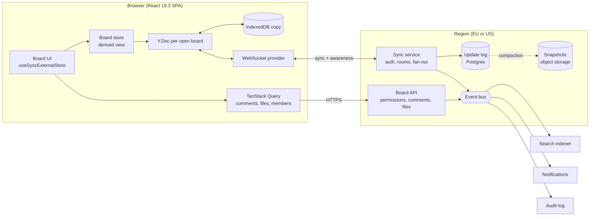
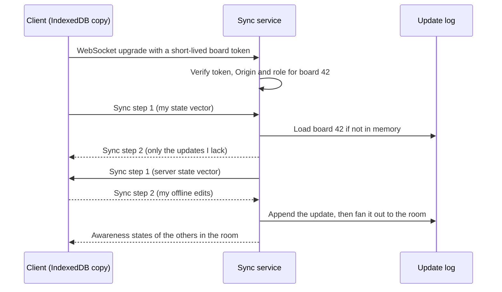

# 69 — Case Study: Collaborative Project-Management App (Acme Boards)

> In a collaborative app the hard question is never "what is the state?". It is "what happens when two people change it at once, and one of them is on a train?" Model the data so that the answer is boring.

**Prerequisites:** [34 Realtime, Offline and Collaboration](34-realtime-offline-and-collaboration.md), [28 State and Data Ownership](28-state-and-data-ownership-architecture.md), [29 Client State Management](29-client-state-management.md) · **Related:** [30 Server State](30-server-state-and-data-fetching.md) · [45 Authentication and Authorization](45-authentication-and-authorization.md) · [40 Resilience](40-resilience-and-reliability.md) · [62 CI/CD and Release Engineering](62-cicd-release-engineering-and-feature-flags.md) · [66 Frontend System Design](66-frontend-system-design.md)

> [!NOTE]
> Acme Boards is fictional. Figures describing the business are part of the scenario, and budget tables are targets. Results marked *verified* come from tests I ran with yjs 13.6.33, y-protocols 1.0.7, fractional-indexing 4.0.0, @hocuspocus/server 4.9.0 and React 19.3 on Node 22.

---

## TL;DR

- **The data model decides whether conflicts are boring.** A board stored as one array of card IDs per column duplicates a card when two people move it at the same time. In 100 randomized offline runs, per-column arrays duplicated cards in **every run**. A model where each card owns its `column` and `rank` converged in all 100 runs with no duplicates and no lost cards (*verified*).
- **One Yjs document per board.** Card titles and descriptions are `Y.Text`, so concurrent typing merges. Scalar fields (column, assignee, due date) are last-writer-wins registers. Columns and their order are *derived*, never stored.
- **Order with string fractional indexes, not floats.** Halving the gap between two floats runs out after 52 inserts at the same spot (*verified*).
- **Sync sends differences, not documents.** On reconnect, clients exchange state vectors. Two offline moves on a 200-card board sync in 87 bytes; the whole document is 17,876 bytes (*verified*).
- **Presence goes in the awareness channel, not the document.** Cursors and "who's viewing" are ephemeral, and putting them in the document would make its history grow forever.
- **Undo is per user.** A `Y.UndoManager` that tracks only the local user's origin undoes *my* move and leaves a colleague's concurrent edit alone (*verified*).
- **CRDTs merge anything, so the server decides who may write.** The sync server authenticates every connection and drops writes from viewers (*verified* with Hocuspocus read-only connections). Comments, files, permissions and billing stay server-authoritative APIs.
- **React reads the document through `useSyncExternalStore`** with a cached snapshot. Yjs owns the state; React renders a view of it.

---

## 1. The brief

Acme Boards is the project-management product in the Acme suite: kanban boards, a list view and a timeline over the same cards. Field and operations teams use it on phones in places with bad coverage.

| Requirement | Target |
|---|---|
| Organisations | 40,000; the largest boards hold 5,000 cards |
| Concurrent editors | Up to 50 on one board during planning sessions |
| Remote change visible to others | ≤ 300 ms p95 within a region |
| Offline | Full editing offline for days; nothing lost on reconnect |
| Correctness | A card is never duplicated or lost; every replica converges |
| Security | Board-level roles (owner, editor, viewer); audit log for enterprise plans |
| Data residency | EU organisations' boards are stored and synced only in the EU |
| Platforms | React 19.3 SPA (desktop and mobile web), installable PWA |

The previous version was a REST app with optimistic updates and a "reload to see changes" banner. Its two biggest support categories were "my changes disappeared" (last request wins) and "the card is in two columns" (a client-side reconciliation bug). This rebuild is about making those two categories impossible by construction.

---

## 2. Architecture



Two kinds of state, two paths:

| State | Owner | Path | Why |
|---|---|---|---|
| Cards, columns, order, titles, descriptions, checklists | The board document (CRDT) | WebSocket sync | Edited concurrently and offline; must merge |
| Presence: who's here, cursors, selection | Awareness (ephemeral) | Same socket, separate channel | Changes many times a second; worthless after a minute |
| Membership and roles | Board API (server-authoritative) | HTTPS + TanStack Query | Security decisions can't be "merged" |
| Comments, attachments | Board API | HTTPS + TanStack Query | Append-only, need moderation, deletion and virus scanning |
| Notifications, search, audit | Event consumers | Event bus | Derived from both sources |

Reconnecting after a day offline:



The client renders from its IndexedDB copy immediately, before the socket even opens. The network only ever brings *differences*.

---

## 3. Repository layout

```text
acme-boards/
├── apps/
│   ├── web/                    # React 19.3 + Vite 8 SPA; PWA shell
│   └── sync/                   # Node WebSocket service (Hocuspocus 4.9)
├── packages/
│   ├── board-model/            # The Yjs schema: addCard, moveCard, rankAt, boardView, migrations
│   ├── board-react/            # createBoardStore, useBoard, presence hooks, Board components
│   ├── board-api-client/       # Typed client for members, comments and files
│   └── ui/                     # Prism components (chapter 70)
├── tools/
│   ├── convergence-fuzz/       # Seeded multi-replica fuzz tests (runs in CI)
│   └── fixtures/               # Board documents saved by every released schema version
├── turbo.json
└── pnpm-workspace.yaml
```

`board-model` is the most important package in the repository. Both `web` and `sync` depend on it, nothing else is allowed to import `yjs` directly (an ESLint `no-restricted-imports` rule enforces it, alongside `turbo boundaries` for workspace dependencies; see [60](60-monorepos-build-tooling-and-bundlers.md)), and it has the strictest review rules. A schema mistake there is permanent, because documents live forever on devices you don't control.

---

## 4. Key designs

### 4.1 Model the data so conflicts are boring

The obvious model for a kanban board is one array of card IDs per column. A move is "delete from this array, insert into that one". It works perfectly until two people move the same card while they're apart:

```ts
// From board.test.ts: the tempting model, demonstrated
const move = (d: Y.Doc, to: string) => d.transact(() => {
  arrayModel(d).get('todo')!.delete(0, 1);
  arrayModel(d).get(to)!.push(['card-1']);
});
move(a, 'done');                                    // offline: A moves it to Done
move(b, 'review');                                  // offline: B moves it to Review
sync(a, b);
assert.deepEqual(where(a), ['review', 'done']);     // the same card is now in two columns
```

Both deletes remove the same element, so they agree. But the two inserts are into *different* arrays, and a CRDT keeps every insert. Nothing is wrong with Yjs here: the model asked for two copies. A "fix-up" pass that deletes duplicates afterwards just moves the race somewhere else, because two clients can run the fix-up concurrently too.

The fix is to make the move a single write to a single place. Each card owns its column and its rank; columns are a view computed from the cards:

```ts
// board.ts (board-model): each card owns its column and rank
export type Card = Y.Map<Y.Text | string>;          // { title: Y.Text, column: string, rank: string }
export type CardView = { id: string; rank: string; title: string };

export const cardsOf = (doc: Y.Doc) => doc.getMap<Card>('cards');

export function addCard(doc: Y.Doc, id: string, title: string, column: string, rank: string) {
  doc.transact(() => {
    const card: Card = new Y.Map();
    const text = new Y.Text();
    text.insert(0, title);
    card.set('title', text);                        // collaborative text: concurrent edits merge
    card.set('column', column);                     // last-writer-wins register
    card.set('rank', rank);                         // fractional-index key within the column
    cardsOf(doc).set(id, card);
  });
}

export function moveCard(doc: Y.Doc, id: string, column: string, rank: string) {
  doc.transact(() => {
    const card = cardsOf(doc).get(id)!;
    card.set('column', column);
    card.set('rank', rank);
  });
}

// Ties happen when two people insert at the same spot concurrently; the card ID breaks them the same way everywhere.
const byRank = (a: CardView, b: CardView) => (a.rank < b.rank ? -1 : a.rank > b.rank ? 1 : a.id < b.id ? -1 : 1);

/** The view is derived, never stored: a card can only be in the one column its own field names. */
export function boardView(doc: Y.Doc): Record<string, CardView[]> {
  const lists: Record<string, CardView[]> = {};
  cardsOf(doc).forEach((card, id) => {
    (lists[card.get('column') as string] ??= []).push({ id, rank: card.get('rank') as string, title: String(card.get('title')) });
  });
  for (const list of Object.values(lists)) list.sort(byRank);
  return lists;
}
```

Yjs resolves concurrent writes to the same map key deterministically, so every replica picks the same winner. One person's move wins and the other's is discarded, which is exactly what a human would expect: the card ends up in one of the two places it was dragged to, never both.

The same principle applies everywhere in the schema: **put each fact in exactly one place, and make every user action a write to the fewest possible places.** Checklists inside a card are a `Y.Array` (order matters and nobody moves items *between* cards). Labels are a `Y.Map` from label ID to `true`, so two people adding labels concurrently both succeed. The assignee is a register, because a card has one assignee and a race should pick one.

*Verified:* concurrent moves to two different columns converge to exactly one column on both replicas. A title edit at the start, an edit at the end and a move, all concurrent, produce `{ doing: ['Fix login bug (urgent)'] }` everywhere.

### 4.2 Order within a column: fractional indexes

Each card's `rank` is a sortable key. Dropping a card between two neighbours generates a key between theirs, so a move touches one card, not every card below it.

Floats are the tempting implementation, and they fail. Halving the gap between 1 and 2 runs out of precision after **52 inserts** at the same spot (*verified*), which a busy planning session can reach in a morning. Use string keys that can always grow; the `fractional-indexing` package generates them:

```ts
import { generateKeyBetween } from 'fractional-indexing';

/** A rank for position `index` in `column`: between the neighbours the user can see. */
export function rankAt(doc: Y.Doc, column: string, index: number, exclude?: string) {
  const others = (boardView(doc)[column] ?? []).filter((c) => c.id !== exclude);
  const lo: string | null = others[index - 1]?.rank ?? null;          // null means 'start of column'
  let hi: string | null = others[index]?.rank ?? null;               // null means 'end of column'
  if (lo !== null && hi !== null && lo >= hi) hi = others.find((c) => c.rank > lo)?.rank ?? null; // tied neighbours
  return generateKeyBetween(lo, hi);
}

/** What a drop handler calls. */
export const placeCard = (doc: Y.Doc, id: string, column: string, index: number) =>
  moveCard(doc, id, column, rankAt(doc, column, index, id));
```

Two people inserting at the same spot concurrently generate the *same* key. That's harmless: the card ID breaks the tie identically on every replica, and the tie check above stops the next insert from asking for a key between two equal keys (which `generateKeyBetween` rejects).

Keys grow by about one character for every six inserts at the same spot (*verified*: 19 characters after 100 inserts, 52 after 300), while appending to the end of a column stays short (3 characters after 1,000 appends). A nightly job on the server rebalances columns whose longest key exceeds a threshold, as one transaction with a server origin, while the room is quiet.

### 4.3 Text: merge keystrokes, not fields

A title is a `Y.Text`, not a string. With a plain string, two people fixing two different typos in the same title would race, and one fix would vanish. With `Y.Text`, both edits survive.

Descriptions are rich text, edited with Tiptap or Lexical over their Yjs bindings (y-prosemirror 1.3.7, @lexical/yjs 0.53.0). The binding maps the editor's document onto a Yjs type, so cursors, formatting and concurrent typing behave as in a shared doc. Don't write your own: the hard parts (marks that span concurrent splits, cursor mapping) took those projects years.

### 4.4 React reads the document; it doesn't own it

The document is an external store. React subscribes to it with `useSyncExternalStore` and renders a derived, immutable snapshot:

```ts
/** An external store over the document, for React's useSyncExternalStore. */
export function createBoardStore(doc: Y.Doc) {
  let snapshot = columnsView(doc);
  const listeners = new Set<() => void>();
  doc.on('update', () => {                          // local and remote changes alike
    snapshot = columnsView(doc);
    listeners.forEach((notify) => notify());
  });
  return {
    subscribe: (notify: () => void) => { listeners.add(notify); return () => { listeners.delete(notify); }; },
    getSnapshot: () => snapshot,                    // stable between updates, as React requires
  };
}
```

```tsx
// Board.tsx: React renders the derived view; Yjs owns the state
export function Board({ store }: { store: ReturnType<typeof createBoardStore> }) {
  const view = useSyncExternalStore(store.subscribe, store.getSnapshot);
  return (
    <div>
      {Object.entries(view).map(([column, titles]) => (
        <section key={column} aria-label={column}>
          <h2>{column}</h2>
          <ul>{titles.map((t) => <li key={t}>{t}</li>)}</ul>
        </section>
      ))}
    </div>
  );
}
```

*Verified:* a Vitest + Testing Library test applies an update from a second replica inside `act()`, and the card moves from the Todo region to the Done region.

Three rules keep this fast and correct:

1. **`getSnapshot` must return the same object until something changes.** Computing a fresh object on every call makes React re-render forever.
2. **Never copy document state into `useState`.** Two sources of truth is the bug this whole architecture exists to remove. Local UI state (which card is being dragged, which menu is open) is fine in React; board facts are not.
3. **Recomputing the whole view on every update doesn't scale to 5,000 cards and 50 typists.** In production, `board-react` keeps per-column and per-card snapshots, updated from `observeDeep` events, so a keystroke in one title re-renders one card. The simple version above is the reference the optimized one is tested against.

Drag and drop is rendered optimistically by the drag library and committed with one `placeCard` call on drop. Never write to the document on every pointer move: each write is a permanent update in the log and a message to 49 other people.

### 4.5 Sync: state vectors, not documents

A state vector summarizes what a replica has seen: for each client, how many operations. Comparing state vectors tells each side exactly which updates the other lacks:

```ts
const sync = (x: Y.Doc, y: Y.Doc) => {
  const toY = Y.encodeStateAsUpdate(x, Y.encodeStateVector(y));  // only what y is missing
  const toX = Y.encodeStateAsUpdate(y, Y.encodeStateVector(x));
  Y.applyUpdate(y, toY);
  Y.applyUpdate(x, toX);
  return toY.byteLength + toX.byteLength;
};
```

*Verified* on a 200-card board: the full document is 17,876 bytes; syncing two offline moves costs 87 bytes. Updates also **commute**: applying two replicas' updates in either order gives identical boards. That is what lets the server fan updates out without ordering them and lets clients apply them in whatever order the network delivers.

The sync service keeps hot boards in memory, appends every update to a log and periodically replaces a board's log with a merged snapshot. `Y.mergeUpdates` compacts without changing the result: *verified*, a 100-update log of 7,129 bytes merged to 5,858 bytes and replayed to the same board. The bigger wins come from snapshotting and from garbage collection of deleted content, which leads to a real trade-off: if you want version history ("show this board as it was last Tuesday"), you must turn garbage collection off for those documents and pay for the growth. Acme keeps daily snapshots in object storage for history and leaves garbage collection on.

### 4.6 Offline: the document is the outbox

The board document is persisted to IndexedDB (y-indexeddb 9.0.12), and the service worker caches the app shell ([06](06-modern-web-platform-apis.md)). Offline edits go into the local document like any other; there's no separate queue, because syncing later *is* the queue.

Everything that isn't the document does need an outbox: attachments, comments and anything else that calls the Board API. Those go through a persisted queue with idempotency keys, replayed on reconnect ([40](40-resilience-and-reliability.md)).

Automatic merging is not the same as *no conflicts*. If two people change a card's due date while offline, one value wins silently. For fields where a silent loss matters (due date, assignee, estimate), the client compares each field's value from before the sync with its value after. If one of *my* offline writes was overwritten, it shows a quiet notice on the card: "Your change to the due date was replaced by Sam's." The data model handles convergence; the UI handles the human.

### 4.7 Presence lives beside the document, not in it

```ts
const presence = new Awareness(doc);                // y-protocols/awareness
presence.setLocalStateField('user', { name: 'Asha', color: '#0b7285' });
presence.setLocalStateField('focus', 'card-1');     // which card I'm looking at
// Sent with encodeAwarenessUpdate, applied with applyAwarenessUpdate; the document is untouched
```

*Verified:* the state arrives on the other replica and the document's encoded size doesn't change. Awareness states expire when a client stops sending them, so a closed laptop disappears from the avatars on its own. Throttle cursor updates (Acme sends at most one every 80 ms) and never persist awareness.

### 4.8 Undo is per user

A global undo in a shared document is a bug report waiting to happen: press Ctrl+Z and undo a colleague's last edit. Tag your own transactions with an origin and track only that origin:

```ts
const LOCAL = Symbol('local-user');
const undo = new Y.UndoManager(cardsOf(doc), { trackedOrigins: new Set([LOCAL]) });
doc.transact(() => moveCard(doc, 'card-1', 'done', 'a0'), LOCAL);  // my move, tagged as mine
// …a colleague's "[P1] " title edit arrives from the network with another origin…
undo.undo();                                        // → { todo: ['[P1] Fix login bug'] }
```

*Verified:* undo reverts my move and keeps the colleague's concurrent edit. The UI wraps every user action in one transaction with the `LOCAL` origin, so one Ctrl+Z undoes one action, however many fields it touched.

### 4.9 Authority: CRDTs merge anything, so the server decides who writes

A CRDT will merge any update it's given. It has no idea who sent it or whether they were allowed to. Authorization therefore lives entirely in the sync service:

```js
// sync service: every connection is authenticated, and viewers are read-only on the server
const server = new Server({
  async onAuthenticate({ token, documentName, connectionConfig }) {
    const role = await verifyBoardToken(token, documentName);       // signed, short-lived, scoped to one board
    if (!role) throw new Error('forbidden');                         // refused before any state is sent
    connectionConfig.readOnly = role === 'viewer';                   // viewers receive updates but cannot send them
    return { role };
  },
});
```

*Verified* with @hocuspocus/server 4.9.0: an editor's write reaches the server and the other clients; a viewer's write is dropped by the server; an unknown token fails authentication and receives no document state.

The same test exposed a UX trap. The viewer's *local* replica still contained its rejected edit, because Yjs applied it locally before the server ignored it. If that replica is persisted to IndexedDB, the phantom change survives reloads. So the UI disables editing for viewers, and on a role downgrade the client deletes its local copy and resyncs from the server.

The rest of the security floor:

- **Tokens, not just cookies.** WebSockets have no CORS: any page can open a socket to your server, and the browser attaches your cookies when they are `SameSite=None` or when the page is same-site (a compromised subdomain, for example). Without an Origin check, that page can act as the victim (cross-site WebSocket hijacking). Acme issues a 60-second board token over the authenticated API, checks the `Origin` header during the upgrade, and re-authorizes on every reconnect.
- **Revocation.** Removing someone from a board publishes an event; the sync service closes their connections to that room within seconds.
- **Rules a CRDT can't express go through the API.** "Only owners can archive a board" or "a card can't be closed while it has open subtasks" are server operations. The API validates them and then writes to the document with a server origin.
- **Quotas.** The sync service rejects single updates over 1 MB and documents over 20 MB, and rate-limits each connection. A CRDT will happily merge a 2 GB paste.
- **Residency.** A board's room is created only in its organisation's region, so EU boards are never loaded into memory outside the EU.

### 4.10 Schema evolution: documents outlive releases

A phone that has been offline for a month will open the app, load a month-old document and run whatever version of the code it has cached. The schema rules follow from that:

- Never rename or repurpose a key; add a new one and keep reading the old one.
- Each document carries `schemaVersion`. Migrations are idempotent and written so that two clients running the same migration concurrently produce the same result.
- `tools/fixtures` holds a board saved by every released version. CI opens all of them with the current code, and opens current-version documents with the previous release (skew in both directions; see [62](62-cicd-release-engineering-and-feature-flags.md)).
- The sync service refuses protocol versions below a minimum and tells the client to update before it writes anything.

---

## 5. ADR

```markdown
# ADR-0007: Board state as one Yjs document per board, with card-owned column and rank

- Status: Accepted (2026-09-14) · Decider: Boards architect · Consulted: mobile, security, SRE, data platform

## Context
Boards are edited concurrently (up to 50 people) and offline for days. The REST + optimistic-update
version loses concurrent changes (last request wins) and shows duplicated cards after reconciliation.
Permissions, comments, files and billing already live in server-authoritative APIs.

## Options
1. Keep REST; add WebSocket invalidation and 409 conflict handling. Simple, but offline editing stays
   impractical and every conflict becomes a dialog.
2. Operational transformation through a central server. Mature for text; needs the server online for
   every edit, which fails the offline requirement.
3. A server-authoritative sync engine that replays client mutations on the server. Strong business-rule
   enforcement; offline edits can be rejected on replay, which users experience as lost work.
4. A CRDT (Yjs) document per board for board content; server-authoritative APIs for everything else.

## Decision
Option 4. Cards own their column and fractional-index rank; columns are derived. Titles and descriptions
are Y.Text. Presence uses the awareness channel. The sync service authenticates every connection,
enforces read-only roles and quotas, and is the only writer of server-origin changes.

## Consequences
- Concurrent and offline edits merge without dialogs; semantic overwrites are surfaced per field.
- Authorization can't live in the data structure; the sync service becomes a security boundary.
- Documents grow (tombstones, rank keys); compaction, snapshots and rank rebalancing are new jobs.
- Schema changes are permanent; board-model gets fixtures, skew tests and stricter review.

## Verification
Convergence fuzz in CI (100 seeds, 3 replicas, 0 divergence, 0 duplicates); remote change visible
≤ 300 ms p95 in-region; reconnect sync ≤ 500 ms p95; no "card in two columns" tickets after rollout.
```

---

## 6. Pipeline

| Stage | What runs | Gate |
|---|---|---|
| Static | `tsc`, ESLint (`no-restricted-imports`: only `board-model` imports `yjs`), `turbo boundaries` | Zero errors |
| Model tests | `node --test` over `board-model`: moves, text merges, undo scope, presence, compaction | All pass |
| Convergence fuzz | Seeded 3-replica simulation, 100 seeds per PR, 10,000 nightly | 0 divergence, 0 duplicates, 0 lost cards |
| Fixture compatibility | Every released schema's fixtures open with the current code; current fixtures open with the previous release | All open, views equal |
| Component tests | Vitest + Testing Library over `board-react` with remote updates applied in `act()` | All pass |
| End to end | Playwright: two browser contexts, one taken offline, both edit, reconnect, compare boards | Boards identical |
| Load | 500 rooms × 50 simulated clients against a staging sync service | p95 fan-out ≤ 150 ms, no memory growth over 1 hour |
| Deploy | Sync service canary per region, connection draining with client reconnect jitter | Error rate and reconnect rate within baseline |

The fuzz test is the most valuable test in the repository, and it's short:

```ts
// tools/convergence-fuzz: three replicas, random edits, a flaky network, then a full sync
function simulate(seed: number, init: (doc: Y.Doc) => void, op: Op) {
  const rand = prng(seed);                          // seeded, so a failure is reproducible
  const docs = [1, 2, 3].map((id) => Object.assign(new Y.Doc(), { clientID: id }));
  init(docs[0]);
  syncAll(docs);
  for (let step = 0; step < 300; step++) {
    op(pick(rand, docs), rand, step);               // add, place (move) or edit a title
    if (rand() < 0.1) syncPair(pick(rand, docs), pick(rand, docs)); // replicas meet only now and then
  }
  syncAll(docs);
  return docs;
}

// For each seed: every replica's view is identical, and every card appears exactly once
const [v0, v1, v2] = docs.map(boardView);
assert.deepEqual(v1, v0);
assert.deepEqual(v2, v0);
const ids = Object.values(v0).flat().map((c) => c.id);
assert.equal(new Set(ids).size, ids.length);        // no card in two places
assert.equal(ids.length, cardsOf(docs[0]).size);    // no card lost
```

*Verified* on the same 100 seeds:

| Model | Runs converged | Cards | Duplicates |
|---|---|---|---|
| Card-owned column and rank | 100 / 100 | 9,802 | 0 |
| Per-column arrays | Converged, but wrongly | — | Duplicates in 100 / 100 runs (2,630 extra copies) |

The network in this simulation is deliberately hostile: replicas sync on about 10% of steps, so they spend most of the run offline from each other. Real users collide less often, which is precisely why the array model survives manual testing and fails in production.

---

## 7. Operations checklist

- [ ] Dashboards per region: open connections, active rooms, messages per second, update size p50/p99, document size per room, time to first sync, reconnects per minute.
- [ ] Alerts: reconnect rate 3× baseline (a deploy or network problem), any document over 15 MB, update-log append lag over 5 s, memory per sync node over 70%.
- [ ] Rooms are pinned to one node by board ID (consistent hashing). Multi-node fan-out for very hot boards uses pub/sub between nodes; test failover by killing a node under load.
- [ ] Deploys drain connections gradually. Clients reconnect with exponential backoff and jitter, so a deploy never becomes a reconnect storm.
- [ ] Idle rooms are unloaded after 10 minutes, after their state is flushed to the log.
- [ ] Compaction and snapshot jobs are monitored. A board whose log isn't compacted for 24 hours pages the owning team.
- [ ] Rank rebalancing runs nightly for columns with keys over 64 characters.
- [ ] Backups of the update log and snapshots, with a monthly restore drill that opens restored boards with the current client.
- [ ] Role changes and removals close affected connections within 5 s (synthetic test hourly).
- [ ] Residency audit: no EU board ID appears in a non-EU node's room list (checked daily).
- [ ] Runbook: "board won't load" (corrupt or oversized document), "edits not appearing" (auth or fan-out), "card overwritten" (explain last-writer-wins and the per-field notice).

---

## 8. Performance report

Targets at p75 unless stated, reported monthly per region:

| Metric | Budget | Alert when |
|---|---|---|
| Board visible from IndexedDB on a warm start | ≤ 1.0 s | > 1.5 s for 2 days |
| Board visible on a cold start (network) | ≤ 2.0 s for boards up to 1,000 cards | > 2.5 s |
| Remote change visible to others (in-region) | ≤ 300 ms p95 | > 400 ms p95 for 1 hour |
| Reconnect sync after offline | ≤ 500 ms p95 | > 800 ms p95 |
| INP while dragging cards | ≤ 100 ms | > 150 ms |
| Keystroke-to-render in a title with 50 people in the room | ≤ 16 ms p95 | > 32 ms |
| Update size | ≤ 2 kB p99 | > 8 kB p99 (someone is writing too much per action) |
| Document size | ≤ 5 MB p99 | Any board > 15 MB |

Measured results from the verification suite, which the production numbers are compared against:

| Measurement (*verified*) | Result |
|---|---|
| Full document, 200 cards with string ranks | 17,876 bytes |
| Reconnect sync after two offline moves | 87 bytes |
| Update log compaction, 100 updates | 7,129 → 5,858 bytes, identical replay |
| Float ranks: inserts at one spot before collapse | 52 |
| String ranks: key length after 100 / 300 inserts at one spot | 19 / 52 characters |
| Convergence fuzz, card-owned model | 100 / 100 seeds, 9,802 cards, 0 duplicates, about 3 s |
| Convergence fuzz, per-column arrays | Duplicates in 100 / 100 seeds |

Each monthly report covers four things:

1. **Budgets against actuals** per region.
2. **The largest documents and hottest rooms,** with owners and a compaction or archiving plan.
3. **Sync reliability:** reconnect storms, failed syncs and their causes.
4. **Regressions attributed to releases.**

Changing a budget needs an ADR.

---

## Decision framework

**Problem:** choosing how shared, editable state reaches many clients.

**Constraints:** concurrency (how many people edit the same thing at once), offline duration, how much the data depends on server-side business rules, and the cost of a lost or duplicated change.

| Approach | Conflicts | Offline | Server authority | Complexity | Fits |
|---|---|---|---|---|---|
| REST + optimistic updates + invalidation ([30](30-server-state-and-data-fetching.md)) | Last request wins, or 409 and a dialog | Read-only, at best | Full | Low | Forms, settings, low-concurrency records |
| Operational transformation (central server) | Transformed on the server | Short gaps only | Full | High (server) | Text editors that are always online |
| Server-authoritative sync engine (mutations replayed on the server) | Server decides; offline edits can be rejected | Queued, may fail on replay | Full | Medium | Business-rule-heavy data with moderate concurrency |
| CRDT document (Yjs, Automerge) | Merged deterministically, everywhere | Days or weeks | Must be added at the sync server | Medium (model design is the hard part) | Boards, documents, whiteboards, design tools |

**Criteria:**

- If people rarely edit the same record at once and offline isn't required, stay with server state. Most screens in most products are here.
- If offline editing for long periods is a requirement, you need merges that don't need the server: a CRDT.
- If every change must pass rules that only the server can check, prefer a server-authoritative engine, or put those operations behind an API even inside a CRDT app (4.9).
- Mixing is normal: Acme Boards is a CRDT for board content and server state for everything else.

**Failure modes:** storing the same fact in two places (duplicates); float ranks (collisions); presence in the document (unbounded growth); global undo; trusting clients to enforce roles; schema renames that strand offline devices.

**Migration path:** start with the most concurrent surface (the board itself). Import existing boards into documents with a one-time server job, run both systems with the REST API reading from the document for a release, then remove the old write path. Keep server-authoritative APIs for everything that isn't edited concurrently.

---

## Pitfalls and anti-patterns

- **Per-column arrays (or any model where one action writes two places).** Duplicates under concurrency, every time (4.1).
- **Deduplicating afterwards.** The fix-up races too. Fix the model instead.
- **Float ranks.** 52 inserts at the same spot and they collide (4.2).
- **Copying document state into React state.** Two sources of truth, and the copy is always the one that's stale.
- **Writing to the document on every pointer move.** Permanent log entries and a flood of messages; write once, on drop.
- **Presence in the document.** It should expire, and the document never forgets.
- **A shared undo stack.** Users undo each other's work.
- **Assuming the CRDT enforces permissions.** It merges whatever it receives. The server must drop writes from viewers and refuse unauthenticated sockets.
- **Cookies alone for WebSocket authentication, with no Origin check.** Cross-site WebSocket hijacking.
- **Renaming a key in the schema.** Offline devices keep writing the old one for weeks.
- **Initializing shared structures on every client.** Two clients that each create "the" array for a key concurrently: one array wins and the other's contents vanish. Create containers on the server or derive them, as the card-owned model does.
- **Testing collaboration only by hand.** Humans don't collide often enough to find these bugs; a seeded fuzz test finds them in seconds.

---

## Architect's checklist

- [ ] Every user action writes to as few places as possible, and no fact is stored twice.
- [ ] Ordering uses string fractional indexes with a deterministic tie-break.
- [ ] Text that people edit together is a CRDT text type with a maintained editor binding.
- [ ] React subscribes with `useSyncExternalStore`; snapshots are cached and immutable.
- [ ] Sync exchanges state vectors; reconnect cost is measured and budgeted.
- [ ] Presence is in awareness, throttled and never persisted.
- [ ] Undo tracks only local-origin transactions.
- [ ] The sync server authenticates every connection, checks Origin, enforces read-only roles and quotas, and closes connections on revocation.
- [ ] Operations with business rules go through an API that writes with a server origin.
- [ ] Silent last-writer-wins overwrites on important fields are surfaced to the person who lost.
- [ ] Schema changes are additive; fixtures from every release are tested in both directions.
- [ ] A seeded convergence fuzz test runs on every PR.
- [ ] Compaction, snapshots and rank rebalancing are scheduled and monitored.

---

## Interview angles

**Q: Two people move the same card to different columns while offline. What happens?**
A: It depends entirely on the data model. With an array of card IDs per column, both inserts survive the merge and the card appears twice; I've measured this in every one of 100 randomized runs. If each card owns a `column` field, the move is one write to one register, and the CRDT picks one winner the same way on every replica. The card ends up in one of the two places, and the person whose move lost can be told.

**Q: Why not keep the board in React state and send changes over a WebSocket?**
A: Then you're writing your own replication protocol: ordering, retries, offline queues, reconciliation. That is where the duplicates and lost changes in the old system came from. A CRDT document gives you convergence by construction. React's job is to render a derived view of it through `useSyncExternalStore`, not to own it.

**Q: How do you enforce permissions when the client merges updates itself?**
A: At the sync server, which is the only path between clients. It authenticates each socket with a short-lived, board-scoped token, checks the Origin header, marks viewers' connections read-only so their updates are dropped, enforces size and rate limits, and closes connections when access is revoked. Anything with business rules goes through an API that writes to the document as the server.

**Q: How do you keep reconnects cheap after a long time offline?**
A: Each side sends a state vector, and the other replies with only the updates it lacks. On a 200-card board, two offline moves synced in 87 bytes, against nearly 18 kB for the whole document. On the server, update logs are compacted into snapshots so loading a board doesn't mean replaying its whole history.

**Q: How do you test that a collaborative system is correct?**
A: With a seeded simulation: several replicas, random operations, random partial syncs, then a full sync, asserting that all replicas are identical and that domain invariants hold (here, every card exactly once). It runs in seconds, it found the duplicate-card bug in every run, and a failing seed reproduces exactly. Hand testing doesn't produce enough collisions to find these bugs.

---

> [!TIP]
> **Runnable code:** [E69](E69-case-study-collaborative-project-management.md) has the board model, the React binding, the convergence fuzzer and a test against a real Hocuspocus server. `node extract-examples.mjs 69` writes it out as a project; then run `npm ci` and `npm test` in it.

## Further reading

- [Yjs documentation](https://docs.yjs.dev/): shared types, transactions, `UndoManager`, awareness and providers.
- [y-protocols](https://github.com/yjs/y-protocols): the sync and awareness protocols used above.
- [Hocuspocus](https://hocuspocus.dev): a Yjs WebSocket server with authentication hooks and read-only connections.
- [fractional-indexing](https://github.com/rocicorp/fractional-indexing): string keys for ordering.
- Ink & Switch, [Local-first software](https://www.inkandswitch.com/local-first/) (2019): the case for data that lives on the device first.
- Martin Kleppmann and Alastair Beresford, [A Conflict-Free Replicated JSON Datatype](https://arxiv.org/abs/1608.03960) (2017).
- Figma, [How Figma's multiplayer technology works](https://www.figma.com/blog/how-figmas-multiplayer-technology-works/) and [Realtime editing of ordered sequences](https://www.figma.com/blog/realtime-editing-of-ordered-sequences/): pragmatic choices from a production multiplayer system, including fractional indexing.
- PortSwigger, [Cross-site WebSocket hijacking](https://portswigger.net/web-security/websockets/cross-site-websocket-hijacking).

---

[← Previous: 68 — Case Study: Large E-commerce Storefront](68-case-study-ecommerce-storefront.md) · [Index](README.md) · [Next: 70 — Case Study: Building an Enterprise Design System →](70-case-study-enterprise-design-system.md)
