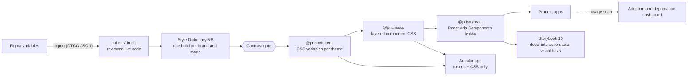

# 70 — Case Study: Building an Enterprise Design System (Prism)

> A design system is a product whose customers are other teams. It succeeds when using it is the easiest way to build the right thing, and it starts failing the day it becomes the slowest.

**Prerequisites:** [35 Enterprise Design System Architecture](35-enterprise-design-system-architecture.md), [36 Accessibility Engineering](36-accessibility-engineering.md), [23 Styling Architecture and Theming](23-styling-architecture-and-theming.md) · **Related:** [22 Component Architecture](22-component-architecture-and-patterns.md) · [42 Testing Architecture](42-testing-architecture.md) · [60 Monorepos and Build Tooling](60-monorepos-build-tooling-and-bundlers.md) · [63 Governance and ADRs](63-architecture-governance-and-adrs.md) · [64 Migration Playbooks](64-migration-playbooks.md)

> [!NOTE]
> Prism and Acme are fictional. Figures describing the organisation are part of the scenario, and budget tables are targets. Results marked *verified* come from builds and tests I ran with style-dictionary 5.8.0, react-aria-components 1.22.1, axe-core 4.14.1, Vitest 5.1, Vite 8 and React 19.3.1.

---

## TL;DR

- **Chapter 35 is the theory; this is one organisation applying it.** Prism serves four products (the SaaS dashboard in [67](67-case-study-enterprise-saas-dashboard.md), the storefront in [68](68-case-study-ecommerce-storefront.md), Boards in [69](69-case-study-collaborative-project-management.md), the admin console in [71](71-case-study-legacy-react-modernization.md)), three brands, light, dark and forced-colors modes, and 30 locales.
- **Tokens are DTCG 2025.10 JSON**, built by Style Dictionary 5.8 into one CSS file per theme. Primitives stay private; products only see semantic tokens.
- **Contrast is a build gate.** Every declared foreground and background pair is checked in every theme. Its first run failed two pairs that had shipped for months: error text at 3.28:1 in light mode and control borders at 2.23:1 in dark mode (*verified*).
- **Components wrap React Aria Components.** Prism owns the API, the look and the accessibility contract; product code never imports the headless layer.
- **Styles are plain CSS in cascade layers**, driven by tokens: no runtime styling cost, and they work in Server Components and in the Angular app.
- **The accessibility tests have teeth.** Interaction and axe tests run on every component, and a deliberately unlabelled switch fails them (*verified*).
- **Deprecations are measured, not announced and hoped for.** A usage scanner finds every deprecated prop in product code with a file and line (*verified*), and a codemod ships with every breaking change.
- **Budget the headless layer per app, not per component.** The first React Aria component costs about 17 kB gzip; the second costs 2–4 kB, because the core is shared (*verified*).

---

## 1. The brief

Thirty product teams build Acme's four product lines. An audit before Prism found:

- five button implementations and eleven shades of "primary blue";
- focus indicators that were missing or invisible on half of the interactive components;
- 214 accessibility issues in the top 20 flows. The gaps had already cost two enterprise deals that required WCAG 2.2 AA conformance, and the European Accessibility Act, which has applied since 28 June 2025, raised the stakes for the storefront;
- three teams maintaining their own date pickers.

| Requirement | Target |
|---|---|
| Consumers | 4 React products (Vite SPA, Next.js 16, React Router 8) and 1 Angular 22 app |
| Brands × modes | Acme, Acme Health (white label), Partner OEM × light, dark, forced colors; comfortable and compact density |
| Accessibility | WCAG 2.2 AA for every component and documented pattern |
| Locales | 30, including right-to-left (Arabic, Hebrew) |
| Rendering | Works in React Server Components trees; no runtime CSS-in-JS |
| Adoption | 80% of UI surfaces on Prism within 12 months |
| Support | Bugs triaged within 2 working days; breaking changes at most twice a year |

---

## 2. Architecture



The layers, and who may depend on what:

| Layer | Package | Depends on | Consumers |
|---|---|---|---|
| Design decisions | `tokens/` (source) | — | Designers and Prism engineers |
| Tokens | `@prism/tokens` | Built from source | Everything |
| Component CSS | `@prism/css` | `@prism/tokens` | `@prism/react`, the Angular app |
| Components | `@prism/react` | `@prism/css`, `react-aria-components` | React products |
| Icons | `@prism/icons` | — | Everything |
| Codemods | `@prism/codemods` | jscodeshift | Product repos, at upgrade time |

Product code imports `@prism/react/switch`, never `react-aria-components`. That rule, enforced with `no-restricted-imports` as in [35](35-enterprise-design-system-architecture.md), is what lets Prism change foundations component by component without touching product code.

---

## 3. Repository layout

```text
prism/
├── tokens/
│   ├── primitives.tokens.json        # palette, space, radius: private
│   ├── semantic.light.tokens.json    # what products use, per mode (and per brand)
│   ├── semantic.dark.tokens.json
│   └── contrast-pairs.json           # every foreground/background pair that ships, with its minimum
├── packages/
│   ├── tokens/                       # @prism/tokens: built CSS variables per theme, TS constants
│   ├── css/                          # @prism/css: component CSS in @layer prism.components
│   ├── react/                        # @prism/react: one subpath export per component
│   ├── icons/                        # @prism/icons
│   └── codemods/                     # one transform per breaking change
├── apps/
│   └── docs/                         # Storybook 10: stories, guidelines, interaction and axe tests
├── scripts/
│   ├── build-tokens.mjs
│   ├── check-contrast.mjs
│   └── prism-usage.mjs               # run against every product repo nightly
└── .changeset/
```

---

## 4. Key designs

### 4.1 Tokens: one source, built per theme

Tokens use the DTCG 2025.10 format, the first stable version of the Design Tokens specification, published by the W3C Design Tokens Community Group in October 2025. Colours are objects with a colour space and components; aliases point from semantic tokens to primitives:

```json
{
  "palette": {
    "$type": "color",
    "red": {
      "700": { "$value": { "colorSpace": "srgb", "components": [0.7882, 0.1647, 0.1647], "hex": "#c92a2a" } }
    }
  }
}
```

```json
{
  "color": {
    "$type": "color",
    "text": {
      "danger": { "$value": "{palette.red.700}" }
    }
  }
}
```

The build creates one Style Dictionary instance per theme. Palette primitives are filtered out of the output, so products can only use semantic tokens; spacing and radius are emitted once, in the default theme:

```js
// scripts/build-tokens.mjs: DTCG 2025.10 tokens -> one CSS file per theme, semantic tokens only
import StyleDictionary from 'style-dictionary';

export const THEMES = { light: ':root, [data-theme="light"]', dark: '[data-theme="dark"]' };

export function themeDictionary(theme) {
  return new StyleDictionary({
    source: ['tokens/primitives.tokens.json', `tokens/semantic.${theme}.tokens.json`],
    log: { verbosity: 'silent' },
    platforms: {
      css: {
        transformGroup: 'css',
        prefix: 'prism',
        buildPath: 'dist/css/',
        files: [{
          destination: `${theme}.css`,
          format: 'css/variables',
          filter: (token) => token.path[0] !== 'palette' && (theme === 'light' || token.$type === 'color'), // primitives stay private
          options: { selector: THEMES[theme], outputReferences: false },
        }],
      },
    },
  });
}
```

```css
/* dist/css/dark.css (excerpt, generated) */
[data-theme="dark"] {
  --prism-color-bg-default: #141517;
  --prism-color-text-default: #f8f9fa;
  --prism-color-text-danger: #ff8787;
  --prism-color-border-control: #6c757d;
  --prism-color-focus-ring: #4dabf7;
}
```

*Verified:* Style Dictionary 5.8.0 reads the 2025.10 colour and dimension objects and emits hex colours and `px` dimensions with the standard `css` transform group.

The root element carries `data-theme` and the matching `color-scheme`, so native controls and scrollbars follow the theme. Brands multiply the source files (brand × mode); each combination is one more Style Dictionary instance. The DTCG Resolver module (also 2025.10) standardizes exactly this kind of set-and-mode combination in a file of its own, which is worth adopting as your tools support it.

### 4.2 Contrast is a build gate

Accessibility reviews found contrast problems one screen at a time. Tokens make it possible to check every combination at once, but only if you know which combinations exist. So Prism *declares* them:

```json
[
  { "fg": "color.text.default", "bg": "color.bg.default", "min": 4.5, "use": "body text" },
  { "fg": "color.text.danger", "bg": "color.bg.default", "min": 4.5, "use": "error messages" },
  { "fg": "color.action.primary.text", "bg": "color.action.primary.bg", "min": 4.5, "use": "primary button label" },
  { "fg": "color.border.control", "bg": "color.bg.default", "min": 3, "use": "control borders (WCAG 1.4.11)" },
  { "fg": "color.focus.ring", "bg": "color.bg.default", "min": 3, "use": "focus indicator (WCAG 1.4.11)" }
]
```

The check resolves every token in every theme through the same Style Dictionary build and applies the WCAG 2.2 formula:

```js
// scripts/check-contrast.mjs: every declared foreground/background pair, in every theme, meets WCAG 2.2
const channel = (c) => (c <= 0.04045 ? c / 12.92 : ((c + 0.055) / 1.055) ** 2.4);
function luminance(hex) {
  if (!/^#[0-9a-f]{6}$/i.test(hex)) throw new Error(`${hex}: contrast needs an opaque hex colour (composite translucent ones first)`);
  const [r, g, b] = [1, 3, 5].map((i) => channel(parseInt(hex.slice(i, i + 2), 16) / 255));
  return 0.2126 * r + 0.7152 * g + 0.0722 * b;                      // WCAG 2.2 relative luminance
}
export function contrast(a, b) {
  const [hi, lo] = [luminance(a), luminance(b)].sort((x, y) => y - x);
  return (hi + 0.05) / (lo + 0.05);
}

export async function checkContrast() {
  const pairs = JSON.parse(await readFile('tokens/contrast-pairs.json', 'utf8'));
  const failures = [];
  for (const theme of Object.keys(THEMES)) {
    const { allTokens } = await themeDictionary(theme).getPlatformTokens('css');   // aliases resolved, transforms applied
    const value = (path) => allTokens.find((t) => t.path.join('.') === path)?.$value ?? `missing token ${path}`;
    for (const { fg, bg, min, use } of pairs) {
      const ratio = contrast(value(fg), value(bg));
      if (ratio < min) failures.push(`${theme}: ${fg} on ${bg} is ${ratio.toFixed(2)}:1, needs ${min}:1 (${use})`);
    }
  }
  return failures;
}
```

Its first run against the tokens Acme had been shipping (*verified*):

```text
FAIL light: color.text.danger on color.bg.default is 3.28:1, needs 4.5:1 (error messages)
FAIL dark: color.border.control on color.bg.default is 2.23:1, needs 3:1 (control borders (WCAG 1.4.11))
2 pair(s) below WCAG minimums
```

Both were plausible choices that no one had measured: a bright red that "looked like an error" and a dark-mode border that "looked subtle". The fix was two alias changes (`red.500` → `red.700` at 5.46:1, `neutral.700` → `neutral.600` at 3.90:1), and the gate has run on every token change since.

Three details matter:

- **Unknown pairs are failures.** A new semantic colour token without an entry in `contrast-pairs.json` fails review, because nobody has said where it may be used.
- **Translucent colours are refused, not guessed.** Their contrast depends on what's underneath; composite them against the background they sit on first.
- **The formula is WCAG 2.2's.** It is what audits and procurement checklists measure against. Perceptual models such as APCA are being explored for WCAG 3, which is still a draft; track them, but gate on what you'll be audited against.

### 4.3 Components: React Aria inside, Prism outside

```tsx
// packages/react/src/switch/Switch.tsx: React Aria supplies behaviour and accessibility; Prism supplies the look
import type { ReactNode } from 'react';
import { Switch as AriaSwitch, type SwitchProps as AriaSwitchProps } from 'react-aria-components';
import './switch.css';

export interface SwitchProps extends Omit<AriaSwitchProps, 'className' | 'style' | 'children'> {
  children: ReactNode;                                              // a visible label is required
}

export function Switch({ children, ...props }: SwitchProps) {
  return (
    <AriaSwitch {...props} className="prism-switch">
      <span className="prism-switch__track" aria-hidden="true"><span className="prism-switch__thumb" /></span>
      {children}
    </AriaSwitch>
  );
}
```

Three API decisions show up in those few lines:

1. **The label is required by the type.** An unlabelled switch doesn't compile.
2. **No `className` or `style`.** Overrides are how design systems drift back into five buttons. Layout belongs to the parent (`Stack`, `Grid`), and visual variants are props. When a team needs something Prism doesn't have, the contribution path ([35](35-enterprise-design-system-architecture.md) §9.1) is meant to be faster than the override would have been, and Prism measures that it is.
3. **State is styled through data attributes.** React Aria sets `data-selected`, `data-focus-visible`, `data-disabled` and friends, so the CSS never needs JavaScript to know the state:

```css
@layer prism.components {
  .prism-switch { display: inline-flex; align-items: center; gap: var(--prism-space-2); color: var(--prism-color-text-default); }
  .prism-switch__track {
    inline-size: 2.25rem; block-size: 1.25rem; border-radius: 999px; padding: 2px;
    border: 1px solid var(--prism-color-border-control); background: var(--prism-color-bg-subtle);
  }
  .prism-switch[data-selected] .prism-switch__track { background: var(--prism-color-action-primary-bg); border-color: transparent; }
  .prism-switch[data-selected] .prism-switch__thumb { background: var(--prism-color-action-primary-text); translate: 1rem 0; }
  .prism-switch[data-focus-visible] .prism-switch__track { outline: 2px solid var(--prism-color-focus-ring); outline-offset: 2px; }
  @media (prefers-reduced-motion: no-preference) { .prism-switch__thumb { transition: translate 120ms ease-out; } }
  @media (forced-colors: active) { .prism-switch[data-selected] .prism-switch__thumb { background: Highlight; } }
}
```

Every product declares the same layer order once: `@layer reset, prism.tokens, prism.components, app;`. Product styles live in `app`, so specificity contests between Prism and product CSS can't happen by accident. Logical properties (`inline-size`, `padding-inline`) make right-to-left layouts work without a separate stylesheet. The `forced-colors` block keeps the selected state visible when Windows High Contrast replaces every colour.

### 4.4 The accessibility contract, tested

```tsx
const audit = (el: Element) => axe.run(el, { rules: { 'color-contrast': { enabled: false } } }); // jsdom can't compute colours

it('is a labelled switch that toggles from the keyboard', async () => {
  const onChange = vi.fn();
  render(<Switch onChange={onChange}>Email notifications</Switch>);
  const control = screen.getByRole('switch', { name: 'Email notifications' });
  await userEvent.tab();
  expect(document.activeElement).toBe(control);
  await userEvent.keyboard(' ');
  expect(onChange).toHaveBeenCalledWith(true);
  expect(control.closest('label')!.hasAttribute('data-selected')).toBe(true);
  expect(control.closest('label')!.hasAttribute('data-focus-visible')).toBe(true);   // keyboard focus is styled
});

it('has no axe violations', async () => {
  const { container } = render(<Switch defaultSelected>Dark mode</Switch>);
  expect((await audit(container)).violations).toEqual([]);
});

it('the audit has teeth: an unlabelled switch fails it', async () => {
  const { container } = render(<AriaSwitch />);
  expect((await audit(container)).violations.map((v) => v.id)).toContain('label');
});
```

*Verified:* all three pass. The last test matters more than it looks. An accessibility test that has never failed might be testing nothing (a misconfigured rule set, the wrong container), so every Prism test suite includes one deliberately broken case.

What automated tests can't cover is covered by people:

- jsdom can't compute colours, which is why contrast is checked on tokens (4.2) and in browser-based visual tests.
- axe finds roughly the mechanical issues: missing names, invalid roles, broken references. It can't tell you whether a combobox *makes sense* with a screen reader.
- Complex components (combobox, date picker, grid, tree, drag and drop) get a manual pass before every minor release on a fixed matrix: NVDA with Firefox and Chrome, JAWS with Chrome, VoiceOver on macOS and iOS, TalkBack on Android.
- WCAG 2.2's newer criteria are part of the review checklist: focus not hidden under sticky headers (2.4.11), dragging movements with a single-pointer alternative (2.5.7), and targets of at least 24 × 24 CSS pixels (2.5.8).

### 4.5 Server Components and the Angular app

Prism's CSS is plain CSS, so it works everywhere: in Server Components trees, in static HTML and in the Angular app, which consumes `@prism/tokens` and `@prism/css` and implements its own components against the same class names and tokens.

In `@prism/react`, interactive components start with `'use client'` at their entry points; presentational ones (`Text`, `Stack`, `Badge`, `VisuallyHidden`) don't use hooks and are safe to render on the server. One subpath export per component means a Server Component that imports `@prism/react/stack` doesn't pull client code into its graph.

### 4.6 Packaging and versioning

| Decision | Choice |
|---|---|
| Module format | ESM only, one subpath export per component, `sideEffects: ["**/*.css"]` |
| Package checks | publint and Are the Types Wrong? on every build ([60](60-monorepos-build-tooling-and-bundlers.md)) |
| API surface | An API report per package; a diff in the report needs a changeset that explains it |
| Releases | Changesets; every PR declares patch, minor or major per package |
| Canary | Every merge to `main` publishes `0.0.0-canary-<sha>`; the four products' CI builds against it nightly |
| Publishing | npm trusted publishing with provenance ([62](62-cicd-release-engineering-and-feature-flags.md)) |

What counts as breaking is written down, because "it's only visual" is the most common argument in design system reviews:

| Change | Release type |
|---|---|
| Removing or renaming a prop, export or token | Major (with a codemod) |
| Changing a default that changes behaviour | Major |
| Changing the DOM structure that products are known to query in tests | Major |
| Changing a token's value | Minor, with before and after images in the changelog |
| Visual refinements within a component | Minor, with the visual diff linked |
| Bug fixes that restore documented behaviour | Patch |

### 4.7 Deprecations are measured

A deprecation without measurement is a wish. Prism runs a scanner nightly against every product repository. It follows imports (including aliases), counts component and prop usage, and reports deprecated usages with locations:

```js
// scripts/prism-usage.mjs (excerpt): which Prism components are used where, with which props
const DEPRECATED = { Button: { variant: { danger: 'use variant="destructive" (removed in Prism 6)' } } };

if (ts.isImportDeclaration(node) && node.moduleSpecifier.text === '@prism/react') {
  for (const el of node.importClause?.namedBindings?.elements ?? []) local.set(el.name.text, (el.propertyName ?? el.name).text);
}
if ((ts.isJsxOpeningElement(node) || ts.isJsxSelfClosingElement(node)) && local.has(node.tagName.getText(src))) {
  // count the component, count each prop value, and record deprecated ones with file:line
}
```

On a two-file fixture (*verified*), it counted `Switch` imported as `Toggle`, ignored a look-alike `Button` imported from `./legacy`, and reported:

```text
Invoices.tsx:6 Button variant="danger": use variant="destructive" (removed in Prism 6)
Settings.tsx:6 Button variant="danger": use variant="destructive" (removed in Prism 6)
```

The lifecycle that uses it:

1. **Announce** in a minor release: the docs, the changelog and a development-only console warning, printed once per component.
2. **Measure** with the scanner; the dashboard shows remaining usages per team.
3. **Migrate** with a codemod in `@prism/codemods` (jscodeshift, as in [64](64-migration-playbooks.md)); Prism engineers open the PRs for teams with fewer than ten usages.
4. **Remove** in the next major, at least six months after the announcement, and only when the scanner shows zero usages or the owning teams have signed off.

The same scanner provides adoption numbers: the share of interactive elements in product code that come from Prism, per team and per product.

### 4.8 Storybook as the workshop

Storybook 10 holds a story for every component state, including the awkward ones: long German labels, right-to-left, compact density, forced colors, loading and error states. Stories double as tests:

- `@storybook/addon-vitest` runs every story as a Vitest test in a real browser, with interaction tests written as `play` functions.
- Visual regression compares every story in light, dark and forced-colors modes on each PR; intended changes are approved in review, and the approved images are what the changelog links to.
- Docs pages put guidelines next to the live component: when to use it, when not to, content rules and the accessibility notes for that component.

---

## 5. ADR

```markdown
# ADR-0003: Build Prism components on React Aria Components; style them with layered CSS and DTCG tokens

- Status: Accepted (2026-03-02) · Decider: Prism lead · Consulted: accessibility, four product leads, brand design

## Context
Acme has five button implementations, three date pickers and 214 known accessibility issues.
Products need drag and drop (Boards), large data grids and date-range pickers (SaaS dashboard)
in 30 locales including right-to-left. Two products render with Server Components; one product is Angular.

## Options
1. Adopt a styled component library and theme it. Fast start; theming fights the library's own design
   language, and accessibility fixes wait for upstream.
2. "Open code" (copy component source into each app). Full control per app; five apps drift again.
3. Wrap a headless library (React Aria Components, Base UI, Radix) in a packaged design system.
4. Build behaviour from scratch. Years of focus management, keyboard, screen-reader and IME edge cases.

## Decision
Option 3 with React Aria Components, for its coverage of the hard components (date and time, drag and drop,
virtualized collections) and its internationalization. Styling is plain CSS in cascade layers over
DTCG tokens built by Style Dictionary; no runtime CSS-in-JS. Product code may not import the headless layer.

## Consequences
- React Aria's verbose API is hidden behind Prism's; Prism engineers need deep familiarity with it.
- The headless core costs about 14 kB gzip per app, paid once; individual components then cost 2–5 kB.
- Prism depends on Adobe's release cadence; the wrapper rule keeps a per-component exit open.
- The Angular app shares tokens and CSS, not components.

## Verification
Zero axe violations across all stories; the contrast gate passes for every brand and mode;
80% adoption in 12 months (scanner); accessibility defects in audited flows down 75% in 12 months.
```

---

## 6. Pipeline

| Stage | What runs | Gate |
|---|---|---|
| Tokens | Style Dictionary build for every brand and mode | Builds cleanly; no unknown aliases |
| Contrast | `check-contrast.mjs` over `contrast-pairs.json` | Zero failures; every semantic colour declared |
| Static | `tsc`, ESLint (including `no-restricted-imports` in products) | Zero errors |
| Unit and accessibility | Vitest + Testing Library + axe, per component, including the broken case | All pass |
| Stories | Storybook build; stories run as tests in a browser | All pass |
| Visual | Screenshots of every story × light, dark, forced colors | Diffs approved in review |
| Package | publint, Are the Types Wrong?, API report diff | Clean, or a changeset explains the diff |
| Size | Gzip size per entry point and for the shared core | Within budget (section 8) |
| Release | Changesets version PR; trusted publishing with provenance | Two approvals for a major |
| Consumers | Four products build and run their tests against the canary nightly | Green, or the owning team is paged |

The token tests run in Vitest's `node` environment. Under the `jsdom` environment, Style Dictionary found no token files at all and every lookup came back missing (*verified*), a confusing failure if you don't know to look for it.

---

## 7. Operations checklist

- [ ] A support rotation with a public queue; bugs triaged within 2 working days; office hours twice a week.
- [ ] Nightly usage scan across product repositories; the adoption and deprecation dashboard is reviewed monthly with product leads.
- [ ] A published deprecation calendar; no more than two majors a year, each with codemods and migration notes.
- [ ] Figma and code parity: the Figma variables export is diffed against `tokens/` weekly, and drift becomes an issue.
- [ ] Accessibility: the manual screen-reader matrix before each minor release; an external audit yearly.
- [ ] Dependency updates (including React Aria) weekly through Renovate, with the full pipeline and visual review.
- [ ] Docs freshness: every component page shows its last review date; pages older than 12 months are flagged.
- [ ] Release notes written for product engineers: what changed, what to do, the codemod command.
- [ ] Contribution metrics: time from proposal to merged component, and how many contributions came from product teams.

---

## 8. Performance report

Budgets, reported monthly:

| Metric | Budget | Alert when |
|---|---|---|
| `@prism/tokens` CSS per theme (gzip) | ≤ 6 kB | Any increase over 10% in one release |
| `@prism/css` for all components (gzip) | ≤ 30 kB | > 30 kB |
| Shared React Aria core in an app (gzip) | ≤ 16 kB | > 16 kB |
| Simple component entry (Button, Switch, Checkbox), gzip | ≤ 5 kB beyond the shared core | > 5 kB |
| Complex component entry (DatePicker, Table, ComboBox), gzip | ≤ 40 kB beyond the shared core | > 40 kB |
| INP contribution in the products' heaviest Prism screens | ≤ 100 ms | > 150 ms |
| Accessibility violations in stories | 0 | Any |

Measured with a Vite 8 library build, React external, gzip level 9 (*verified*):

| Build | Output | Gzip |
|---|---|---|
| Switch alone | `switch.js` | 17.1 kB |
| Switch and Button together | shared React Aria core chunk | 13.6 kB |
| | `switch.js` | 4.3 kB |
| | `button.js` | 2.5 kB |
| Switch CSS | `switch.css` | 0.44 kB |

The first component pays for the shared core: press handling that behaves the same for mouse, touch, keyboard and screen readers, focus management, hover and internationalization. That is why Prism's budget is per app and per component *beyond* the core, and why "this button is 17 kB" in a bundle analyser is a misreading.

Each report covers four things:

1. **Budgets against actuals,** per package and per product.
2. **Adoption and deprecation progress** from the scanner, per team.
3. **Accessibility:** automated results, manual-matrix findings and audit defects, with owners.
4. **Support:** queue size, time to triage, and the most-requested missing components.

Changing a budget needs an ADR.

---

## Decision framework

**Problem:** how to give many teams consistent, accessible UI without becoming their bottleneck.

**Constraints:** number of products and frameworks, brand and mode variety, accessibility obligations, the size of the design system team, and how much divergence products genuinely need.

| Approach | Consistency | Team cost | Accessibility | Flexibility for products | Fits |
|---|---|---|---|---|---|
| Tokens and CSS only | Visual | Low | Each team's own | High | Many frameworks, small DS team |
| Styled library, themed | High within its look | Low to start, rising | Upstream's | Low | One product, standard look |
| Open code (copied components) | Drifts over time | Low centrally, high in products | Copied, then diverges | Very high | A few products, strong product engineers |
| Packaged wrappers over a headless library | High | Medium | Owned centrally, tested centrally | Medium (props and contribution) | Several React products, accessibility obligations |
| Built from scratch | High | Very high | Years to get right | Total | Rarely justified |

**Criteria:**

- If you have accessibility obligations and more than two React products, a packaged system over a headless library is the default.
- Choose the headless library by its coverage of your *hardest* components, not your easiest. Every library has a good button.
- Tokens and CSS are the part every framework can share; put the cross-framework investment there.
- If products truly need to diverge (a marketing site, a game-like editor), let them take tokens and leave components.

**Failure modes:** a design system team that becomes a ticket queue; overrides that recreate drift; breaking changes without codemods; accessibility claimed but not tested; contrast checked screen by screen instead of by token; adoption measured by survey instead of by code.

**Migration path:** tokens first (every product can adopt CSS variables in a week), then the most duplicated components (buttons, inputs, dialogs), then the hardest ones that teams are maintaining badly (date pickers, comboboxes, tables). Measure with the scanner from day one, and retire product-local duplicates with codemods.

---

## Pitfalls and anti-patterns

- **Exposing primitives.** If products can use `palette.red.500`, they will, and dark mode will break.
- **Undeclared colour pairs.** The contrast gate can only check pairs it knows about.
- **`className` and `style` escape hatches on every component.** Drift with extra steps.
- **Accessibility tests that have never failed.** Include a deliberately broken case.
- **Running token tests in jsdom.** Style Dictionary may find no files at all; use the `node` environment.
- **Judging the headless layer by one component's bundle size.** The core is shared; measure per app.
- **Breaking changes in minors because "it's only visual".** Write down what counts as breaking.
- **Deprecating without measuring.** You'll find out what's still used on the day you remove it.
- **Treating Storybook as documentation only.** Its stories are your best test fixtures.
- **A design system team that writes every component itself.** It becomes the bottleneck; make contribution the fast path.

---

## Architect's checklist

- [ ] Tokens in DTCG 2025.10, reviewed in git; primitives private, semantic tokens public.
- [ ] One build per brand and mode, with `data-theme` and `color-scheme` on the root.
- [ ] Every foreground and background pair declared, and the contrast gate running on every token change.
- [ ] Components wrap the headless layer; products can't import it directly.
- [ ] Required labels and accessible names enforced by types where possible.
- [ ] State styled with data attributes; CSS in cascade layers; logical properties for RTL; a forced-colors pass.
- [ ] Interaction and axe tests per component, including one deliberately broken case.
- [ ] A manual screen-reader matrix for complex components before each minor release.
- [ ] ESM subpath exports, publint, type checks, an API report and size budgets per entry and for the shared core.
- [ ] Changesets, canaries, and products building against the canary nightly.
- [ ] A written definition of breaking; a codemod for every major change.
- [ ] A usage scanner for adoption and deprecations, reviewed monthly.

---

## Interview angles

**Q: How do you make sure a design system's colours are accessible in every theme?**
A: Check tokens, not screens. Each foreground token declares the backgrounds it's used on and the minimum ratio, 4.5:1 for text and 3:1 for borders and focus indicators. A build step resolves every pair in every theme and applies the WCAG 2.2 formula. When we introduced it at Acme, its first run failed two pairs that had shipped for months: error text in light mode and control borders in dark mode.

**Q: Why wrap a headless library instead of using it directly in product code?**
A: Because the design system needs to own the API. The wrapper encodes our decisions: required labels, our variants, our tokens, no style overrides. It also lets us change the foundation one component at a time. If product code imports the headless library directly, every one of those decisions is re-made in every team, and switching foundations means touching every call site.

**Q: How do you handle breaking changes for 30 consuming teams?**
A: Few and predictable: at most two majors a year, with a written definition of breaking. Each removal is announced in a minor with a development warning, measured with a usage scanner that lists every remaining usage with its file and line, migrated with a codemod, and removed only when usage reaches zero or owners sign off. Products build against our canary nightly, so we see breakage before they do.

**Q: The bundle analyser says your Switch is 17 kB. Is that a problem?**
A: Mostly it's a misreading. About 14 kB of that is the headless library's shared core: press handling, focus management, internationalization. Every later component reuses it, and in our measurement the second component added about 2.5 kB. So the budget is per app for the core and per component beyond it. If an app uses only one or two simple components, that's when a lighter foundation is worth discussing.

**Q: How do you know whether the design system is succeeding?**
A: From code, not surveys: the share of interactive elements in product code that come from the system, per team; remaining deprecated usages; accessibility defects in audited flows; time from a team's request to a merged component; and how many contributions come from product teams. A design system that is adopted, fast to change and contributed to is succeeding.

---

> [!TIP]
> **Runnable code:** [E70](E70-case-study-enterprise-design-system.md) has the token build, the contrast gate, the Switch and the usage scanner, with tests. `node extract-examples.mjs 70` writes it out as a project; then run `npm ci` and `npm test` in it.

## Further reading

- [Design Tokens Technical Reports 2025.10](https://www.designtokens.org/TR/2025.10/): the Format, Color and Resolver modules.
- [Style Dictionary](https://styledictionary.com/): token transformation and DTCG support.
- [React Aria Components](https://react-spectrum.adobe.com/react-aria/components.html): the headless layer used here.
- [WCAG 2.2](https://www.w3.org/TR/WCAG22/): especially 1.4.3, 1.4.11, 2.4.11, 2.5.7 and 2.5.8.
- [axe-core rule descriptions](https://github.com/dequelabs/axe-core/blob/develop/doc/rule-descriptions.md).
- [Storybook: Vitest addon](https://storybook.js.org/docs/writing-tests/integrations/vitest-addon).
- [Changesets](https://github.com/changesets/changesets).
- Nathan Curtis, [EightShapes articles on design systems](https://medium.com/eightshapes-llc): team models, versioning and adoption.

---

[← Previous: 69 — Case Study: Collaborative Project-Management App](69-case-study-collaborative-project-management.md) · [Index](README.md) · [Next: 71 — Case Study: Legacy React Modernization →](71-case-study-legacy-react-modernization.md)
