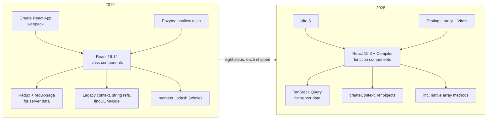

# 71 — Case Study: Legacy React Modernization (Acme Admin)

> A modernization is judged by what users and teams feel afterwards, not by the version number in `package.json`. Measure first, so you know which of the two you're changing.

**Prerequisites:** [64 Migration Playbooks](64-migration-playbooks.md), [16 React 19 Features and the Compiler](16-react-19-features-and-the-compiler.md), [19 Class Components and Legacy APIs](19-class-components-lifecycles-and-legacy-apis.md) · **Related:** [38 React Performance Engineering](38-react-performance-engineering.md) · [39 Web Performance](39-web-performance-and-core-web-vitals.md) · [42 Testing Architecture](42-testing-architecture.md) · [60 Build Tooling](60-monorepos-build-tooling-and-bundlers.md) · [62 CI/CD and Release Engineering](62-cicd-release-engineering-and-feature-flags.md)

> [!NOTE]
> Acme Admin is fictional, and so are the durations and organisational figures. Results marked *verified* come from a reproduction of one Acme Admin screen that I built twice (React 16.14 with moment and lodash; React 19.3.1 with babel-plugin-react-compiler 1.0.0) and measured with Vite 8.3, Vitest 5.1 and headless Chrome through Puppeteer 25.8.

---

## TL;DR

- **The 2019 screen doesn't render at all on React 19.3.** A string ref throws, legacy context is gone and `ReactDOM.render` no longer exists (*verified*). Upgrading is a code migration, not a version bump.
- **Smaller bundles came from the dependency diet, not from React.** The screen went from 86.6 to 68.7 kB gzip (−21%), but React 19.3's runtime is 27 kB gzip *larger* than React 16.14's. Removing moment and lodash saved 46 kB (*verified*).
- **The React Compiler did nothing for the slowest interaction until we changed the code's shape.** With the same code, typing in a message box still re-rendered all 500 table rows on every keystroke. Moving the table into its own component took that to zero, and handler time per keystroke fell from 17.8 ms to 4.2 ms at 4× CPU slowdown (*verified*).
- **`memo` still earns its place on list rows.** A row selection re-rendered all 500 rows with the compiler and 1 row with `memo(UserRow)` (*verified*).
- **The Babel compiler and the experimental Rust port produced byte-identical output** for this screen (*verified*). Choose between them on build speed and maturity, not output.
- **Order matters:** tooling, then tests, then React 17, 18 and 19 with codemods, then the compiler behind its lint rules, then the feature reorganisation. Every step shipped to production on its own.

---

## 1. The brief

Acme Admin is the internal console for support and operations: users, tenants, tickets, billing adjustments. It was built in 2019 and grew without a pause.

| Area | 2019 state |
|---|---|
| Build | Create React App (`react-scripts`), webpack 4 era |
| React | 16.14; 410 class components, 120 function components |
| Legacy APIs | String refs in 60 files, legacy context for the tenant, `findDOMNode` in 7 places, `UNSAFE_componentWillReceiveProps` in 34 |
| Data | Redux with redux-saga for all server data |
| Utilities | moment for dates, lodash imported whole |
| Tests | 1,900 Enzyme tests, many shallow-rendered against component internals |
| Users | 900 support and operations staff, many on a VPN |

The complaints were specific: typing lags on the big tables, and the first load takes "forever" on the VPN. The React team had sunset Create React App in February 2025, so the build itself had become a liability.

The goals agreed with the business:

| Goal | Target |
|---|---|
| Upgrade | React 19.3 and the React Compiler by the end of Q3 |
| Responsiveness | INP p75 ≤ 200 ms on the users, tenants and tickets screens |
| Load | Initial JavaScript ≤ 120 kB gzip |
| Delivery | No feature freeze longer than two weeks; every step shippable on its own |
| Safety | Tests green at every step; no step without a rollback |

---

## 2. Architecture: before and after



The folder structure changed too, from folders by type to folders by feature, so that a team could own a feature end to end:

```text
Before                                  After
src/                                    src/
├── components/   (410 files)           ├── app/            # routes, providers, the root
├── containers/                         ├── features/
├── actions/                            │   ├── users/      # UsersPage, UserTable, api.ts, tests
├── reducers/                           │   ├── tenants/
├── sagas/                              │   ├── tickets/
├── utils/        (moment, lodash)      │   └── billing/
└── App.js                              └── shared/
                                            ├── ui/         # Prism wrappers (chapter 70)
                                            └── lib/        # format.ts (Intl), small helpers
```

---

## 3. Baseline first

Before touching anything, the team picked one representative hot screen, the users list, and measured three things that would later decide what "done" meant.

**1. What the bundle is made of.** Each dependency measured on its own, as a production app build with gzip at level 9 (*verified*):

| Module | Minified | Gzip |
|---|---|---|
| React 16.14 (`react` + `react-dom`) | 127.7 kB | 39.8 kB |
| moment 2.31 | 62.6 kB | 20.1 kB |
| lodash 4.18, imported whole | 71.7 kB | 25.7 kB |
| The whole users screen, as shipped | 266.1 kB | 86.6 kB |

**2. How much rendering an interaction causes.** A counter in the row component, read after a scripted interaction in Vitest: ten keystrokes in the "message to selected users" box, then one row click.

**3. What the user feels.** Event Timing entries, the data INP is built from, collected in headless Chrome at 4× CPU slowdown while typing 25 characters:

```js
// bench/measure.mjs (excerpt): keystroke interaction latency, as INP measures it
await page.evaluateOnNewDocument(() => {
  window.__events = [];
  new PerformanceObserver((list) => window.__events.push(...list.getEntries().map((e) => (
    { id: e.interactionId, d: e.duration, p: e.processingEnd - e.processingStart }))))
    .observe({ type: 'event', durationThreshold: 16, buffered: true });
});
const cdp = await page.createCDPSession();
await cdp.send('Emulation.setCPUThrottlingRate', { rate: 4 });   // a mid-range phone, roughly
await page.goto(origin + path, { waitUntil: 'networkidle0' });
await page.click('textarea');
await page.keyboard.type('Hello team, please review', { delay: 120 });
// group entries by interactionId: max duration per interaction, summed handler time
```

Each build ran three times in a fresh browser context, and the tables report the median run. Lab numbers like these don't replace field data ([39](39-web-performance-and-core-web-vitals.md)); they tell you which change moved what, in a setting where nothing else changes.

---

## 4. Key designs

### 4.1 What breaks on React 19

This is the 2019 screen, simplified to its essentials:

```jsx
// UsersPage.jsx: Acme Admin's users screen as it was written in 2019 (React 16.14)
class UserRow extends React.Component {
  render() {
    const { user, selected, onSelect } = this.props;
    return (
      <tr className={selected ? 'selected' : ''} onClick={() => onSelect(user.id)}>
        <td>{user.name}</td><td>{user.email}</td><td>{user.role}</td>
        <td>{moment.utc(user.lastLogin).format('D MMM YYYY, HH:mm')}</td>
      </tr>
    );
  }
}
UserRow.propTypes = { user: PropTypes.object.isRequired, selected: PropTypes.bool, onSelect: PropTypes.func.isRequired };

export class UsersPage extends React.Component {
  static contextTypes = { tenant: PropTypes.string };               // legacy context
  state = { query: '', selectedId: null, message: '' };
  setQuery = _.debounce((query) => this.setState({ query }), 200);
  componentDidMount() { this.refs.search.focus(); }                // string ref
  render() {
    const { query, selectedId, message } = this.state;
    const rows = _.filter(USERS, (u) => u.name.toLowerCase().includes(query.toLowerCase()));
    return (
      <main>
        <h1>Users ({this.context.tenant})</h1>
        <input ref="search" placeholder="Search users" onChange={(e) => this.setQuery(e.target.value)} />
        <textarea aria-label="Message to selected users" value={message} onChange={(e) => this.setState({ message: e.target.value })} />
        <table><tbody>
          {rows.map((u) => <UserRow key={u.id} user={u} selected={u.id === selectedId} onSelect={(id) => this.setState({ selectedId: id })} />)}
        </tbody></table>
      </main>
    );
  }
}
```

Installed against React 19.3.1 and rendered with `createRoot` (*verified*):

```text
ReactDOM.render            → undefined (removed)
render                     → throws: Expected ref to be a function, an object returned by
                             React.createRef(), or undefined/null.
console.error (×2)         → the legacy childContextTypes and contextTypes APIs were removed in React 19
the page                   → nothing rendered
```

PropTypes produce no error at all: React 19 silently ignores them, so whatever checking they did is simply gone. The removals that mattered for Acme Admin, and what replaced each:

| Removed in React 19 | Replacement | How it was migrated |
|---|---|---|
| `ReactDOM.render`, `hydrate`, `unmountComponentAtNode` | `createRoot`, `hydrateRoot`, `root.unmount()` | Codemod (the transform from [64](64-migration-playbooks.md) §2.1) |
| String refs | `createRef` in classes, `useRef` in functions | The official codemod, then review |
| Legacy context (`contextTypes`, `childContextTypes`) | `createContext` with `static contextType` or `use` | By hand: one provider, 23 consumers |
| `findDOMNode` | A ref on the element | By hand: 7 places |
| PropTypes checks | TypeScript | Converted with the components |
| `defaultProps` on function components | Default parameters | Codemod |
| `act` from `react-dom/test-utils` | `act` from `react` | Codemod over the test suite |

The root-API codemod on the screen's entry point (*verified*):

```jsx
// before
ReactDOM.render(<TenantProvider tenant="acme-eu"><UsersPage /></TenantProvider>, document.getElementById('root'));
// after
import { createRoot } from 'react-dom/client';
createRoot(document.getElementById('root')).render(<TenantProvider tenant="acme-eu"><UsersPage /></TenantProvider>);
```

### 4.2 The order of steps

Acme followed the playbook in [64](64-migration-playbooks.md) §3.1, with each step merged and shipped before the next began:

| # | Step | Duration | Why here |
|---|---|---|---|
| 1 | Create React App → Vite | 2 weeks | Fast builds make every later step cheaper; removes the unmaintained toolchain |
| 2 | Enzyme → Testing Library + Vitest, feature by feature | 6 weeks, in parallel | Enzyme has no official adapter for React 17 or later; behaviour tests survive the refactors that follow |
| 3 | React 16 → 17 | 1 week | Events attach to the root instead of `document`; the new JSX transform |
| 4 | React 17 → 18.3 | 3 weeks | `createRoot`, automatic batching, Strict Mode's double-invoked effects find unsafe effects; 18.3 adds warnings for everything 19 removes |
| 5 | Remove legacy APIs while still on 18.3 | 4 weeks | Each removal is a warning on 18.3 and fatal on 19; fix them where they're only warnings |
| 6 | React 18 → 19.3 | 1 week | With steps 4 and 5 done, mostly a version bump plus codemods for tests and types |
| 7 | The React Compiler | 4 weeks | Lint first, then per feature, then everywhere (4.4) |
| 8 | Feature folders, TanStack Query, dependency diet | Ongoing | Done team by team, in the features they were already changing |

Step 5 is the one that makes the plan work. React 18.3 is 18.2 plus warnings for every API that React 19 removes: string refs, legacy context, `findDOMNode`, `defaultProps` on function components. React 19 fails on them. Fixing them on 18.3 turns the 19 upgrade into an anticlimax.

### 4.3 The dependency diet

```tsx
// shared/lib/format.ts: the moment usage on this screen, replaced by the platform
const loginFormat = new Intl.DateTimeFormat('en-GB', {
  day: 'numeric', month: 'short', year: 'numeric', hour: '2-digit', minute: '2-digit', timeZone: 'UTC',
});
export const formatLogin = (ms: number) => loginFormat.format(ms);   // created once, reused for every row
```

lodash calls became native methods (`Array.prototype.filter`, `Object.groupBy`). The debounced search became `useDeferredValue`, which keeps typing responsive without delaying the result by a fixed 200 ms:

```tsx
const [query, setQuery] = useState('');
const deferredQuery = useDeferredValue(query);                       // typing stays responsive; filtering follows
const rows = USERS.filter((u) => u.name.toLowerCase().includes(deferredQuery.toLowerCase()));
```

The result, for the whole screen (*verified*):

| Build | Minified | Gzip |
|---|---|---|
| 2019: React 16.14, moment, lodash, PropTypes | 266.1 kB | 86.6 kB |
| React 19.3 runtime alone (`react` + `react-dom/client`) | 218.4 kB | 67.2 kB |
| 2026: React 19.3, no compiler | 220.8 kB | 68.2 kB |
| 2026: React 19.3 + compiler | 221.6 kB | 68.7 kB |

Read the second row carefully. React 19.3's runtime is 27 kB gzip larger than React 16.14's, so **a React upgrade alone makes this bundle bigger**. The 21% reduction came entirely from removing moment and lodash. If someone promises a smaller bundle from a React upgrade, ask what else is being removed. The compiler's memoization code added about 0.4 kB gzip to the screen.

### 4.4 The React Compiler: what it did and didn't do

The modern screen, a straight translation of the 2019 one:

```tsx
export function UsersPage() {
  const tenant = use(TenantContext);
  const [query, setQuery] = useState('');
  const deferredQuery = useDeferredValue(query);
  const [selectedId, setSelectedId] = useState<number | null>(null);
  const [message, setMessage] = useState('');
  const rows = USERS.filter((u) => u.name.toLowerCase().includes(deferredQuery.toLowerCase()));
  return (
    <main>
      <h1>Users ({tenant})</h1>
      <input placeholder="Search users" autoFocus value={query} onChange={(e) => setQuery(e.target.value)} />
      <textarea aria-label="Message to selected users" value={message} onChange={(e) => setMessage(e.target.value)} />
      <table><tbody>
        {rows.map((u) => <UserRow key={u.id} user={u} selected={u.id === selectedId} onSelect={setSelectedId} />)}
      </tbody></table>
    </main>
  );
}
```

The expectation was that the compiler would cache the table, so typing in the message box wouldn't touch the rows. The measurement said otherwise (*verified*, 500 rows; identical for the Babel plugin and the Rust port):

| Variant | Compiler | Row renders: 10 keystrokes | Row renders: 1 click |
|---|---|---|---|
| React 16.14, class components | — | 5,000 | 500 |
| React 19.3, translated as above | No | 5,000 | 500 |
| React 19.3, translated as above | **Yes** | **5,000** | 500 |
| `memo(UserRow)` | Either | 0 | 1 |
| Row elements built before the rest of the JSX | Yes | 0 | 500 |
| The table extracted into a `UserTable` component | Yes | 0 | 500 |

The compiled output explains it. The compiler placed the filter, the `rows.map(...)` call **and** the heading, input and textarea elements into one memoized block, guarded by every piece of state:

```js
// compiled UsersPage (excerpt): one block, invalidated by any of five values
if ($[0] !== deferredQuery || $[1] !== message || $[2] !== query || $[3] !== selectedId || $[4] !== tenant) {
  // ...filter, the h1, the input, the textarea, rows.map(...)
}
```

`rows` comes from a call the compiler can't see into, and the compiler can't prove that the later `rows.map(...)` doesn't change it, so it keeps everything created in between in the same block. A keystroke in the message box changes `message`, the block re-runs, the row elements are new and all 500 rows render.

Extracting the table gave the compiler separate blocks with honest dependencies:

```tsx
function UserTable({ rows, selectedId, onSelect }: { rows: User[]; selectedId: number | null; onSelect: (id: number) => void }) {
  return (
    <table><tbody>
      {rows.map((u) => <UserRow key={u.id} user={u} selected={u.id === selectedId} onSelect={onSelect} />)}
    </tbody></table>
  );
}
// in UsersPage:  <UserTable rows={rows} selectedId={selectedId} onSelect={setSelectedId} />
```

```js
// compiled UsersPage after the split (excerpt)
if ($[0] !== deferredQuery) { /* rows */ }
if ($[10] !== rows || $[11] !== selectedId) { t6 = <UserTable rows={rows} selectedId={selectedId} onSelect={setSelectedId} />; }
```

What the user feels, in Chrome at 4× CPU slowdown (*verified*, median of three runs):

| Build | Interaction latency, median | Worst interaction | Handler time per keystroke |
|---|---|---|---|
| React 16.14, class components | 32 ms | 56 ms | 17.8 ms |
| React 19.3, no compiler | 32 ms | 48 ms | 17.3 ms |
| React 19.3 + compiler, same code | 24 ms | 48 ms | 15.0 ms |
| React 19.3 + compiler, table as a component | 16 ms | 32 ms | 4.2 ms |

(Event Timing rounds durations to 8 ms, and an interaction includes waiting for the next frame, so 16 ms is close to the floor.)

Four lessons came out of this one screen:

1. **The compiler optimizes the code you have.** Component boundaries are still yours to draw, and a component that does five things gets one memo block for all five.
2. **Small components are now a performance technique as well as a readability one.** The split that fixed this took ten minutes and needed no `useMemo`.
3. **`memo` still matters for list rows.** When a selection changes, every row's element is rebuilt, because each row's `selected` prop is computed in the parent. The compiler can't skip them; `memo` compares props and renders one.
4. **Measure the specific interaction.** A general "the compiler makes React fast" would have shipped a screen with exactly the old lag.

### 4.5 Rolling out the compiler

The rollout itself followed [16](16-react-19-features-and-the-compiler.md):

1. **Lint first.** eslint-plugin-react-hooks 7 reports code that breaks the Rules of React. The compiler skips such components rather than miscompiling them, and the lint rules are how you see that. On the reproduction, the compiler skipped `UserRow` because of the instrumentation counter it mutated during render ("This value cannot be modified"); production components that mutate during render are skipped the same way, silently.
2. **Opt in per feature** with `compilationMode: 'annotation'` and a `'use memo'` directive as the first statement of each component to compile, starting with the hot screens and their benchmarks.
3. **Switch to the default inference mode** once the feature teams had fixed what the lint rules reported, keeping `'use no memo'` as a documented, ticketed escape hatch.

In Vite 8 with @vitejs/plugin-react 6.3, the stable compiler runs through Babel:

```ts
// vite.config.ts
import babel from '@rolldown/plugin-babel';
import react, { reactCompilerPreset } from '@vitejs/plugin-react';
import { defineConfig } from 'vite';

export default defineConfig({
  plugins: [react(), babel({ presets: [reactCompilerPreset()] })],
});
```

The plugin also offers `react({ compiler: true })`, which uses an experimental Rust port of the compiler. It needs the optional peer `oxc-transform-react` in a narrow version range: npm's peer check rejected 0.158.0, and 0.156.0 worked (*verified*). On this screen its output was byte-identical to the Babel plugin's. Acme stayed on Babel for production and benchmarks the Rust port's build-speed gains quarterly.

### 4.6 Tests that survive the migration

Enzyme's shallow tests asserted on component internals (`wrapper.state('selectedId')`, `instance().handleClick()`), so every refactor broke them, including the ones that changed nothing a user could see. They were rewritten as behaviour tests, feature by feature, during step 2:

```tsx
// users.test.tsx: asserts what a user sees, so it survives class-to-function rewrites
it('selects a user when their row is clicked', async () => {
  render(<TenantContext value="acme-eu"><UsersPage /></TenantContext>);
  await userEvent.click(screen.getByText('User 42'));
  expect(screen.getByText('User 42').closest('tr')!.className).toBe('selected');
});
```

The same tests then ran unchanged on React 16 (with the old root), 18 and 19, which is what made steps 3–6 safe to ship one at a time.

---

## 5. ADR

```markdown
# ADR-0011: Adopt the React Compiler after restructuring hot screens; keep memo on large-list rows

- Status: Accepted (2026-07-08) · Decider: Admin console architect · Consulted: feature leads, Prism, SRE

## Context
Acme Admin is on React 19.3. The users, tenants and tickets screens have INP p75 between 240 and 310 ms.
A reproduction of the users screen showed that the compiler alone did not stop 500 rows re-rendering
on keystrokes in an unrelated field; splitting the table into a component did (17.8 → 4.2 ms per keystroke at 4×).

## Options
1. No compiler; add useMemo, useCallback and memo by hand where profiling shows a need.
2. Compiler everywhere at once.
3. Compiler per feature in annotation mode, after restructuring each feature's hot screens against a benchmark;
   then inference mode everywhere.

## Decision
Option 3. Every hot screen gets an Event Timing benchmark before it is opted in. Rows of large lists and grids
stay wrapped in memo. eslint-plugin-react-hooks 7 runs as an error in CI; 'use no memo' needs a ticket.

## Consequences
- Manual memoization is removed from most components; reviews focus on component boundaries instead.
- Components that break the Rules of React are skipped silently by the compiler, so lint findings are blocking.
- The Babel route stays in production; the Rust port is evaluated for build speed, not correctness.

## Verification
INP p75 ≤ 200 ms on the three hot screens (RUM, 28 days); benchmark handler time per keystroke ≤ 6 ms at 4×;
no increase in error rate after each feature is opted in.
```

---

## 6. Pipeline

| Stage | What runs | Gate |
|---|---|---|
| Static | `tsc`, ESLint with eslint-plugin-react-hooks 7 rules as errors | Zero errors |
| Tests | Vitest + Testing Library over every feature | All pass |
| Next-version job | The same tests against the next React release (18.3 while on 17, 19 while on 18.3; canary afterwards) | Non-blocking; failures become tickets |
| Codemod dry runs | Each codemod runs in check mode on the whole repo | No unexpected diffs |
| Bundle | Gzip size per route and for the initial load | Initial ≤ 120 kB; no route grows > 5% without approval |
| Benchmarks | `measure.mjs` per hot screen at 4×: interaction latency and handler time | Within 10% of the last accepted run |
| Deploy | Canary to 10% of staff for 24 hours, behind a flag per migrated screen | Error rate and INP within baseline |

---

## 7. Operations checklist

- [ ] RUM INP per screen and per interaction, broken down by the build that served it, so each step's effect is visible.
- [ ] Error-rate comparison for 48 hours after each step; a rollback rehearsed before the step ships.
- [ ] A flag per migrated hot screen, so one screen can go back without reverting the release.
- [ ] Strict Mode on in development from step 4 onward; its double-invoked effects are triaged, not silenced.
- [ ] The count of React deprecation warnings in development tracked weekly until zero, before the React 19 step.
- [ ] Dependency audit after the diet: no second date library sneaking back in through a transitive dependency.
- [ ] Benchmarks re-run after every React minor release and compiler update.
- [ ] A migration status page: steps done, steps next, features opted into the compiler.

---

## 8. Performance report

Targets and lab results for the users screen:

| Metric | 2019 | 2026 | Target | Source |
|---|---|---|---|---|
| Screen JavaScript (gzip) | 86.6 kB | 68.7 kB | ≤ 120 kB initial | *verified* (lab build) |
| Row renders per keystroke in the message box | 500 | 0 | 0 | *verified* |
| Handler time per keystroke at 4× | 17.8 ms | 4.2 ms | ≤ 6 ms | *verified* |
| Worst interaction while typing at 4× | 56 ms | 32 ms | ≤ 50 ms | *verified* |
| INP p75 in the field | 240–310 ms | — | ≤ 200 ms | RUM, reported monthly |
| Initial load on VPN, p75 | 8.1 s | — | ≤ 3 s | RUM, reported monthly |

The field targets are set against the scenario's baseline. The lab numbers come from one screen; every other hot screen gets its own benchmark before it's opted into the compiler.

Each monthly report covers four things:

1. **Field INP and load per screen,** against targets.
2. **Migration progress:** steps completed, features on the compiler, deprecated APIs remaining.
3. **Bundle composition:** the largest dependencies, and anything new.
4. **Regressions attributed to releases.**

Changing a budget needs an ADR.

---

## Decision framework

**Problem:** bringing a large, old React application up to date without stopping feature work.

**Constraints:** test coverage you can trust, the number of legacy APIs in use, team capacity, how long the product must keep shipping features during the work, and whether the architecture (not just the code) needs to change.

| Approach | Risk | Time to first value | Ongoing cost | Fits |
|---|---|---|---|---|
| Incremental upgrade, one shippable step at a time | Low per step | Weeks | Low | Most applications, including this one |
| Strangler: new framework app takes over routes one by one ([61](61-micro-frontends-and-module-federation.md)) | Medium (two stacks for a while) | Months | Two runtimes during the move | Architecture must change, e.g. SPA to server-rendered |
| Big-bang rewrite | High | Many months, then all at once | Feature freeze | Almost never; only when the old app is tiny or truly unsalvageable |
| Do nothing | Rising security and hiring cost | — | Growing | Only for software with a planned end of life |

**Criteria:**

- If tests assert behaviour, upgrade incrementally. If they don't, fix the tests first: that is step 2 for a reason.
- If users need a different rendering architecture (server rendering for a public site, say), consider a strangler onto a framework ([54](54-choosing-a-react-framework.md)) instead of upgrading in place.
- Never combine a React major with a structural change in the same release; you won't know which one caused the regression.

**Failure modes:** treating the upgrade as a version bump; expecting the compiler to fix structure; promising bundle savings from React itself; migrating tests and code in the same PR; leaving legacy-API removal until the React 19 step.

**Migration path:** the eight steps in 4.2, with a benchmark for every hot screen before the compiler step.

---

## Pitfalls and anti-patterns

- **Upgrading React before removing legacy APIs.** React 18.3 warns; React 19 fails. Remove them while they're warnings.
- **Trusting PropTypes after the upgrade.** React 19 ignores them silently; move the checks into TypeScript.
- **"The compiler will handle performance."** It didn't, for this screen, until the component boundary changed.
- **Removing `memo` from list rows because "the compiler does it now".** Selection changes still re-render every row without it.
- **Ignoring the compiler's lint rules.** Components that break the rules are skipped silently, and you lose the optimization without knowing.
- **Expecting a smaller bundle from React 19.** Its runtime is bigger than React 16's; savings come from what you remove.
- **Rewriting shallow Enzyme tests one-for-one.** Rewrite them as behaviour tests, or they'll break again at the next refactor.
- **A single long-lived migration branch.** Every step should merge and ship within days.
- **Benchmarks on a fast laptop only.** Throttle the CPU; your users' machines are slower than yours.

---

## Architect's checklist

- [ ] A baseline for each hot screen: bundle composition, renders per interaction, interaction latency at 4×.
- [ ] Behaviour tests in place before the first React version step.
- [ ] Each React major as its own release, with codemods for roots, refs, `act` and types.
- [ ] Legacy APIs removed while the current version still only warns about them.
- [ ] A dependency diet planned and measured separately from the React upgrade.
- [ ] eslint-plugin-react-hooks rules as errors before the compiler is enabled.
- [ ] Compiler adoption per feature, each with a benchmark; the compiled output inspected for hot components.
- [ ] `memo` kept on large-list and grid rows.
- [ ] Flags and rollbacks per migrated screen; RUM broken down by build.
- [ ] Field INP targets with monthly reporting; budgets changed only by ADR.

---

## Interview angles

**Q: How would you upgrade a large React 16 application to React 19?**
A: In shippable steps: tooling first (Create React App to Vite), behaviour tests next, then 17, 18 and 19 as separate releases with codemods. The key is removing legacy APIs (string refs, legacy context, `findDOMNode`) while still on 18.3, where they only warn. On 19 they're fatal: when I tried our 2019 screen on React 19.3, a string ref threw and nothing rendered. Done that way, the final step to 19 is almost uneventful.

**Q: Will the React Compiler fix our performance problems?**
A: Some of them, and only after measuring. On our users screen, the compiler alone left typing in a message box re-rendering all 500 table rows, because it put the table and the unrelated inputs into one memoized block keyed on every piece of state. Extracting the table into its own component fixed it, and handler time per keystroke dropped from about 18 ms to 4 ms at 4× CPU slowdown. The compiler optimizes the code you have; component boundaries are still a design decision.

**Q: Is `memo` obsolete with the compiler?**
A: Not for list rows. When a selection changes, every row's element is rebuilt in the parent because each row's `selected` prop depends on the selection. In our measurement, one click re-rendered 500 rows with the compiler and one row with `memo(UserRow)`. For large lists and grids I keep `memo` on the row and let the compiler handle everything else.

**Q: The business expects the upgrade to make the app smaller. What do you tell them?**
A: That React 19's runtime is bigger than React 16's, about 27 kB gzip bigger in my measurement, so the upgrade alone makes the bundle larger. Our 21% reduction came from removing moment and lodash in favour of `Intl` and native methods. I'd present the upgrade's value as security, hiring, the compiler and modern features, and plan bundle savings as a separate, measured piece of work.

**Q: How do you keep a migration from stalling halfway?**
A: Make every step small enough to ship on its own, never keep a long-lived branch, measure progress publicly (steps done, deprecated APIs remaining, features on the compiler), and do the work inside the features teams are already changing. A migration stalls when it's a parallel project nobody's roadmap includes.

---

## Further reading

- [React 19 Upgrade Guide](https://react.dev/blog/2024/04/25/react-19-upgrade-guide): every removal, with codemods.
- [React Compiler](https://react.dev/learn/react-compiler) and its [configuration](https://react.dev/reference/react-compiler/configuration), including annotation mode and the directives.
- [Sunsetting Create React App](https://react.dev/blog/2025/02/14/sunsetting-create-react-app) (React blog, February 2025).
- [eslint-plugin-react-hooks](https://www.npmjs.com/package/eslint-plugin-react-hooks): the Rules of React as lint rules.
- [Event Timing API](https://developer.mozilla.org/en-US/docs/Web/API/PerformanceEventTiming) (MDN) and [Interaction to Next Paint](https://web.dev/articles/inp) (web.dev).
- [@vitejs/plugin-react](https://github.com/vitejs/vite-plugin-react/tree/main/packages/plugin-react): the Babel and Rust compiler options.

---

[← Previous: 70 — Case Study: Building an Enterprise Design System](70-case-study-enterprise-design-system.md) · [Index](README.md) · [Next: 72 — The Principal Frontend Engineer →](72-the-principal-frontend-engineer.md)
