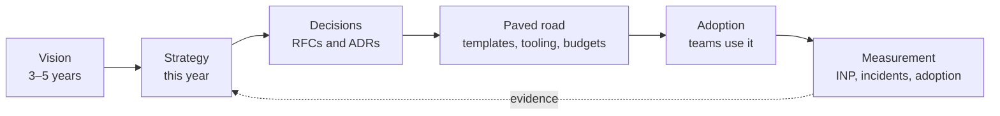

# 72 — The Principal Frontend Engineer

> At senior level you're paid for good answers. At staff and principal level you're paid for choosing the right questions, getting the organisation to answer them, and making sure the answers stick.

**Prerequisites:** [01 Thinking Like a Frontend Architect](01-thinking-like-a-frontend-architect.md), [63 Architecture Governance and ADRs](63-architecture-governance-and-adrs.md) · **Related:** [64 Migration Playbooks](64-migration-playbooks.md) · [66 Frontend System Design](66-frontend-system-design.md) · [70 Case Study: Prism](70-case-study-enterprise-design-system.md) · [73 Interview Question Bank](73-interview-question-bank.md) · [74 Machine-Coding Drills](74-machine-coding-drills.md) · [77 Hiring, Leveling and Org Design](77-hiring-leveling-and-org-design.md) · [78 Business Cases](78-business-cases-and-investment-arguments.md) · [79 Distributed Systems Design](79-distributed-systems-design-for-frontend-architects.md)

---

## TL;DR

- **The job changes shape, not just size.** Senior engineers solve well-defined problems. Staff engineers define problems for a group of teams. Principal engineers decide which problems the organisation should spend years on.
- **Know your archetype.** Tech lead, architect, solver or right hand: each is a legitimate way to operate, and most people move between them.
- **Find the work that compounds.** In frontend, that's usually the paved road, cross-cutting quality (performance, accessibility, security), migrations, the design system and developer experience.
- **Write strategy down.** A diagnosis, guiding policies and coherent actions, on a page or two. If it isn't written, it isn't a strategy; it's an opinion you repeat in meetings.
- **Influence is a craft.** Talk to people before the meeting, make decisions reversible where you can, disagree and commit, and escalate cleanly when you must.
- **Multiply others.** Mentor, sponsor, delegate the glue work and grow the next staff engineers. Your output is the organisation's output.
- **Stay technical on purpose.** Prototypes, benchmarks, critical-path code and incidents keep your judgement calibrated. The verified measurements throughout this handbook are what that looks like.
- **Measure outcomes, not activity:** INP, error rates, build times, adoption, lead time, incidents.

---

## 1. What changes at staff and principal

| | Senior | Staff | Principal |
|---|---|---|---|
| Scope | A team, a feature area | Several teams, a product or platform | An organisation or the company's frontend |
| Time horizon | This quarter | This year | Two to five years |
| Problems | Given, mostly well defined | Found and framed for others | Chosen, among many competing ones |
| Typical artefacts | Code, design docs | RFCs, ADRs, migration plans, reference implementations | Strategy documents, technical vision, investment cases |
| Leverage | Your own output | A group of teams' output | The organisation's direction |
| Success looks like | Features shipped well | Several teams faster and safer | The right bets made years early; fewer wrong ones |
| Failure looks like | Bugs, delays | A platform nobody adopts | An organisation that is busy, but not going anywhere |

Two shifts surprise people most.

**From answers to questions.** A senior engineer is asked "how should we cache product pages?" A principal engineer notices that three teams are building three caching layers, asks whether caching is the right place to spend effort at all, and gets the organisation to agree on the answer.

**From doing to deciding what gets done.** Your calendar fills with reviews, conversations and writing. That isn't a betrayal of engineering. It is the engineering, at a scale where the hardest problems are coordination problems. But it needs a deliberate counterweight (section 10), or your judgement drifts away from the code.

---

## 2. Archetypes

Will Larson's *Staff Engineer* describes four common shapes of the role. Frontend versions of each:

| Archetype | What they do | A frontend example |
|---|---|---|
| **Tech lead** | Guides one team's or a few teams' approach and execution | Leads the checkout teams through a move to Server Components without slipping the roadmap |
| **Architect** | Owns direction and quality for a technical area across teams | Owns the frontend architecture: framework choices, boundaries, the paved road, fitness functions |
| **Solver** | Goes deep on hard, high-stakes problems, one after another | Fixes the INP regression nobody else could find; leads the response to a framework security advisory |
| **Right hand** | Extends a senior leader's reach across the organisation | Runs the frontend side of a company-wide platform consolidation on the VP's behalf |

Most principal engineers move between these over a career, and sometimes within a year. The archetype matters because it tells you, your manager and your peers what *good* looks like for you right now. An architect who measures themselves by tickets closed will feel like a failure; a solver who's been told to "set direction" will feel lost.

---

## 3. Finding the work

Nobody hands a principal engineer a backlog. You find the work, and the main skill is choosing well among many reasonable options.

Where frontend leverage usually lives:

- **The paved road** ([63](63-architecture-governance-and-adrs.md) §7): the default way to build a new app or feature, so that doing the right thing is the easy thing.
- **Cross-cutting quality:** performance budgets, accessibility, security floors. No single team owns these, so they decay without someone who does.
- **Migrations** ([64](64-migration-playbooks.md)): every year something needs to move. Done well, a migration is a chance to fix structure; done badly, it's two years of half-finished work.
- **The design system** ([70](70-case-study-enterprise-design-system.md)): the most leveraged code in most frontend organisations.
- **Developer experience:** build times, test reliability, preview environments, local setup. Minutes saved per engineer per day, multiplied by everyone.
- **Patterns in incidents:** three incidents with the same shape are a missing abstraction, not bad luck.

How to choose:

| Question | Why it matters |
|---|---|
| What happens if nobody does this for a year? | Separates real problems from attractive ones |
| How many teams does it affect, and how much? | Leverage |
| Is the window closing? (a framework end of life, a contract, a hiring plan) | Urgency |
| Am I unusually well placed to do it? | Your comparative advantage, not just your interest |
| Can someone else do it, with my help? | If yes, sponsor them instead (section 8) |

Two traps Larson names are worth remembering. **Snacking** is picking easy, visible work because it feels productive. **Preening** is picking work that impresses leadership but doesn't matter. Both feel like progress. Neither compounds.

---

## 4. Technical strategy

A strategy is a decision about where to focus, and what not to do. Richard Rumelt's kernel works well for engineering: a **diagnosis** of the situation, a **guiding policy** for dealing with it, and **coherent actions** that carry out the policy.

```markdown
# Frontend strategy 2027 (Acme)

## Diagnosis
- Four product lines, three rendering approaches, two design systems, one Angular app.
- 60% of frontend incidents in 2026 came from version skew and unowned shared code.
- INP p75 fails on 4 of the 10 highest-traffic screens; nobody owns cross-cutting performance.
- New-app setup takes three weeks; teams copy the last app they worked on.

## Guiding policies
1. One paved road per kind of app: Next.js for public, server-rendered products; Vite SPA for internal tools.
2. Prism is the only design system; tokens are the cross-framework contract.
3. Performance and accessibility budgets are enforced in CI, not reviewed by hand.
4. Shared code has an owner, or it is deleted.

## Coherent actions (2027)
- Q1: Paved-road templates for both app types, with budgets, flags and observability built in (ADR-0014).
- Q1–Q2: Merge the second design system into Prism; codemods for every breaking change.
- Q2: Skew protection and deployment-ID checks on every product (see chapter 62).
- Q3: The Angular app moves to tokens and Prism CSS; a decision on its future in Q4.
- Ongoing: the ownership map in CODEOWNERS; unowned packages are archived after 90 days' notice.

## What we are not doing
- Micro-frontends for the storefront. The teams can deploy independently today; skew is the real problem.
- A framework rewrite of the admin console. It upgrades in place (chapter 71).

## How we'll know
INP p75 passes on all top-10 screens; frontend incidents from skew and shared code down 50%;
new-app setup under one day; Prism adoption ≥ 80%.
```

What makes it work:

- **The diagnosis has numbers.** Without them, every team reads their own situation into it.
- **The policies rule things out.** "Use the best tool for the job" isn't a policy; it's a refusal to decide.
- **"What we are not doing" is the most valuable section.** It saves more time than everything else, because it ends recurring debates.
- **It fits on a page or two.** A strategy nobody reads doesn't steer anything.

A **technical vision** is the companion document: what the frontend should look like in three to five years if the strategy works. It's less precise, more aspirational, and useful for hiring and for testing whether each year's strategy points in a consistent direction.



---

## 5. Influence without authority

You rarely have the authority to make other teams do anything. You influence them, and that's a set of learnable techniques, not a personality trait.

**Talk to people before the meeting.** A decision meeting where people first hear the proposal is a debate. One where you've talked to each stakeholder first, heard their concerns and adjusted the proposal is a confirmation. Japanese organisations call this *nemawashi*: preparing the roots before moving a tree.

**Make it easy to say yes.** Offer a reversible first step, a pilot with one team, or a time-boxed experiment with a success criterion agreed in advance. Most resistance is fear of being locked in.

**Bring evidence, not seniority.** "I measured it" ends more arguments than "I've seen this before". The measured results in [71](71-case-study-legacy-react-modernization.md), where the compiler alone left 500 rows re-rendering, would have settled an argument that years of experience couldn't.

**Separate the decision from the decider.** Agree first on *how* a decision will be made (criteria, who decides, by when), then make it. People accept outcomes they disagree with when the process was fair.

**Disagree and commit, in both directions.** When the decision goes against you, support it properly, and say what evidence would make you raise it again. When it goes your way, do the same for the people who disagreed, and check in with them later.

**Escalate cleanly.** When two teams can't agree and the cost of waiting is real, write a short, neutral summary together (the options, each side's strongest argument, what you each recommend) and take it to whoever can decide. Escalation done jointly is a normal part of engineering. Escalation done alone damages trust.

**Say no well.** "Not now" is often the right answer. Make it a useful one: "Not this quarter, because of X. If Y happens, or if you can show Z, I'll help you make the case."

---

## 6. Writing

Writing is how principal engineers scale. A good document makes the same argument a thousand times without you in the room.

| Document | Purpose | Length | Where it lives |
|---|---|---|---|
| Strategy | Where we focus this year, and what we won't do | 1–2 pages | Engineering wiki, reviewed yearly |
| Vision | Where we want to be in 3–5 years | 2–4 pages | Engineering wiki |
| RFC | A proposal that needs input before a decision | 2–6 pages | Repository or RFC process ([63](63-architecture-governance-and-adrs.md) §3) |
| ADR | A decision and its reasons | 1 page | Next to the code |
| Migration plan | Steps, owners, measures, rollback | 2–5 pages | With the migration's tracking issue |
| Postmortem | What happened, why, what changes | 1–3 pages | Incident tooling |
| One-page memo | A single argument to a busy leader | 1 page | Email or doc |

Habits that make engineering writing work:

- **Lead with the conclusion.** The first paragraph should say what you recommend and why. Many readers stop there.
- **Show the alternatives fairly.** If you can't state the best argument for the option you rejected, you don't understand the decision yet.
- **Use numbers, and say where they came from.** Lab or field? Which version? Which devices?
- **Define success before you start.** A plan without a success criterion can't fail, and so can't be evaluated.
- **Write for the reader who disagrees.** They'll read most carefully and decide whether others trust it.
- **Cut.** A two-page document that's read beats a ten-page one that's skimmed.

---

## 7. Reviewing other people's designs

You'll review far more designs than you write. Done well, reviews spread good judgement; done badly, they make you a bottleneck and teams stop asking.

- **Ask questions before giving verdicts.** "What happens to an open tab during a deploy?" teaches; "this is wrong" doesn't.
- **Separate blocking concerns from preferences,** and label them. Most comments should be explicitly non-blocking.
- **Review against the team's constraints, not your ideal.** The best design for their deadline, skills and system may not be the one you'd choose.
- **Keep reviews fast.** A review that takes two weeks is a decision by delay. Agree on a turnaround, and meet it.
- **Make yourself unnecessary.** Turn repeated review comments into checklists, lint rules, fitness functions and paved-road defaults, so the next team doesn't need you.

---

## 8. Multiplying others

| Practice | What it is | Example |
|---|---|---|
| **Mentoring** | Sharing advice and experience | Weekly time with a senior engineer working on their first cross-team RFC |
| **Sponsorship** | Using your position to create opportunities for someone | Recommending them to lead the Prism migration, and backing them in the room where it's decided |
| **Delegation** | Giving away work you could do, so someone else grows | Handing the next framework advisory response to a staff engineer, with you as backup |
| **Making glue work visible** | Crediting the coordination that holds projects together | Writing up who ran the migration's office hours and wrote its docs, in their review |
| **Teaching in public** | Talks, docs, office hours, recorded walkthroughs | A recorded walkthrough of the compiled output that changed how teams structure components |

Lara Hogan's distinction is worth keeping in mind: mentors give advice; sponsors put someone's name forward when they're not in the room. Senior people tend to over-mentor and under-sponsor.

Tanya Reilly's "Being Glue" describes the coordinating, unblocking and documenting work that makes projects succeed and that's easy to overlook in promotions. Part of your job is noticing who's doing it, making sure it counts, and making sure it isn't always the same people.

---

## 9. Working with management, product and design

A principal engineer is a partner to engineering managers, product managers and design leads, not a substitute for any of them.

- **With engineering managers:** they own people and delivery; you own technical direction across teams. Agree explicitly on who decides what, especially when a team's roadmap and the technical strategy pull in different directions.
- **With product:** translate technical investments into product outcomes. "Skew protection" means little to a product leader; "no more 'reload to continue' errors after deploys, which are 9% of support tickets" means a lot.
- **With design:** the design system is a joint product. Shared ownership of tokens and components avoids the classic split where design decides and engineering discovers it can't be built accessibly.
- **Managing up:** give your leadership short, regular, honest updates: what's going well, what's at risk, what you need. Bad news early is a gift; bad news late is a crisis.

A typical principal engineer's week, as a target rather than a rule:

| Activity | Share |
|---|---|
| Hands-on: prototypes, critical-path code, benchmarks, incidents | 25–30% |
| Design reviews and RFCs | 20–25% |
| Writing: strategy, ADRs, plans | 15% |
| Mentoring, sponsorship, office hours | 15–20% |
| Alignment with leadership, product and design | 15% |

---

## 10. Staying technical

The risk of the role is that your technical judgement slowly expires. Counter it deliberately:

- **Build the prototype.** Before recommending a framework, a caching model or a collaboration library, build the smallest version and measure it. Almost every chapter of this handbook found something its author didn't expect by doing exactly that: the compiler's memo blocks in [71](71-case-study-legacy-react-modernization.md), the duplicated cards in [69](69-case-study-collaborative-project-management.md), the contrast failures in [70](70-case-study-enterprise-design-system.md).
- **Own a piece of critical-path code,** small enough not to block a team: a fitness function, the budget checker, a codemod.
- **Join incidents.** Production is where your assumptions meet reality.
- **Read code you didn't write,** especially in the frameworks you depend on. Release notes tell you what changed; source tells you how it behaves.
- **Keep a lab.** A scratch repository where you try every significant release before your organisation adopts it.

---

## 11. Measuring impact

Measure outcomes your organisation cares about, not the activity that produced them.

| Area | Outcome measures |
|---|---|
| User experience | INP, LCP and CLS at p75 by screen; error rates; accessibility defects in audited flows |
| Delivery | Lead time for changes; deploy frequency; change failure rate; time to restore |
| Developer experience | CI time; local build and test time; flaky-test rate; new-app setup time |
| Platform adoption | Share of apps on the paved road; design-system adoption; remaining deprecated usages |
| Risk | Time to patch a critical framework advisory; unowned packages; dependency age |

Keep a running record of your work and its effect, sometimes called a brag document (Julia Evans' term): the problem, what you did, who you worked with, and what changed, with numbers. It makes performance reviews honest, and it shows you which of your efforts actually mattered.

---

## 12. The staff-plus interview loop

Interviews for staff and principal roles test different things than senior ones. A typical loop:

| Round | What they're testing | How to prepare |
|---|---|---|
| Frontend system design | Framing an ambiguous problem, trade-offs, depth where it matters | Practise the method in [66](66-frontend-system-design.md): requirements, constraints, architecture, deep dives, failure modes |
| General system design (many principal loops) | Breadth beyond the frontend: estimates, building blocks, failure modes | The method and building blocks in [79](79-distributed-systems-design-for-frontend-architects.md) |
| Architecture deep dive on your own work | Real judgement and real scope | Prepare two projects: the context, the options you rejected and why, what went wrong, the measured result |
| Technical leadership (behavioural) | Influence, conflict, mentoring, strategy | Six to eight stories, each with situation, action and a measurable result; at least one where you were wrong |
| Coding or machine coding | Still technical; clean, tested code under time pressure | The drills in [74](74-machine-coding-drills.md): debounce, Promise utilities, a virtual list, hooks, UI components |
| Written exercise (some companies) | Writing as a leadership tool | A one-page RFC or strategy in 60–90 minutes |

What separates staff-plus answers from senior ones:

- **You frame before you solve.** You ask who the users are, what scale matters, and what the business needs, and you state assumptions out loud.
- **You talk about trade-offs and how you'd decide,** not only about the answer.
- **Your stories have organisational scope.** "I fixed it" is senior. "I noticed three teams had the same problem, got agreement on a shared fix, and the incidents stopped" is staff.
- **You have numbers.** Before and after, with how they were measured.
- **You can say what you'd do differently.** Self-correction is a seniority signal.

Red flags interviewers watch for: answers that are all *I* and never *we* (or the reverse, with no sign of your own contribution), dogmatic framework opinions, designs with no failure modes, and stories without results.

---

## 13. Career paths

- **Principal and beyond.** Distinguished or fellow roles exist at larger companies; the scope is the whole company or the industry, and the role is rarer than people think.
- **The pendulum.** Moving between management and the staff-plus path is normal, and many of the best technical leaders have done both. Charity Majors' "engineer/manager pendulum" is the classic argument for it.
- **Generalist versus specialist.** A principal frontend engineer needs depth in frontend and enough breadth (backend, infrastructure, security, product) to make good cross-boundary decisions. The breadth is what Parts IV, VII and X of this handbook are for.

---

## Decision framework

**Problem:** choosing what to spend the next six months on.

**Constraints:** your archetype and your manager's expectations, the organisation's strategy, your comparative advantage, and what will happen if nobody does it.

| Option | Do it yourself when | Sponsor someone else when | Decline when |
|---|---|---|---|
| A cross-team migration | It's high-risk and nobody else has the context | A staff engineer is ready to lead it with backup | The strategy doesn't need it this year |
| A hard, one-off technical problem | It blocks many teams and is urgent | Someone needs the growth and there's time | Its impact is local |
| A new platform capability | You can build the reference implementation quickly | A platform team owns the area | There's no adoption plan |
| A strategy or vision document | You have the context and the mandate | Rarely; this is core principal work | The organisation isn't ready to act on it |
| An urgent incident | You're the best placed to lead it | The on-call lead has it under control | Never decline to help; decline to take over |

**Criteria:** leverage, urgency, comparative advantage, and whether doing it yourself denies someone else a growth opportunity.

**Failure modes:** snacking, preening, becoming the bottleneck for every review, writing strategies nobody acts on, losing technical touch, and confusing busyness with impact.

---

## Pitfalls and anti-patterns

- **Becoming the review bottleneck.** If every design needs you, you've built a dependency, not a culture.
- **Strategy without "what we won't do".** It's a wish list.
- **Being right, alone.** A correct decision nobody adopts has no impact.
- **Only mentoring, never sponsoring.** Advice is cheap; opportunities change careers.
- **Snacking and preening.** Visible work that doesn't compound.
- **Opinions instead of measurements.** Build the prototype; measure it.
- **Losing touch with the code.** Your judgement expires faster than your title.
- **Escalating alone.** Write the summary with the other side.
- **Doing all the glue work yourself, or letting the same few people do it.** Make it visible and shared.

---

## Architect's checklist

- [ ] I know which archetype I'm operating as, and my manager agrees.
- [ ] My current work passes the "what happens if nobody does this for a year?" test.
- [ ] There's a written strategy with numbers in the diagnosis and a "what we're not doing" section.
- [ ] Every major decision I've driven this year has an ADR or RFC.
- [ ] I talk to stakeholders before decision meetings.
- [ ] I'm sponsoring at least one person into a stretch opportunity.
- [ ] My repeated review comments have become checklists, lint rules or fitness functions.
- [ ] I've built and measured a prototype of the last thing I recommended.
- [ ] I keep a record of my work's outcomes, with numbers.
- [ ] I could hand over my current work in a week.

---

## Interview angles

**Q: How is a staff or principal engineer different from a very good senior engineer?**
A: Scope and the kind of problem. A senior engineer solves well-defined problems for a team. At staff level I find and frame problems for several teams and get them solved, often by other people. At principal level I'm choosing which problems the organisation spends years on, and writing that down so it outlasts me. The work moves from answers to questions, and from doing to deciding what gets done.

**Q: Tell me about a time you changed a technical direction without authority over the teams involved.**
A: A strong answer has the problem with numbers, the people involved and their concerns, what you did before the decision (one-to-ones, a pilot, a measurement), how the decision was made, what happened after, and what you'd do differently. For example: three teams each building their own caching layer; a measured prototype showing the shared approach was faster; a pilot with one team; an ADR; adoption by the other two within a quarter; and an admission that the first proposal underestimated one team's constraints.

**Q: How do you decide what to work on?**
A: I ask what happens if nobody does it for a year, how many teams it affects, whether a window is closing, and whether I'm unusually well placed to do it or should sponsor someone else. I try to avoid work that's easy and visible but doesn't compound, and work that impresses leadership but doesn't matter.

**Q: What does a good technical strategy look like?**
A: A diagnosis with numbers, a few guiding policies that rule things out, coherent actions with owners and dates, an explicit list of what we're not doing, and measures that show whether it worked, all on a page or two. If it doesn't rule anything out, it isn't a strategy.

**Q: How do you stay technical as a principal engineer?**
A: Deliberately: I build and measure prototypes before recommending anything, own a small piece of critical-path code, join incidents, read framework source when behaviour surprises me, and try each significant release in a lab first. Most of my best recommendations started with a measurement that contradicted what I expected.

---

## Further reading

- Will Larson, *Staff Engineer: Leadership beyond the management track* (2021), and [staffeng.com](https://staffeng.com/).
- Tanya Reilly, *The Staff Engineer's Path* (O'Reilly, 2022), and ["Being Glue"](https://noidea.dog/glue).
- Richard Rumelt, *Good Strategy/Bad Strategy* (2011): the diagnosis, guiding policy and coherent actions kernel.
- Lara Hogan, ["What does sponsorship look like?"](https://larahogan.me/blog/what-sponsorship-looks-like/).
- Julia Evans, ["Get your work recognized: write a brag document"](https://jvns.ca/blog/brag-documents/).
- Charity Majors, ["The Engineer/Manager Pendulum"](https://charity.wtf/2017/05/11/the-engineer-manager-pendulum/).
- Camille Fournier, *The Manager's Path* (2017): the management side of the partnership.

---

[← Previous: 71 — Case Study: Legacy React Modernization](71-case-study-legacy-react-modernization.md) · [Index](README.md) · [Next: 73 — Interview Question Bank →](73-interview-question-bank.md)
