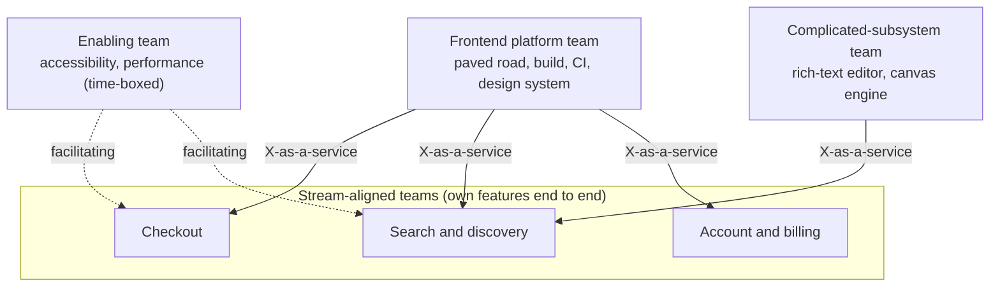

# 77 — Hiring, Leveling and Org Design

> The architecture you'll have in three years is being decided by who you hire this year and how you organise them. Treat the interview loop and the team map as architecture artefacts, because they are.

**Prerequisites:** [72 The Principal Frontend Engineer](72-the-principal-frontend-engineer.md), [01 Thinking Like a Frontend Architect](01-thinking-like-a-frontend-architect.md) (§9, Conway's law) · **Related:** [63 Architecture Governance](63-architecture-governance-and-adrs.md) · [70 Case Study: Prism](70-case-study-enterprise-design-system.md) · [73 Interview Question Bank](73-interview-question-bank.md) · [74 Machine-Coding Drills](74-machine-coding-drills.md)

---

## TL;DR

- **Principal engineers shape hiring even when they don't run it:** the loop's design, the rubrics, the interviewer bench, calibration and the bar.
- **Design the loop from the competencies backwards.** Name what the level needs, map every competency to at least two rounds, and cut rounds that measure nothing new.
- **Anchored rubrics beat gut feel.** Describe what each level looks like for each dimension, collect written feedback before the debrief, and track how each interviewer scores over time.
- **Leveling is about scope and evidence,** not years or brilliance: who was affected, how much, and what the person did that others wouldn't have.
- **Organise frontend by stream, with platforms underneath.** Product teams own features end to end; a frontend platform team owns the paved road, the build and the design system; enabling teams coach on accessibility or performance for a while, then move on.
- **Create a platform team when duplication costs more than coordination,** and measure it by adoption, not output.

---

## 1. What a principal engineer owns in hiring

| Area | Contribution |
|---|---|
| Loop design | Which rounds exist, what each measures, how long they take |
| Rubrics | Anchored descriptions of each level for each competency |
| Question bank | Calibrated questions with follow-up ladders, retired when they leak |
| Interviewer bench | Training, shadowing, reverse-shadowing, and feedback on feedback |
| Calibration | Reviewing pass rates and score distributions per interviewer and per round |
| The bar | Protecting it in debriefs, especially under hiring pressure |
| The pitch | Explaining the technical work honestly to strong candidates |

---

## 2. Designing the loop

Start with the competencies the role needs, then choose rounds that produce evidence for them. A frontend loop by level:

| Round | Senior | Staff | Principal | Main competencies |
|---|---|---|---|---|
| Coding or machine coding ([74](74-machine-coding-drills.md)) | Yes | Yes | Often | Code quality, testing instinct, UI fundamentals |
| Frontend system design ([66](66-frontend-system-design.md)) | Yes | Yes | Yes | Framing, architecture, trade-offs, depth |
| Deep dive on past work | Short | Yes | Yes | Real scope, judgement, results |
| Technical leadership | Short | Yes | Yes | Influence, conflict, mentoring, strategy |
| Written exercise (an RFC or strategy) | No | Sometimes | Often | Writing as a leadership tool |
| Cross-functional conversation (product or design) | No | Sometimes | Yes | Partnership, translating technical work into outcomes |

Rules that keep a loop efficient and fair:

- **Every competency is measured by at least two rounds,** so one interviewer's view never decides it alone.
- **No two rounds measure only the same thing.** A second coding round rarely adds information at staff level; a deep dive does.
- **The same prompt for every candidate at a level,** with a defined follow-up ladder, so differences come from candidates, not questions.
- **Time-box take-homes** to what you'd ask a colleague to do in an evening, or pay for them, or don't use them.
- **Decide your policy on AI coding assistants explicitly** and tell candidates in advance. Either allow them and assess judgement (what the candidate accepts, rejects and verifies), or don't, but don't leave it to each interviewer.
- **Offer accommodations by default,** and make the loop accessible: screen-reader-friendly coding environments, extra time when asked.

---

## 3. Rubrics with anchors

A rubric is useful only if two interviewers would score the same performance the same way. Anchors describe what each level looks like:

| Dimension | Senior | Staff | Principal |
|---|---|---|---|
| Framing | Clarifies requirements when prompted | Asks questions that change the design; states assumptions | Reframes the problem around the business goal; names what not to build |
| Architecture | A sound design for the stated problem | Clear boundaries and data flow; alternatives considered | Designs for evolution and for the organisation building it |
| Depth | Goes deep where asked | Chooses where to go deep, and goes there | Finds the part of the problem others would miss |
| Trade-offs | Names trade-offs when asked | Compares options against explicit criteria | Quantifies trade-offs; knows when a decision is reversible |
| Failure modes | Handles obvious errors | Covers degradation, skew, security and accessibility | Designs the operational response: detection, rollback, ownership |
| Communication | Clear | Structured, easy to follow | Adapts to the audience; makes the interviewer smarter |

How to use it:

1. **Score each dimension independently,** with a sentence of evidence per score: what the candidate said or did.
2. **Write feedback before the debrief,** and don't read others' feedback first. Anchoring on the first opinion is the most common way debriefs go wrong.
3. **The debrief discusses evidence,** not impressions. "Strong communicator" is an impression; "explained the cache invalidation trade-off so the product manager on the panel could follow it" is evidence.
4. **Decide against the bar for the level,** not against the other candidates in the pipeline this month.

Decades of research on employee selection, summarised in Schmidt and Hunter's well-known 1998 meta-analysis and later revisions, find that structured interviews predict job performance better than unstructured ones. Rubrics and consistent prompts are what "structured" means in practice.

---

## 4. Calibration

Hiring decisions drift unless someone looks at the data:

| Signal | What it tells you | Action |
|---|---|---|
| Pass rate per interviewer | Unusually harsh or lenient interviewers | Pair them with calibrated interviewers; review their feedback |
| Pass rate per round | A round that rejects everyone, or no one | Redesign the prompt or the rubric |
| Score spread within debriefs | Interviewers disagreeing systematically | Discuss anchors with concrete examples |
| Offer acceptance and early attrition | Whether the loop sells and selects well | Review the loop with recent hires after six months |
| Feedback quality | Evidence or impressions | Feedback on feedback for interviewers |

Interviewer development follows a path: training on the rubric, shadowing two or three loops, reverse-shadowing (they lead, an experienced interviewer observes), then interviewing alone with periodic review.

---

## 5. Leveling

Levels describe scope and impact, demonstrated over time. A frontend individual-contributor ladder:

| Dimension | Senior | Staff | Senior staff | Principal |
|---|---|---|---|---|
| Scope | A team's area | Several teams, or a platform | A product line or a major platform | The organisation's frontend, or a company-wide concern |
| Problems | Well defined | Ambiguous, framed by them | Ambiguous and contested | Chosen by them among many |
| Technical depth | Expert in the team's stack | Deep in at least one area that matters to several teams | Recognised authority in an area | Sets technical direction others build on |
| Influence | Within the team | Across teams, without authority | Across the organisation | Across the company, and often outside it |
| Developing others | Mentors | Mentors and sponsors; grows senior engineers | Grows staff engineers | Shapes the organisation's technical culture |
| Typical evidence | Features, designs, reviews | RFCs, migrations, platform adoption | Strategy, multi-year programmes | Vision, strategy, the bets that paid off |

Promotion should be a recognition, not a reward:

- **Evidence over at least two or three quarters,** at the next level's scope, not one heroic project.
- **A written packet:** the problems, what the person did, the measurable results, and quotes from peers in other teams.
- **A sponsor** who argues the case in calibration, and who has told the person in advance what's missing if the case isn't ready.
- **Calibration across teams,** so the same evidence leads to the same level everywhere.

---

## 6. Organising frontend teams

*Team Topologies* by Matthew Skelton and Manuel Pais gives a useful vocabulary for how teams relate:

| Team type | Frontend example | Interaction | Measured by |
|---|---|---|---|
| Stream-aligned | A product team owning checkout across UI, BFF and experiments | Consumes platforms as services | Product outcomes, lead time |
| Platform | Paved-road templates, build tooling, CI, the design system ([70](70-case-study-enterprise-design-system.md)) | X-as-a-service, with docs and support | Adoption, satisfaction, time saved |
| Enabling | Accessibility or performance specialists coaching teams for a quarter | Facilitating, then leaving | Capability left behind in teams |
| Complicated subsystem | A rich-text editor, a WebGL canvas, a collaboration engine ([69](69-case-study-collaborative-project-management.md)) | X-as-a-service | Reliability and API quality |

Principles that hold up:

- **Teams of five to nine,** small enough for one backlog and one conversation.
- **Limit cognitive load:** a team that owns too many domains owns none of them well.
- **Ownership is explicit:** every package, route and component has an owning team in CODEOWNERS, and unowned code is assigned or deleted ([63](63-architecture-governance-and-adrs.md)).
- **Design boundaries and teams together.** If three teams change one page, either the page needs seams (a module boundary per team) or the teams need to change ([01](01-thinking-like-a-frontend-architect.md) §9).

---

## 7. When to create a frontend platform team

Signals that it's time:

- Three or more product teams maintaining their own build setups, CI pipelines or component libraries.
- Migrations that never finish because nobody owns them across teams.
- New applications taking weeks to set up, because each copies the last one.
- Inconsistent UI and accessibility, traced to duplicated components.

How to start one without creating a bottleneck:

1. **Start small,** with engineers who've felt the duplication pain, and a clear first product: often the paved-road template or the build.
2. **Treat it as a product team:** users (the other teams), a roadmap built from their problems, documentation, support hours.
3. **Make adoption voluntary but easy.** If teams must be forced onto the platform, the platform isn't good enough yet.
4. **Measure adoption and time saved,** not features shipped.
5. **Keep contribution open:** product teams can contribute to the platform through a clear process, so it never becomes the only place things can change.

---

## 8. Starting in a new principal role

The first 90 days decide how much influence the rest will have:

| Phase | Goal | Activities |
|---|---|---|
| Days 1–30: listen | Understand the system and the people | One-to-ones with engineering leads, product, design and SRE; read the last year's ADRs and postmortems; ship one small change through the whole pipeline |
| Days 31–60: map | Find the leverage | Write down the top problems with evidence; draw the ownership map; test your diagnosis with the people who'll disagree |
| Days 61–90: first win and strategy | Earn trust, set direction | Fix one painful, visible problem; draft the frontend strategy ([72](72-the-principal-frontend-engineer.md) §4) and circulate it for comment |

The most common mistake is the reverse order: proposing a strategy in the first month, before understanding why things are the way they are.

---

## Decision framework

**Problem:** choosing a frontend organisation structure for the next stage of growth.

**Constraints:** number of engineers and products, how much code is shared, delivery pressure, and the leadership available.

| Structure | Fits | Risks |
|---|---|---|
| One frontend team serving all products | Up to roughly 8–10 frontend engineers | A queue for every product; frontend divorced from product outcomes |
| Frontend engineers embedded in product teams, with a guild | Several products, little shared infrastructure | Duplicated tooling and components; inconsistent quality |
| Stream-aligned teams plus a frontend platform team | Several products sharing a stack and a design system | The platform becoming a bottleneck if run as a ticket queue |
| Plus enabling and complicated-subsystem teams | Large organisations with specialist needs | Too many team types for the size of the organisation |

**Criteria:** cognitive load per team, how much is shared, and whether teams can deliver without waiting for each other.

**Failure modes:** reorganising without changing code boundaries; a platform team without users' input; enabling teams that never leave; hiring loops nobody calibrates.

**Migration path:** map ownership first, then fix the boundaries in the code, then move people. Reorganisations that skip the first two rarely change how work flows.

---

## Pitfalls and anti-patterns

- **A loop designed by accretion.** Rounds added over years, measuring the same thing twice and some things never.
- **Feedback written after the debrief.** It records the group's conclusion, not the interviewer's evidence.
- **"Culture fit" as a criterion.** It means "like us". Assess behaviours you can describe instead.
- **Leveling by tenure or by one hero project.** Scope and consistent evidence decide levels.
- **Promotions as retention tools.** They distort the ladder for everyone else.
- **A platform team measured by output.** Features nobody adopts are cost, not value.
- **Reorgs without ownership maps.** The same code, owned by nobody, in a new structure.

---

## Architect's checklist

- [ ] Every round in our loop is mapped to competencies, and every competency to at least two rounds.
- [ ] Rubrics have anchors per level, and feedback is written before debriefs.
- [ ] Pass rates per interviewer and per round are reviewed quarterly.
- [ ] Our policy on AI tools in interviews is written down and shared with candidates.
- [ ] The ladder describes scope and evidence per level, and promotion packets follow it.
- [ ] Every package, route and component has an owning team.
- [ ] Platform teams are measured by adoption and time saved.
- [ ] Enabling engagements have an end date and a definition of done.

---

## Interview angles

**Q: How would you design the interview loop for a staff frontend engineer?**
A: From the competencies: framing ambiguous problems, frontend architecture, technical depth, influence without authority, and writing. I'd use a system design round, a deep dive on the candidate's own work, a leadership round and a coding round, with anchored rubrics for each and every competency covered twice. Written feedback goes in before the debrief, and I'd review pass rates per interviewer each quarter.

**Q: What's the difference between a staff and a principal engineer, in leveling terms?**
A: Scope and the kind of problem. Staff engineers frame and solve ambiguous problems across several teams; principal engineers choose which problems the organisation works on, set direction that outlives their involvement, and shape its technical culture. The evidence differs too: migrations and platforms at staff, strategy and multi-year bets at principal.

**Q: When would you create a frontend platform team?**
A: When duplication costs more than coordination: several teams maintaining their own builds, CI and components, migrations nobody owns, and new apps taking weeks to start. I'd start small with a concrete first product, run it as a product with the other teams as users, and measure adoption and time saved.

**Q: Three teams keep stepping on each other in the same codebase. What do you do?**
A: Map who changes what, then decide whether the code needs seams (module boundaries with an owner each, enforced in CI) or the teams need different boundaries. Usually it's both. Moving people without changing code boundaries just moves the conflict.

**Q: How do you keep a debrief from turning into a popularity contest?**
A: Independent written feedback with evidence before anyone talks, the most junior interviewer speaks first, the discussion is about evidence against the level's rubric rather than comparisons with other candidates, and someone is responsible for the bar rather than for filling the role.

---

## Further reading

- Matthew Skelton and Manuel Pais, *Team Topologies* (2019).
- Will Larson, *An Elegant Puzzle: Systems of Engineering Management* (2019).
- Camille Fournier, *The Manager's Path* (2017).
- Frank Schmidt and John Hunter, "The validity and utility of selection methods in personnel psychology", *Psychological Bulletin* (1998).
- Tanya Reilly, *The Staff Engineer's Path* (2022): leveling and influence from the individual contributor's side.

---

[← Previous: 76 — Frontend Cost and Capacity Engineering](76-frontend-cost-and-capacity-engineering.md) · [Index](README.md) · [Next: 78 — Business Cases and Investment Arguments →](78-business-cases-and-investment-arguments.md)
