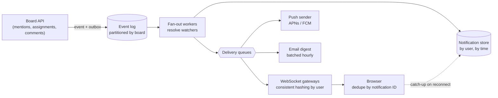

# 79 — Distributed Systems Design for Frontend Architects

> At principal level, "I'm a frontend engineer" stops being an answer to backend questions. You don't need to design databases for a living, but you need to know what they promise, what they cost and how they fail, because your UI inherits all three.

**Prerequisites:** [66 Frontend System Design](66-frontend-system-design.md), [33 API Integration, BFF and Contracts](33-api-integration-bff-and-contracts.md) · **Related:** [05 Networking, Caching and Delivery](05-networking-caching-and-delivery.md) · [34 Realtime, Offline and Collaboration](34-realtime-offline-and-collaboration.md) · [40 Resilience and Reliability](40-resilience-and-reliability.md) · [69 Case Study: Acme Boards](69-case-study-collaborative-project-management.md) · [76 Cost and Capacity](76-frontend-cost-and-capacity-engineering.md)

> [!NOTE]
> Results marked *verified* come from a tested token-bucket rate limiter and a consistent-hashing ring written for this chapter (three `node:test` tests, 100,000 simulated keys).

---

## TL;DR

- **Many principal loops include a general system-design round.** It tests the same method as [66](66-frontend-system-design.md): requirements, estimates, a design, deep dives and failure modes, applied to services instead of screens.
- **Estimate before you draw.** Requests per second, storage, bandwidth and concurrent connections decide the design; a few lines of arithmetic beat a diagram full of boxes.
- **Know the building blocks by their promises and failure modes:** caches go stale and stampede, replicas lag, queues redeliver, partitions get hot keys, and networks time out.
- **The UI inherits the consistency model.** Replica lag shows up as "I saved it and it disappeared". Read-your-writes guarantees and optimistic updates are where backend semantics meet the frontend.
- **At-least-once delivery means idempotency everywhere:** idempotency keys on writes, deduplication by ID on the client.
- **Two building blocks, verified:** consistent hashing moved 20.5% of keys when a fifth server joined, against 79.9% for hash-modulo, and 100 virtual nodes kept every server's share between 18.4% and 20.8%. A token bucket allowed a 10-request burst, then 5 per second, with an exact `Retry-After`.

---

## 1. What the round expects from a frontend architect

| Expectation | What it looks like |
|---|---|
| A method | Requirements, estimates, API, data model, architecture, deep dives, failure modes |
| Numbers | Requests per second, storage, bandwidth, connections, at average and peak |
| Building blocks | The right store, cache, queue or protocol, with the reason |
| Trade-offs | Consistency against latency, cost against simplicity, now against later |
| Failure thinking | What breaks first at ten times the load, and what the user sees |
| Your edge | Connecting backend semantics to user experience, which backend specialists often skip |

The last row is your advantage. Use it: say what each backend choice means for the screen.

---

## 2. Estimating

Rough orders of magnitude worth knowing:

| Operation | Approximate time |
|---|---|
| Read from memory | Nanoseconds to microseconds |
| Random read from SSD | About 0.1 ms |
| Round trip within a data centre or region | About 0.5–1 ms |
| Round trip across a continent | Tens of milliseconds |
| Round trip between continents | 100–200 ms |

A worked estimate, for notifications in a collaborative product like Acme Boards ([69](69-case-study-collaborative-project-management.md)):

| Quantity | Assumption | Result |
|---|---|---|
| Daily active users | 2 million | |
| Events per user per day | 20 | 40 million events a day |
| Watchers notified per event | 5 | 200 million notifications a day |
| Average rate | 200 million ÷ 86,400 s | About 2,300 per second |
| Peak rate | 5 × average | About 11,600 per second |
| Storage | 1 KB each, kept 30 days | 200 GB a day; 6 TB for 30 days |
| Concurrent connections at peak | 30% of daily users online | 600,000 WebSockets |
| Gateway nodes | 50,000 connections per node (measure yours), 2× headroom | 12 busy, 24 provisioned, plus spares |

Five minutes of this tells you the system is write-heavy, fan-out dominates, storage is modest, and connection handling is the capacity problem.

---

## 3. Building blocks, by promise and failure mode

| Block | Promise | How it fails | Mitigations |
|---|---|---|---|
| Load balancer | Spreads requests across healthy instances | Uneven load with long-lived connections | Least-connections balancing; reconnect with jitter |
| CDN and caches | Fast reads of shared data | Staleness; stampedes when entries expire | TTLs plus tag invalidation; request coalescing; stale-while-revalidate ([76](76-frontend-cost-and-capacity-engineering.md)) |
| Relational database | Transactions, constraints, flexible queries | Write limits on one primary; lock contention | Indexes, read replicas, partitioning when needed |
| Key-value or document store | Fast access by key at scale | Queries the model didn't plan for | Model data for the access patterns |
| Search index | Full-text and faceted queries | Lags behind the source of truth | Treat it as derived; show "may take a moment" in the UI |
| Object storage | Cheap, durable blobs | Higher latency per request | CDN in front; direct uploads with signed URLs |
| Work queue | Each job processed by one worker | Redelivery, poison messages | Idempotent consumers; dead-letter queues |
| Log or stream | Ordered events per partition, replayable | Hot partitions; consumer lag | Partition by a well-spread key; monitor lag |
| Pub/sub and WebSocket gateways | Fan-out to connected clients | Reconnect storms; slow consumers | Backpressure, jittered reconnects, catch-up from a log |

---

## 4. Consistency, and what the user sees

| Guarantee | Meaning | What breaks in the UI without it |
|---|---|---|
| Strong (linearizable) | Every read sees the latest write | — (it costs latency and availability) |
| Read-your-writes | A user always sees their own writes | "I saved it and it vanished" when a read hits a lagging replica |
| Monotonic reads | A user never sees data go backwards | A counter that drops, then rises again |
| Eventual | Replicas converge, eventually | Different users see different states for a while |

Ways to give users read-your-writes on top of eventually consistent stores:

- **Route a user's reads to the primary** for a short time after they write.
- **Return a version or timestamp with the write,** and have reads wait until the replica has caught up to it.
- **Update the client cache with the server's response** to the mutation instead of refetching immediately ([30](30-server-state-and-data-fetching.md)).
- **In Next.js, expire the cache entries the user just changed** (`updateTag` in a Server Action) so their next render reads fresh data ([48](48-nextjs-rendering-and-caching.md)).

CAP in one sentence: during a network partition, a system must choose between refusing some requests and serving possibly stale data. PACELC adds the everyday case: even without partitions, there's a trade-off between latency and consistency.

---

## 5. Partitioning and consistent hashing

When data or connections outgrow one machine, you split them by key. The naive way, `hash(key) % servers`, remaps almost everything when the number of servers changes. Consistent hashing places servers and keys on a ring, so adding a server moves only the keys between it and its neighbour:

```js
/** Consistent hashing ring with virtual nodes. */
export class Ring {
  constructor(nodes, vnodes = 100) { this.vnodes = vnodes; this.points = []; nodes.forEach((n) => this.add(n)); }
  add(node) {
    for (let v = 0; v < this.vnodes; v++) this.points.push({ at: hash32(`${node}#${v}`), node });
    this.points.sort((a, b) => a.at - b.at);
  }
  nodeFor(key) {
    const h = hash32(key);
    let lo = 0, hi = this.points.length;                              // first point at or after the key's hash
    while (lo < hi) { const mid = (lo + hi) >> 1; if (this.points[mid].at < h) lo = mid + 1; else hi = mid; }
    return this.points[lo % this.points.length].node;
  }
}
```

With 100,000 keys going from four servers to five (*verified*):

| Scheme | Keys that moved |
|---|---|
| `hash % servers` | 79.9% |
| Consistent hashing, 100 virtual nodes per server | 20.5% (the ideal is 20%) |

And why virtual nodes matter, with five servers (*verified*):

| Virtual nodes per server | Busiest server | Quietest server |
|---|---|---|
| 1 | 42.7% of keys | 3.5% |
| 10 | 32.6% | 11.8% |
| 100 | 20.8% | 18.4% |

Where this shows up for frontend architects: pinning collaborative rooms or WebSocket sessions to servers ([69](69-case-study-collaborative-project-management.md)), sharding caches, and spreading tenants. The remaining problem is **hot keys**: one huge board or one celebrity account can overload a single partition however good the ring is. Give hot keys special handling, such as dedicated capacity, splitting fan-out or caching their reads.

---

## 6. Asynchronous processing

Queues decouple producers from consumers and absorb peaks, at the price of **at-least-once delivery**: a message can arrive twice (a consumer crashed after processing but before acknowledging).

- **Idempotent consumers:** processing the same message twice has the same effect as once, using a unique ID and a record of processed IDs.
- **Idempotency keys on client writes:** the browser generates a key per user action and retries with the same key, so a retried payment or order isn't applied twice ([40](40-resilience-and-reliability.md)).
- **The outbox pattern:** write the business change and the event to publish in the same database transaction, and publish from the outbox afterwards, so an event is never lost or sent without its change.
- **Ordering per key, not globally:** partition by board or user ID when order matters within that scope.
- **Dead-letter queues** for messages that keep failing, with alerts and a way to replay them.
- **On the client:** deduplicate by event ID, because the same notification can arrive over a WebSocket and in a catch-up fetch.

---

## 7. Rate limiting

```js
/** Token bucket: bursts up to `capacity`, refilled at `ratePerSecond`. `now` is injectable for tests. */
export class TokenBucket {
  constructor(capacity, ratePerSecond, now = () => performance.now()) {
    Object.assign(this, { capacity, ratePerSecond, now, tokens: capacity, last: now() });
  }
  tryTake(cost = 1) {
    const t = this.now();
    this.tokens = Math.min(this.capacity, this.tokens + ((t - this.last) / 1000) * this.ratePerSecond);
    this.last = t;
    if (this.tokens < cost) return { allowed: false, retryAfterMs: Math.ceil(((cost - this.tokens) / this.ratePerSecond) * 1000) };
    this.tokens -= cost;
    return { allowed: true, retryAfterMs: 0 };
  }
}
```

*Verified:* with a capacity of 10 and 5 tokens a second, a burst of 12 requests let 10 through; the next was refused with a retry hint of exactly 200 ms; one second later 5 more passed; and after a long idle period the bucket held 10, never more.

In production the counter lives in a shared store (or at the edge or API gateway), keyed by user, IP address or tenant, and the response is `429 Too Many Requests` with a `Retry-After` header. Clients should honour it, and retry with backoff and jitter otherwise ([74](74-machine-coding-drills.md) drill 4).

---

## 8. Reliability patterns

| Pattern | Purpose | Frontend connection |
|---|---|---|
| Timeouts on every call | A slow dependency can't hold resources forever | Server rendering with a deadline; streaming a fallback instead |
| Retries with backoff and jitter | Ride out transient failures without synchronized waves | The same rules in the browser |
| Circuit breakers | Stop calling a failing dependency for a while | Show a degraded panel instead of an error page |
| Bulkheads | Isolate resources so one failure can't take everything | Per-panel error boundaries and Suspense boundaries |
| Load shedding | Refuse some work to keep serving the rest | Serve cached or simplified pages under overload |
| SLOs and error budgets | Agree how reliable is reliable enough | Frontend SLOs on availability and Web Vitals ([41](41-observability-and-diagnostics.md)) |
| Multi-region | Survive a region failing | Active-passive is simpler; active-active needs conflict handling, as in CRDT apps |
| Recovery objectives | How much data you may lose (RPO) and how long recovery may take (RTO) | Drive backup and failover design |

---

## 9. A worked design: notifications for Acme Boards

**Requirements:** in-app notifications when someone mentions you, assigns you a card or comments on a card you watch; delivered in real time when online, batched by email when offline, push on mobile; unread counts; 30 days of history.



Key decisions:

| Decision | Choice | Why |
|---|---|---|
| Fan-out on write or on read | On write for normal boards; on read for boards with thousands of watchers | Precomputed inboxes are fast to read; huge fan-outs would flood the system (the hot-key problem) |
| Delivery semantics | At least once, deduplicated by notification ID on the client | Simpler and more robust than exactly-once |
| Ordering | Per board, from the partitioned log | Global order isn't needed and doesn't scale |
| Real-time path | WebSocket gateways, users pinned by consistent hashing | Reconnects return to the same node; adding a node moves a fifth of users, not most |
| Offline users | Push for urgent types, an hourly email digest for the rest | Fewer, more useful interruptions |
| Unread counts | A counter per user, updated by the fan-out, recomputed nightly | Fast reads; the nightly job corrects drift |
| Failure handling | Gateways can fail without losing notifications; clients catch up from the store | The store is the source of truth, the socket is an optimization |

What the user sees when things fail: a gateway restart means a reconnect and a catch-up fetch, with no lost notifications; a fan-out backlog means notifications arrive late, with nothing lost; an email-provider outage delays digests, which are retried from the queue.

---

## Decision framework

**Problem:** choosing the right building block for a requirement in a design round or a real design.

**Constraints:** read and write rates, consistency needs, query patterns, data volume and growth, and what the team can operate.

| Requirement | Default choice | Reconsider when |
|---|---|---|
| Transactions and relational queries | A relational database | Write volume or data size outgrows one primary |
| Very high read rate of shared data | A cache or CDN in front of the source | Data is personalised or must be fresh to the second |
| Lookups by key at large scale | A key-value or document store | You need ad-hoc queries or joins |
| Background work | A work queue with idempotent consumers | Many independent consumers need the same events (use a log) |
| Real-time fan-out to clients | WebSocket gateways fed by queues or a log | Updates are rare (polling or server-sent events suffice) |
| Abuse protection | Token-bucket rate limits at the edge or gateway | Limits must be global across regions with strict accuracy |

**Criteria:** access patterns first, then consistency, then operations.

**Failure modes:** drawing boxes before estimating; exactly-once promises; global ordering; ignoring hot keys; caches without an invalidation story; no story for what the user sees when it fails.

**Migration path:** start with a relational database, a cache and a queue, which handle most products for a long time. Split and specialise when measurements, not diagrams, show the need.

---

## Pitfalls and anti-patterns

- **No numbers.** A design without estimates can't be judged.
- **"Exactly once".** Design for at least once with idempotency.
- **Modulo hashing for sticky routing.** Changing the server count moves most keys.
- **One partition for a hot key.** The busiest board or account sets your capacity.
- **Reads from replicas right after writes.** Users see their changes vanish.
- **Retries without jitter or timeouts.** Self-inflicted outages.
- **The socket as the source of truth.** Connections drop; keep a store to catch up from.

---

## Architect's checklist

- [ ] I can estimate requests per second, storage, bandwidth and connections for a design in a few minutes.
- [ ] For each building block I choose, I can state its promise and its main failure mode.
- [ ] The design states its consistency model and how users get read-your-writes where they need it.
- [ ] Writes are idempotent; consumers and clients deduplicate by ID.
- [ ] Partitioning uses a well-spread key, with a plan for hot keys.
- [ ] Rate limits, timeouts, retries with jitter and circuit breakers are specified.
- [ ] Every failure mode has a description of what the user sees.

---

## Interview angles

**Q: Design a notification system for a collaborative app.**
A: Estimate first: with 2 million daily users, 20 events each and 5 watchers per event, that's 200 million notifications a day, about 2,300 a second on average and over 11,000 at peak, plus 600,000 concurrent connections. Then a partitioned event log fed by an outbox, fan-out workers writing per-user inboxes, delivery queues to WebSocket gateways, push and email, and clients that deduplicate by notification ID and catch up from the store on reconnect. Fan-out on read for huge boards, because they're hot keys.

**Q: A user saves a change and it disappears when the page reloads. What's happening?**
A: Probably a read from a lagging replica or a stale cache: the write succeeded, the read didn't see it. Fixes are read-your-writes routing (read from the primary for a while after a write), version tokens that reads wait for, updating the client cache from the mutation response, and expiring the specific cache entries the user changed.

**Q: Why consistent hashing instead of hash modulo the number of servers?**
A: Because changing the number of servers should move as few keys as possible. In my test going from four servers to five, modulo moved about 80% of 100,000 keys and consistent hashing about 20%, the theoretical minimum. Virtual nodes keep the load even: with one point per server the busiest server had 43% of keys, and with 100 points it had under 21%.

**Q: How would you rate-limit an API that your frontend and third parties both call?**
A: Token buckets keyed by API key, user or tenant, enforced at the edge or gateway with a shared counter store, returning 429 with `Retry-After`. Separate limits for first-party and third-party traffic, generous bursts for interactive use, and clients that honour `Retry-After` and back off with jitter.

**Q: What does at-least-once delivery mean for the UI?**
A: The same event can arrive twice, over a socket and again in a catch-up fetch, or because a worker retried. So every notification and event has an ID, the client deduplicates by it, and every write the client makes carries an idempotency key so retries don't apply twice.

---

> [!TIP]
> **Runnable code:** [E79](E79-distributed-systems-design-for-frontend-architects.md) has the token bucket and the consistent-hashing ring, with tests. `node extract-examples.mjs 79` writes it out as a project; it has no dependencies, so just run `npm test` in it.

## Further reading

- Martin Kleppmann, *Designing Data-Intensive Applications* (2017): replication, partitioning, consistency and stream processing.
- [The System Design Primer](https://github.com/donnemartin/system-design-primer): a broad, practical survey.
- [Google: Site Reliability Engineering books](https://sre.google/books/): SLOs, error budgets and load shedding.
- [Amazon Builders' Library: Timeouts, retries and backoff with jitter](https://aws.amazon.com/builders-library/timeouts-retries-and-backoff-with-jitter/).
- David Karger and others, "Consistent Hashing and Random Trees" (1997).

---

[← Previous: 78 — Business Cases and Investment Arguments](78-business-cases-and-investment-arguments.md) · [Index](README.md) · [Next: A1 — React API Reference Tables →](A1-react-api-reference.md)
