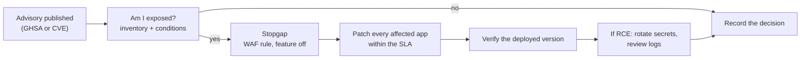

# A3 — Security Advisories Timeline

> The question after an advisory is never "are we vulnerable?". It's "how fast can we know, and how fast can we ship?". Both answers are decided long before the advisory arrives.

**Prerequisites:** [43 Frontend Security Architecture](43-frontend-security-architecture.md), [44 RSC Security Threat Model](44-rsc-security-threat-model.md) · **Related:** [49 Next.js Data, Mutations and Auth](49-nextjs-data-mutations-and-auth.md) · [58 Angular at Scale](58-angular-at-scale.md) · [62 CI/CD and Release Engineering](62-cicd-release-engineering-and-feature-flags.md) · [A2 Version History](A2-react-version-history-and-governance.md)

> [!NOTE]
> Compiled on 25 November 2026 from the React, Next.js and Angular security advisories and release posts, the GitHub Advisory Database and hosting providers' notices. Check the linked advisories for the authoritative affected ranges before acting; ranges here are summarised.

---

## TL;DR

- **React: nine Server Components advisories in eleven months,** December 2025 to October 2026, two of them unauthenticated remote code execution. Client-only React apps were never affected.
- **Current floors for React Server Components:** 19.0.9, 19.1.10, 19.2.9 or 19.3.1.
- **Next.js: floors 16.4.5 and 15.5.29** (with `sharp` 0.35.5 or later). 13.x and 14.x are end of life and get no fixes. Since July 2026 Next.js publishes scheduled monthly security releases, plus out-of-band ones for critical issues.
- **Angular: seven advisories from November 2025 to October 2026,** mostly in server-side rendering (SSRF, host-header and URL-parsing issues) and two in XSRF handling.
- **The October 2026 React RCE had no CVE for 27 days,** so tools that only match CVEs missed it. Track GitHub advisories (GHSA IDs) too.
- **The recurring themes:** deserialization at the server boundary, trusting `Host` and forwarded headers, middleware as the only security check, image processing, and caches that mix users or tenants.

---

## 1. How to read an advisory

| Field | What to check |
|---|---|
| ID | GHSA (GitHub) IDs often appear before CVE IDs; search for both |
| Affected package | For React RSC issues: `react-server-dom-webpack`, `-turbopack`, `-parcel`, usually bundled inside your framework |
| Affected and fixed versions | Per minor line; the fix for your line may be a patch, not the latest minor |
| Severity | CVSS 3.1 and 4.0 scores differ for the same issue; read the vector, not just the number |
| Conditions | "Requires App Router", "self-hosted", "Windows only", "only with this config": these decide whether you're exposed |
| Known exploitation | A listing in CISA's Known Exploited Vulnerabilities catalogue means patch now, not this sprint |

---

## 2. React Server Components

All nine affect the React Server Components packages (`react-server-dom-webpack`, `react-server-dom-turbopack`, `react-server-dom-parcel`) and therefore every framework that uses them: Next.js, React Router's RSC APIs, Waku, Parcel's RSC support, the Vite RSC plugin and Redwood SDK.

| # | Advisory | Published | Type | Severity | Fixed in |
|---|---|---|---|---|---|
| 1 | CVE-2025-55182 ("React2Shell") | 3 Dec 2025 | Unauthenticated remote code execution | CVSS 10.0; actively exploited | 19.0.1, 19.1.2, 19.2.1 |
| 2 | CVE-2025-55184 | 11 Dec 2025 | Denial of service | 7.5 | 19.0.2, 19.1.3, 19.2.2 (incomplete) |
| 3 | CVE-2025-55183 | 11 Dec 2025 | Source code exposure | 5.3 | 19.0.2, 19.1.3, 19.2.2 |
| 4 | CVE-2025-67779 | 11 Dec 2025 | Denial of service (a case #2 missed) | 7.5 | 19.0.3, 19.1.4, 19.2.3 |
| 5 | CVE-2026-23864 (GHSA-83fc-fqcc-2hmg) | 26 Jan 2026 | Multiple denial-of-service issues | 7.5 | 19.0.4, 19.1.5, 19.2.4 |
| 6 | CVE-2026-23869 ("React2DoS", GHSA-479c-33wc-g2pg) | 8 Apr 2026 | Denial of service via cyclic `Map`/`Set` | 7.5 | 19.0.5, 19.1.6, 19.2.5 |
| 7 | CVE-2026-23870 (GHSA-rv78-f8rc-xrxh) | 6 May 2026 | Denial of service (resource consumption) | 7.5 | 19.0.6, 19.1.7, 19.2.6 |
| 8 | CVE-2026-44907 (GHSA-wx67-qw84-cm4g) | 21 Jul 2026 | Denial of service in Server Functions | 7.5 | 19.0.8, 19.1.9, 19.2.8 |
| 9 | GHSA-xqc2-xf4c-x3h3 (CVE-2026-126187, assigned 10 Nov 2026) | 14 Oct 2026 | Unauthenticated remote code execution (deserialization) | CVSS 4.0: 9.5 | 19.0.9, 19.1.10, 19.2.9, 19.3.1 |

What the sequence teaches:

- **The first fix is rarely the last.** Advisories 2 and 4 were the same class of bug; 4 covered a case the first fix missed.
- **Deserialization is the attack surface.** The RSC protocol turns request bodies into server-side values; both RCEs came from there ([44](44-rsc-security-threat-model.md)).
- **Identifiers lag.** Advisory 9 had a GitHub advisory and fixed releases on 14 October and a CVE only on 10 November. In between, CVE-keyed scanners, and for a while `npm audit`, didn't flag the affected packages.
- **Your framework vendors React.** With Next.js's App Router, the React that runs is the one Next.js ships; upgrading `react` in `package.json` alone isn't the fix.

---

## 3. Next.js

### 3.1 Before the scheduled program

| Advisory | Date | Issue | Fixed in |
|---|---|---|---|
| CVE-2025-29927 | Mar 2025 | Middleware bypass with a crafted `x-middleware-subrequest` header | Patches for 12.x–15.x lines |
| CVE-2025-66478 (GHSA-9qr9-h5gf-34mp) | 3 Dec 2025 | Downstream tracking of React2Shell for the App Router (later rejected as a duplicate of CVE-2025-55182) | 15.0.5, 15.1.9, 15.2.6, 15.3.6, 15.4.8, 15.5.7, 16.0.7 |

For CVE-2025-66478, Next.js 13.x, 14.x stable, Pages Router applications and the Edge runtime were not affected; 14.3 canaries from 14.3.0-canary.77 were.

### 3.2 Scheduled security releases (since July 2026)

Next.js announced a formal security release program on 13 July 2026: pre-announced monthly releases for the active and maintenance LTS lines, with out-of-band releases for critical issues.

| Release | Versions | Highlights |
|---|---|---|
| July (published 20 July) | 16.2.11, 15.5.21 | Nine CVEs, including denial of service through Server Actions; a middleware/proxy bypass with Turbopack and a single i18n locale; SSRF and open redirects from `rewrites` and `redirects` built from request input; SSRF from Server Actions on custom servers via `Host` headers; disclosure of Server Function and `use cache` endpoint IDs; `fetch` cache confusion for requests with bodies |
| August (moved forward to 25 August) | 16.3.3, 15.5.24 | Two critical RCEs: AVIF image optimization through `sharp`'s libheif (AVIF optimization disabled until upstream fixes landed), and an RCE on Windows-hosted servers using both routers without Cache Components |
| 22 September (out of band) | 16.3.6, 15.5.26 | A critical issue in an upstream dependency (Satori), GHSA-vcvr-r3jv-pc5j |
| September (30 September) | 16.3.8, 15.5.27 | Seven issues: one high, five medium, one low |
| 14 October (out of band) | 16.4.1, 15.5.28 | GHSA-673q-mjm6-r5xr, an unauthenticated RCE in `use cache` functions returning typed arrays (CVSS 4.0: 9.5, affecting 16.0.0–16.4.0), alongside React's advisory 9; an image-optimization fix (CVE-2026-96889) |
| November (3 November) | 16.4.5, 15.5.29 | Seven advisories (CVE-2026-119346 to 119351 and CVE-2026-119790): a cross-tenant cache disclosure when combining `unstable_cache` and `use cache`, an HttpOnly cookie exposure on Edge-runtime routes, cache poisoning of shared fallback shells with Cache Components, an SVG rejection bypass and a cross-client response injection behind some proxies. 16.4.5 fixes all seven; 15.5.29 fixes the three that affect 15.5 |

What the year teaches:

- **Middleware isn't an authorization layer.** Two bypasses in two years (2025 and July 2026). Authorize where data is read and changed ([49](49-nextjs-data-mutations-and-auth.md)).
- **Image optimization is server-side parsing of untrusted files.** Four of the year's issues involved image handling: SVG in July and November, AVIF in August, and the October fix.
- **Caches are a security boundary.** Cross-tenant and cross-user leaks came from cache keys that didn't include everything the result depended on, the same lesson as [67](67-case-study-enterprise-saas-dashboard.md)'s client-side tenant leak.
- **Request-controlled hostnames lead to SSRF.** Rewrites, redirects and Server Actions that build URLs from `Host` or forwarded headers.

---

## 4. Angular

| Advisory | Published | Package and issue | Severity | Fixed in |
|---|---|---|---|---|
| CVE-2025-66035 (GHSA-58c5-g7wp-6w37) | 26 Nov 2025 | `@angular/common`: the XSRF token sent to protocol-relative (`//host`) URLs | CVSS 4.0: 7.7 | 19.2.16, 20.3.14, 21.0.1 |
| CVE-2026-27739 (GHSA-x288-3778-4hhx) | 25 Feb 2026 | `@angular/ssr`: SSRF and header injection through `Host` and `X-Forwarded-*` | CVSS 4.0: 9.2 | 19.2.21, 20.3.17, 21.1.5; introduced `allowedHosts` |
| CVE-2026-33397 (GHSA-vfx2-hv2g-xj5f) | 19 Mar 2026 | `@angular/ssr`: open redirect through a backslash in `X-Forwarded-Prefix` (an incomplete earlier fix) | CVSS 4.0: 6.9 | 20.3.21, 21.2.3 |
| CVE-2026-41423 (GHSA-45q2-gjvg-7973) | 16 Apr 2026 | `@angular/platform-server`: SSRF through protocol-relative and backslash URLs; affects `renderModule`, `renderApplication` and `CommonEngine`, not `AngularNodeAppEngine` | CVSS 3.1: 9.3 | 19.2.21, 20.3.19, 21.2.9 |
| CVE-2026-46417 (GHSA-rfh7-fxqc-q52v) | 19 May 2026 | `@angular/ssr`: hostname hijack with absolute-form request URLs | 6.1 | 19.2.22, 20.3.21, 21.2.13 |
| CVE-2026-50168 (GHSA-xrxm-cp7j-8xf6) | 15 Jun 2026 | `@angular/ssr`: a doubled-port parser differential that bypasses the host allowlist | 8.2 | 19.2.23, 20.3.22, 21.2.15, 22.0.0-rc.2 |
| CVE-2026-111753 (GHSA-jfgx-762w-99vr) | 20 Oct 2026 | `@angular/common`: XSRF origin check by regular expression differed from the URL parser (backslashes, control characters) | — | 20.3.34, 21.0.3 (21.0.3 and later, and 22.x, compare origins with the URL parser) |

What the sequence teaches:

- **Host and URL parsing is hard to get right twice.** Four SSR advisories were variations on "what host is this request for?", each fixing a parser differential the previous fix missed. `allowedHosts` exists because of them ([58](58-angular-at-scale.md)).
- **The newer server engine was safer.** `AngularNodeAppEngine` was not affected by the `platform-server` SSRF; migrating off `CommonEngine` reduces exposure.
- **Compare origins with a URL parser, not a regular expression.** That was the XSRF lesson, twice.

---

## 5. Supply chain

| Incident | Date | What happened | Lesson |
|---|---|---|---|
| Shai-Hulud | September 2025 | A self-propagating worm in npm packages, spreading through install scripts and stolen publish tokens | Don't run dependency install scripts by default; use trusted publishing |
| "Mini Shai-Hulud" | 11 May 2026 | Malicious releases published through a compromised GitHub Actions CI pipeline in the TanStack ecosystem | Pin and review CI actions; give publish workflows minimal permissions |

Controls that would have reduced exposure, all covered in [60](60-monorepos-build-tooling-and-bundlers.md) and [62](62-cicd-release-engineering-and-feature-flags.md): a release-age delay (pnpm's `minimumReleaseAge`), lockfiles, no install scripts without an allowlist, npm trusted publishing with provenance, pinned GitHub Actions by commit, and alerts on new maintainers or new install scripts in dependencies.

---

## 6. Floors as of 25 November 2026

| Stack | Minimum safe versions | Notes |
|---|---|---|
| React with Server Components | 19.0.9 · 19.1.10 · 19.2.9 · 19.3.1 | Client-only React apps are not affected by the RSC advisories |
| Next.js | 16.4.5 (16.4.6 is the latest bug-fix release) · 15.5.29 | `sharp` 0.35.5 or later; 13.x and 14.x are end of life |
| Angular SSR | 19.2.23 · 20.3.22 · 21.2.15 · 22.x | Plus `allowedHosts` configured; for XSRF on 20.3, 20.3.34 |

---

## 7. Responding to the next one

1. **Know what you run.** An inventory of every deployed app, its framework and the React version it actually bundles (`npm ls react-server-dom-webpack`, or the framework's version), kept current by CI rather than by spreadsheet.
2. **Check the conditions.** Router type, runtime, hosting, configuration: most advisories have conditions that decide exposure.
3. **Stop the bleeding.** Many providers ship WAF rules within hours of a critical advisory; a stopgap buys time, never replaces the patch.
4. **Patch within an SLA you've agreed in advance:** hours for exploited RCEs, days for high severity, the next release for medium.
5. **Verify what's deployed,** not what's merged: version endpoints or build metadata, checked after the rollout.
6. **After an RCE in a publicly reachable app, assume compromise until shown otherwise:** rotate secrets the server could read, and review logs from before the patch.
7. **Subscribe to the sources:** the React blog and GitHub advisories (`github.com/react/react`), the Next.js security releases, Angular's advisories, and your hosting provider's security notices.

---

## Decision framework

**Problem:** deciding how fast to act on a framework advisory.

**Constraints:** severity and exploitation status, your exposure (conditions), the blast radius (public or internal app), and your deployment speed.

| Situation | Response |
|---|---|
| Unauthenticated RCE, exploited or with public details, you're exposed | Stopgap within hours, patch the same day, rotate secrets, review logs |
| High-severity DoS or data exposure, you're exposed | Patch within days; stopgap if one exists |
| Medium severity or narrow conditions you meet | The next scheduled release |
| You don't meet the conditions | Record why, and patch with the next routine upgrade |

**Criteria:** exploitability, exposure, data sensitivity.

**Failure modes:** CVE-only tracking; patching `package.json` while the framework vendors another version; assuming "internal" means safe; no verification of the deployed build.

---

## Pitfalls

- **Waiting for a CVE ID.** GitHub advisories can precede CVEs by weeks.
- **Upgrading `react` in a Next.js App Router app and calling it done.** Upgrade Next.js.
- **Treating middleware or a proxy as the security boundary.** Two bypasses in two years.
- **Trusting `Host` and `X-Forwarded-*` headers.** Configure allowed hosts at the framework and the proxy.
- **Leaving image optimization open to arbitrary remote images.** Restrict sources, and keep the image libraries patched.
- **Ignoring end-of-life lines.** Next.js 13 and 14 received no fixes for 2026's issues.

---

## Further reading

- [React blog: security posts](https://react.dev/blog) and the [react/react security advisories](https://github.com/react/react/security/advisories).
- [Next.js security release program](https://nextjs.org/blog/next-security-release-program) and the [vercel/next.js advisories](https://github.com/vercel/next.js/security).
- [Angular security advisories](https://github.com/angular/angular/security/advisories) and [angular-cli advisories](https://github.com/angular/angular-cli/security/advisories).
- [CISA Known Exploited Vulnerabilities catalog](https://www.cisa.gov/known-exploited-vulnerabilities-catalog).
- [OWASP: Server-Side Request Forgery Prevention Cheat Sheet](https://cheatsheetseries.owasp.org/cheatsheets/Server_Side_Request_Forgery_Prevention_Cheat_Sheet.html).

---

[← Previous: A2 — React Version History, Release Channels and Governance](A2-react-version-history-and-governance.md) · [Index](README.md) · [Next: A4 — Experimental, Canary and Unannounced APIs →](A4-experimental-and-canary-apis.md)
