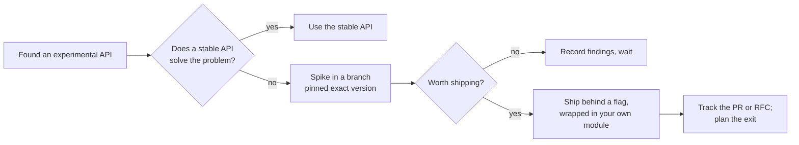

# A4 — Experimental, Canary and Unannounced APIs

> An export in an experimental build is a fact. A blog post about it is a plan. A conference rumour is neither. Keep the three apart and you'll never ship on a rumour.

**Prerequisites:** [A1 React API Reference](A1-react-api-reference.md), [A2 Version History and Release Channels](A2-react-version-history-and-governance.md) · **Related:** [16 React 19 Features and the Compiler](16-react-19-features-and-the-compiler.md) · [55 React Ecosystem Atlas](55-react-ecosystem-atlas-2026.md)

> [!NOTE]
> *Verified* on 25 November 2026 by listing exports from `react@experimental` (0.0.0-experimental-92bb0678-20261124) and `react@canary` (19.3.0-canary-92bb0678-20261124) against 19.3.1, including the `react-server` condition. Behaviour descriptions come from React's release notes where they exist; where they don't, this appendix says so.

---

## TL;DR

- **Canary has nothing stable 19.3.1 lacks** (on the day of the check). Everything in flight lives in the experimental channel.
- **Experimental `react` adds six exports:** `optimisticKey`, `unstable_SuspenseList`, `unstable_startGestureTransition`, `unstable_getCacheForType`, and the aliases `unstable_Activity` and `experimental_useOptimistic`.
- **Experimental `react` under `react-server` adds more:** the taint APIs, `startTransition`, and three undocumented names: `addToLedger`, `captureLedgers` and `createMaskLedger`.
- **Stable 19.3.1 still carries one unstable export:** `unstable_useCacheRefresh`.
- **Not announced:** React 20, signals in React, or deprecating class components. Treat claims otherwise as rumour until a React blog post says so.
- **Rule of thumb:** experimental APIs belong in spikes and framework internals, behind a flag, pinned to an exact version, never in a published library.

---

## 1. Three levels of certainty

| Level | Evidence | What you may do |
|---|---|---|
| **Stable** | In a `latest` release and documented on react.dev | Build products on it |
| **In flight** | Exported from canary or experimental builds; may have an RFC, a PR or release notes | Spike it, track it, ship it only behind a flag and an exact version pin |
| **Rumour** | Talks, social media, "I heard the team is…" | Nothing, except ask for a source |

---

## 2. In flight: client APIs (`react@experimental`)

| Export | What's known | Status signals |
|---|---|---|
| `unstable_startGestureTransition` | Intended for gesture-driven transitions (swipes, drags) animated with `<ViewTransition>`; replaced the earlier `useSwipeTransition` experiment | Experimental |
| `unstable_SuspenseList` | Coordinates the order in which sibling Suspense boundaries reveal (`revealOrder`, `tail`) | A long-running experiment, also present under `react-server` |
| `optimisticKey` | Exported from experimental builds, and React DevTools 8 can display it; its behaviour isn't documented for stable use | Experimental |
| `unstable_getCacheForType` | Low-level access to React's cache, used by framework and library internals | Experimental; not for application code |
| `unstable_Activity` | An alias of `<Activity>`, stable since 19.2 | Use `Activity` |
| `experimental_useOptimistic` | An alias of `useOptimistic`, stable since 19.0 | Use `useOptimistic` |

Also reported in experimental builds, as a prop rather than an export: `<Suspense defer>`. Its semantics aren't documented for stable use; don't depend on it.

`react-dom@experimental` exported the same names as `react-dom@19.3.1` on the day of the check.

---

## 3. In flight: Server Components APIs (`react-server` condition)

Experimental builds add these to the Server Components surface:

| Export | What's known |
|---|---|
| `experimental_taintObjectReference` | Marks an object (a user record, say) so React throws if it's passed to a Client Component |
| `experimental_taintUniqueValue` | Marks a value (a token, a key) the same way |
| `startTransition` | Available to server code in experimental builds |
| `unstable_SuspenseList`, `unstable_getCacheForType`, `optimisticKey` | As in section 2 |
| `addToLedger`, `captureLedgers`, `createMaskLedger` | Present in the build; no public documentation, release notes or RFC found as of 25 November 2026 |

The taint APIs are the most useful of these for architects: a runtime backstop against leaking secrets across the server-client boundary ([44](44-rsc-security-threat-model.md)). Until they're stable, the reliable controls are `server-only` imports and passing only the fields a client needs.

The three "ledger" exports are a good example of the difference between *in flight* and *documented*. Their existence is a fact; what they're for is not yet public. Don't guess in a design document.

---

## 4. Unstable in stable releases

| Export | Release | Notes |
|---|---|---|
| `unstable_useCacheRefresh` (`react`) | Since 19.0 | Refreshes a `cache()` scope; the prefix means it can change in any release |
| `unstable_batchedUpdates` (`react-dom`) | Since 15.x | Effectively obsolete since React 18's automatic batching; kept for compatibility |

---

## 5. In flight around React

| Area | What's experimental | Where |
|---|---|---|
| React Compiler | A Rust port of the compiler, merged in June 2026 | `react({ compiler: true })` in @vitejs/plugin-react 6.3 (needs `oxc-transform-react` in a pinned range); `experimental.turbopackRustReactCompiler` in Next.js 16.3+ |
| Next.js | `useOffline` (16.3), agent-driven upgrades (`experimental.agentUpgrade`) | [47](47-nextjs-app-router-architecture.md), [50](50-nextjs-in-production.md) |
| Angular | `debounced()`, `resourceFromSnapshots`, WebMCP support | [57](57-angular-signals-reactivity-and-rxjs.md) |
| Browser platform | The Soft Navigations API shipped in Chrome 151; CrUX publishes experimental soft-navigation Web Vitals (October 2026). The stable Core Web Vitals are unchanged | [39](39-web-performance-and-core-web-vitals.md) |
| Observability | An experimental OpenTelemetry browser SDK | [41](41-observability-and-diagnostics.md) |

The compiler result in [71](71-case-study-legacy-react-modernization.md) is the right way to evaluate something experimental: the Rust port produced byte-identical output to the Babel plugin on one real screen, which is evidence. It didn't make the Rust port production-ready, which is a different question about maturity and support.

---

## 6. Rumours and non-announcements

As of 25 November 2026, none of these has been announced on the React blog:

| Claim | Status |
|---|---|
| "React 20 is coming soon" | No React 20 has been announced. 19.x minors continue |
| "React is adopting signals" | No React proposal exists. The TC39 Signals proposal is a separate, language-level effort |
| "Class components are deprecated" | They're not; they're still the only way to write error boundaries |
| "Hooks will be replaced by the Compiler" | The Compiler optimizes components and hooks; it doesn't replace them |
| "`forwardRef` has been removed" | It's still exported; it's unnecessary for function components since 19 |
| "Server Components are required" | They're optional; client-only React remains fully supported |

When you hear one of these, ask for the source. A React blog post, an RFC or a merged PR with release notes is a source; a talk slide without either is a direction at best.

---

## 7. Working with experimental APIs safely

- **Wrap it.** Import experimental APIs in exactly one module of your own, so a rename touches one file.
- **Pin exactly.** `"react": "0.0.0-experimental-92bb0678-20261124"`, never a range or a tag.
- **Flag it.** Ship behind a feature flag with the stable path still working.
- **Never in a published library.** Your consumers can't pin your experimental dependency for you.
- **Check before every upgrade.** Re-run the export check in [A1](A1-react-api-reference.md) §10; exports appear, move and disappear.

---

## Decision framework

**Problem:** whether to use an API that isn't stable yet.

**Constraints:** how much it would save, whether a stable alternative exists, how contained the usage can be, and the cost of it changing.

| Situation | Decision |
|---|---|
| A stable API solves it, even less elegantly | Use the stable API |
| You maintain a framework and need to integrate early | Use canary, pinned, with tests against each new canary |
| A product feature would be much better with it | Spike, then ship only behind a flag and a wrapper |
| A library you publish | Don't |
| Its purpose isn't documented (the "ledger" exports) | Don't |

**Criteria:** containment, reversibility, documentation.

**Failure modes:** shipping an experimental API without a wrapper; tag-based versions that change under you; planning roadmaps around rumours.

---

## Pitfalls

- **Treating canary as a preview of features.** On the day of this check, it had no extra exports; features in flight were in experimental.
- **Using aliases.** `unstable_Activity` and `experimental_useOptimistic` exist for compatibility; use the stable names.
- **Guessing what undocumented exports do.** Write "unknown" in the design document.
- **Building on `<Suspense defer>` or `optimisticKey` before they're documented.** Their behaviour can change without notice.

---

## Further reading

- [React: release channels](https://react.dev/community/versioning-policy).
- [React Canaries](https://react.dev/blog/2023/05/03/react-canaries) (2023).
- [react.dev: `experimental_taintObjectReference`](https://react.dev/reference/react/experimental_taintObjectReference).
- [The React RFC repository](https://github.com/reactjs/rfcs).
- [TC39 Signals proposal](https://github.com/tc39/proposal-signals).

---

[← Previous: A3 — Security Advisories Timeline](A3-security-advisories-timeline.md) · [Index](README.md) · [Next: A5 — Glossary and Further Reading →](A5-glossary-and-further-reading.md)
